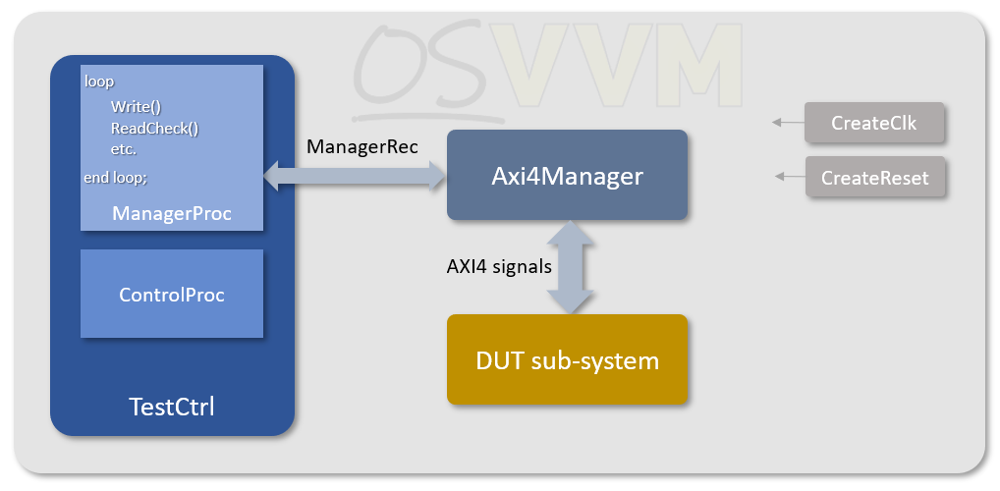
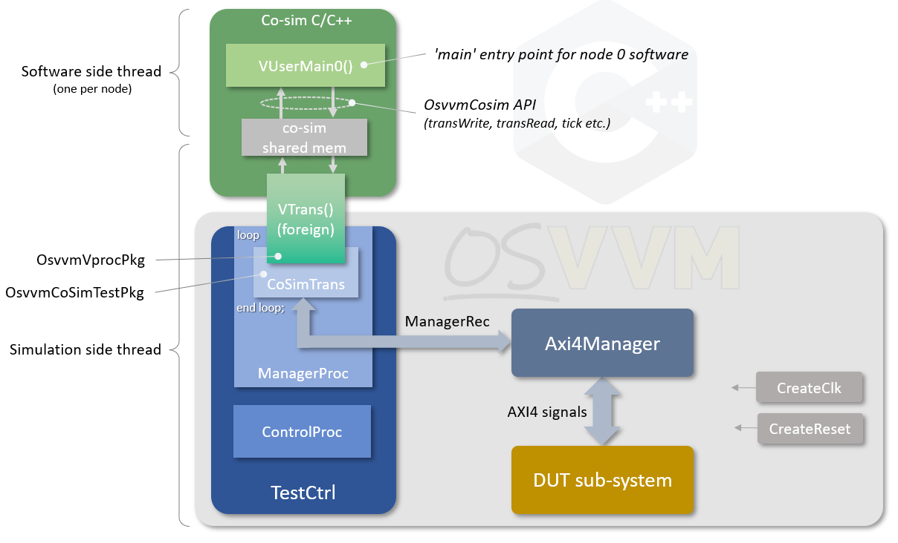
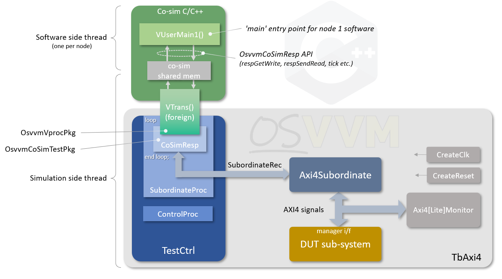
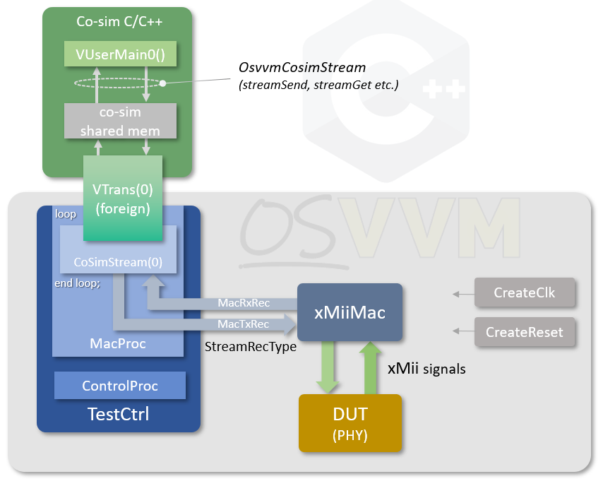
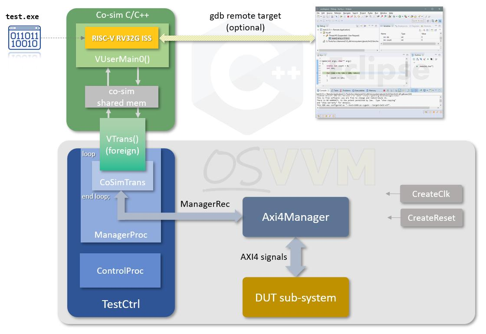
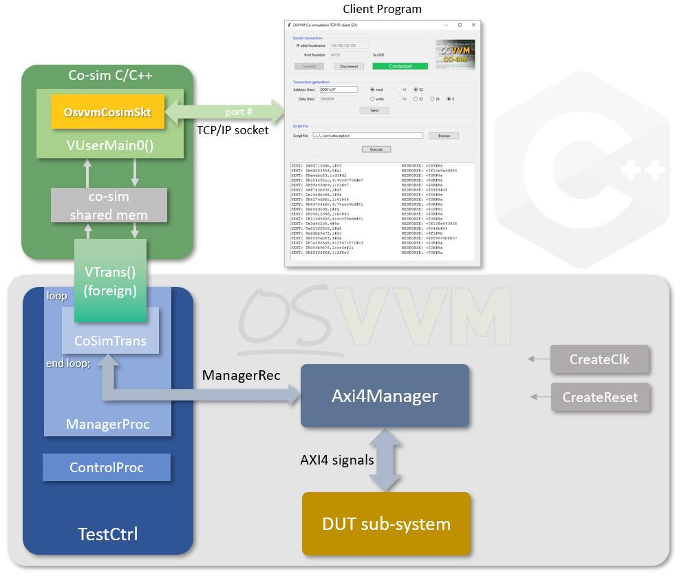
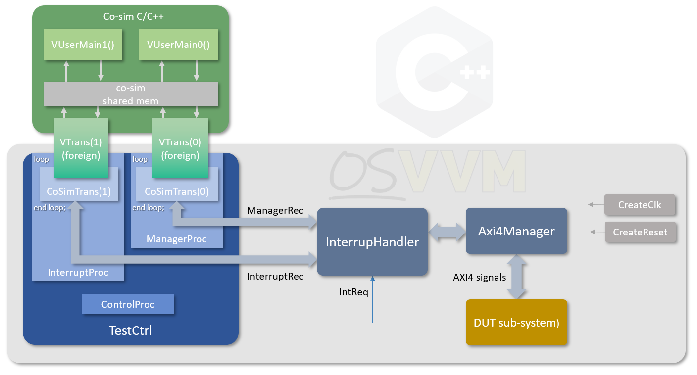
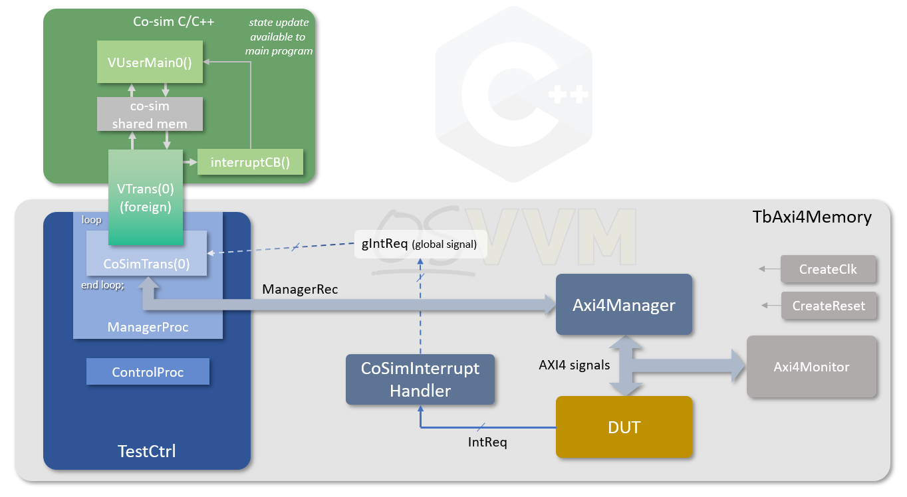
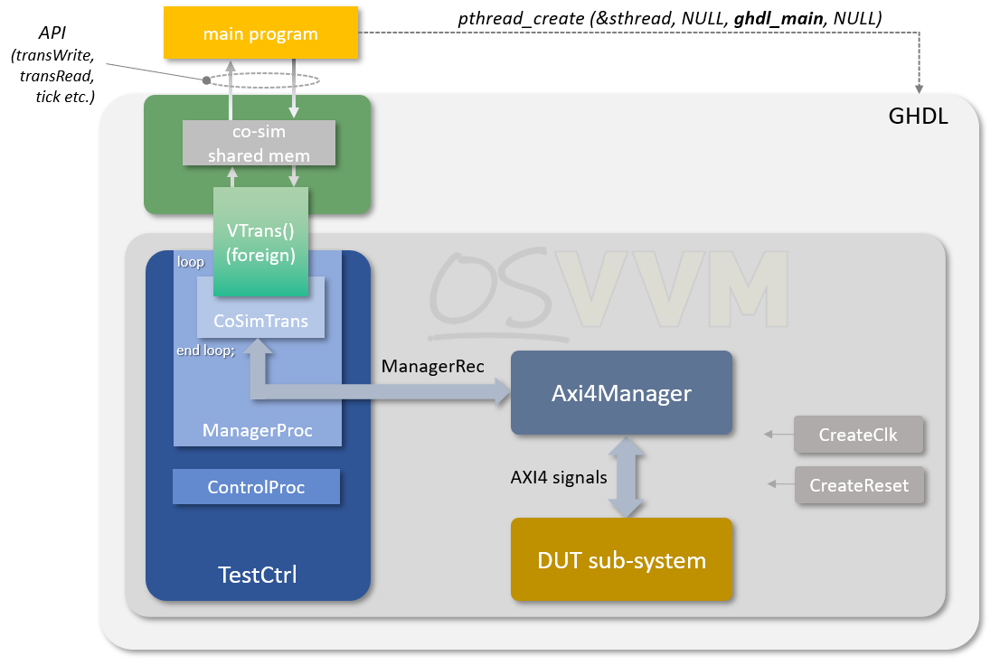

.. _FRAMEWORK/CoSimulation:

OSVVM's Co-simulation Framework
###############################

.. _FRAMEWORK/CoSimulation/Overview:

Overview
********

The co-simulation features of OSVVM are a compliment to the Address Bus Model Independent Transactions features, as
outlined in [1] and the Streaming Model Independent features (see [3]). It is highly recommended that these documents
are read before this one, as it will be assumed that the reader is familiar with the transactions associated with that
feature.

A typical address bus transaction test bench might look something like the diagram below for an AXI4 environment, which
is based on the example test bench in :file:`AXI4/Axi4/testbench/TbAxi4Memory.vhd`. with the :vhdlcode:`Axi4Memory` VC
standing in for a unit under test component.

   Figure 1: Address Bus Transaction Test Environment

In this example the test has a manger process using calls to the address bus procedures, within an operation loop, to
generate transaction via the :vhdlcode:`ManagerRec` which the :vhdlcode:`Axi4Manager` VC component translates into
specific AXI4 signalling. In this case the target is another OSVVM VC, which is a memory component but would normally be
the DUT component or sub-system. A subordinate process inspects arriving traffic and performs checks. In some scenarios
the subordinate process generates the responses but, in this case, the :vhdlcode:`Axi4Memory` VC generates these
internally. The advantage of this system is that the transactions are abstracted away from the bus specific model with
re-usable components. If the :vhdlcode:`Axi4Manager` VC is replaced with another address bus VC, then the manager code
remains unchanged and can drive the new system

The aim of the co-simulation features is to extend this architecture (and similarly for streaming) to allow the
generation of the transactions to be performed within a C/C++ domain. It extends the calls to the address bus procedures
to calls to methods within a C++ class. This opens up new possibilities not availabe in a pure VHDL domains. Some of
these are listed below:

* Writing of tests in C++

   * Test development environment extended to software engineers

* Running C++ models and code on simulated hardware

   * Instruction set simulators or cycle accurate processor models
   * System models with a mix of software models and logic IP

* Connection to an external program via TCP/IP sockets

   * Where model might not be callable directly from the C++ code

With co-simulation of processor and system models, the possibility of developing software alongside the logic IP exists
before silicon is available, but using both that actual hard and soft components together and not facsimiles, reducing
risk.

The co-simulation features replace the transaction calls to :vhdlcode:`TestCtrl`\ ’s :vhdlcode:`ManagerProc` with a
connection to the co-simulation interface. The diagram below shows the updated framework for address bus model
independent AXI4 manager VC.

   Figure 2: Co-simulation Environment Address Bus Example

In place of calls directly to the address bus transaction procedures, a :vhdlcode:`CoSimTrans` procedure is provided to
replace these and drive :vhdlcode:`ManagerRec` instead. This hides details away for calls to the underlying
co-simulation code, with calls to foreign procedures that communicate with user program. The code, at startup will call
a function (:vhdlcode:`VUserMain0` for ‘node 0’, for example) that the user provides with all their code and sub-code
called from there (much like :vhdlcode:`main()`). The user code now has access to the transaction API provided by the
co-simulation code, and can generate read and write transactions in the OSVVM domain.

A complementary setup for subordinate responses is also available. Here the co-simulation features replace the
transaction calls to :vhdlcode:`TestCtrl`\ ’s :vhdlcode:`SubordinateProc` with a connection to the co-simulation
interface. The diagram below shows the updated framework for address bus model independent AXI4 subordinate VC.

   Figure 3: Co-simulation Environment Address Bus Responder Example

In place of calls directly to the address bus transaction procedures, a :vhdlcode:`CoSimTransResp` procedure is provided
to replace these and drive :vhdlcode:`SubordinateRec` instead. This hides details away for calls to the underlying
co-simulation code, with calls to foreign procedures that communicate with user program. The code, at startup will call
a function (:vhdlcode:`VUserMain1` for ‘node 1’, for example) that the user provides with all their code and sub-code
called from there. The user code now has access to the transaction API provided by the co-simulation code, and can send
read responses and ftech received write transactions in the OSVVM domain. The complexity of the user code to model other
system features is now unlimited, and can direct address bus accesses towards the simulation, and components modelled
there via the API as appropriate.

A similar setup is found for the stream model independent setup. The diagram below shows an example test setup using the
xMii MAC VC for Ethernet (with a setup for the xMii PHY VC being very similar):

   Figure 4: Co-simulation Environment Stream Example

The main features, then, of the co-simulation C++ code are as follows:

* Ability to support multiple, independent Address Bus Interfaces (such as AXI, Avalon etc.) for word and burst
  transfers
* Multiple nodes to drive separate :vhdlcode:`AddressBusRecType` transaction signals from multiple processes
* Ability to handle interrupts in the software via callbacks
* Ability to advance simulation time (without a transaction)

The rest of this document will detail how to use the co-simulation features to drive address bus transactions from the
VHDL/OSVVM side and the C++ side.

.. _FRAMEWORK/CoSimulation/PrerequisitesForWindows:

Prerequisites for Windows
*************************

To run the co-simulation features on Windows requires the use of MSYS2 and the gcc toolchains for 64- and 32-bit
compilation, as well as ``make`` and ``python3``. The list below provides a link to the MSYS2 installer. Once installed,
the required gcc modules can be installed as shown for the latest MSYS2 at time of writing (recommend updating existing
installations before proceeding).

* `msys2 <https://github.com/msys2/msys2-installer/releases/download/2022-10-28/msys2-x86_64-20221028.exe>`__
* mingw-w64 32- and 64-bit gcc toolchains, with required non-included libraries
* From an MSYS2 MINGW64 shell:

   * ``pacman -S mingw-w64-x86_64-gcc``
   * ``pacman -S mingw-w64-i686-gcc``
   * ``pacman -S mingw-w64-x86_64-dlfcn``
   * ``pacman -S mingw-w64-i686-dlfcn``

* Utility functions
* From an MSYS2 MINGW64 shell:

   * ``pacman -S make``
   * ``pacman -S python3``
   * ``pacman -S rlwrap (for GHDL and NVC)``
   * ``pacman -S mingw-w64-x86_64-tcllib (for GHDL and NVC)``

Note that ModelSim require running from the MSYS2 MINGW32 shell, as it is a 32-bit executable and the co-simulation code
must be compiled for 32-bits, whereas all the other simulators require using the MSYS32 MINGW64 shell for 64-bit
compilation.

If GHDL is required to be used, the ``mingw-w64-x86_64-ghdl-llvm`` package must be installed with ``pacman`` and should
be run from the MSYS2 MINGW64 shell. It must also be ensured that ``tclsh`` is available (``pacman -S tcl``).

For Active-HDL or Riviera-PRO to use the local MSYS2 environment and toolchain the tool installation’s mingw folder
should be renamed (e.g., to :file:`_mingw`) to prevent interference. Alternatively ``PATH`` can be setup to point to
:file:`<path to Aldec tool>/mingw/bin` to use the bundled toolchain and the ``LD_LIBRARY_PATH`` updated with
:file:`<path to Aldec tool>/mingw/x86_64-w64-mingw32/lib`.

.. _FRAMEWORK/CoSimulation/RunningTheCoSimulationExamples:

Running the Co-simulation Examples
**********************************

See the steps in the OSVVM Overview guide for running the OSVVM demos. Do the steps shown in
:ref:`Figure 5 <FRAMEWORK/CoSimulation/Figure5>` in your simulator. :file:`StartUp.tcl` needs to be sourced each time
you start the simulator. See the Script User Guide for additional details for Aldec's ActiveHDL and GHDL.

.. code-block:: tcl
   :caption: Figure 5. Compiling and Running Co-simulation tests
   :name: FRAMEWORK/CoSimulation/Figure5

   cd sim
   source ../OsvvmLibraries/Scripts/StartUp.tcl
   build  ../OsvvmLibraries/OsvvmLibraries.pro
   build  ../OsvvmLibraries/CoSim/RunAllTests.pro

.. _FRAMEWORK/CoSimulation/CoSimulationSupportedPlatforms:

Co-simulation Supported Platforms
*********************************

Below is a list of simulators and the tested support for them for the co-simulation features of OSVVM.

.. list-table:: Table 1: Supported Simulators
   :header-rows: 1
   :name: FRAMEWORK/CoSimulation/Table1
   :widths: 103 143 91 68

   * - Vendor
     - Simulator
     - Linux
     - Windows
   * - Siemens
     - ModelSim
     - ✓
     - ✓
   * - Siemens
     - QuestaSim
     - ✓
     - ✓
   * - Open Source
     - GHDL
     - ✓
     - ✓
   * - Aldec
     - Active-HDL
     - N/A
     - ✓
   * - Aldec
     - Riviera-PRO
     - ✓
     - ✓
   * - Open Source
     - NVC
     - ✓
     - ✓

.. _FRAMEWORK/CoSimulation/OSVVMCoSimulationAddressTransactionProcedure:

OSVVM Co-simulation Address Transaction Procedure
*************************************************

To add address bus transaction co-simulation to the VHDL test logic in OSVVM, procedures are provided in
:vhdlcode:`OsvvmTestCoSimPkg`. The procedures stand in for address bus transaction generation logic such as that
demonstrated, for example, in the :file:`AXI4/Axi4/TestCases/TbAxi4_MemoryReadWrite.vhd` test. The co-simulation
procedures use the standard OSVVM test environments driving the :vhdlcode:`AddressBusRecType` records, usually from a
manager process, to instigate bus reads and writes on, for instance, AXI4 or Axi4Lite busses, as dictated by
the test bench used. The instigators of the transactions are then from C++ programs compiled and run with the simulation
instead of direct calls to the OSVVM Address Bus Transaction procedures [1]. The co-simulation demonstration programs
use the :file:`TbAxi4Memory.vhd` test benches fro Axi4 and Axi4Lite.

Before any calls to co-simulated code can be made, the code must be initialised for all nodes to be used. Separate
programs can be run concurrently if needed (though not usual), and each must have a unique node ID. This is done using
the :vhdlcode:`CoSimInit` procedure, as shown below.

.. code-block:: VHDL

   ------------------------------------------------------------------
   procedure CoSimInit (
   ------------------------------------------------------------------
     variable NodeNum          : in     integer := 0
   ) ;

The procedure would normally be called from within the :vhdlcode:`ControlProc` of the test case, or possibly from within
the :vhdlcode:`MangerProc` if only a single node used, before any calls made to other co-simulation procedures.

To generate address bus transactions from the co-simulation software repeated calls to a procedure
:vhdlcode:`CoSimTrans` must be made from a process (in a loop for example) that drive an :vhdlcode:`AddressBusRecType`
signal. This would normally be from a test case’s :vhdlcode:`MangerProc`, but multiple driving processes are allowed and
each can make calls to :vhdlcode:`CoSimTrans`, so long as each uses a unique mode ID and that node has been initialised
with a call to :vhdlcode:`CoSimInit` (see, for example,
:file:`CoSim/testbench/TestCases_Interrupt/TbAb_InterruptCosim1.vhd`). The :vhdlcode:`CoSimTrans` procedure is defined
below:

.. code-block:: VHDL

   ------------------------------------------------------------------
   procedure CoSimTrans (
   ------------------------------------------------------------------
     signal   ManagerRec       : inout  AddressBusRecType ;
     variable Done             : inout  integer ;
     variable Error            : inout  integer ;
     variable IntReq           : in     integer := 0 ;
     variable NodeNum          : in     integer := 0
   ) ;

The main argument to the procedure is the :vhdlcode:`ManagerRec` that is used to send a transaction request to the
address bus transaction VC, such as an AXI4 manager VC. The :vhdlcode:`Done`, and :vhdlcode:`Error` arguments indicate
status from the co-simulation software. These must be connected to local variables in the calling process in order for
state to be preserved between calls. The calling procedure can choose to use these signals or not, but that inidcate
state that is useful in controlling the simulation from state that the software has indicated.

The :vhdlcode:`Done` argument is an indication that the co-simulation software has completed its run, when non-zero, and
will no longer generate output. The calling process may use this to halt testing, but the status is an indication that
the software is complete, rather than a request to halt. In systems with multiple nodes, a test may wish only to stop
when all nodes have indicated that they are done.

The co-simulation software can also have internal errors and self-check failures. It communicates this by setting the
:vhdlcode:`Error` argument to a non-zero value. The calling process can use this to assert a failure and even stop at
the first instance this error state.

The :vhdlcode:`IntReq` input argument is used to communicate interrupt status to the co-simulation software. This
boolean, when true, will call a function in the co-simulation software if one has been registered as an interrupt
callback function (see the next section). The callback function is called for every call to :vhdlcode:`CoSimTrans` that
the input is true, so if the source of the interrupt in the test bench is a level driven interrupt, the calling process
should only set the :vhdlcode:`IntReq` true when the state changes and the callback to set/clear interrupt state to the
software on alternate calls. An edge driven interrupt would need the :vhdlcode:`IntReq` true just for cycles on its
active edge. For environments that do not use the interrupt callback features, the argument can be left off and the
default false value used.

The :vhdlcode:`NodeNum` argument is the node ID. When only one co-simulation process present, this can be left off and
the node defaults to 0. Where multiple processes are generating transactions each must use a unique :vhdlcode:`NodeNum`.

This, then, is all that is required from the VHDL/OSVVM environment side to be able to generate transactions for both
word/sub-word and burst address bus transactions.

.. _FRAMEWORK/CoSimulation/OSVVMAddressBusTransactionCAPI:

OSVVM Address Bus Transaction C++ API
*************************************

The user side C++ code has access to an API in order to generate address bus transactions, allow simulation time to
advance and to generate status. It can also get interrupt status from the simulation if present. A simple example for a
program is given in :ref:`Figure 7 <FRAMEWORK/CoSimulation/Figure7>`. For each node used in the OSVVM test bench, there
is expected to be a user written function named :vhdlcode:`VUserMain`\ *n*, where *n* is the number matching the node ID
used (e.g. :vhdlcode:`VUserMain0`). This is like the :vhdlcode:`main()` of a C/C++ program for the node, or perhaps more
like :vhdlcode:`WinMain()` for Windows non-console programs. An example definition is shown below:

.. code-block:: c++

   ------------------------------------------------------------------
   extern "C" void VUserMain0()
   ------------------------------------------------------------------
   {
   // User code here
   }

The source code for the user code would normally be gathered into a single sub-directory for a given test. This might
include just a single source file (e.g. :file:`VUserMain0.cpp`) but can have sub-files to any complexity and would also
include the code for all active nodes. All the source code then has access to the co-simulation API.

.. _FRAMEWORK/CoSimulation/OSVVMAddressBusTransactionCAPI/OsvvmCosimClassConstructor:

OsvvmCosim Class Constructor
============================

The API is defined in the :file:`OsvvmCosim.h` header in :file:`CoSim/code`. This is a C++ wrapper class to abstract
away the lower level calls to the co-simulation infrastructure software. A constructor defines which node the object is
attached to.

.. code-block:: c++

   ------------------------------------------------------------------
   OsvvmCosim (
   ------------------------------------------------------------------
     int nodeIn = 0,
     std::string test_name = ""
   );

Any user file can construct the API object. This class is a wrapper and does not hold state (except the node number) and
so sub-programs can create their own API objects (with the correct node for the top level program) to gain access to the
API methods.

In order to identify the different co-simulation tests, that may all uses the same underlying test bench, the software
can set a test name when constructing an :vhdlcode:`OsvvmCosim` object using the :vhdlcode:`test_name` argument. By
default, the argument is set to "" and the test name will not be set. Any other value will be used to set the test name
in the OSVVM environment.

.. _FRAMEWORK/CoSimulation/OSVVMAddressBusTransactionCAPI/AdvancingTime:

Advancing Time
==============

Advancing time without generating transactions is done with the :vhdlcode:`tick()` method as defined below.

.. code-block:: c++

   ------------------------------------------------------------------
   int tick (
   ------------------------------------------------------------------
     const int ticks,
     const bool done  = false,
     const bool error = false
   );

The method is called with a :vhdlcode:`ticks` parameter to indicate how many calls to the :vhdlcode:`CoSimTrans` VHDL
procedure should be made without generating a transaction. If the calling process does not add any additional clock
waits in the loop calling :vhdlcode:`CoSimTrans`, then the ticks will be clock cycles. The optional :vhdlcode:`done` and
:vhdlcode:`error` inputs send status to the equivalent arguments on :vhdlcode:`CoSimTrans` as explained in the previous
section.

The transaction methods are the methods that are used to generate the address bus activity.

.. _FRAMEWORK/CoSimulation/OSVVMAddressBusTransactionCAPI/TransactionMethods:

Transaction methods
===================

The basic available write and read transaction methods are listed below for both single word trasnactions and burst
transactions.

.. code-block:: c++

   ------------------------------------------------------------------
   uint<nn>_t transWrite (
   ------------------------------------------------------------------
     const uint<nn>_t addr,
     const uint<nn>_t data,
     const int        prot = 0 );

   ------------------------------------------------------------------
   uint<nn>_t transWriteAsync (
   ------------------------------------------------------------------
     const uint<nn>_t addr,
     const uint<nn>_t data,
     const int        prot = 0 );

   ------------------------------------------------------------------
   uint<nn>_t transWriteAndRead (
   ------------------------------------------------------------------
     const uint<nn>_t addr,
     const uint<nn>_t wdata,
     const uint<nn>_t *rdata,
     const int        prot = 0 );

   ------------------------------------------------------------------
   uint<nn>_t transWriteAndReadAsync (
   ------------------------------------------------------------------
     const uint<nn>_t addr,
     const uint<nn>_t wdata,
     const int        prot = 0 );

   ------------------------------------------------------------------
   void transRead (
   ------------------------------------------------------------------
     const uint<nn>_t addr,
     const uint<nn>_t *data,
     const int        prot = 0);

   ------------------------------------------------------------------
   bool transReadPoll (
   ------------------------------------------------------------------
     const uint<nn>_t addr,
     const uint<nn>_t *data,
     const int        idx,
     const int        bitval,
     const int        waittime = 10,
     const int        prot = 0
   );

   ------------------------------------------------------------------
   void transBurstWrite (
   ------------------------------------------------------------------
     const uint<nn>_t addr,
     const int        bytesize,
     const int        prot = 0);

   ------------------------------------------------------------------
   void transBurstWriteAsync (
   ------------------------------------------------------------------
     const uint<nn>_t addr,
           uint8_t    *data,
     const int        bytesize,
     const int        prot = 0);

   ------------------------------------------------------------------
   void  transBurstRead  (
   ------------------------------------------------------------------
     const uint<nn>_t addr,
           uint8_t    *data,
     const int        bytesize,
     const int        prot = 0);

These transaction methods are overloaded for various sizes of address and data , using the :file:`stdint.h` definitions,
where :vhdlcode:`uint<nn>_t` indicates different uint sizes. For address parameters this is :vhdlcode:`uint32_t` or
:vhdlcode:`uint64_t`. For the data parameters of :vhdlcode:`transRead` and :vhdlcode:`transWrite` this is one of
:vhdlcode:`uint8_t`, :vhdlcode:`uint16_t`, :vhdlcode:`uint32_t` or :vhdlcode:`uint64_t` (if address type is also
:vhdlcode:`uint64_t`). Note that using :vhdlcode:`uint64_t` can only be done if the target test bench is configured for
a 64-bit bus architecture.

The single word methods, :vhdlcode:`transRead` and :vhdlcode:`transWrite`, and its non-blocking asynchronous equivalent
:vhdlcode:`transWriteAsync`, take an address, data and optional :vhdlcode:`prot` (protection) arguments, with the
:vhdlcode:`transRead` having a pointer to the variable for returning the read data. The :vhdlcode:`transWrite` returns a
value which is a future-proofing for returning read data in the same transaction as a write, but is not yet supported.
The :vhdlcode:`transRead` method does not return a value and a pointer is used to return the data as this is how the
method selects the size of the read transaction (byte, half-word etc.) based on the argument’s size. The
:vhdlcode:`transWriteAndRead` method does a write to the specified address with the :vhdlcode:`wdata` value, and returns
the old value in the :vhdlcode:`rdata` argument. The :vhdlcode:`transWriteAndReadAsync` method is simlar, but the read
data is not returned at the call. The read transaction is instigated, however, and the data can be fetched with methods
such as :vhdlcode:`transReadData`. The :vhdlcode:`transReadPoll` method will poll a memory location specified by the
:vhdlcode:`addr` argument, at intervals defined by the :vhdlcode:`waittime` argument, until the data read has its bit
indexed at :vhdlcode:`idx` matching the value in :vhdlcode:`bitval`. The value read on matching is returned in
:vhdlcode:`data`.

The burst transactions use byte buffers to send and return data. The calling code provides buffer space to a maximum of
4Kbytes preloaded with byte data for writes, or updated with byte data on reads. If no data is specified, then the burst
write will use whatever has been pushed to the write fifo using :vhdlcode:`transBurstPushData` (see later). The bytesize
parameter indicates the transfer size. The co-simulation code will not go beyond 4Kbytes when reading or writing to the
buffers, so it is recommended to use 4Kbyte buffers in all cases to avoid overrun. A non-blocking version of
:vhdlcode:`transBurstWrite` is provided as :vhdlcode:`transBurstWriteAsync`. In addition, the burst writes can have
predetermined patterns as a source of data, namely incrementing or random, with a data byte provided to indicate the
first word to use for the pattern. The methods are shown below:

.. code-block:: c++

   ------------------------------------------------------------------
   void transBurstWriteIncrement (
   ------------------------------------------------------------------
     const uint<nn>_t addr,
     const uint8_t    firstbyte,
     const int        bytesize,
     const int        prot = 0);

   ------------------------------------------------------------------
   void transBurstWriteIncrementAsync (
   ------------------------------------------------------------------
     const uint<nn>_t addr,
     const uint8_t    firstbyte,
     const int        bytesize,
     const int        prot = 0);

   ------------------------------------------------------------------
   void transBurstWriteRandom (
   ------------------------------------------------------------------
     const uint<nn>_t addr,
     const uint8_t    firstbyte,
     const int        bytesize,
     const int        prot = 0);

   ------------------------------------------------------------------
   void transBurstWriteRandomAsync (
   ------------------------------------------------------------------
     const uint<nn>_t addr,
     const uint8_t    firstbyte,
     const int        bytesize,
     const int        prot = 0);

.. _FRAMEWORK/CoSimulation/SplitTransactions:

Split Transactions
------------------

For VCs that support it, methods are provided for split transactions—i.e., sending address and data seperately, at
different times. The methods to support this are listed below:

.. code-block:: c++

   ------------------------------------------------------------------
   void transWriteAdressAsync (
   ------------------------------------------------------------------
     const uint<nn>_t addr,
     const int        prot = 0);
   ------------------------------------------------------------------
   uint<nn>_t transWriteDataAsync (
   ------------------------------------------------------------------
     const uint<nn>_t data,
     const uint32_t   bytelane,
     const int        prot = 0 );

   ------------------------------------------------------------------
   void transReadAdressAsync (
   ------------------------------------------------------------------
     const uint<nn>_t addr,
     const int        prot = 0);

   ------------------------------------------------------------------
   void transReadData (
   ------------------------------------------------------------------
     const uint<nn>_t *data
   );

   ------------------------------------------------------------------
   bool transTryReadData (
   ------------------------------------------------------------------
     const uint<nn>_t *data
   );

The :vhdlcode:`transTryReadData` is the same as :vhdlcode:`transReadData`, but will return if no data available, rather
than block. It will return :vhdlcode:`false` if no data available and :vhdlcode:`true` if data was availabe, which is
then returned in the data buffer.

.. _FRAMEWORK/CoSimulation/PushAndPopBurstData:

Push and Pop Burst Data
-----------------------

Data can be pushed and pooped from the transaction fifos independently of transaction method calls for use in split
transactions etc. In addition, the fifos can be filled with predetermined patterns. The methods for this are listed
below.

.. code-block:: c++

   ------------------------------------------------------------------
   void transBurstPushData (
   ------------------------------------------------------------------
     const uint8_t *data,
     const int      bytesize);

   ------------------------------------------------------------------
   void transBurstPushIncrement (
   ------------------------------------------------------------------
     const uint8_t  data,
     const int      bytesize);

   ------------------------------------------------------------------
   void transBurstPushRandom (
   ------------------------------------------------------------------
     const uint8_t  data,
     const int      bytesize);

   ------------------------------------------------------------------
   void transBurstPopData (
   ------------------------------------------------------------------
     const uint8_t *data,
     const int      bytesize);

.. _FRAMEWORK/CoSimulation/ReadChecks:

Read Checks
-----------

Methods are provided that do check on data as they are read for eith words or bursts. This can be using provided data,
using data already pushed to the Fifo, or predetermined patterns. The provided methods for word transactions are listed
below:

.. code-block:: c++

   ------------------------------------------------------------------
   void transReadCheck (
   ------------------------------------------------------------------
     const uint<nn>_t  addr,
     const uint<nn>_t  data,
     const int         prot = 0);

   ------------------------------------------------------------------
   void transReadDataCheck (
   ------------------------------------------------------------------
     const uint<nn>_t  data);

   ------------------------------------------------------------------
   bool transTryReadDataCheck (
   ------------------------------------------------------------------
     const uint<nn>_t  data);

The first method does a blocking read transaction, and compares the read value with that supplied as the
:vhdlcode:`data` argument. The second method does the same check, but with already received data from a previous read.
The last method is the same as the second but is non-blocking, returning :vhdlcode:`false` if no word available and
:vhdlcode:`true` if data was available and was checked.

The burst transactions also have check methods, with methods that instigate a transaction and check, and methods that
check previously received data. In addition, the data can be checked agains a supplied set of data, or against a
predetermined pattern. The provided methods are shown below:

.. code-block:: c++

   ------------------------------------------------------------------
   void transBurstReadCheckData (
   ------------------------------------------------------------------
     const uint<nn>_t  addr,
     const uint8_t    *data,
     const int         bytesize,
     const int         prot = 0);

   ------------------------------------------------------------------
   void transBurstCheckData (
   ------------------------------------------------------------------
     const uint8_t    *data,
     const int         bytesize,
     const int         prot = 0);

   ------------------------------------------------------------------
   void transBurstReadCheckIncrement (
   ------------------------------------------------------------------
     const uint<nn>_t  addr,
     const uint8_t     data,
     const int         bytesize,
     const int         prot = 0);

   ------------------------------------------------------------------
   void transBurstReadCheckRandom (
   ------------------------------------------------------------------
     const uint<nn>_t  addr,
     const uint8_t     data,
     const int         bytesize,
     const int         prot = 0);

.. _FRAMEWORK/CoSimulation/OSVVMAddressBusTransactionCAPI/DirectiveMethods:

Directive Methods
=================

Some directive methods are provided for transaction statistics and synchronization, as listed below:

.. code-block:: c++

   ------------------------------------------------------------------
   int transGetTransactionCount (
   ------------------------------------------------------------------
     void
   );

   ------------------------------------------------------------------
   int transGetWriteTransactionCount (
   ------------------------------------------------------------------
     void
   );

   ------------------------------------------------------------------
   int transGetReadTransactionCount (
   ------------------------------------------------------------------
     void
   );

   ------------------------------------------------------------------
   void transWaitForTransaction (
   ------------------------------------------------------------------
     void
   );

   ------------------------------------------------------------------
   void transWaitForWriteTransaction (
   ------------------------------------------------------------------
     void
   );

   ------------------------------------------------------------------
   void transWaitForReadTransaction (
   ------------------------------------------------------------------
     void
   );

.. _FRAMEWORK/CoSimulation/OSVVMAddressBusTransactionCAPI/InterruptCallback:

Interrupt Callback
==================

User code can register a callback function which will be called by the simulation every time the :vhdlcode:`IntReq`
input to the :vhdlcode:`CoSimTrans` procedure changes state in the OSVVM test process. To register an interrupt callback
function the following method is used:

.. code-block:: c++

   ------------------------------------------------------------------
   void regInterruptCB (
   ------------------------------------------------------------------
       pVUserInt_t func
   );

.. _FRAMEWORK/CoSimulation/OSVVMAddressBusTransactionCAPI/AdditionalMethods:

Additional Methods
==================

As well as the methods outlined above a couple of other methods are provided to iad usage of the class. These are shown
below:

.. code-block:: c++

   ------------------------------------------------------------------
   int getNodeNumber (
   ------------------------------------------------------------------
       void
   );

   ------------------------------------------------------------------
   int waitForSim (
   ------------------------------------------------------------------
       void
   );

The :vhdlcode:`getNodeNumber` method simply returns the node number associated with the instantiation object of the
class. As stated before, mutiple object are allowed for access to a given node. To aid in managing which node a
particular object has been associated with, this method gives access to that state.

The :vhdlcode:`waitForSim` method is for running in GHDL when in callable simulation mode. For all other modes, this
call does nothing. When active, a call to this method blocks until the simulation is in a suitable state to have
transaction methods called to instigate traffic on the bus. For more details see
:ref:`section 12.6 <FRAMEWORK/CoSimulation/UsingGHDLCallableSimulation>`, which also has example code using this method.

.. _FRAMEWORK/CoSimulation/OsvvmCosimIntInterruptSupportClass:

OsvvmCosimInt Interrupt Support Class
=====================================

The :vhdlcode:`OsvvmCosimInt` class, derived from the :vhdlcode:`OsvvmClass`, adds additional programming support for
handling interrupts for new test code that has no other means of processing interrupts such as when using a software
processor model. This inherits all the methods of the parent class, as described in the sections above, including the
:vhdlcode:`regInterruptCB()` method.

The type of callback function, as defined by :vhdlcode:`pVUserInt_t`, is :vhdlcode:`int <myfunc>(int)`. When the
callback is executed the :vhdlcode:`int` argument contatins the current state of the :vhdlcode:`IntReq` input to the
:vhdlcode:`CoSimTrans` procedure. Example code can be found in :file:`OsvvmLibraries/CoSim/test/interruptCB`. In
addition it provided methods for registering up to 32 interrupt service routine (ISR) functions:

.. code-block:: c++

   ------------------------------------------------------------------
   void registerIsr (
   ------------------------------------------------------------------
       const pVUserInt_t func,
       const int         level);

Each function registered to a valid level (from 0 to 31) will be called if the interrupt level indicates that it is
active, it is enabled and no higher priority is active. The priority has 0 as the highest and 31 as the lowest. Various
methods are provided for controlling whether an interrupt is enabled or not. A master interrupt can eb enabled or
disabled to globally control all interrupts.

.. code-block:: c++

   ------------------------------------------------------------------
   void enableMasterInterrupt (
   ------------------------------------------------------------------
       void
   );

   ------------------------------------------------------------------
   void disableMasterInterrupt (
   ------------------------------------------------------------------
       void
   );

Each individual level also has an enable and disable method for individual control of each ISR:

.. code-block:: c++

   ------------------------------------------------------------------
   void enableIsr (
   ------------------------------------------------------------------
       const int level
   );

   ------------------------------------------------------------------
   void disableIsr (
   ------------------------------------------------------------------
       const int level
   );

In order to update interrupt state, a method is provided to pass in the current interrupt request status:

.. code-block:: c++

   ------------------------------------------------------------------
   void updateIntReq (
   ------------------------------------------------------------------
       const int intReq
   );

This method would normally be used in conjunction with a callback function registered with the
:vhdlcode:`regInterruptCB()` method, which is called whenever the interrupt request input to :vhdlcode:`CoSimTrans`
changes. This function would have access to the :vhdlcode:`OsvvmCosimInt` object and call its :vhdlcode:`updateIntReq()`
method to pass in the interrupt request status.

.. _FRAMEWORK/CoSimulation/OSVVMCoSimulationAddressBusResponderProcedure:

OSVVM Co-simulation Address Bus Responder Procedure
***************************************************

As a complimentary feature to the address bus model independent transaction features detailed in the last two sections
an address bus transaction responder is also provided. This is used, for example, when testing IP with a manager
interface and the test environment is required to generate the responses to read and write requests. From the VHDL side,
the responder re-uses the :vhdlcode:`CoSimInit` procedure (see
:ref:`section 5 <FRAMEWORK/CoSimulation/OSVVMCoSimulationAddressTransactionProcedure>`) to initialise a node for a
responder co-simulation user software. The supplied node number must be unique for each instance that will be used, and
from any other co-simulation elements for transactions and streams).

To generate address bus transactions responser from the co-simulation software repeated calls to a procedure
:vhdlcode:`CoSimResp` must be made from a process (in a loop for example) that drive an :vhdlcode:`AddressBusRecType`
signal. This would normally be from a test case’s :vhdlcode:`SubordinateProc`, but multiple driving processes are
allowed and each can make calls to :vhdlcode:`CoSimResp`, so long as each uses a unique mode ID and that node has been
initialised with a call to :vhdlcode:`CoSimInit` (see, for example, :file:`CoSim/TestCases/TbAb_Responder.vhd`). The
:vhdlcode:`CoSimResp` procedure is defined below:

.. code-block:: VHDL

   ------------------------------------------------------------------
   procedure CoSimResp (
   ------------------------------------------------------------------
     signal   SubordinateRec   : inout  AddressBusRecType ;
     variable Done             : inout  integer ;
     variable Error            : inout  integer ;
     variable NodeNum          : in     integer := 1
   ) ;

The main argument to the procedure is the :vhdlcode:`SubordinateRec` that is used to send transaction responses to the
address bus transaction VC, such as an AXI4 manager VC, or to an AXI4 manager interface on a DUT. The :vhdlcode:`Done`,
and :vhdlcode:`Error` arguments indicate status from the co-simulation software. These must be connected to local
variables in the calling process in order for state to be preserved between calls. The calling procedure can choose to
use these signals or not, but they indicate state that is useful in controlling the simulation from that indicated from
software.

The :vhdlcode:`Done` argument is an indication that the co-simulation software has completed its run, when non-zero, and
will no longer generate output. The calling process may use this to halt testing, but the status is an indication that
the software is complete, rather than a request to halt. In systems with multiple nodes, a test may wish only to stop
when all nodes have indicated that they are done.

The co-simulation software can also have internal errors and self-check failures. It communicates this by setting the
:vhdlcode:`Error` argument to a non-zero value. The calling process can use this to assert a failure and even stop at
the first instance this error state.

The :vhdlcode:`NodeNum` argument is the node ID. When only one co-simulation process present, this can be left off and
the node defaults to 1 for the responder. Where multiple processes are generating transactions each must use a unique
:vhdlcode:`NodeNum`.

.. _FRAMEWORK/CoSimulation/OSVVMAddressBusResponderCAPI:

OSVVM Address Bus Responder C++ API
***********************************

The user side C++ code has access to an API in order to generate address bus reponses, allow simulation time to advance
and to generate status. For each node used in the OSVVM test bench, there is expected to be a user written function
named :vhdlcode:`VUserMain`\ *n*, where *n* is the number matching the node ID used (e.g. :vhdlcode:`VUserMain1`, with a
node number of 1 being the default for a responder). This is like the :vhdlcode:`main()` of a C/C++ program for the
node, or perhaps more like :vhdlcode:`WinMain()` for Windows non-console programs. An example definition is shown below:

.. code-block:: c++

   ------------------------------------------------------------------
   extern "C" void VUserMain1()
   ------------------------------------------------------------------
   {
   // User code here
   }

The source code for the user code would normally be gathered into a single sub-directory for a given test. This might
include just a single source file (e.g. :file:`VUserMain1.cpp`) but can have sub-files to any complexity and would also
include the code for all active nodes. All the source code then has access to the co-simulation API.

.. _FRAMEWORK/CoSimulation/OSVVMAddressBusResponderCAPI/OsvvmCosimClassConstructor:

OsvvmCosim Class Constructor
============================

The API is defined in the :file:`OsvvmCosimResp.h` header in :file:`CoSim/code`. This is a C++ wrapper class to abstract
away the lower level calls to the co-simulation infrastructure software. A constructor defines which node the object is
attached to.

.. code-block:: c++

   ------------------------------------------------------------------
   OsvvmCosimResp (
   ------------------------------------------------------------------
     int nodeIn = 0,
     std::string test_name = ""
   );

Any user file can construct the API object. This class is a wrapper and does not hold state (except the node number) and
so sub-programs can create their own API objects (with the correct node for the top level program) to gain access to the
API methods.

In order to identify the different co-simulation tests, that may all uses the same underlying test bench, the software
can set a test name when constructing an :vhdlcode:`OsvvmCosim` object using the :vhdlcode:`test_name` argument. By
default, the argument is set to "" and the test name will not be set. Any other value will be used to set the test name
in the OSVVM environment.

.. _FRAMEWORK/CoSimulation/OSVVMAddressBusResponderCAPI/AdvancingTime:

Advancing Time
==============

Advancing time without generating transactions is done with the :vhdlcode:`tick()` method as defined below.

.. code-block:: c++

   ------------------------------------------------------------------
   int tick (
   ------------------------------------------------------------------
     const int ticks,
     const bool done  = false,
     const bool error = false
   );

The method is called with a :vhdlcode:`ticks` parameter to indicate how many calls to the :vhdlcode:`CoSimTrans` VHDL
procedure should be made without generating a transaction. If the calling process does not add any additional clock
waits in the loop calling :vhdlcode:`CoSimTrans`, then the ticks will be clock cycles. The optional :vhdlcode:`done` and
:vhdlcode:`error` inputs send status to the equivalent arguments on :vhdlcode:`CoSimTrans` as explained in the previous
section.

.. _FRAMEWORK/CoSimulation/ResponseMethods:

Response methods
================

The response methods are the methods that are used to generate the address bus response activity. The basic available
write and read transaction methods are listed below:

.. code-block:: c++

   ------------------------------------------------------------------
   void respGetWrite (
   ------------------------------------------------------------------
     uint<nn>_t *addr,
     uint<nn>_t *data
   );

   ------------------------------------------------------------------
   bool respTryGetWrite (
   ------------------------------------------------------------------
     uint<nn>_t *addr,
     uint<nn>_t *data
   );

   ------------------------------------------------------------------
   void respSendRead (
   ------------------------------------------------------------------
     uint<nn>_t *addr,
     uint<nn>_t  data
   );

   ------------------------------------------------------------------
   bool respTrySendRead (
   ------------------------------------------------------------------
     uint<nn>_t *addr,
     uint<nn>_t  data
   );

These reponse methods are overloaded for various sizes of address and data , using the :file:`stdint.h` definitions,
where :vhdlcode:`uint<nn>_t` indicates different uint sizes. For address parameters this is :vhdlcode:`uint32_t` or
:vhdlcode:`uint64_t`. For the data parameters of :vhdlcode:`transRead` and :vhdlcode:`transWrite` this is one of
:vhdlcode:`uint8_t`, :vhdlcode:`uint16_t`, :vhdlcode:`uint32_t` or :vhdlcode:`uint64_t` (if address type is also
:vhdlcode:`uint64_t`). Note that using :vhdlcode:`uint64_t` can only be done if the target test bench is configured for
a 64-bit bus architecture.

The methods :vhdlcode:`respGetWrite` and :vhdlcode:`respSendRead`, and their non-blocking asynchronous equivalents
:vhdlcode:`respTryGetWrite`, and :vhdlcode:`respTrySendData`, take and address pointer argument, which returns the
address associated with the received transaction. The write methods take a data pointer argument in which the written
data is returned. The read methods take a data input argument to send as the read response data. The
:vhdlcode:`respGetWrite` and :vhdlcode:`respSendRead` methods are blocking, and wil not return until the transaction is
completed. For writes, this means that a whole write transaction has been received, and for reads, that the repsonse
data has been sent. The try methods return a boolean status. If the response can’t be processed it will return false.
For writes, this means no write data is available. For reads, this means that no read address has been received.

.. _FRAMEWORK/CoSimulation/SplitResponseMethods:

Split Response Methods
----------------------

For VCs that support it, methods are provided for split transactions—i.e., fetching (or sending, where applicable)
address and data seperately, at different times. The methods to support this are listed below.

.. code-block:: c++

   ------------------------------------------------------------------
   void respGetWriteAddress (
   ------------------------------------------------------------------
     uint<nn>_t *addr
   );

   ------------------------------------------------------------------
   void respTryGetWriteAddress (
   ------------------------------------------------------------------
     uint<nn>_t *addr
   );

   ------------------------------------------------------------------
   void respGetWriteData (
   ------------------------------------------------------------------
     uint<nn>_t *data
   );

   ------------------------------------------------------------------
   void respTryGetWriteData (
   ------------------------------------------------------------------
     uint<nn>_t *data
   );

   ------------------------------------------------------------------
   void respGetReadAddress (
   ------------------------------------------------------------------
     uint<nn>_t *addr
   );

   ------------------------------------------------------------------
   void respTryGetReadAddress (
   ------------------------------------------------------------------
     uint<nn>_t *addr
   );

   ------------------------------------------------------------------
   void respSendReadData (
   ------------------------------------------------------------------
     uint<nn>_t data
   );

   ------------------------------------------------------------------
   bool respSendReadDataAsync (
   ------------------------------------------------------------------
     uint<nn>_t data
   );

There are methods for fetching both read and write received addresses, with :vhdlcode:`respGetWriteAddress` and
:vhdlcode:`respGetReadAddress` being block, waiting until an address is available. The non-blocking versions
(:vhdlcode:`respTryGetWriteAddress` and :vhdlcode:`respTryGetReadAddress`) return :vhdlcode:`false` if no address is
available. Retrieving write data is done with :vhdlcode:`respGetWriteData` (blocking) and
:vhdlcode:`respTryGetWriteData` (non-blocking, returning false if no write data available). To send the response data,
:vhdlcode:`respSendReadData` (blocking until a read address is available) and :vhdlcode:`respSendReadData`
(non-blocking). This last does return the status of whether a read address was availabe at the point the methods was
called, but the data is placed in the respond fifo regardless.

.. _FRAMEWORK/CoSimulation/OSVVMAddressBusResponderCAPI/DirectiveMethods:

Directive Methods
=================

Some directive methods are provided for transaction statistics and synchronization, as listed below:

.. code-block:: c++

   ------------------------------------------------------------------
   int respGetTransactionCount (
   ------------------------------------------------------------------
     void
   );

   ------------------------------------------------------------------
   int respGetWriteTransactionCount (
   ------------------------------------------------------------------
     void
   );

   ------------------------------------------------------------------
   int respGetReadTransactionCount (
   ------------------------------------------------------------------
     void
   );

   ------------------------------------------------------------------
   void respWaitForTransaction (
   ------------------------------------------------------------------
     void
   );

   ------------------------------------------------------------------
   void respWaitForWriteTransaction (
   ------------------------------------------------------------------
     void
   );

   ------------------------------------------------------------------
   void respWaitForReadTransaction (
   ------------------------------------------------------------------
     void
   );

.. _FRAMEWORK/CoSimulation/OSVVMAddressBusResponderCAPI/AdditionalMethods:

Additional Methods
==================

As well as the methods outlined above a couple of other methods are provided to iad usage of the class. These are shown
below:

.. code-block:: c++

   ------------------------------------------------------------------
   int getNodeNumber (
   ------------------------------------------------------------------
       void
   );

   ------------------------------------------------------------------
   int waitForSim (
   ------------------------------------------------------------------
       void
   );

The :vhdlcode:`getNodeNumber` method simply returns the node number associated with the instantiation object of the
class. As stated before, mutiple object are allowed for access to a given node. To aid in managing which node a
particular object has been associated with, this method gives access to that state.

The :vhdlcode:`waitForSim` method is for running in GHDL when in callable simulation mode. For all other modes, this
call does nothing. When active, a call to this method blocks until the simulation is in a suitable state to have
transaction methods called to instigate traffic on the bus. For more details see
:ref:`section 12.6 <FRAMEWORK/CoSimulation/UsingGHDLCallableSimulation>`, which also has example code using this method.

.. _FRAMEWORK/CoSimulation/OSVVMCoSimulationStreamTransactionProcedure:

OSVVM Co-simulation Stream Transaction Procedure
************************************************

To enable streaming transaction co-simulation in the VHDL test logic of OSVVM, procedures are provided in
:vhdlcode:`OsvvmTestCoSimPkg`. The procedures stand in for streaming transaction generation logic such as that
demonstrated, for example, in the :file:`Ethernet/TestStandAlone/Tb_xMii.vhd` test. The co-simulation procedures use the
standard OSVVM test environments driving the :vhdlcode:`StreamRecType` records, usually from a manager process, to
instigate bus reads and writes on, for instance, Ethernet or UART interconnects, as dictated by the test bench used. The
instigators of the transactions are then from C++ programs compiled and run with the simulation instead of direct calls
to the OSVVM Streaming Transaction procedures [3].

Just as for the adress bus transactions, before any calls to co-simulated code can be made, the code must be initialised
for all nodes to be used. Separate programs can be run concurrently if needed (though not usual), and each must have a
unique node ID. This is done using the :vhdlcode:`CoSimInit` procedure, as shown below.

.. code-block:: VHDL

   ------------------------------------------------------------------
   procedure CoSimInit (
   ------------------------------------------------------------------
     variable NodeNum          : in     integer := 0
   ) ;

To generate address bus transactions from the co-simulation software repeated calls to a procedure
:vhdlcode:`CoSimStream` must be made from a process (in a loop for example) that drive a :vhdlcode:`StreamRecType`
signal. This would normally be from a test case’s :vhdlcode:`MangerProc`, but multiple driving processes are allowed and
each can make calls to :vhdlcode:`CoSimStream`, so long as each uses a unique mode ID and that node has been initialised
with a call to :vhdlcode:`CoSimInit`. The :vhdlcode:`CoSimStream` procedure is defined below:

.. code-block:: VHDL

   ------------------------------------------------------------------
   procedure CoSimStream (
   ------------------------------------------------------------------
     signal   TxRec            : inout  StreamRecType ;
     signal   RxRec            : inout  StreamRecType ;
     variable Done             : inout  integer ;
     variable Error            : inout  integer ;
     variable IntReq           : inout  integer := 0 ;
     variable NodeNum          : in     integer := 0) ;

The main arguments to the procedure are the :vhdlcode:`TxRec` and :vhdlcode:`RxRec` that are used to send transaction
requests and receive transactions to and from a streaming transaction VC, such as an Ethernet VC. The :vhdlcode:`Done`,
and :vhdlcode:`Error` arguments indicate status from the co-simulation software. These must be connected to local
variables in the calling process in order for state to be preserved between calls. The calling procedure can choose to
use these signals or not, but that inidcate state that is useful in controlling the simulation from state that the
software has indicated.

The :vhdlcode:`Done` argument is an indication that the co-simulation software has completed its run, when non-zero, and
will no longer generate output. The calling process may use this to halt testing, but the status is an indication that
the software is complete, rather than a request to halt. In systems with multiple nodes, a test may wish only to stop
when all nodes have indicated that they are done.

.. _FRAMEWORK/CoSimulation/OSVVMStreamingCAPI:

OSVVM Streaming C++ API
***********************

Like for the Address Bus Transaction, the streaming features have a C++ API in order to generate streaming transactions,
allow simulation time to advance and to generate status. User code is also entered via a :vhdlcode:`VUserMain`\ *n*
function, with *n* being the node number (defaulting to 0).

.. _FRAMEWORK/CoSimulation/OsvvmCosimStreamClassConstructor:

OsvvmCosimStream Class Constructor
==================================

The Streaming API is provided via a class, :vhdlcode:`OsvvmCosimStream`, defined in :file:`OsvvmCosimStream.h`, which
can be found in :file:`CoSim/code`. This is a C++ wrapper class to abstract away the lower level calls to the
co-simulation infrastructure software. A constructor defines which node the object is attached to.

.. code-block:: c++

   ------------------------------------------------------------------
   OsvvmCosimStream (
   ------------------------------------------------------------------
     int nodeIn = 0,
     std::string test_name = ""
   );

Any user file can construct the API object. This class is a wrapper and does not hold state (except the node number) and
so sub-programs can create their own API objects (with the correct node for the top level program) to gain access to the
API methods. In order to identify the different co-simulation tests, that may all uses the same underlying test bench,
the software can set a test name when constructing an :vhdlcode:`OsvvmCosim` object using the :vhdlcode:`test_name`
argument. By default, the argument is set to "" and the test name will not be set. Any other value will be used to set
the test name in the OSVVM environment.

.. _FRAMEWORK/CoSimulation/OSVVMStreamingCAPI/AdvancingTime:

Advancing Time
==============

Advancing time without generating transactions is done with the :vhdlcode:`tick()` method as defined below.

.. code-block:: c++

   ------------------------------------------------------------------
   int tick (
   ------------------------------------------------------------------
     const int ticks,
     const bool done  = false,
     const bool error = false );

The method is called with a ticks parameter to indicate how many calls to the :vhdlcode:`CoSimStream` VHDL procedure
should be made without generating a transaction. If the calling process does not add any additional clock waits in the
loop calling :vhdlcode:`CoSimStream`, then the ticks will be clock cycles. The optional done and error inputs send
status to the equivalent arguments on :vhdlcode:`CoSimStream` as explained in the previous section. The transaction
methods are the methods that are used to generate the streaming activity.

.. _FRAMEWORK/CoSimulation/OSVVMStreamingCAPI/TransactionMethods:

Transaction Methods
===================

The basic streaming transaction methods are shown below:

.. code-block:: c++

   ------------------------------------------------------------------
   uint<nn>_t streamSend (
   ------------------------------------------------------------------
     const uint<nn>_t data,
     const int        param = 1
   );

   ------------------------------------------------------------------
   uint<nn>_t streamSendAsync (
   ------------------------------------------------------------------
     const uint<nn>_t data,
     const int        param = 1
   );

   ------------------------------------------------------------------
   void streamGet (
   ------------------------------------------------------------------
     uint<nn>_t *data
   );

   ------------------------------------------------------------------
   void streamGet (
   ------------------------------------------------------------------
     uint<nn>_t *data,
     const int  *status
   );

   ------------------------------------------------------------------
   void streamBurstSend (
   ------------------------------------------------------------------
           uint8_t   *data,
     const int        bytesize
   );

   ------------------------------------------------------------------
   void streamBurstSend (
   ------------------------------------------------------------------
     const int        bytesize
   );

   ------------------------------------------------------------------
   void streamBurstSendAsync (
   ------------------------------------------------------------------
           uint8_t    *data,
     const int         bytesize
   );

   ------------------------------------------------------------------
   void streamBurstSendAsync (
   ------------------------------------------------------------------
      const int        bytesize
   );

   ------------------------------------------------------------------
   void  streamBurstGet  (
   ------------------------------------------------------------------
           uint8_t    *data,
     const int         bytesize
   );

The :vhdlcode:`streamSend` and :vhdlcode:`streamGet` transaction methods are overloaded for various sizes of data ,
using the :file:`stdint.h` definitions, where :vhdlcode:`uint<nn>_t` indicates different uint sizes. For the data
parameter, this is one of :vhdlcode:`uint8_t`, :vhdlcode:`uint16_t`, :vhdlcode:`uint32_t` or :vhdlcode:`uint64_t`. There
are also non-bloking variants of the of the :vhdlcode:`transSend` and :vhdlcode:`transBurstSend` methods;
:vhdlcode:`transSendAsync` and :vhdlcode:`transBurstSendAsync`. In addition the :vhdlcode:`transBurstSend` and
:vhdlcode:`transBurstSendAsync` can have a data buffer pointer argument or not. When supplied the buffer data is pushed
to the transaction fifo before the transaction is instigated. When no data buffer argument is given, the data already in
the fifo is used, loaded previously via the push methods (see below).

The :vhdlcode:`streamSend` and :vhdlcode:`streamSendAsync` optional :vhdlcode:`param` argument is used by some VCs. For
example, the UART VC uses this to inject parity errors and other conditions. The default value is for no errors. The
:vhdlcode:`streamGet` also has an optoinal second argument, status, which can be used to get status returned from a
streaming VC, if it supports this. For example, the UART VC can indicate receiving a a transaction with a parity error.

There are also pattern generating versions of the burst send methods. These can generate patterns in the fifo as either
incrementing or rendom, with a data argument specifying the first byte of the pattern. The methods are listed below.

.. code-block:: c++

   ------------------------------------------------------------------
   void streamBurstSendIncrement (
   ------------------------------------------------------------------
           uint8_t  data,
     const int      bytesize,
     const int      param = 1
   ) ;

   ------------------------------------------------------------------
   void streamBurstSendIncrementAsync (
   ------------------------------------------------------------------
           uint8_t  data,
     const int      bytesize,
     const int      param = 1
   ) ;
   ------------------------------------------------------------------
   void streamBurstSendRandom (
   ------------------------------------------------------------------
           uint8_t  data,
     const int      bytesize,
     const int      param = 1
   ) ;

   ------------------------------------------------------------------
   void streamBurstSendRandomAsync (
   ------------------------------------------------------------------
           uint8_t  data,
     const int      bytesize,
     const int      param = 1
   ) ;

The streaming burst transactions use byte buffers to send and return data. The calling code provides buffer space to a
maximum of 4Kbytes preloaded with byte data for writes, or updated with byte data on reads. The bytesize parameter
indicates the transfer size. The co-simulation code will not go beyond 4Kbytes when reading or writing to the buffers,
so it is recommended to use 4Kbyte buffers in all cases to avoid overrun.

.. _FRAMEWORK/CoSimulation/PushAndPopMethods:

Push and Pop Methods
--------------------

Various methods are provided to push and pop data from the transaction fifos, both Tx and Rx. The push methods are
either for transmission and are pushed to the Tx fifo, or are for comparison with received data, when they push to the
Rx fifo (these are the push to check methods). There are also methods to load the fifos with predetermined patterns,
namely increment and random petterns, with the first byte specified as a parameter. The methds are listed below:

.. code-block:: c++

   ------------------------------------------------------------------
   void streamBurstPushData (
   ------------------------------------------------------------------
           uint8_t *data,
     const int      bytesize
   ) ;

   ------------------------------------------------------------------
   void streamBurstPushCheckData (
   ------------------------------------------------------------------
           uint8_t *data,
     const int      bytesize
   ) ;

   ------------------------------------------------------------------
   void streamBurstPushIncrement (
   ------------------------------------------------------------------
           uint8_t  data,
     const int      bytesize
   ) ;
   ------------------------------------------------------------------
   void streamBurstPushCheckIncrement (
   ------------------------------------------------------------------
           uint8_t  data,
     const int      bytesize
   ) ;

   ------------------------------------------------------------------
   void streamBurstPushRandom (
   ------------------------------------------------------------------
           uint8_t  data,
     const int      bytesize
   ) ;

   ------------------------------------------------------------------
   void streamBurstPushCheckRandom (
   ------------------------------------------------------------------
           uint8_t  data,
     const int      bytesize
   ) ;

   ------------------------------------------------------------------
   void streamBurstPopData (
   ------------------------------------------------------------------
           uint8_t *data,
     const int      bytesize
   ) ;

.. _FRAMEWORK/CoSimulation/CheckMethods:

Check Methods
-------------

A set of methods are provided to check data word and burst data in the receive fifo, and these are listed below.

.. code-block:: c++

   ------------------------------------------------------------------
   void streamCheck (
   ------------------------------------------------------------------
     const uint<nn>_t data,
     const int        param = 0
   ) ;

   ------------------------------------------------------------------
   void streamBurstCheck (
   ------------------------------------------------------------------
           uin8_t  *data
     const int      bytesize,
     const int      param = 1
   ) ;

   ------------------------------------------------------------------
   void streamBurstCheck (
   ------------------------------------------------------------------
     const int      bytesize,
     const int      param = 1
   ) ;

   ------------------------------------------------------------------
   void streamBurstCheckIncrement (
   ------------------------------------------------------------------
           uin8_t   data
     const int      bytesize,
     const int      param = 1
   ) ;

   ------------------------------------------------------------------
   void streamBurstCheckRandom (
   ------------------------------------------------------------------
           uin8_t   data
     const int      bytesize,
     const int      param = 1
   ) ;

.. _FRAMEWORK/CoSimulation/NonBlockingGetAndCheck:

Non-blocking Get and Check
--------------------------

Methods are provided which are non-blocking get and check operations. These return false if no data is available,
otherwise they return true and return or check the data. These are listed below.

.. code-block:: c++

   ------------------------------------------------------------------
   bool streamTryGet (
   ------------------------------------------------------------------
     uint<nn>_t *data
   ) ;

   ------------------------------------------------------------------
   bool streamTryGet (
   ------------------------------------------------------------------
     uint<nn>_t *data,
     int        *status
   ) ;

   ------------------------------------------------------------------
   bool streamTryCheck (
   ------------------------------------------------------------------
     uint<nn>_t *data,
     const int   param = 0
   ) ;
   ------------------------------------------------------------------
   bool streamBurstTryGet (
   ------------------------------------------------------------------
     uint<nn>_t *data,
     const int   bytesize,
     const int   param = 1
   ) ;

   ------------------------------------------------------------------
   bool streamBurstTryGet (
   ------------------------------------------------------------------
     const int   bytesize,
     const int   param = 1
   ) ;

   ------------------------------------------------------------------
   bool streamBurstTryCheck (
   ------------------------------------------------------------------
     uint<nn>_t *data,
     const int   bytesize,
     const int   param = 1
   ) ;

   ------------------------------------------------------------------
   bool streamBurstTryCheck (
   ------------------------------------------------------------------
     const int   bytesize,
     const int   param = 1
   ) ;

   ------------------------------------------------------------------
   bool streamBurstTryIncrement (
   ------------------------------------------------------------------
     uint8_t     data,
     const int   bytesize,
     const int   param = 1
   ) ;

   ------------------------------------------------------------------
   bool streamBurstTryRandom (
   ------------------------------------------------------------------
     uint8_t     data,
     const int   bytesize,
     const int   param = 1
   ) ;

The class also has :vhdlcode:`getNodeNumber` and :vhdlcode:`waitForSim` methods as for the :vhdlcode:`OsvvmClass`, with
the same functionality (see
:ref:`section 6.6 <FRAMEWORK/CoSimulation/OSVVMAddressBusTransactionCAPI/AdditionalMethods>`).

.. _FRAMEWORK/CoSimulation/OSVVMStreamingCAPI/DirectiveMethods:

Directive Methods
-----------------

Some additional directive methods are provided for statistics and flow synchronisation, as listed below:

.. code-block:: c++

   ------------------------------------------------------------------
   int streamGetRxTransactionCount (
   ------------------------------------------------------------------
     void
   ) ;

   ------------------------------------------------------------------
   int streamGetTxTransactionCount (
   ------------------------------------------------------------------
     void
   ) ;

   ------------------------------------------------------------------
   void streamWaitForRxTransaction (
   ------------------------------------------------------------------
     void
   ) ;

   ------------------------------------------------------------------
   void streamWaitForTxTransaction (
   ------------------------------------------------------------------
     void
   ) ;

.. _FRAMEWORK/CoSimulation/CompilingCoSimulationCode:

Compiling Co-simulation Code
****************************

To compile the co-simulation files, both OSVVM and C++, some additional steps are required over a pure OSVVM
environment. Some Tcl procedures are available to compile the C++ code which are gathered into
:file:`CoSim/Scripts/MakeVproc.tcl`. Ultimately, these scripts call the :file:`makefile` in the :file:`CoSim` directory,
setting parameters as appropriate. This builds the co-simulation code into a shared object called :file:`VProc.so`, and
the user code is compiled to :file:`VUser.so`.

For normal OSVVM test case code, this might use :tclcode:`RunTest` to analyse and then run the test code. For a
co-simulation test additional arguments must be given to compile the C++ code. The :tclcode:`MkVproc` TCL function is
used and has two arguments:

.. code-block:: tcl

   ------------------------------------------------------------------
   proc MkVproc {
   ------------------------------------------------------------------
     testname
     {libname ""}
   }

The first argument is a path to the directory where the user source code is located, containing all the user code for
the particular test. An optional :tclcode:`libname` argument allows for libraries within :file:`CoSim/lib` to be linked
with the user code by tagging a ``-l:<libname>`` argument. An example :file:`.pro` script to compile a co-simulation
test is shown below, where the script is located in :file:`AXI4/Axi4/TestCases`:

.. code-block:: tcl
   :caption: Figure 6: Compiling Co-simulation Code
   :name: FRAMEWORK/CoSimulation/Figure6

   MkVproc  $::osvvm::OsvvmCoSimDirectory/tests/usercode_size
   simulate TbAxi4_CoSim

In this example, the test case, :vhdlcode:`TbAxi4_Cosim`, is run with arguments to build the software to run with it.
The :tclcode:`MkVproc` call specified that the top level test directory is :file:`CoSim` (using the global
:tclcode:`$::osvvm::OsvvmCoSimDirectory`), and that the particular test code to be compiled is in
:file:`tests/usercode_size`, under the top level test directory. The output of the make process, instigated by
:tclcode:`MkVproc`, will be in the directory from which the :file:`.pro` script was called, which would normally be
outside of the :file:`OsvvmLibraries` directory. The co-simulation shared objects, :file:`VProc.so` and
:file:`VUser.so`, along with the intermediate compiled files and static libraries are all output to the running
directory. With a call to :tclcode:`MkVproc` a clean compile is done. That is so all the build files of any previous
compilation are deleted first in order to ensure no clashes or pick up of old files in the event of a compilation error.
A :tclcode:`MkVprocNoClean` procedure is provided to skip the cleaning step for diagnostic purposes but would not be
used in normal operations.

.. _FRAMEWORK/CoSimulation/UsageExamples:

Usage Examples
**************

In this section will be described a set of usage cases for the co-simulation address bus features. Each has a
demonstration test case which may be referred to as a reference for each of the case.

.. _FRAMEWORK/CoSimulation/CTestCodeForWordAndBurstTransactions:

C++ test code for word and burst transactions
=============================================

At its simplest, the co-simulation features allow address bus transaction tests to be written in C++. The user code
provides a :vhdlcode:`VUserMain0` function, instantiates an :vhdlcode:`OsvvmCosim` object and then has access to all the
API features described above. The diagram in :ref:`Figure 2 <FRAMEWORK/CoSimulation/Figure2>` shows this test setup.

Demo tests for both word/sub-word and burst transactions exist, with the C++ source as:

* :file:`CoSim/tests/usercode_size/VUserMain0.cpp`
* :file:`CoSim/tests/usercode_burst/VUserMain0.cpp`

Both of these programs can be run on the :file:`TbAxiMemory.vhd` test bench for both Axi4Lite and Axi4. The
Axi4Lite and Axi4 test case VHDL for the tests are:

* :file:`AXI4/Axi4Lite/testbench/TbAxi4_CoSim.vhd`
* :file:`AXI4/Axi4/TestCases/TbAxi4_CoSim.vhd`

These VHDL test case files are common to most of the relevant tests as it is just different C++ programs that need to be
run on them. A simple example of a program using the word/sub-word API calls is show below.

.. code-block:: c++
   :caption: Figure 7: Example Co-simulation Test Program
   :name: FRAMEWORK/CoSimulation/Figure7

   #include "OsvvmCosim.h"

   extern "C" void VUserMain0() {
       bool                  error = false;
       uint32_t              wdata = 0;
       OsvvmCosim            cosim(0);

       for (int loop = 0; loop < 4; loop++)
       {
           uint32_t addr  = 0x10000000;
           uint32_t rdata;

           for (int idx = 0; idx < 4; idx++) {
               cosim.transWrite(addr, wdata + idx);
               addr  += 4;
           }

           addr = 0x10000000;

           for (int idx = 0; idx < 4; idx++) {
               cosim.transRead(addr, &rdata);
               if (rdata != (wdata + idx)) {
                   error = true;
                   break;
               }
               addr += 4;
           }
           wdata += 0x10;
       }

       // Flag to the simulation we're finished, after 10 more iterations
       cosim.tick(10, true, error);

       // If ever got this far then sleep forever
       SLEEPFOREVER;
   }

.. _FRAMEWORK/CoSimulation/RISCVInstructionSetSimulator:

RISC-V instruction set simulator
================================

The first case above gives full access to the API to write new test code to drive the address bus transactions. A more
useful ability might be to run a complex C++ model and have this access logic components in the simulation. The test
code in :file:`CoSim/tests/iss` hooks up a RISC-V instruction set simulator. This is a pre-existing open-source model
available on `github <https://github.com/wyvernSemi/riscV/tree/main/iss>`__ which models a RISC-V processor to the
RV32GC+Zicsr standard, with machine level privileges. The model can be called from an external function and provides a
means to register a callback function to be called whenever the processor does a load or store access. This callback
function can choose to process the access or hand it back to the ISS. The model can also be connected to a gdb debugger
as a remote target over TCP/IP and thus an IDE such as Eclipse. The test environment now looks like the following:

   Figure 8: ISS model Co-Simulation Environment

In this test the driving of the transactions now come from within the model itself, with a pre-compiled RISC-V program
(:file:`test.exe`, in the test directory) that is one of RISC-V International’s unit test−to test the sb (store byte)
instruction. The :vhdlcode:`VUserMain0` function is now just a means to instantiate the model, load a program (if not
loaded over gdb) and run it. Binary libraries for the RISC-V ISS model are provided in :file:`CoSim/lib` and the headers
in :file:`CoSim/include`.

A simplifed :vhdlcode:`VUserMain0` program is shown below.

.. code-block:: c++
   :caption: Figure 9: Main Program with RISC-V ISS
   :name: FRAMEWORK/CoSimulation/Figure9

   #include "OsvvmCosim.h"
   #include "rv32.h"
   #include "rv32_cpu_gdb.h"

   extern "C" void VUserMain0()
   {
       OsvvmCosim cosim(node);

       rv32i_cfg_s cfg; // ISS config structure
       bool error = false;

       rv32* pCpu = new rv32(); // ISS object

       // Register memory access callback
       pCpu->register_ext_mem_callback(memcosim);

       // Load a program and run the ISS model
       if (!pCpu->read_elf("test.exe")) {

           pCpu->run(cfg);
           error = check_exit_status(pCpu);

       }
       else
           error = true;

       // Clean up
       delete pCpu;

       // Flag to sim that the test is finished
       cosim.tick(10, true, error);

       // Let the simulation free run
       SLEEPFOREVER;
   }

The registered call back function (:vhdlcode:`memcosim` in the example above) is called each load and store from the
model and has parameters for byte address data and type. A simplified version of the callback is shown below

.. code-block:: c++
   :caption: Figure 10: ISS Callback Function
   :name: FRAMEWORK/CoSimulation/Figure10

   int memcosim (const uint32_t byte_addr, uint32_t &data,
                 const int      type,      const rv32i_time_t time)
   {
     OsvvmCosim cosim(node);
     int        cycle_count = 5;
     uint8_t    rdata8;
     uint16_t   rdata16;
     uint32_t   rdata32;

     switch (type)
     {
       case MEM_WR_ACCESS_BYTE : cosim.transWrite(byte_addr,  (uint8_t)data);
         break;
       case MEM_WR_ACCESS_HWORD: cosim.transWrite(byte_addr, (uint16_t)data);
         break;
       case MEM_WR_ACCESS_WORD:  cosim.transWrite(byte_addr, (uint32_t)data);
         break;
       case MEM_WR_ACCESS_INSTR: cosim.transWrite(byte_addr, (uint32_t)data);
         break;
       case MEM_RD_ACCESS_BYTE:  cosim.transRead(byte_addr, &rdata8);  data=rdata8;
         break;
       case MEM_RD_ACCESS_HWORD: cosim.transRead(byte_addr, &rdata16); data=rdata16;
         break;
       case MEM_RD_ACCESS_WORD:  cosim.transRead(byte_addr, &rdata32); data=rdata32;
         break;
       case MEM_RD_ACCESS_INSTR: cosim.transRead(byte_addr, &rdata32); data=rdata32;
         break;
       default: cycle_count = RV32I_EXT_MEM_NOT_PROCESSED;
         break
     }
     return cycle_count;
   }

This example serves to demonstrate the simplicity of connecting an existing C++ model environment to the OSVVM
co-simulation features. The test bench uses the :vhdlcode:`TbAxi4Memory` VC as a target, with the program loaded and
then run from that memory, but this just stands in for simulated DUT logic, either a peripheral or a sub-system, say.
The callback might be enhanced to do some address decoding to only forward to OSVVM relevant accesses, and hand back
those out of range for the rest of the model to handle.

The method described here relies on having a model that is callable from the :vhdlcode:`VUserMain0` program. The
simulators, in general, are executables and are not callable from external programs. The OSVVM co-simulation code
provides the means to have a ‘free running’ program that can call API methods to initiate activity in the logic
simulation but, ultimately, this was all initiated from the simulator process. In order to have a program, separate from
the simulator, drive the transactions another method is required.

.. _FRAMEWORK/CoSimulation/ConnectingToExternalPrograms:

Connecting to External Programs
===============================

If the modelling system to be hooked to OSVVM is, itself, an executable and can’t be called from the co-simulation code,
then a means is needed to communicate between the external model and the OSVVM co-simulation program. In
:file:`CoSim/code` is some source code that defines an :vhdlcode:`OsvvmCosimSkt` class which acts as a TCP/IP socket
server. It defines a protocol for sending word or sub-word read or write transactions, sending back responses to a
connected client. The protocol is based on gdb’s remote target protocol, but the class is defined in such a way as to
allow a parsing and response methods to be overwritten in a derived class to alter or extend that protocol, so long as
the basic structure is a start-of-packet (SOP) byte, data bytes, end-of-packet byte, followed by a fixed number of bytes
(which can be 0). The current protocol is restricted to word and sub-word transactions and has no support for time
advancement or interrupts, but this is easily added by extending the class to enhance the protocol and add burst
transfers, time, and interrupt support. It serves as a demonstration and, of course, a user can write their own socket
code. The test environment now looks like that shown in the figure below:

   Figure 11: TCP/IP Socket Based Test Environment

The :file:`CoSim/tests/socket` test code makes use of this class to open up a TCP/IP port and listen for an external
connection. The :vhdlcode:`VUserMain0` program is shown below:

.. code-block:: c++
   :caption: Figure 12: Use of OsvvmCosimSkt Class
   :name: FRAMEWORK/CoSimulation/Figure12

   extern "C" void VUserMain0()
   {
       OsvvmCosim    cosim(node);
       OsvvmCosimSkt skt(node);
       bool error = false;

       if (skt.ProcessPkts() != OsvvmCosimSkt::OSVVM_COSIM_OK)
       {
           fprintf(stderr, "***ERROR: socket exited with bad status\n");
           error = true;
       }
       else
       {
           printf("DONE\n");
       }

       // Flag to the simulation we're finished, after 10 more iterations
       cosim.tick(10, true, error);

       SLEEPFOREVER;
   }

Standing in for an external program, a python script is provided in :file:`CoSim/Scripts`. A batch version, used in
running the demo tests is called :file:`client_batch.py`. A GUI version (:file:`client_gui.py`) can be used to interact
directly with the simulation. When the simulation is started the simulation will wait on connection to a port (by
default 49152—which is ``0xC000``). The GUI can then connect to this port and send commands and receive
responses. The GUI is shown as the client in :ref:`Figure 12 <FRAMEWORK/CoSimulation/Figure12>` above. As well as
sending and receiving data manually, the GUI can read a script, and the ISS demo test generates a script as it runs that
can be used. There is also a :file:`sktscript.txt` file in the :file:`CoSim/tests/socket` directory, used in the demo
tests.

.. _FRAMEWORK/CoSimulation/InterruptHandlerVCUsage:

InterruptHandler VC usage
=========================

In the 2022.11 release of OSVVM an Interrupt Handler VC component was added to allow for testing of the interrupt
generation features of a DUT (see [2] for details). The test environment adds to the basic environment by having an
additional :vhdlcode:`InterruptProc` process that can generate transactions in the same manner as a
:vhdlcode:`MangerProc` process. The :vhdlcode:`InterruptHandler` arbitrates between the two sources to forward
transactions to the :vhdlcode:`Axi4Manager` VC based on the state of the DUT’s interrupt request line. To use the
handler with co-simulation code, the multi-node capabilities are used, where the manager process uses node 0 (the case
in the previous examples, and the interrupt process uses node 1. Each node will call its respective top level
functions—:vhdlcode:`VUserMain0` and :vhdlcode:`VUserMain1`—each running as separate programs. This arrangement is shown
in the diagram below.

   Figure 13: Co-simulation with InterruptHandler VC

A test example is given in the code in :file:`CoSim/tests/interrupt` and runs on the :file:`TbAxi4Memory.vhd` test bench
in :file:`Common/TbInterrupt/testbench`. The VHDL test case is :file:`TbAxi4_InterruptCosim1.vhd` under
:file:`Common/TbInterrupt/TestCases`. The two :vhdlcode:`VUserMain` programs running simply emulate the
functionality in the :file:`TbAxi4_Interrupt1.vhd`, just using calls to the API to instigate the transactions.

.. _FRAMEWORK/CoSimulation/UsageExamples/InterruptCallback:

Interrupt callback
==================

The interrupt callback method of handling interrupts make use of a VHDL global signal, :vhdlcode:`gIntReq`, defined in
the :vhdlcode:`InterruptGlobalSignalPkg`. The :vhdlcode:`CoSimInterruptHandler` reflects the state of the
:vhdlcode:`IntReq` input and sets the global signal accordingly. The manager process of the test case can then access
this signal to set the interrupt input of :vhdlcode:`CoSimTrans` as required. In the case of the
:file:`TbAxi4_InterruptCosim3.vhd` test case, the input to :vhdlcode:`CoSimTrans` is set to 1 whenever the
:vhdlcode:`gIntReq` changes state. The test code in :file:`CoSim/tests/interruptIss` registers an interrupt callback
function with the co-simulation software and this function toggles a local static variable, :vhdlcode:`IntReq`, each
time it is called. The test uses the RISC-V ISS model, and another function is registered as a callback from this model
to inspect :vhdlcode:`IntReq` and return the status to the model. The associated RISC-V test program has the exception
vectors set up and enables interrupts before running code to write to a given address to initiate an external interrupt,
which the test bench monitors for and sets the :vhdlcode:`IntReq` output from the :vhdlcode:`TestCtrl_e` test bench
component in the logic simulation. The RISC-V interrupt routine clears the interrupt (writes 0 to the same address that
set the interrupt signal) and sets a RISC-V register to say it has been called, which the main test program then checks
for, flagging a pass/fail condition.

This setup is shown in the diagram below:

   Figure 14: Interrupt Callback Environment

This test, then, demonstrates the connection between an interrupt signal in logic simulation causing an external
interrupt initiating a jump to exception code, within a software processor system model.

.. _FRAMEWORK/CoSimulation/UsingGHDLCallableSimulation:

Using GHDL callable Simulation
==============================

The default behaviour of the co-simulation code is to call one or more user programs, running in threads, with entry
points at :vhdlcode:`VUserMain`\ *x* (one for each active node). The user test code is called from there and can be any
code complexity, modelling whole systems if required. The assumption here is that the user's code, modelling their
system, is callable from external code. This is true of the example with the RISC-V ISS, which is instantiated and run
from a :vhdlcode:`VUserMain` program. This may not always be possible for pre-existing modelling systems, where the tool
being used is an executable in its own right, and custom models are added to this environment and are called from there.

The supported GHDL simulator has a documented feature whereby the simulator can be called from an external program via
the `ghdl_main <https://ghdl-cosim.readthedocs.io/en/latest/vhpidirect/wrapping.html>`__ function. As documented, this
is meant to be called from user code compiled as a shared object and loaded as such as for foreign language routines.
Again, since a user's model may not be in the form of a shared object, a different model is needed to make calling the
simulation possible. GHDL's two steps for compiling code is to first analyse all the VHDL files and then, secondly,
elaborate the top level. The GHDL tool must be compiled for an LLVM backend (though ``gcc`` might work, but not tried)
and not mcode (see `here <https://ghdl.github.io/ghdl/development/building/index.html>`__). The first step results in a
set of objects for each component in a respective library. For OSVVM, all these files are in subdirectories of
:file:`VHDL_LIBS`. The elaboration step results in an object in the compile directory with the form
:file:`e~<name of top level>.o`, for example :file:`e~tbaxi_cosim.o`. It also results in an executable which is the
simulation that can be run, but this is not yet suitable. These objects in :file:`VHDL_LIBS` can all be gathered into a
single static library, along with the relevant objects from GHDL for the normal VHDL libraries (e.g.
:file:`<root to GHDL libs>/std/08/*.o`) to be used in compiling with the main code.

The OSVVM co-simulation code itself must be compiled slightly differently so that it does not attempt to start the
threads containing the :vhdlcode:`VUserMain`\ *x* code. This is done by compiling with ``-DDISABLE_VUSERMAIN_THREAD`` in
the gcc/g++ flags. This will still create the usual :file:`VProc.so` and :file:`VUser.so` shared object files. It also
prevents the user code from setting the :vhdlcode:`done` argument to :vhdlcode:`true` in any call to the
:vhdlcode:`tick` method. A call to this method with :vhdlcode:`done` set to :vhdlcode:`true` will block forever as it
will terminate the simulation. The co-simulation software expects a response for each API call from the simulator that
is no longer forthcoming, as the simulation has terminated. When the code is run as a thread from the simulator, this is
not an issue, as the simulator terminating is the end of the simulation and the program exits. When called from an
external program, it must not hang on this call, and external means are required to call the :vhdlcode:`tick` method
with :vhdlcode:`done` set to :vhdlcode:`true` (in code which hasn't been compiled with ``-DDISABLE_VUSERMAIN_THREAD``).

The two co-simulation shared objects, along with the new static library of component object files and the elaboration
object can now be compiled with the user's main program to replace the original executable with one that now has user
code that can call the GHDL simulator and use the co-simulation API directly. However, the simulator must be started
first via the call to :vhdlcode:`ghdl_main`. This is a blocking call and won't exit until the simulation has finished.
Therefore this must be run in a separate thread. Once started, and the simulation has initialised the co-simulation
code, the user code can then make calls to the co-simulation API, via an :vhdlcode:`OSvvmCosimClass`. The diagram below
summarises this environment

   Figure 15: Callable GHDL test environment

The user code must take care of initialising the simulator, running :vhdlcode:`ghdl_main` in a thread, and waiting for
it to be ready for API accesses. When the simulation finishes, the simulation must be stopped with a call to the
:vhdlcode:`tick` method with the :vhdlcode:`done` argument set to :vhdlcode:`true`. As mentioned above, such a call to
this method will block forever, and so this needs to be called fro a separate thread. Whan called, the
:vhdlcode:`ghdl_main` function will return and the thread it’s running in will terminate. The main program can wait on
this thread in order to ensure the simulation has, in fact, finished, using a :vhdlcode:`pthread_join` call. The
abbreviated code fragment below summarises the use of these features.

.. code-block:: c++

   #include <pthread.h>
   #include "OsvvmCosim.h"
   extern "C" int ghdl_main (int argc, char **argv);
   extern "C" int VUserMain0 ();
   static int    node = 0;
   static int    largc;
   static char** largv;
   // -----------------------------------------------------
   int run_sim (int dummy) {
       int status = ghdl_main(largc, largv);
       return status;
   }
   // -----------------------------------------------------
   int stop_sim_thread (int dummy) {
     OsvvmCosim cosim(node);
     // This call will hang because the simulation will not return
     // a respoinse since it was stopped.
     cosim.tick(1, true, false);
     return 0;
   }
   // -----------------------------------------------------
   void stop_sim(void) {
       pthread_t stop_thread;
       pthread_create(&stop_thread, NULL, (pThreadFunc_t)stop_sim_thread,
                      (void *)((long long)node));
   }
   // ===================== M A I N =======================
   int main (int argc, char **argv) {
       OsvvmCosim cosim(node);
       pthread_t sim_thread;
       // Export arguments for use by thread code
       largc = argc; largv = argv;
       // Create a thread for calling GHDL simulator
       pthread_create(&sim_thread, NULL, (pThreadFunc_t)run_sim, (void *)((long long)node));
       // Allow the simulation's co-simulation code to initialise and be ready
       // for the first API call.
       cosim.waitForSim();
       // Do some tests, calling the VUserMain0 code directly.
       VUserMain0();
       // Post a done status to the simulator.
       stop_sim();
       // Wait for the simulator to exit and the thread to complete.
       pthread_join(sim_thread, NULL);
       return 0;
   }

The steps necessary to set up the GHDL callable simulation are summarised below.

* Analyse VHDL files: ``ghdl -a <list of files>``
* Elaborate top level: ``ghdl -e <top level>``
* Compile co-sim code: ``make -C <path to OsvvmLibraries/CoSim> [options]``

   * The ``USRFLAGS`` must be set to include ``-DDISABLE_VUSERMAIN_THREAD``

* Compile user code: ``gcc -c main.c -o main.o``
* Gather analysed file objects, user code, and GHDL library objects into a library:

   * .. code-block:: shell

        ar crs libtb.a main.o                      \
        `find VHDL_LIBS -name *.o`                 \
        `find <GHDL rootdir>/std/08;  -name *.o`   \
        `find <GHDL rootdir>/ieee/08; -name *.o`

* Generate a new executable:

   * .. code-block:: shell

        gcc ${GHDLFLAGS} e~tbaxi_cosim.o VProc.so VUser.so libtb.a \
                        -o tbaxi4_cosim.exe

   * The ``GHDLFLAGS`` are (on MSYS2/mingw-w64):

     .. code-block:: shell

        <GHDL rootdir>/libgrt.a \
        -ldbghelp               \
        -L.                     \
        -L<root>/lib/gcc/x86_64-mingw32/12.2.0/adalib

The above steps, not including the analysis of the VHDL files are encapsulated in the procedure
:tclcode:`MkVprocGhdlMain`, which has the same arguments as :tclcode:`MkVproc` described in section Error! Reference
source not found.. This makes use of a make file, :file:`makefile.ghdl`, in :file:`OsvvmLibraries/CoSim`. This make file
is customisable with user overridable variables, as documented in the file’s header, so can be used for user code
outside of the :file:`OsvvmLibraries` directory structure.

.. _FRAMEWORK/CoSimulation/Summary:

Summary
*******

This document defines the features of the co-simulation capabilities of OSVVM. A sub-set of the Address Bus Model
Independent Transaction and Stream Model Independent interfaces are exposed within a C++ environment to allow reads and
writes of words or bursts, driving an :vhdlcode:`AddressBusRecType` or :vhdlcode:`StreamRecType` signal to initiate
transactions on one of the pre-existing Address Bus or streaming virtual components. A single point of entry from VHDL
is given with the :vhdlcode:`CoSimTrans` or :vhdlcode:`CoSimStream` procedure (for a given node), abstracting away the
details of the programming interfaces of the different simulators, and keeping the OSVVM environment intact. Support for
interrupts using the :vhdlcode:`InterruptHandler` VC component is also given for two usage models.

With the domain crossed from VHDL to C++ the possibilities for modelling systems that are partially simulated in C++ and
partially simulated in HDL in a logic simulator is demonstrated. Two methods were described (with examples) with a
model’s code called directly from user co-simulation code, or a TCP/IP socket link is established to drive the simulator
from an external program.

.. _FRAMEWORK/CoSimulation/SummaryOfOsvvmCosimTransactionMethods:

Summary of OsvvmCosim Transaction Methods
=========================================

The table below summarises the transaction methods of the :vhdlcode:`OsvvmCosim` class. All of these methods are
inherited (and some overloaded) by the :vhdlcode:`OsvvmCosimInt` interrupt class.

.. list-table::
   :header-rows: 1
   :widths: 211 446

   * - method
     - function
   * - :vhdlcode:`transWrite`
     - Blocking write byte, hword, word or dword
   * - :vhdlcode:`transWriteAsync`
     - Non-blocking write byte, hword, word or dword
   * - :vhdlcode:`transWriteAddressAsync`
     - Non-blocking write address (split transaction)
   * - :vhdlcode:`transWriteDataAsync`
     - Non-blocking write byte, hword, word or byte (split transaction)
   * - :vhdlcode:`transWriteAndRead`
     - Blocking write and read byte, hword, word or dword
   * - :vhdlcode:`transWriteAndReadAsync`
     - Non-blocking write and read byte, hword, word or dword
   * - :vhdlcode:`transBurstWrite`
     - Blocking burst write
   * - :vhdlcode:`transBurstWriteAsync`
     - Non-blocking burst write
   * - :vhdlcode:`transBurstWriteIncrement`
     - Blocking burst write of incrmenting pattern
   * - :vhdlcode:`transBurstWriteIncrementAsync`
     - Non-blocking burst write of incrmenting pattern
   * - :vhdlcode:`transBurstWriteRandom`
     - Blocking burst write of incrmenting pattern
   * - :vhdlcode:`transBurstWriteRandomAsync`
     - Non-blocking burst write of incrmenting pattern
   * - :vhdlcode:`transRead`
     - Blocking read byte, hword, word or dword
   * - :vhdlcode:`transReadAddressAsync`
     - Non-blocking read address (split transaction)
   * - :vhdlcode:`transReadData`
     - Blocking data only read of byte, hword, word or dword (split transaction)
   * - :vhdlcode:`transTryReadData`
     - Non-blocking data only read of byte, hword, word or dword (split transaction)
   * - :vhdlcode:`transReadCheck`
     - Blocking read and check of byte, hword, word or dword
   * - :vhdlcode:`transReadDataCheck`
     - Blocking data only read and check of byte, hword, word or dword (split transaction)
   * - :vhdlcode:`transTryReadDataCheck`
     - Non-blocking data only read and check of byte, hword, word or dword (split transaction)
   * - :vhdlcode:`transBurstRead`
     - Blocking burst read
   * - :vhdlcode:`transBurstReadCheckData`
     - Blocking burst read and check of data (split transaction)
   * - :vhdlcode:`transBurstReadCheckIncrement`
     - Blocking burst read and check data incrementing pattern(split transaction)
   * - :vhdlcode:`transBurstReadCheckRandom`
     - Blocking burst read and check random pattern (split transaction)
   * - :vhdlcode:`transBurstCheckData`
     - Blocking check of received data
   * - :vhdlcode:`transBurstCheckIncrement`
     - Blocking check of received incrementing pattern
   * - :vhdlcode:`transBurstCheckRandom`
     - Blocking check of received random pattern
   * - :vhdlcode:`transPushData`
     - Blocking push of data to fifo for transmission or check
   * - :vhdlcode:`transPushIncrement`
     - Blocking push of incrementing pattern to fifo for transmission or check
   * - :vhdlcode:`transPushRandom`
     - Blocking push of random pattern to fifo for traansmission or check
   * - :vhdlcode:`transPopData`
     - Blocking pop of data from receive fifo
   * - :vhdlcode:`transGetTransactionCount`
     - Get the number of interactions over the interface
   * - :vhdlcode:`transGetWriteTransactionCount`
     - Get the number of write transactions over the interface
   * - :vhdlcode:`transGetReadTransactionCount`
     - Get the number of read transactions over the interface
   * - :vhdlcode:`transWaitForTransaction`
     - Wait for a transaction
   * - :vhdlcode:`transWaitForWriteTransaction`
     - Wait for a write transaction
   * - :vhdlcode:`transWaitForReadTransaction`
     - Wait for a read transaction

.. _FRAMEWORK/CoSimulation/SummaryOfOsvvmCosimRespResponseMethods:

Summary of OsvvmCosimResp Response Methods
==========================================

The table below summarises the response methods of the :vhdlcode:`OsvvmCosimResp` class.

.. list-table::
   :header-rows: 1
   :widths: 230 424

   * - method
     - function
   * - :vhdlcode:`respGetWrite`
     - Get write transaction address and data
   * - :vhdlcode:`respTryGetWrite`
     - Get write transaction address and data or return false if none
   * - :vhdlcode:`respGetWriteAddress`
     - Get write address
   * - :vhdlcode:`respTryGetWriteAddress`
     - Get write address or return false if none
   * - :vhdlcode:`respGetWriteData`
     - Get write data
   * - :vhdlcode:`respTryGetWriteData`
     - Get write data or return false if none
   * - :vhdlcode:`respSendRead`
     - Send read response for received transaction
   * - :vhdlcode:`respTrySendRead`
     - Send read response for received transaction or return false if none
   * - :vhdlcode:`respGetReadAddress`
     - Get read address
   * - :vhdlcode:`respTryGetReadAddress`
     - Get read address or return false if none
   * - :vhdlcode:`respSendReadData`
     - Send response data for received transaction
   * - :vhdlcode:`respSedReadDataAsync`
     - Send response data for received transaction asynchronously
   * - :vhdlcode:`respWaitForTransaction`
     - Wait for a transaction
   * - :vhdlcode:`respWaitForWriteTransaction`
     - Wait for a write transaction
   * - :vhdlcode:`respWaitForReadTransaction`
     - Wait for a read transaction
   * - :vhdlcode:`respGetTransactionCount`
     - Get the number of interactions over the interface
   * - :vhdlcode:`respGetWriteTransactionCount`
     - Get the number of write transactions over the interface
   * - :vhdlcode:`respGetReadTransactionCount`
     - Get the number of read transactions over the interface

.. _FRAMEWORK/CoSimulation/SummaryOfOsvvmCosimStreamTransactionMethods:

Summary of OsvvmCosimStream Transaction Methods
===============================================

The table below summarises the transaction methods of the :vhdlcode:`OsvvmCosimStream` class.

.. list-table::
   :header-rows: 1
   :widths: 201 422

   * - method
     - function
   * - :vhdlcode:`streamSend`
     - Blocking send of byte, hword, word or dword
   * - :vhdlcode:`streamSendAsync`
     - Non-blocking send of byte, hword, word or dword
   * - :vhdlcode:`streamBurstSend`
     - Blocking send of burst data
   * - :vhdlcode:`streamBurstSendAsync`
     - Non-blocking send of burst data
   * - :vhdlcode:`streamBurstSendIncrement`
     - Blocking send of burst incrementing pattern
   * - :vhdlcode:`steramBurstSendIncrementAsync`
     - Non-blocking send of burst incrementing pattern
   * - :vhdlcode:`streamBurstSendRandom`
     - Blocking send of burst random pattern
   * - :vhdlcode:`streamBurstSendRandomAsync`
     - Non-blocking send of burst random pattern
   * - :vhdlcode:`streamGet`
     - Blocking get of byte, hword, word or dword
   * - :vhdlcode:`streamGetBurstGet`
     - Blocking get of burst data
   * - :vhdlcode:`streamCheck`
     - Blocking get and check of byte, hword, word or dword
   * - :vhdlcode:`streamBurstCheck`
     - Blocking get and check of burst data
   * - :vhdlcode:`streamBurstCheckIncrement`
     - Blocking get and check of burst incrementing pattern
   * - :vhdlcode:`streamBurstCheckRandom`
     - Blocking get and check of burst random pattern
   * - :vhdlcode:`streamTryGet`
     - Non-blocking get of byte, hword, word or dword
   * - :vhdlcode:`streamTryCheck`
     - Non-blocking get and check of byte, hword, word or dword
   * - :vhdlcode:`streamBurstTryGet`
     - Non-blocking get of burst data
   * - :vhdlcode:`streamBurstTryCheck`
     - Non-blocking get and check of burst data
   * - :vhdlcode:`streamBurstTryIncrement`
     - Non-blocking get and check of burst incrementing pattern
   * - :vhdlcode:`streamBurstTryRandom`
     - Non-blocking get and check of burst random pattern
   * - :vhdlcode:`streamBurstPushData`
     - Push data to fifo for transmission
   * - :vhdlcode:`streamBurstPushCheckData`
     - Push data to fifo for checking against received data
   * - :vhdlcode:`streamBurstPushIncrement`
     - Push incrementing pattern to fifo for transmission
   * - :vhdlcode:`streamBurstPushCheckIncrement`
     - Push incrementing pattern to fifo for checking against received data
   * - :vhdlcode:`streamBurstPushRandom`
     - Push random pattern to fifo for transmission
   * - :vhdlcode:`streamBurstPushCheckRandom`
     - Push random pattern to fifo for checking against received data
   * - :vhdlcode:`streamGetRxTransactionCount`
     - Get number of completed transactions for transmit interface
   * - :vhdlcode:`streamGetTxTransactionCount`
     - Get number of completed transactions for receive interface
   * - :vhdlcode:`streamWaitForRxTransaction`
     - Wait for a transaction completion on transmit interface
   * - :vhdlcode:`streamWaitForTxTransaction`
     - Wait for a transaction completion on receive interface
