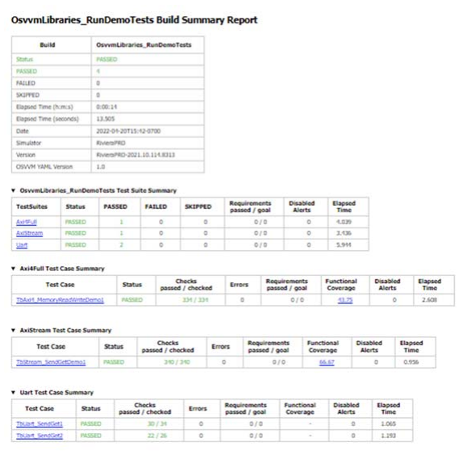
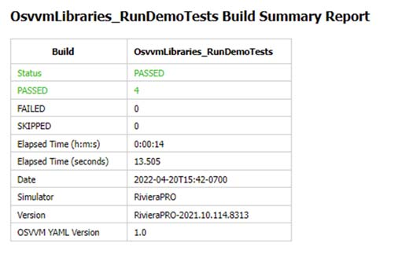
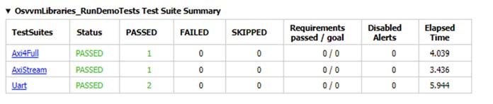
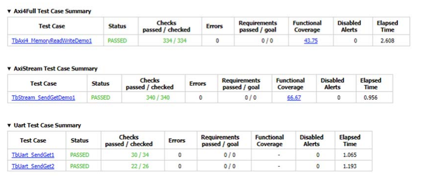
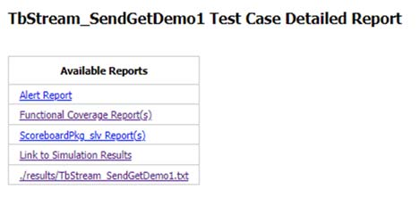
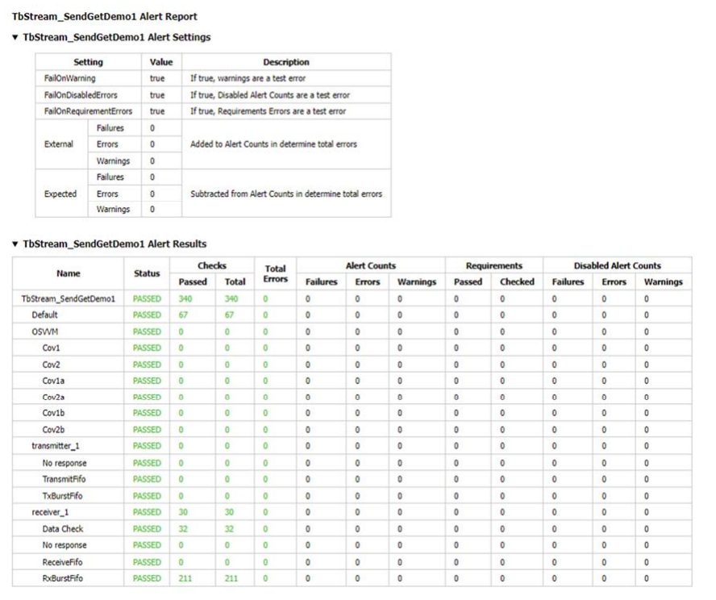
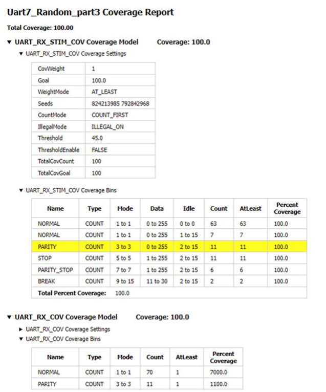
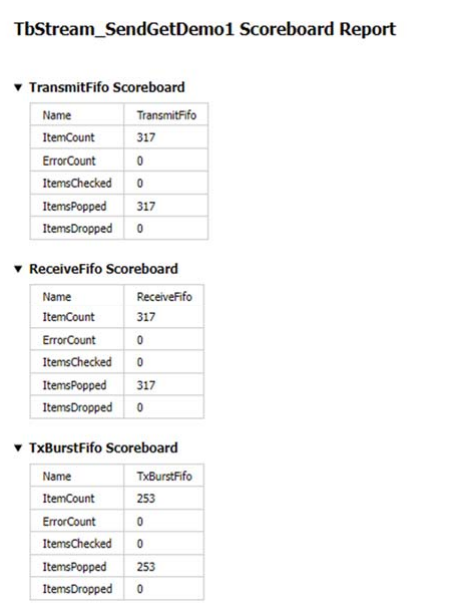
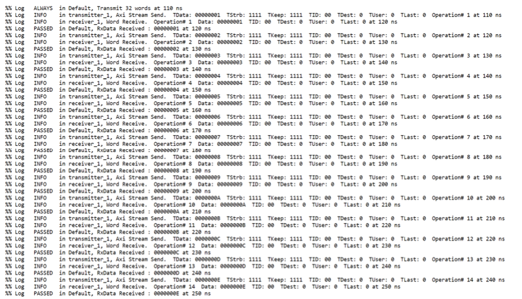
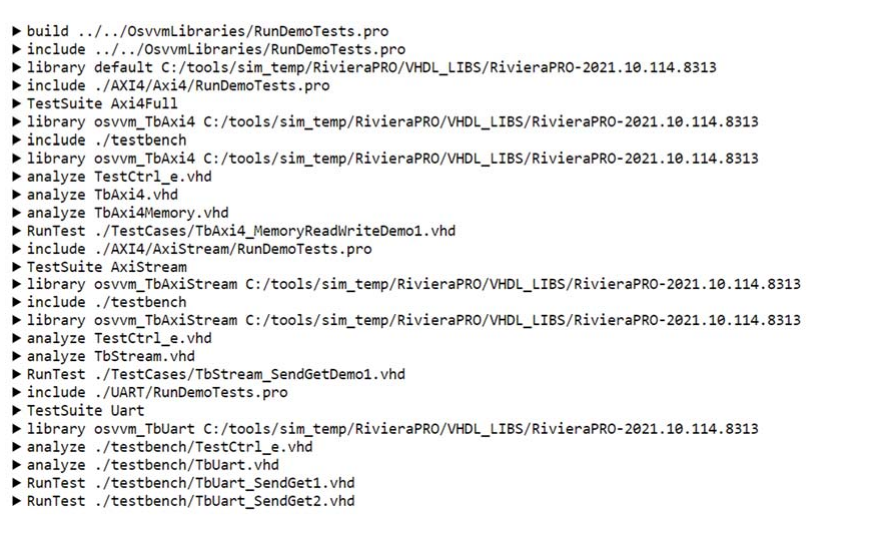

.. _FRAMEWORK/Overview:

OSVVM Overview
##############

.. _FRAMEWORK/Overview/AboutOSVVM:

About OSVVM
***********

OSVVM is an advanced verification methodology that defines a VHDL verification framework, verification utility library,
verification component library, scripting API, and co-simulation capability that simplifies your FPGA or ASIC
verification project from start to finish. Using these libraries you can create a simple, readable, and powerful
testbench that is suitable for either a simple FPGA block (aka a unit level test) or a complex ASIC (a full chip and/or
system test).

OSVVM is developed by the same VHDL experts who have helped develop VHDL standards. We have used our expert VHDL skills
to create advanced verification capabilities that provide:

* A structured transaction-based verification framework using verification components.
* An accelerated approach for developing verification components that uses the transaction interface and API defined in
  our transaction support library.
* Improved reuse and reduced project schedules.
* Improved readability and reviewability by the whole team including hardware, software, and system engineers.
* Buzz word verification features including Constrained Random, Functional Coverage, Scoreboards, FIFOs, Memory Models,
  error logging and reporting, and message filtering that are simple to use and work like built-in language features.
* Co-simulation of C++ models in a hardware simulator environment.
* A scripting API that runs any simulator using the same script. OSVVM scripting supports GHDL, NVC, Aldec Riviera-PRO
  and ActiveHDL, Siemens Questa and ModelSim, Synopsys VCS, and Cadence Xcelium.
* Unmatched test reporting with HTML based test suite reports, test case reports, and logs that facilitate debug and
  test artifact collection.
* Support for continuous integration (CI/CD) with JUnit XML test suite reporting.
* A rival to the verification capabilities of SystemVerilog + UVM.

Looking to improve your VHDL verification methodology? OSVVM provides a complete solution for VHDL ASIC or FPGA
verification. There is no new language to learn. It is simple, powerful, and concise. Each piece can be used separately.
Hence, you can learn and adopt pieces as you need them.

Important benefits of OSVVM:

* **Each piece is independent**

   * Add them to your current VHDL testbench incrementally.

* **Verification framework that is**

   * Simple enough to use on small blocks
   * So simple in fact that we don't need a "Lite" or "Easy" approach
   * It is powerful enough to use on large, complex FPGAs and ASICs
   * Using the same framework architecture for RTL, Core, and System tests facilitates reuse between them
   * Test cases are readable by RTL, verification, software, and system engineers
   * It is simple enough that you just need VHDL engineers and not verification specialists.
   * Our Model Independent Transactions (MIT) define a common set of transactions for Address Bus and Streaming
     Interfaces

* **Verification utility library that**

   * Simplifies Self-checking, Error handling, and Message Filtering
   * Implements Constrained Random, Functional Coverage, Scoreboards, FIFOs, Memory Models
   * Is simple to use and works like built-in language features

* **Co-Simulation capability that supports**

   * Running C++ models and code on simulated hardware

      * Instruction set simulators or cycle accurate processor models
      * System models with a mix of software models and logic IP

   * Writing of tests in C++

      * Test development environment extended to software engineers

   * Connection to an external program via TCP/IP sockets

      * Where model might not be callable directly from the C++ code

* **Unmatched Test reporting**

   * JUnit XML for use with continuous integration (CI/CD) tools.
   * HTML Build Summary Report for reporting test suite level information
   * HTML Test Case Detailed report for each test case.
   * HTML based Alert, Functional Coverage, and Scoreboard Reports
   * HTML based test transcript/log files
   * Find and debug issues faster

* **Verification component library**

   * Free open source verification components for AXI4 Full, AXI4 Lite, AXI Stream, UART, and DPRAM
   * More in progress

* **One Script to Run Simulators**

   * Same script supports GHDL, Aldec Riviera-PRO and ActiveHDL, Siemens QuestaSim and ModelSim, Synopsys VCS, and
     Cadence Xcelium

* **It is free open source.**

   * It upgrades an ordinary VHDL license with full featured verification capabilities.

SynthWorks has been using OSVVM for 25+ years in our training classes and consulting work. During that time, we have
innovated new capabilities and evolved our existing ones to increase re-use and reduce effort and time spent.

.. _FRAMEWORK/Overview/GettingStartedWithOSVVM:

Getting Started with OSVVM
**************************

The best way to get started with OSVVM is to run the demo examples.

.. _FRAMEWORK/Overview/DownloadOSVVM:

Download OSVVM
==============

OSVVM is available as either a git repository OsvvmLibraries or a zip file from OSVVM Downloads Page.

On GitHub, all OSVVM libraries are a submodule of the repository OsvvmLibraries. Download all OSVVM libraries using git
clone with the ``--recursive`` flag:

.. code-block:: shell

   $ git clone --recursive https://GitHub.com/OSVVM/OsvvmLibraries

.. _FRAMEWORK/Overview/RunningTheDemos:

Running the Demos
=================

A great way to get oriented with OSVVM is to run the demos.

If you are using Aldec's Riviera-PRO or Siemens' QuestaSim/ModelSim do the following.

* Step 1: Create a directory named :file:`sim` that is in the same directory that contains the :file:`OsvvmLibraries`
  directory.
* Step 2: Start your simulator and go to the :file:`sim` directory.
* Step 3: Do the following in your simulator command line:

.. code-block:: tcl

   source ../OsvvmLibraries/Scripts/StartUp.tcl
   build  ../OsvvmLibraries
   build  ../OsvvmLibraries/RunDemoTests.pro

These will produce some reports, such as :file:`OsvvmLibraries_RunDemoTests.html`. We will discuss these in the next
section, :ref:`OSVVM Reports <FRAMEWORK/Overview/OSVVMSReports>`.

If you are using GHDL, Aldec Active-HDL, Synopsys VCS, or Cadence Xcelium, see the :ref:`OSVVM Script User Guide <UG>`
for details on running the scripts in these tools. The start up aspect for each of these is slightly different, however,
once you get the simulator into OSVVM script mode, running the scripts is the same.

.. _FRAMEWORK/Overview/OSVVMSReports:

OSVVM's Reports
***************

Good reports simplify debug and help find problems quickly. This is important as according to the 2020 Wilson
Verification Survey FPGA verification engineers spend 46% of their time debugging.

OSVVM produces the following reports:

* HTML Build Summary Report for human inspection that provides test completion status.
* JUnit XML Build Summary Report for use with continuous integration (CI/CD) tools.
* HTML Test Case Detailed report for each test case with Alert, Functional Coverage, and Scoreboard reports.
* HTML based simulator transcript/log files (simulator output)
* Text based test case transcript file (from :vhdlcode:`TranscriptOpen`)

The best way to see the reports is to look at the ones from the demo. If you have not already done
:tclcode:`build OsvvmLibraries/RunDemoTests.pro`, then do so now.

.. _FRAMEWORK/Overview/HTMLBuildSummaryReport:

HTML Build Summary Report
=========================

The Build Summary Report allows us to quickly confirm if a build passed or quickly identify which test cases did not
PASS.

The Build Summary Report has three distinct pieces:

* Build Status
* Test Suite Summary
* Test Case Summary

For each Test Suite and Test Case, there is additional information, such as Functional Coverage and Disabled Alert
Count.

In the :file:`sim` directory, the Build Summary Report, shown below, is in the file
:file:`OsvvmLibraries_RunDemoTests.html`.

   Build Summary Report

Note that any place in the report there is a triangle preceding text, pressing on the triangle will rotate it and either
hide or reveal additional information.

.. _FRAMEWORK/Overview/BuildStatus:

Build Status
------------

The Build Status, shown below, is in a table at the top of the Build Summary Report. If code coverage is run, there will
be a link to the results at the bottom of the Build Summary Report.

   Build Status

.. _FRAMEWORK/Overview/TestSuiteSummary:

Test Suite Summary
------------------

When running tests, test cases are grouped into test suites. A build can include multiple test suites. The next table we
see in the Build Summary Report is the Test Suite Summary. The figure below shows that this build includes the test
suites Axi4Full, AxiStream, and UART.

   Test Suite Summary

.. _FRAMEWORK/Overview/TestCaseSummary:

Test Case Summary
-----------------

The remainder of the Build Summary Report is Test Case Summary, shown below. There is a separate Test Case Summary for
each test suite in the build.

   Test Case Summary

.. _FRAMEWORK/Overview/JUnitXMLBuildSummaryReport:

JUnit XML Build Summary Report
==============================

The JUnit XML Build Summary Report works with continuous integration (CI/CD). The CI/CD tools use this to understand if
the test is passing or not. They also have facilities for displaying the report - however, the OSVVM HTML format
provides a superset of information.

OSVVM runs regressions on GitHub.

.. _FRAMEWORK/Overview/HTMLTestCaseDetailedReport:

HTML Test Case Detailed Report
==============================

For each test case that is run (simulated), a Test Case Detailed Report is produced that contains the following
information:

* Test Information Link Table
* Alert Report
* Functional Coverage Report(s)
* Scoreboard Report(s)
* Link to Test Case Transcript (opened with :vhdlcode:`TranscriptOpen`)
* Link to this test case in HTML based simulator transcript

After running one of the regressions, open one of the HTML files in the directory :file:`./reports/<test-suite-name>`.

Note that any place in the report there is a triangle preceding text, pressing on the triangle will rotate it and either
hide or reveal additional information.

.. _FRAMEWORK/Overview/TestInformationLinkTable:

Test Information Link Table
---------------------------

The Test Information Link Table is in a table at the top of the Test Case Detailed Report. The Test Information link
table has links to the Alert Report (in this file), Functional Coverage Report (in this file), Scoreboard Reports (in
this file), a link to simulation results (if the simulation report is in HTML), and a link to any transcript files
opened by OSVVM.

   Test Information Link Table

.. _FRAMEWORK/Overview/AlertReport:

Alert Report
------------

The Alert Report, shown below, provides detailed information for each :vhdlcode:`AlertLogID` that is used in a test
case.

   Alert Report

.. _FRAMEWORK/Overview/FunctionalCoverageReportS:

Functional Coverage Report(s)
-----------------------------

The Test Case Detailed Report contains a Functional Coverage Report, shown below, for each functional coverage model
used in the test case. Note this report is not from the demo.

   Functional Coverage Report

.. _FRAMEWORK/Overview/ScoreboardReportS:

Scoreboard Report(s)
--------------------

The Test Case Detailed Report contains a Scoreboard Report, shown below, for each scoreboard model used in the test
case.

   Scoreboard Report

.. _FRAMEWORK/Overview/TestCaseTranscript:

Test Case Transcript
====================

OSVVM's transcript utility facilitates collecting all test output into a single file, shown below.

   Test Case Transcript

.. _FRAMEWORK/Overview/HTMLSimulatorTranscript:

HTML Simulator Transcript
=========================

Simulator transcript files can be long. The basic OSVVM regression test (:file:`OsvvmLibraries/RunAllTests.pro`),
produces a log file that is 84K lines long. As a plain text file, this is not browsable, however, when converted to an
html file it is. OSVVM gives you the option to create either html (default), shown below, or plain text. In the html
report, any place there is a triangle preceding text, pressing on the triangle will rotate it and either hide or reveal
additional information.

   HTML Simulator Transcript

.. _FRAMEWORK/Overview/StructuredTestbenchFramework:

Structured Testbench Framework
******************************

Some methodologies (or frameworks) are so complex that you need a script to create initial starting point for writing
verification components, test cases, and/or the test harness. SystemVerilog + UVM is certainly like this. There are even
several organizations that propose that you use their "Lite" or "Easy" approach.

OSVVM is simple enough to use on small blocks and powerful enough to use on large, complex chips or systems. This allows
us to use the same style of framework for RTL, Core, and Chip level verification - which in turn facilitates re-use of
verification components and test cases. OSVVM has added the abstractions needed to make our verification component based
approach as easy as the "Lite" approach of other methodologies.

SynthWorks has been using this framework for 25+ years in our training classes and consulting work. During that time, we
have innovated new capabilities and evolved our existing ones to increase re-use and reduce effort spent.

When we examine OSVVM's framework in detail, we see that it has many similar elements to SystemVerilog + UVM. However,
one thing not present is OO language constructs. Instead OSVVM uses ordinary VHDL constructs, such as structural and
behavioral code. This makes it readily accessible to both verification and RTL engineers.

.. _FRAMEWORK/Overview/StructuredTestbenchFramework/GoingFurther:

Going Further
=============

Read the following documents for more information on OSVVM's Structured Testbench Framework.

.. list-table::
   :header-rows: 1
   :widths: 44 56

   * - Document
     - User Guide
   * - OSVVM's Structured Testbench Framework
     - :ref:`FRAMEWORK/StructuredTestbench`
   * - OSVVM's Verification Component Developer's Guide
     - :ref:`FRAMEWORK/VCDevelopers`
   * - OSVVM's Test Writers User Guide
     - :ref:`FRAMEWORK/TestWriters`
   * - OSVVM's Address Bus Model Independent Transactions Users Guide
     - :ref:`MIT/AddressBus`
   * - OSVVM's Stream Model Independent Transactions Users Guide
     - :ref:`MIT/Stream`

.. _FRAMEWORK/Overview/VHDLUtilityLibrary:

VHDL Utility Library
********************

The OSVVM Utility Library <osvvm> implements the advanced verification capabilities found in other verification
languages (such as SystemVerilog and UVM) as packages. The list below lists out many of the OSVVM features and the
package in which they are implemented.

* Constrained Random test generation (:vhdlcode:`RandomPkg`)
* Functional Coverage with hooks for UCIS coverage database integration (:vhdlcode:`CoveragePkg`)
* Intelligent Coverage Random test generation (:vhdlcode:`CoveragePkg`)
* Utilities for testbench process synchronization generation (:vhdlcode:`TbUtilPkg`)
* Utilities for clock and reset generation (:vhdlcode:`TbUtilPkg`)
* Transcript files (:vhdlcode:`TranscriptPkg`)
* Error logging and reporting - Alerts and Affirmations (:vhdlcode:`AlertLogPkg`)
* Message filtering - Logs (:vhdlcode:`AlertLogPkg`)
* Scoreboards and FIFOs (data structures for verification) (:vhdlcode:`ScoreboardGenericPkg`)
* HTML and JUnit XML test reporting (:vhdlcode:`ReportPkg`, :vhdlcode:`AlertLogPkg`, :vhdlcode:`CoveragePkg`,
  :vhdlcode:`ScoreboardGenericPkg`)
* Memory models (:vhdlcode:`MemoryPkg`)
* Transaction-Level Modeling Support (:vhdlcode:`TbUtilPkg`, :vhdlcode:`ResolutionPkg`)

Through the years, the packages have been updated many times. Now, all of the packages that create data structures
(:vhdlcode:`AlertLogPkg`, :vhdlcode:`CoveragePkg`, :vhdlcode:`ScoreboardGenericPkg`, and :vhdlcode:`MemoryPkg`) use
singleton data structures. Usage of singletons simplifies API to an ordinary call interface - ie: no more shared
variables and protected types.

.. _FRAMEWORK/Overview/VHDLUtilityLibrary/GoingFurther:

Going Further
=============

Read the following documents for more information on OSVVM's VHDL Utility Library.

.. list-table::
   :header-rows: 1
   :widths: 42 34 24

   * - Document
     - User Guide
     - Quick Reference
   * - OSVVM Test Writer's User Guide - a general overview to usage
     - :ref:`FRAMEWORK/TestWriters`
     - None
   * - :vhdlcode:`AlertLogPkg`
     - :ref:`UTILITY/AlertLogPkg`
     - :ref:`UTILITY/AlertLogPkgQuickRef`
   * - :vhdlcode:`TranscriptPkg`
     - :ref:`UTILITY/TranscriptPkg`
     - :ref:`UTILITY/TranscriptPkgQuickRef`
   * - :vhdlcode:`RandomPkg`
     - :ref:`UTILITY/RandomPkg`
     - :ref:`UTILITY/RandomPkgQuickRef`
   * - :vhdlcode:`CoveragePkg`
     - :ref:`UTILITY/CoveragePkg`
     - :ref:`UTILITY/CoveragePkgQuickRef`
   * - :vhdlcode:`ScoreboardGenericPkg`
     - :ref:`UTILITY/ScoreboardPkg`
     - :ref:`UTILITY/ScoreboardPkgQuickRef`
   * - :vhdlcode:`TbUtilPkg`
     - :ref:`UTILITY/TbUtilPkg`
     - :ref:`UTILITY/TbUtilPkgQuickRef`
   * - :vhdlcode:`MemoryPkg`
     - :ref:`UTILITY/MemoryPkg`
     - None
   * - :vhdlcode:`TextUtilPkg`
     - :ref:`UTILITY/TextUtilPkg`
     - None

.. _FRAMEWORK/Overview/ScriptingLibrary:

Scripting Library
*****************

The goal of OSVVM's scripting is to have "One Script to Run them All" - where all is any simulator.

Current supported simulators are

* GHDL (Free Open Source simulator),
* Aldec's Active-HDL and Riviera-PRO,
* Siemens' ModelSim and QuestaSim,
* Synopsys' VCS, and
* Cadence's Xcelium.

OSVVM scripts are a TCL based API layer that provides a tool independent means to simulate (and perhaps in the future
synthesize) your design. The API uses TCL procedures to create the abstraction layers – which is why they have the
extension :file:`.pro`.

The scripts are executable TCL, so the full power of TCL can be used when needed (such as is in :file:`osvvm.pro`).

.. _FRAMEWORK/Overview/ScriptingLibrary/GoingFurther:

Going Further
=============

Read the following documents for more information on OSVVM's Scripting.

.. list-table::
   :header-rows: 0
   :widths: 60 40

   * - OSVVM Script User Guide
     - :ref:`UG`
   * - OSVVM Script library
     - OSVVM-Scripts

.. _FRAMEWORK/Overview/OSVVMVerificationComponentLibrary:

OSVVM Verification Component Library
************************************

OSVVM's growing verification component library is tabulated below.

.. list-table::
   :header-rows: 1
   :widths: 54 30 16

   * - Verification Component(s)
     - User Guide
     - Repository
   * - Axi4 Full (Manager, Memory, and Subordinate) VCs
     - :ref:`VC/Axi4`
     - AXI4
   * - Axi4 Lite (Manager, Memory, and Subordinate) VCs
     - :ref:`VC/Axi4`
     - AXI4
   * - AxiStream Transmitter and Receiver VCs
     - :ref:`VC/AxiStream`
     - AXI4
   * - UART Transmitter and Receiver VCs
     - None
     - UART
   * - :vhdlcode:`DpRam` behavioral model and :vhdlcode:`DpRam` controller
     - None
     - DpRam

Note all of the OSVVM verification components use the model independent transaction interfaces which are defined in
OSVVM-Common. It is required to be in the directory :file:`OsvvmLibraries/Common`.
