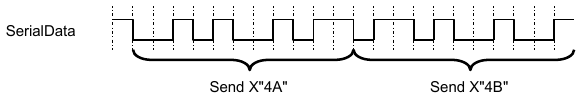
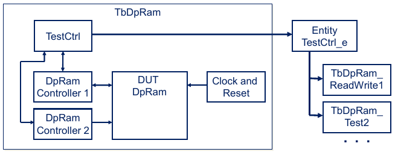

.. _FRAMEWORK/StructuredTestbench:

OSVVM's Structured Testbench Framework
######################################

.. _FRAMEWORK/StructuredTestbench/Overview:

Overview
********

OSVVM's structured testbench framework is simple enough to use on small blocks. So simple in fact that a "Lite" or
"Easy" approach is not needed. It is powerful enough to use on large, complex ASICs. This allows the same testbench
architecture to be used for RTL, CORE, and System tests – this in turn facilitates reuse/pre-use of both verification
components and test sequences.

SynthWorks has been using this framework for 25+ years in our training classes and consulting work. During that time, we
have innovated new capabilities and evolved our approach to increase re-use and reduce effort and time spent.

In this document we examine OSVVM’s framework in detail and see that it has many similar elements to SystemVerilog +
UVM. However, one thing not present is OO language constructs. Instead OSVVM uses ordinary VHDL constructs, such as
structural and behavioral code. This makes it readily accessible to both verification and RTL engineers.

.. _FRAMEWORK/StructuredTestbench/Transactions:

Transactions
************

Writing tests is all about creating waveforms at an interface. In a basic test approach, each test directly drives and
wiggles interface waveforms. This is tedious and error prone.

In OSVVM, signal wiggling is replaced by transactions. A transaction is an abstract representation of either an
interface waveform (such as :vhdlcode:`Send` for a UART transmitter or :vhdlcode:`Read` for an AXI4 Bus) or a directive
(such as wait for clock). In OSVVM, a transaction is initiated using a procedure call. In a verification component (VC)
based approach, the procedure call collects the transaction information and passes it to the VC via a transaction
interface (a record). The VC then decodes this information and creates the corresponding interface stimulus to the
device under test (DUT).

:ref:`Figure 1 <FRAMEWORK/StructuredTestbench/Figure1>` shows two calls to a send procedure and the corresponding
waveforms produced by the :vhdlcode:`UartTx` verification component.

.. code-block:: VHDL

   UartTbTxProc : process
   begin
     WaitForBarrier(StartTest) ;
     Send(UartTxRec, X"4A") ;
     Send(UartTxRec, X"4B") ;

   Figure 1. Two Calls to Send transaction and the resulting waveform

Writing tests using transactions makes tests easy to read by anyone who has basic programming experience, including
verification, hardware, software, and system engineers.

.. _FRAMEWORK/StructuredTestbench/FrameworkTestHarness:

Framework / Test Harness
************************

The objective of any verification framework is to make the Device Under Test (DUT) "feel like" it has been plugged into
the board. Hence, the framework must be able to produce the same waveforms and sequence of waveforms that the DUT will
see on the board – this includes the simultaneous behavior of independent interfaces.

The OSVVM testbench framework looks identical to other frameworks, including SystemVerilog. It includes the DUT
(:vhdlcode:`DpRam`), verification components (:vhdlcode:`DpRamController`), and test sequencer (:vhdlcode:`TestCtrl`) as
shown in :ref:`Figure 2 <FRAMEWORK/StructuredTestbench/Figure2>`. The test sequencer calls a sequence of transactions.
The transactions in turn instruct the verification components to create a sequence of waveforms on the DUT interface.

   Figure 2. OSVVM Testbench Framework

The top level of the testbench connects the components together and is often called a test harness. Connections between
the verification components and :vhdlcode:`TestCtrl` use VHDL records as an interface (aka transaction interface).
Connections between the verification components and the DUT are the DUT interfaces (such as UART, AxiStream, AXI4, SPI,
and I2C).

Do not despair about the amount of work here – OSVVM has done some of it for you. For example, our Model Independent
Transactions define both the transaction interfaces and transaction call API for you.

The test harness is coded using structural code – just like connectivity in RTL design.
:ref:`Figure 3 <FRAMEWORK/StructuredTestbench/Figure3>` shows a sketch of the code for :vhdlcode:`TbDpRam`. OSVVM
verification components put component declarations in packages and reference the packages in the context declaration
(:vhdlcode:`DpRamContext`). This allows the use of component instances without having a component declaration. The
complete code is in :file:`TbDpRam.vhd` in the directory :file:`OsvvmLibraries/DpRam/testbench`.

.. code-block:: VHDL
   :caption: Figure 3. TbDpRam Test Harness
   :name: FRAMEWORK/StructuredTestbench/Figure3
   :force:

   library osvvm ;
     context osvvm.OsvvmContext ;
   library OSVVM_DPRAM ;
     context OSVVM_DpRam.DpRamContext ;
   . . .
   entity  TbDpRam is
   end entity TbDpRam ;
   architecture TestHarness of TbDpRam is
     constant ADDR_WIDTH : integer := 24 ;
     constant DATA_WIDTH : integer := 16 ;

     signal Clk         : std_logic ;
     signal nReset      : std_logic ;
     signal AddrA       : std_logic_vector(ADDR_WIDTH-1 downto 0) ;
     signal WriteA      : std_logic ;
     signal DataInA     : std_logic_vector(DATA_WIDTH-1 downto 0) ;
     . . .
     signal Manager1Rec, Manager2Rec  : AddressBusRecType (
             Address      (ADDR_WIDTH-1 downto 0),
             DataToModel  (DATA_WIDTH-1 downto 0),
             DataFromModel(DATA_WIDTH-1 downto 0)
           ) ;

     component TestCtrl is
       port ( . . . ) ;
     end component TestCtrl ;  . . .
   begin

     -- procedures
     osvvm.TbUtilPkg.CreateClock(Clk, tperiod_Clk) ;
     osvvm.TbUtilPkg.CreateReset(nReset, . . .) ;

     -- instances
     DpRam_1 : DpRam
       generic map (ADDR_WIDTH, DATA_WIDTH, FALSE, FALSE, "DpRam_1")
       port map (Clk, AddrA, WriteA, DataInA, DataOutA, AddrB, …) ;

     Manager_1 : DpRamController port map (…, AddrA, WriteA, …, Manager1Rec);

     Manager_2 : DpRamController port map (…, AddrB, WriteB, …, Manager2Rec);

     TestCtrl_1 :  TestCtrl port map   (nReset, Manager1Rec, Manager2Rec) ;
   end TestHarness ;

.. _FRAMEWORK/StructuredTestbench/TheTestSequencerTestCtrl:

The Test Sequencer (TestCtrl)
*****************************

Tests (or test cases) are written in the test sequencer (:vhdlcode:`TestCtrl`). A sketch of a :vhdlcode:`TestCtrl`
architecture is shown in :ref:`Figure 4 <FRAMEWORK/StructuredTestbench/Figure4>`. Key features of OSVVM test cases are:

* Transaction procedure calls (:vhdlcode:`Write`, :vhdlcode:`Read`, :vhdlcode:`ReadCheck`, :vhdlcode:`Send`,
  :vhdlcode:`Get`, :vhdlcode:`Check`, …) are used to create the sequence of interface waveforms that make up a test.
* Independent / concurrent behavior that is present in a hardware system is created by using a separate process for each
  independent interface.
* A control process is used to coordinate test initiation and completion.
* Separate tests are written in separate architectures of :vhdlcode:`TestCtrl`
* Synchronization primitives (such as :vhdlcode:`WaitForBarrier`) coordinate activities on independent interfaces. More
  details are in :vhdlcode:`TbUtilPkg` :ref:`User Guide <UTILITY/TbUtilPkg>` and
  :ref:`Quick Reference <UTILITY/TbUtilPkgQuickRef>`.

Details of writing tests are in the :ref:`OSVVM Test Writers User Guide <FRAMEWORK/TestWriters>`. The complete code is
in :file:`TbDpRam_BasicReadWrite.vhd` in the directory :file:`OsvvmLibraries/DpRam/testbench`.

.. code-block:: VHDL
   :caption: Figure 4. TestCtrl Architecture
   :name: FRAMEWORK/StructuredTestbench/Figure4

   architecture BasicReadWrite of TestCtrl is
     . . .
   begin
     ControlProc : process
     begin
       SetAlertLogName("TbDpRam_BasicReadWrite") ;
       . . .
       WaitForBarrier(TestDone, 5 ms) ;
       EndOfTestReports ;
       std.env.stop;
     end process ;
     Manager1Proc : process
     begin
       . . .
       for i in 1 to 10 loop
         Write(Manager1Rec, X"01_0000" + i, X"1000" + i ) ;
       end loop ;
       . . .
       WaitForBarrier(TestDone) ;
     end process Manager1Proc;
     Manager2Proc : process
     begin
       . . .
       for i in 1 to 10 loop
         ReadCheck(Manager2Rec, X"01_0000" + i, X"1000" + i) ;
       end loop ;
       . . .
       WaitForBarrier(TestDone) ;
     end process Manager2Proc ;

.. _FRAMEWORK/StructuredTestbench/SelectingTestCases:

Selecting Test Cases
********************

An OSVVM test suite consists of multiple architectures of the :vhdlcode:`TestCtrl`, each architecture contains a single
test case. Organizationally the :vhdlcode:`TestCtrl` entity and its multiple architectures go in separate files.

Using multiple architectures does not change the test harness – other than we need to use component instantiation for
:vhdlcode:`TestCtrl` rather than entity instantiation. Component instantiation allows late binding of the architecture
and optionally the use of configuration declarations.

Compilation dependencies are on primary units (entity) and not the architectures. Hence, the design hierarchy and
testbench can be compiled before the test architectures are compiled.

The architecture for a given test is selected by either default binding or a configuration declaration. With default
binding, the most recent successfully analyzed (compiled) architecture is selected for simulation.
:ref:`Figure 5 <FRAMEWORK/StructuredTestbench/Figure5>` shows the OSVVM script sequence to run a test using default
binding.

.. code-block:: tcl
   :caption: Figure 5. OSVVM Sequence to Run a test using Default Binding
   :name: FRAMEWORK/StructuredTestbench/Figure5

   TestName TbAxi4_MemoryReadWriteDemo1       ;# Set TestName for scripts
   analyze  TbAxi4_MemoryReadWriteDemo1.vhd   ;# Analyze test case architecture
   simulate TbAxi4Memory                      ;# Load top level.

OSVVM examples use configuration declarations to select the architecture to run.
:ref:`Figure 6 <FRAMEWORK/StructuredTestbench/Figure6>` shows the configuration to select test architecture
:vhdlcode:`MemoryReadWriteDemo1`. To simplify the entire process, we give the configuration the same name as the test
case name. The architecture name is a short version of the test case name. OSVVM examples put the configuration
declaration at the bottom of the file containing the test architecture.

.. code-block:: VHDL
   :caption: Figure 6. Configuration for Test Architecture MemoryReadWriteDemo1
   :name: FRAMEWORK/StructuredTestbench/Figure6

   Configuration TbAxi4_MemoryReadWriteDemo1 of TbAxi4Memory is
     for TestHarness
       for TestCtrl_1 : TestCtrl
         use entity work.TestCtrl(MemoryReadWriteDemo1) ;
       end for ;
     end for ;
   end TbAxi4_MemoryReadWriteDemo1 ;

To run the test case using a configuration use :tclcode:`RunTest` as shown in
:ref:`Figure 7 <FRAMEWORK/StructuredTestbench/Figure7>`. This is an abbreviation for calling :tclcode:`TestName`,
:tclcode:`analyze`, and :tclcode:`simulate` where they all use the same root name.

.. code-block:: tcl
   :caption: Figure 7. OSVVM Sequence to Run a test using Configurations
   :name: FRAMEWORK/StructuredTestbench/Figure7

   RunTest  TbAxi4_MemoryReadWriteDemo1.vhd

.. _FRAMEWORK/StructuredTestbench/TheVerificationComponentVC:

The Verification Component (VC)
*******************************

The verification component (VC) translates the transaction information into an interface waveform. It receives the
transaction information on a record (see
:ref:`next section <FRAMEWORK/StructuredTestbench/RecordBasedTransactionInterface>`). A template for a simple OSVVM
verification component is shown in :ref:`Figure 8 <FRAMEWORK/StructuredTestbench/Figure8>`.

.. code-block:: VHDL
   :caption: Figure 8. Verification Component Structure
   :name: FRAMEWORK/StructuredTestbench/Figure8

   library osvvm ;
     context osvvm.OsvvmContext ;
     use osvvm.ScoreboardPkg_slv.all ;

   library osvvm_common ;
     context osvvm_common.OsvvmCommonContext ;

   entity DpRamController is
   generic ( . . . ) ;
   port (
     -- DUT Interface
     . . .
     -- Testbench Transaction Interface
     TransRec    : InOut AddressBusRecType
   ) ;
   end entity DpRamController ;
   architecture SimpleBlocking of DpRamController is
   begin

     TransactionHandler : process
     begin

         WaitForTransaction(Clk, TransRec.Rdy, TransRec.Ack) ;

         case TransRec.Operation is
           -- Model Transaction Dispatch
           when WRITE_OP =>
             DpRamWrite(TransRec, Clk, Address, oData, Write) ;

           when READ_OP =>
             DpRamRead(TransRec, Clk, Address, Write, iData) ;

           when WRITE_AND_READ =>
             DpRamWriteAndRead(TransRec, Clk, Address, oData, Write, iData) ;

           when others =>
             Alert(ModelID, "Unimplemented Transaction", FAILURE) ;

         end case ;
     end process TransactionHandler ;
   end architecture SimpleBlocking ;

OSVVM VC commonly start with libraries :vhdlcode:`ieee`, :vhdlcode:`osvvm`, and :vhdlcode:`osvvm_common`. They typically
include the ieee packages, the :vhdlcode:`OsvvmContext` and :vhdlcode:`OsvvmCommonContext` context references, and the
package :vhdlcode:`ScoreboardPkg_slv`.

The VC interface has the DUT interface signals and a :vhdlcode:`TransRec` of either :vhdlcode:`AddressBusRecType` or
:vhdlcode:`StreamRecType`.

For simple VC, there is a transaction handler process that waits until the VC receives a transaction
(:vhdlcode:`WaitForTransaction`) and then decodes the transaction and does appropriate interface signaling (here
represented by procedure calls to :vhdlcode:`DpRamWrite`, :vhdlcode:`DpRamRead`, and :vhdlcode:`DpRamWriteAndRead`).
Often it is better practice to write code here rather than calling a subprogram – one more layer of abstraction
introduced by the subprograms can lead to obfuscation.

Details of writing VC are in the :ref:`OSVVM Verification Component Developers Guide <FRAMEWORK/VCDevelopers>`.

.. _FRAMEWORK/StructuredTestbench/RecordBasedTransactionInterface:

Record Based Transaction Interface
**********************************

The transaction interface is a record that is used to communicate information between the test sequencer
(:vhdlcode:`TestCtrl`) and the verification component (VC). As such, it is an ":vhdlcode:`InOut`" of both
:vhdlcode:`TestCtrl` and the VC. To properly handle drivers, the record elements are a resolved type from the OSVVM
package :vhdlcode:`ResolutionPkg`. We call such a record an OSVVM interface. An example of an OSVVM interface is shown
in :ref:`Figure 9 <FRAMEWORK/StructuredTestbench/Figure9>`.

.. code-block:: VHDL
   :caption: Figure 9. An OSVVM Interface
   :name: FRAMEWORK/StructuredTestbench/Figure9

   type AddressBusRecType is record
     Rdy             : bit_max ;
     Ack             : bit_max ;
     Address         : std_logic_vector_max_c ;
     AddrWidth       : integer_max ;
     DataToModel     : std_logic_vector_max_c ;
     DataFromModel   : std_logic_vector_max_c ;
     . . .
   end record AddressBusRecType ;

Types in :vhdlcode:`ResolutionPkg` use "maximum" as a resolution function and add the suffix ":vhdlcode:`_max`" or
":vhdlcode:`_max_c`" to the type names. Maximum resolution picks the largest value driven on each element of signal
object that has multiple drivers. The largest value is the right most value of a type ('-' for :vhdlcode:`std_ulogic`).
This works in conjunction with the left most value being the smallest and the default value for an object of that type.

:vhdlcode:`ResolutionPkg` provides the following (as subtypes): :vhdlcode:`std_logic_max`,
:vhdlcode:`std_logic_vector_max`, :vhdlcode:`unsigned_max`, :vhdlcode:`signed_max`, :vhdlcode:`bit_max`,
:vhdlcode:`bit_vector_max`, :vhdlcode:`integer_max`, :vhdlcode:`integer_vector_max`, :vhdlcode:`time_max`,
:vhdlcode:`time_vector_max`, :vhdlcode:`real_max`, :vhdlcode:`real_vector_max`, :vhdlcode:`character_max`,
:vhdlcode:`string_max`, :vhdlcode:`boolean_max`, and :vhdlcode:`boolean_vector_max`. More details on
:vhdlcode:`ResolutionPkg` are in :vhdlcode:`ResolutionPkg` :ref:`Users Guide <UTILITY/ResolutionPkg>`.

For OSVVM VC, the OSVVM Model Independent Transaction Interfaces define two such records, :vhdlcode:`AddressBusRecType`
and :vhdlcode:`StreamRecType`, that are suitable for most VC.

.. _FRAMEWORK/StructuredTestbench/TransactionAPIProcedures:

Transaction API (Procedures)
****************************

Calls to the transaction procedures tell a verification component what to do on its interface. The interface of the
verification component determines how to do it.

:ref:`Figure 10 <FRAMEWORK/StructuredTestbench/Figure10>` shows an example of a transaction procedure. These procedures
are nothing more than an abstraction layer that puts the transaction information into the record, signals a transaction
is ready (:vhdlcode:`RequestTransaction`), and gathers results when the transaction completes.

.. code-block:: VHDL
   :caption: Figure 10. An OSVVM Transaction Procedure
   :name: FRAMEWORK/StructuredTestbench/Figure10

   procedure Read (
     signal   TransactionRec : InOut AddressBusRecType ;
              iAddr          : In    std_logic_vector ;
     variable oData          : Out   std_logic_vector
   ) is
   begin
     -- Put values in record
     TransactionRec.Operation   <= READ_OP ;
     TransactionRec.Address     <= SafeResize(iAddr, TransactionRec.Address'length);
     -- Start Transaction
     RequestTransaction(Rdy => TransactionRec.Rdy, Ack => TransactionRec.Ack) ;
     -- Return Results
     oData  := SafeResize(TransactionRec.DataFromModel, oData'length) ;
   end procedure Read ;

Historically we wrote transaction procedures for each verification component. After doing this for long enough, we
realized that from a transaction perspective, many interfaces do the same thing and could be handled by a common set of
transaction procedures.

For OSVVM VC, the OSVVM Model Independent Transaction Interfaces define two sets of procedures that are suitable for
most VC.

.. _FRAMEWORK/StructuredTestbench/OSVVMModelIndependentTransactions:

OSVVM Model Independent Transactions
************************************

OSVVM Model Independent Transactions evolved from the observation that some interfaces do the same transactions. Address
bus interfaces (such as AXI, Avalon, Wishbone, …) all do read and write transactions. Streaming interfaces (such as
AxiStream, UART, …) all do send and get transactions.

For these interfaces, OSVVM Model Independent Transactions define

* The Transaction Interfaces: :vhdlcode:`AddressBusRecType` and :vhdlcode:`StreamRecType`.
* The Transaction initiation procedures: :vhdlcode:`Read`, :vhdlcode:`Write` (address bus) vs :vhdlcode:`Send`,
  :vhdlcode:`Get` (stream).

With OSVVM Model Independent Transactions, it reduces the development of verification components to just write the model
functionality/behavior.

More details are provided in the :ref:`Address Bus Model Independent Transactions User Guide <MIT/AddressBus>` and the
:ref:`Stream Model Independent Transactions User Guide <MIT/Stream>`.

.. _FRAMEWORK/StructuredTestbench/RunningTheExamples:

Running the Examples
********************

See the steps in the :ref:`OSVVM Overview guide <FRAMEWORK/Overview/RunningTheDemos>` for running the OSVVM demos. Do
the steps shown in :ref:`Figure 11 <FRAMEWORK/StructuredTestbench/Figure11>` in your simulator. :file:`StartUp.tcl`
needs to be sourced each time you start the simulator. See the :ref:`Script User Guide <UG>` for additional details for
Aldec's ActiveHDL, GHDL, Synopsys VCS, and Cadence Xcelium.

.. code-block:: tcl
   :caption: Figure 11. Compiling and Running DPRAM tests
   :name: FRAMEWORK/StructuredTestbench/Figure11

   cd sim
   source ../OsvvmLibraries/Scripts/StartUp.tcl
   build  ../OsvvmLibraries/OsvvmLibraries.pro
   build  ../OsvvmLibraries/DpRam/RunAllTests.pro

.. _FRAMEWORK/StructuredTestbench/Summary:

Summary
*******

This document starts your journey into OSVVM's Structured Testbench Framework.

For creating the test harness, what you have here and in the example code (:file:`TbDpRam.vhd`) which is in the
directory (:file:`OsvvmLibraries/DpRam/testbench`) should be sufficient. The code is basically a structural netlist
which is created in a 'Lego' like fashion – just like RTL code.

In OSVVM, creating test cases is nothing more than calling transactions in the test sequencer (:vhdlcode:`TestCtrl`).
See the :ref:`OSVVM Test Writers User Guide <FRAMEWORK/TestWriters>` for more details. From there more details are in
each of OSVVM's user guides for each package in the :ref:`OSVVM Utility Library <UTILITY>`. The key benefit to
organizing test cases in this fashion is that the test cases are readable by all – where all is RTL, verification,
software, and system engineers.

In OSVVM, a verification component is nothing more than behavioral code. See the
:ref:`OSVVM Verification Component Developers Guide <FRAMEWORK/VCDevelopers>` for more details. One benefit to this
approach is that it is similar enough to RTL that an engineer can easily do both RTL and verification tasks.

Connections between the test sequencer and the verification component are handled by OSVVM's Model Independent
Transactions. These define the interface records and abstract transaction API that can be used by verification
components. For more details see the :ref:`Address Bus Model Independent Transactions Users’ Guide <MIT/AddressBus>` and
the :ref:`Stream Model Independent Transactions Users’ Guide <MIT/Stream>`. This approach benefits verification
component developers by removing the need to create transaction records and the transaction API for each verification
component. This approach benefits test case developers since there are only two transaction APIs to learn rather than
one per verification component. It also promotes reuse of test sequences between similar verification components.
