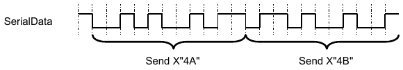
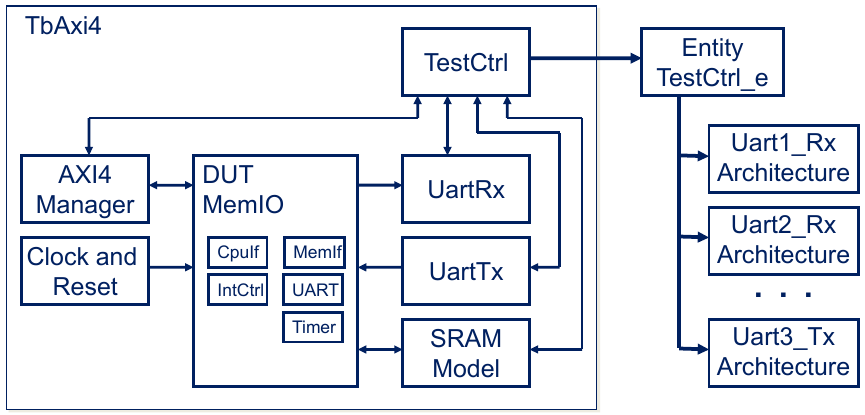
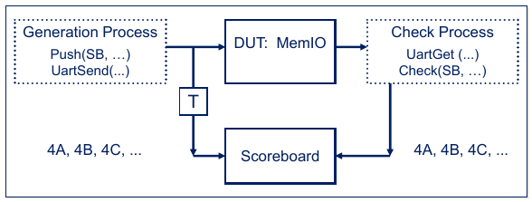
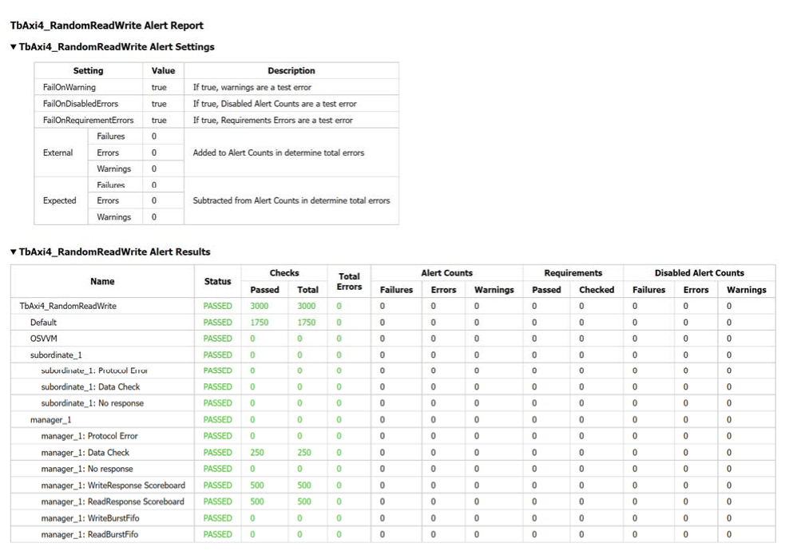
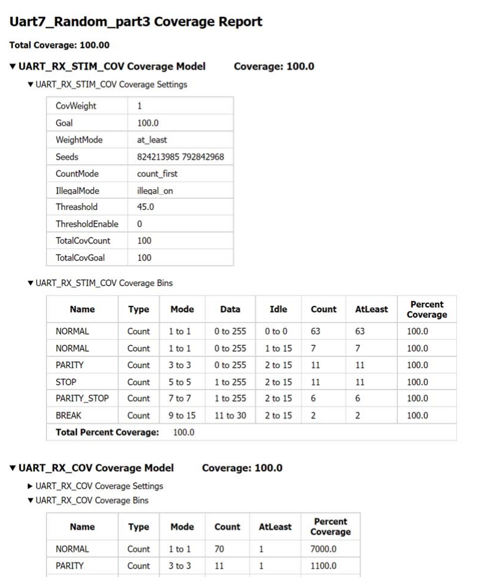
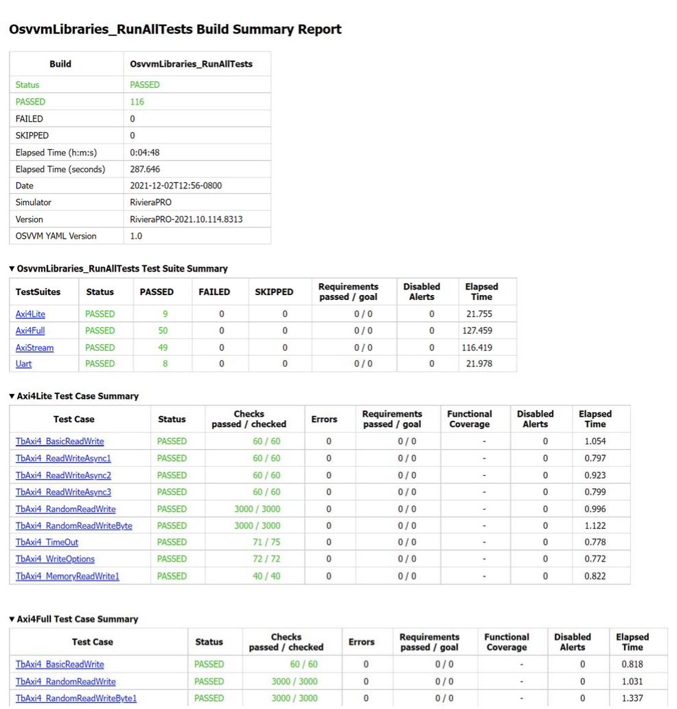

.. _FRAMEWORK/TestWriters:

OSVVM Test Writers User Guide
#############################

.. _FRAMEWORK/TestWriters/Overview:

Overview
********

Most people don't think of VHDL as a verification language. However, with the Open Source VHDL Verification Methodology
(OSVVM) utility and verification component libraries it is. Using OSVVM we can create readable, powerful, and concise
VHDL verification environments (testbenches) whose capabilities are similar to other verification languages, such as
SystemVerilog and UVM.

This paper covers the basics of using OSVVM's transaction-based test approach to write directed tests, write constrained
random tests, use OSVVM’s generic scoreboard, add functional coverage, add protocol and parameter checks, add message
filtering, and add test wide reporting.

.. _FRAMEWORK/TestWriters/WhyVHDLWhyOSVVM:

Why VHDL? Why OSVVM?
********************

According the 2020 Wilson Research Group Functional Verification Study,

* 64% of FPGA design worldwide uses VHDL
* 50% of FPGA verification worldwide uses VHDL
* 18% of FPGA verification projects worldwide use OSVVM (or 36% of VHDL FPGA verification projects)
* For Europe, 34% of FPGA verification projects use OSVVM while only 26% use UVM

Clearly VHDL is a dominant language in the FPGA market and OSVVM is a leading VHDL Verification Methodology.

.. _FRAMEWORK/TestWriters/BenefitsOfOSVVM:

Benefits of OSVVM
*****************

For the VHDL community, OSVVM is a clear win. We can write tests in the same language we already know and re-use
components, tests, and testbenches from other projects. More importantly OSVVM’s transaction-based approach simplifies
creating readable and reviewable tests (an important metric in the safety critical community). In addition, OSVVM uses a
component (entity) based approach just like RTL design. Hence, not only can RTL designers read tests and verification
components, they can also write them. While having independent design and verification teams is important, it is also
important to be able to deploy engineers to either a design or verification role on a project by project basis.

.. _FRAMEWORK/TestWriters/WhatAreTransactions:

What are Transactions?
**********************

Writing tests is all about creating waveforms at an interface. In a basic test approach, each test directly drives and
wiggles interface waveforms. This is tedious and error prone.

In OSVVM, signal wiggling is replaced by transactions. A transaction is an abstract representation of an interface
waveform (such as :vhdlcode:`Send` for a UART transmit) or a directive to the verification component (such as wait for
clock). In OSVVM, a transaction is initiated using a procedure call. In a verification component (VC) based approach,
the procedure call collects the transaction information and passes it to the VC via a transaction interface (a record).
The VC then decodes this information and creates the corresponding interface stimulus to the device under test (DUT).

:ref:`Figure 1 <FRAMEWORK/TestWriters/Figure1>` shows two calls to a send procedure and the corresponding waveforms
produced by the :vhdlcode:`UartTx` verification component.

.. code-block:: VHDL

   UartTbTxProc : process
   begin
     WaitForBarrier(StartTest) ;
     Send(UartTxRec, X"4A") ;
     Send(UartTxRec, X"4B") ;

   Figure 1. Two Calls to Send transaction and the resulting waveform

.. _FRAMEWORK/TestWriters/TheOSVVMTestbenchFramework:

The OSVVM Testbench Framework
*****************************

The objective of any verification framework is to make the Device Under Test (DUT) "feel like" it has been plugged into
the board. Hence, the framework must be able to produce the same waveforms and sequence of waveforms that the DUT will
see on the board.

The OSVVM testbench framework looks identical to other frameworks, including SystemVerilog. It includes verification
components (:vhdlcode:`AxiManager`, :vhdlcode:`UartRx`, and :vhdlcode:`UartTx`) and :vhdlcode:`TestCtrl` (the test
sequencer) as shown in :ref:`Figure 2 <FRAMEWORK/TestWriters/Figure2>`. The top level of the testbench connects the
components together (using the same methods as in RTL design) and is often called a test harness. Connections between
the verification components and :vhdlcode:`TestCtrl` use VHDL records as an interface (aka transaction interface).
Connections between the verification components and the DUT are the DUT interfaces (such as UART, AxiStream, AXI4, SPI,
and I2C).

   Figure 2. OSVVM Testbench Framework

For more details, including to OSVVM reference testbenches, see :ref:`VC/Axi4` and :ref:`VC/AxiStream`

.. _FRAMEWORK/TestWriters/TestCtrlTheOSVVMTestSequencer:

TestCtrl, The OSVVM Test Sequencer
**********************************

The :vhdlcode:`TestCtrl` architecture consists of a control process plus one process per independent interface, see
:ref:`Figure 3 <FRAMEWORK/TestWriters/Figure3>`. The control process is used for test initialization and finalization.
Each test process creates interface waveform sequences by calling the transaction procedures (:vhdlcode:`Write`,
:vhdlcode:`Send`, …).

Each test is a separate architecture of :vhdlcode:`TestCtrl` (the test sequencer). Hence, a single test is visible in a
single file, improving readability.

Since the processes are independent of each other, synchronization is required to create coordinated events on the
different interfaces. This is accomplished by using synchronization primitives, such as :vhdlcode:`WaitForBarrier` (see
:ref:`UTILITY/TbUtilPkg` and :ref:`UTILITY/TbUtilPkgQuickRef`).

.. code-block:: VHDL
   :caption: Figure 3. TestCtrl Architecture
   :name: FRAMEWORK/TestWriters/Figure3

   architecture UartTx1  of TestCtrl is
     . . .
   begin
     ControlProc : process
     begin
       . . .
       WaitForBarrier(TestInit) ;
       . . .
       WaitForBarrier(TestDone, 5 ms) ;
       ReportAlerts ;
       std.env.stop;
     end process ;
     Axi4MProc : process
     begin
       WaitForBarrier(TestInit) ;
       Write(. . .) ;
       WaitForBarrier(DutInit);
       . . .
       WaitForBarrier(TestDone) ;
     end process Axi4MProc ;
     TxProc : process
     begin
       WaitForBarrier(DutInit);
       Send(. . .) ;
       . . .
       WaitForBarrier(TestDone) ;
     end process TxProc ;
     . . .

.. _FRAMEWORK/TestWriters/TestInitialization:

Test Initialization
*******************

The :vhdlcode:`ControlProc` both initializes a test and finalizes a test. Test initialization is shown in
:ref:`Figure 4 <FRAMEWORK/TestWriters/Figure4>`. :vhdlcode:`SetAlertLogName` sets the test name. Each verification
component calls :vhdlcode:`GetAlertLogID` to allocate an ID that allows it to accumulate errors separately within the
:vhdlcode:`AlertLog` data structure. Accessing the IDs here allows the message filtering of a verification component to
be controlled by the test. :vhdlcode:`WaitForBarrier` stops :vhdlcode:`ControlProc` until the test is complete.

.. code-block:: VHDL
   :caption: Figure 4. Test Initialization
   :name: FRAMEWORK/TestWriters/Figure4

   ControlProc : process
   begin
     SetAlertLogName("Test_UartRx_1");
     SB   <= NewID("SB") ;
     TBID <= GetAlertLogID("TB");
     RxID <= GetAlertLogID("UartRx_1");
     SetAlertLogId(SB, "UART_SB") ;
     SetLogEnable(PASSED, TRUE) ;
     SetLogEnable(RxID, INFO, TRUE) ;
     WaitForBarrier(TestDone, 5 ms) ;
     . . .

.. _FRAMEWORK/TestWriters/ASimpleDirectedTest:

A Simple Directed Test
**********************

A simple test can be created by transmitting (:vhdlcode:`Send`) a value on one interface and receiving (:vhdlcode:`Get`)
and checking (:vhdlcode:`AffirmIfEqual`) it on another interface. The receiving and checking can also be done using the
:vhdlcode:`Check` transaction (:vhdlcode:`Get` plus check inside the VC). This is shown in
:ref:`figure 5 <FRAMEWORK/TestWriters/Figure5>`.

.. code-block:: VHDL
   :caption: Figure 5. A Simple Directed Test
   :name: FRAMEWORK/TestWriters/Figure5

   TxProc : process

   begin
     Send (TRec, X"10") ;

     Send (TRec, X"11") ;
     . . .

   end process TxProc

.. code-block:: VHDL

   RxProc : process
     variable RxD : ByteType;
   begin
     Get(RRec, RxD) ;
     AffirmIfEqual(TBID, RxD, X"10");

     Check(RRec, X"11") ;
     . . .
   end process RxProc ;

The :vhdlcode:`AffirmIfEqual` checks its two parameters. It produces a log "PASSED" message if they are equal and alert
"ERROR" message otherwise. These are shown in :ref:`Figure 6 <FRAMEWORK/TestWriters/Figure6>`.

.. code-block:: text
   :caption: Figure 6. Messaging from AffirmIfEqual
   :name: FRAMEWORK/TestWriters/Figure6

   %% Alert ERROR   In TB, Received: 08 /= Expected: 10 at 2150 ns
   %% Log   PASSED  In TB, Received: 11 at 3150 ns

See the :ref:`UTILITY/AlertLogPkg` and :ref:`UTILITY/AlertLogPkgQuickRef` for more information about OSVVM's affirmation
capability (:vhdlcode:`AffirmIf`, :vhdlcode:`AffirmIfEqual`, :vhdlcode:`AffirmIfDiff`, …).

The :vhdlcode:`Check` transaction checks received value against the supplied expected value. It produces a log "PASSED"
message if they are equal and alert "ERROR" message otherwise. These are shown in
:ref:`Figure 7 <FRAMEWORK/TestWriters/Figure7>`. Note since source message ("In :vhdlcode:`UartRx_1`,") comes from the
VC.

.. code-block:: text
   :caption: Figure 7. Messaging from Check
   :name: FRAMEWORK/TestWriters/Figure7

   %% Alert ERROR   In UartRx_1, Received: 8 /= Expected: 10 at 2150 ns
   %% Log   PASSED  In UartRx_1, Received: 11 at 3150 ns

.. _FRAMEWORK/TestWriters/ReusingTestCasesBetweenSimilarVC:

Reusing Test Cases between Similar VC
*************************************

The transactions supported are determined by the VC being used. That said, OSVVM takes a further step to improve reuse
and simplify readability by introducing our Model Independent Transactions.

Model Independent Transactions observe that many interfaces can be classified as either an address bus interface (AXI,
Wishbone, Avalon, X86) or a stream interface (AxiStream, UART, …). For interfaces that fall into one of these
categories, OSVVM has defined a set of transactions the interface can support. The basic set of transactions supported
by the different interfaces is shown in :ref:`Table 1 <FRAMEWORK/TestWriters/Table1>` below.

.. list-table:: Table 1. OSVVM Standard Transactions
   :name: FRAMEWORK/TestWriters/Table1
   :header-rows: 0

   * - Address Bus Model Independent Transactions
   * - .. code-block:: VHDL

          Write(TransactionRec, X"AAAA", X"DDDD") ;
          Read (TransactionRec, X"AAAA", DataOut) ;
          ReadCheck(TransactionRec, X"AAAA", X"DDDD") ;
   * - Stream Model Independent Transactions
   * - .. code-block:: VHDL

          Send(TransactionRec, X"DDDD") ;
          Get(Transactionrec, DataOut) ;
          Check(TransactionRec, X"DDDD") ;
   * - Common Directive Transactions
   * - .. code-block:: VHDL

          GetTransactionCount(TransactionRec, Count) ;
          SetModelOptions(TransactionRec, Option, OptVal) ;

The transaction, :vhdlcode:`SetModelOptions`, facilitates configuring the VC to support different modes.

Switching between verification components that implement the OSVVM Model Independent Transactions, is primarily a matter
of switching the verification component that is instantiated in the test harness. Hence, a test for an AXI Subordinate
can be easily adapted for a Wishbone Subordinate VC.

For more details, see the :ref:`MIT/AddressBus` and :ref:`MIT/Stream`. Also see :ref:`VC/Axi4` and :ref:`VC/AxiStream`.

.. _FRAMEWORK/TestWriters/UsingRandomization:

Using Randomization
*******************

Constrained random randomly selects test values, modes, operations, and sequences of transactions. In general,
randomization works well when there are a large variety of similar items to test.

The OSVVM package, :vhdlcode:`RandomPkg`, provides a library of randomization utilities. A subset of these is shown in
:ref:`Figure 8 <FRAMEWORK/TestWriters/Figure8>`.

.. code-block:: VHDL
   :caption: Figure 8. Subset OSVVM's Random library
   :name: FRAMEWORK/TestWriters/Figure8

   -- Random Range:  randomly pick a value within a range
   Data_slv8 := RV.RandSlv(Min => 0, Max => 15, 8) ;

   -- Random Set: randomly pick a value within a set
   Data1 := RV.RandInt( (1,2,3,5,7,11) ) ;

   -- Weighted distribution:  randomly pick a value between 0 and N-1
   -- where N is number of values in the argument
   -- the likelyhood of each value = value / (sum of all values)
   Data2 := RV.DistInt( (70, 10, 10, 5, 5) ;

An OSVVM constrained random test consists of randomization plus code patterns plus transaction calls. For example, the
code in :ref:`Figure 9 <FRAMEWORK/TestWriters/Figure9>` generates a UART test with normal transactions 70% of the time,
parity errors 10% of the time, stop errors 10% of the time, parity and stop errors 5% of the time, and break errors 5%
of the time.

.. code-block:: VHDL
   :caption: Figure 9. An OSVVM Constrained Random Test
   :name: FRAMEWORK/TestWriters/Figure9

   TxProc : process
     variable RV : RandomPType ;
     . . .
   for I in 1 to 10000 loop
     case RV.DistInt( (70, 10, 10, 5, 5) ) is
       when 0  =>    -- Nominal case   70%
         ErrorMode := UARTTB_NO_ERROR ;
         TxD:= RV.RandSlv(0, 255, Data'length) ;
       when 1  =>    -- Parity Error   10%
         ErrorMode:= UARTTB_PARITY_ERROR ;
         TxD:= RV.RandSlv(0, 255, Data'length) ;
       when  . . .  -- (2, 3, and 4)

     end case ;

     Send(UartTxRec, Data, ErrorMode) ;
   end loop ;

Hence, creating constrained random tests in OSVVM is simply a matter of learning the patterns. All of the pattern is
written directly in the code, and hence, visible to review.

Constrained random introduces two issues to our testing. First, how do we self-check the test? Previously we recreated
the transmit pattern on the receive side. Due to the complexity, this would be tedious and error prone. In the
:ref:`next section <FRAMEWORK/TestWriters/OSVVMSScoreboards>`, we solve this problem by using OSVVM's generic
scoreboards.

Second, how do we prove the test actually did something useful? We solve this problem by using OSVVM's functional
coverage.

See the :ref:`UTILITY/RandomPkg` and :ref:`UTILITY/RandomPkgQuickRef` for more information about OSVVM's randomization
capability.

.. _FRAMEWORK/TestWriters/OSVVMSScoreboards:

OSVVM's Scoreboards
*******************

A scoreboard facilitates checking data when there is latency in the system. A scoreboard receives the expected value
from the stimulus generation process and checks the value when it is received by the check process, as shown in
:ref:`figure 10 <FRAMEWORK/TestWriters/Figure10>`.

   Figure 10. Scoreboard Block Diagram

The OSVVM scoreboard supports small data transformations, out of order execution, and dropped values. It uses package
generics to allow the expected type and actual type to differ. The "match" function that determines if the expected and
actual values match is also a package generic. The FIFO-like data structure of the scoreboard is created internal to a
protected type.

The use model for OSVVM's scoreboard is shown in :ref:`Figure 11 <FRAMEWORK/TestWriters/Figure11>`. The scoreboard
instance is created using a shared variable declaration. On the transmit side (:vhdlcode:`TxProc`), the expected value
is pushed into the scoreboard (:vhdlcode:`SB.Push`), and then a transaction is transmitted (:vhdlcode:`Send`). On the
receive side (:vhdlcode:`RxProc`), the transaction is received (:vhdlcode:`Get`), and then the received value is checked
in the scoreboard (:vhdlcode:`SB.Check`). This greatly simplifies :vhdlcode:`RxProc` since it no longer reproduces what
the transmit side did. Scoreboards can also be used to simplify checking in directed tests.

.. code-block:: VHDL
   :caption: Figure 11. OSVVM Scoreboard Use Model
   :name: FRAMEWORK/TestWriters/Figure11

   use work.ScoreboardPkg_uart.all ;
   signal SB : work.Scoreboardpkg_uart.ScoreboardIDType;
   . . .
   SB <= NewID("SB") ; -- Add to Control Process

.. code-block:: VHDL

   TxProc : process
     variable RV   : RandomPType;
     . . .
   begin
     for I in 1 to 10000 loop
       case RV.DistInt((. . .)) is
          . . .
        end case ;
       Push(SB, (TxD, ErrorMode));
       Send(TRec, TxD, ErrorMode);
     end loop ;
     . . .

.. code-block:: VHDL

   RxProc : process
     variable RxD  : ByteType;
   begin

     for I in 1 to 10000 loop

       Get(RRec, RxD, RxErrorMode);
       Check(SB, (RxD, RxErrorMode));
     end loop ;
     . . .

See the :ref:`UTILITY/ScoreboardPkg` and :ref:`UTILITY/ScoreboardPkgQuickRef` for more information about OSVVM's
scoreboard capability.

.. _FRAMEWORK/TestWriters/AddingFunctionalCoverage:

Adding Functional Coverage
**************************

Functional coverage is code that tracks items in the test plan. As such it tracks requirements, features, and boundary
conditions. If a test uses constrained random, functional coverage is needed to determine if the test did something
useful. Going further as design complexity increases, functional coverage is recommended to assure that a directed test
actually did everything that was intended.

There are two categories of functional coverage: item (aka Point) coverage and cross coverage. Item coverage tracks
relationships within a single object. For a UART, were transfers with no errors, parity errors, stop bit errors, parity
and stop bit errors, and break errors seen?

Cross coverage tracks relationships between multiple objects. For a simple ALU, has each set of registers for input 1
been used with each set of registers for input 2?

Functional coverage in OSVVM is implemented as a data structure within a protected type.

:ref:`Figure 12 <FRAMEWORK/TestWriters/Figure12>` continues with :vhdlcode:`RxProc` from the constrained random test and
adds functional coverage. First the coverage object (:vhdlcode:`RxCov`) is declared. Next
":vhdlcode:`AddBins (RxCov, GenBin(N))`" is called to construct the functional coverage model. The value "N" corresponds
to the integer representation of the UART status bits for Break, Stop, Parity, and Data Available. The calls to
:vhdlcode:`AddBins` all complete at time 0, before any stimulus is generated or checked. Next, after the received
stimulus has been retrieved (using :vhdlcode:`Get`), :vhdlcode:`Icover(RxCov, RxErrorMode)` is called to record the
coverage. At the end of the test, :vhdlcode:`WriteBin(RxCov)` prints the coverage results.

.. code-block:: VHDL
   :caption: Figure 12. UART RxProc with functional coverage added
   :name: FRAMEWORK/TestWriters/Figure12

   architecture CR_1 of TestCtrl is
     signal RxCov : CoverageIDType ;  -- define coverage object
     . . .
   begin
   . . .
   RxProc : process
     . . .
   begin
     RxCov <= NewID("RxCov", TbID) ;
     wait for 0 ns ;
     -- Define coverage model
     AddBins(RxCov, GenBin(1) ) ;        -- Normal
     AddBins(RxCov, GenBin(3) ) ;        -- Parity Error
     AddBins(RxCov, GenBin(5) ) ;        -- Stop Error
     AddBins(RxCov, GenBin(7) ) ;        -- Parity + Stop
     AddBins(RxCov, GenBin(9, 15, 1) ) ; -- Break
     for I in 1 to 10000 loop
       Get(RRec, RxD, RxErrorMode);
       Check(SB, (RxD, RxErrorMode));
       ICover(RxCov, RxErrorMode) ;      -- Collect functional coverage
     end loop ;
     . . .
     WriteBin(RxCov) ;                   -- Print coverage results

See :ref:`UTILITY/CoveragePkg` and :ref:`UTILITY/CoveragePkgQuickRef` for more information about OSVVM's functional
coverage capability.

Why not just use code coverage that is provided with a simulator? Code coverage only tracks code execution. Hence, code
coverage cannot track the examples above since the information is not in the code. On the other hand, if a design's code
coverage does not reach 100% then there are untested items and testing is not done. Hence, both code coverage and
functional coverage are needed to determine when testing is done.

.. _FRAMEWORK/TestWriters/AddingProtocolAndParameterCheckers:

Adding Protocol and Parameter Checkers
**************************************

OSVVM alerts are used to check for invalid conditions on an interface or library subprogram. Alerts both report and
count errors. Alerts have the levels FAILURE, ERROR (default), and WARNING. By default, FAILURE level alerts cause a
simulation to stop. By default, ERROR and WARNING do not cause a simulation to stop. When a test completes, all errors
reported by :vhdlcode:`Alert` (and :vhdlcode:`AffirmIf`) can be reported using :vhdlcode:`ReportAlerts`.

:ref:`Figure 13 <FRAMEWORK/TestWriters/Figure13>` shows a protocol checker used in a memory model to detect if a write
enable (:vhdlcode:`iWE`) and read enable (:vhdlcode:`iOE`) occur simultaneously while the memory is addressed
(:vhdlcode:`iCE`). Parameter checkers are similar to protocol checkers and check for invalid parameters to library
programs.

.. code-block:: VHDL
   :caption: Figure 13. Memory Model Protocol Checker
   :name: FRAMEWORK/TestWriters/Figure13

    SimultaneousAccessCheck: process
   begin
     wait on iCE, iWE, iOE ;
     AlertIf(SramAlertID, (iCE and iWE and iOE) = '1',
         "nCE, nWE, and nOE are all active") ;
   end process SimultaneousAccessCheck ;

Alerts can be enabled (default) or disabled via a call to :vhdlcode:`SetAlertEnable`. The stopping behavior of Alert
levels can be changed with :vhdlcode:`SetAlertStopCount`. :ref:`Figure 14 <FRAMEWORK/TestWriters/Figure14>` shows the
usage of both of these.

.. code-block:: VHDL
   :caption: Figure 14. Usage of SetAlertEnable and SetAlertStopCount
   :name: FRAMEWORK/TestWriters/Figure14

   -- Turn off Warnings for a verification component
   SetAlertEnable(UartRxAlertLogID, WARNING, FALSE) ;

   -- If get 20 ERRORs stop the test
   SetAlertStopCount(ERROR, 20) ;

See the :ref:`UTILITY/AlertLogPkg` and :ref:`UTILITY/AlertLogPkgQuickRef` for more information about OSVVM's Alert
capability (:vhdlcode:`Alert`, :vhdlcode:`AlertIf`, :vhdlcode:`AlertIfEqual`, :vhdlcode:`SetAlertEnable`,
:vhdlcode:`SetAlertStopCount`, …).

.. _FRAMEWORK/TestWriters/AddingMessageFiltering:

Adding Message Filtering
************************

OSVVM logs allow messaging to be turned on or off based on settings in the test – either globally or for a specific
verification component. Logs have the levels ALWAYS, DEBUG, INFO, and PASSED. Logs print when enabled. Log ALWAYS is
always enabled. The other logs are disabled by default. :ref:`Figure 15 <FRAMEWORK/TestWriters/Figure15>` shows the
usage of log and its output.

.. code-block:: VHDL
   :caption: Figure 15. Log and its output
   :name: FRAMEWORK/TestWriters/Figure15

   Log(TbID, "Test 1 Starting") ;

.. code-block:: text

   %% Log   ALWAYS   In Testbench, Test 1 Starting at 1770 ns

Logs are enabled or disabled using :vhdlcode:`SetLogEnable`. :ref:`Figure 16 <FRAMEWORK/TestWriters/Figure16>` shows
"PASSED" being enabled for the enitre testbench and "INFO" being enabled only for :vhdlcode:`UartRx`. Generally this is
done in :vhdlcode:`ControlProc` at test initialization.

.. code-block:: VHDL
   :caption: Figure 16. SetLogEnable Usage
   :name: FRAMEWORK/TestWriters/Figure16

   SetLogEnable(PASSED, TRUE) ;      -- Turn on PASSED for all VC
   SetLogEnable(RxID, INFO, TRUE) ;  -- Turn on INFO for CpuID

See the :ref:`UTILITY/AlertLogPkg` and :ref:`UTILITY/AlertLogPkgQuickRef` for more information about OSVVM's Alert
capability (:vhdlcode:`Log`, :vhdlcode:`SetLogEnable`).

.. _FRAMEWORK/TestWriters/TestFinalization:

Test Finalization
*****************

Test finalization is error checking and reporting that is done in :vhdlcode:`ControlProc` after test completion. This is
shown in :ref:`Figure 17 <FRAMEWORK/TestWriters/Figure17>`. Finalization starts when
":vhdlcode:`WaitForBarrier(TestDone, 5 ms)`" resumes. This happens either when all of the test processes have called
their corresponding :vhdlcode:`WaitForBarrier` (normal completion) or 5 ms passes. The 5 ms is a test timeout (watch
dog) that activates if one of the test processes did not complete properly. The sequence of calls to :vhdlcode:`AlertIf`
check for proper test finish conditions. :vhdlcode:`ReportAlerts` prints test results (see
:ref:`Test Wide Reporting <FRAMEWORK/TestWriters/TestReporting>`).

.. code-block:: VHDL
   :caption: Figure 17. Test Finalization
   :name: FRAMEWORK/TestWriters/Figure17

   ControlProc : process
   begin
     . . .
     WaitForBarrier(TestDone, 5 ms) ;
     AlertIf(TBID, NOW >= 5 ms, "Test timed out") ;
     AlertIf(TBID, not SB.Empty, "Scoreboard not empty") ;
     AlertIf(TBID, GetAffirmCount < 1, "Checked < 1 items") ;
     EndOfTestReports ;
     std.env.stop(GetAlertCount) ;
     wait ;
   end process ControlProc ;

See the :ref:`UTILITY/TbUtilPkg` and :ref:`UTILITY/TbUtilPkgQuickRef` for more information about OSVVM's process
synchronization capability (:vhdlcode:`WaitForBarrier`, :vhdlcode:`WaitForClock`, …).

.. _FRAMEWORK/TestWriters/TestReporting:

Test Reporting
**************

At the end of the test, :vhdlcode:`EndOfTestReports` is called to create a text, YAML, HTML, and JUnit XML test reports.
:vhdlcode:`EndOfTestReports` calls

* :vhdlcode:`ReportAlerts` to generate a test completion report with PASSED/FAILED,
* :vhdlcode:`WriteAlertSummaryYaml` to add an alert summary to the build report,
* :vhdlcode:`WriteAlertYaml` to generate a detailed tests alert report, and
* :vhdlcode:`WriteCovYaml` to generate a detailed coverage report.

For more details on :vhdlcode:`EndOfTestReports` see :vhdlcode:`AlertLogPkg` and :vhdlcode:`ReportPkg`
:ref:`User Guide <UTILITY/AlertLogPkg>`.

.. _FRAMEWORK/TestWriters/TestCompletionReportsViaReportAlertsTextBased:

Test Completion Reports via ReportAlerts – Text Based
=====================================================

The :vhdlcode:`AlertLog` data structure tracks FAILURE, ERROR, and WARNING for the entire test as well as for each
:vhdlcode:`AlertLogID` (see :vhdlcode:`GetAlertLogID`). :vhdlcode:`ReportAlerts` prints a test completion message using
this information.

For tests that do not use ID based reporting, :vhdlcode:`ReportAlerts` prints either a simple PASSED or FAILED message
shown in :ref:`Figure 18 <FRAMEWORK/TestWriters/Figure18>`.

.. code-block:: text
   :caption: Figure 18. ReportAlerts when not using ID based reporting
   :name: FRAMEWORK/TestWriters/Figure18

   %% DONE  PASSED  Test_UartRx_1  Passed: 48  Affirmations Checked: 48  at 100000 ns

.. code-block:: text

   %% DONE  FAILED  Test_UartRx_1  Total Error(s) = 10  Failures: 0  Errors: 1  Warnings: 1
   Passed: 48  Affirmations Checked: 48  at 100000 ns

For tests that use ID based reporting, :vhdlcode:`ReportAlerts` prints a simple PASSED or a detailed FAILED message
shown in :ref:`Figure 19 <FRAMEWORK/TestWriters/Figure19>`.

.. code-block:: text
   :caption: Figure 19. ReportAlerts when using ID based reporting
   :name: FRAMEWORK/TestWriters/Figure19

   %% DONE  PASSED  TbUart_SendGet1  Passed: 48  Affirmations Checked: 48  at 100000 ns

.. code-block:: text

   %% DONE  FAILED  TbUart_SendGet1  Total Error(s) = 7  Failures: 0  Errors: 7  Warnings: 0
   Passed: 41  Affirmations Checked: 48  at 100000 ns
   %%    Default                      Failures: 0  Errors: 0  Warnings: 0  Passed: 0
   %%    OSVVM                        Failures: 0  Errors: 0  Warnings: 0  Passed: 0
   %%    TB                           Failures: 0  Errors: 0  Warnings: 0  Passed: 0
   %%    AxiM_1                       Failures: 0  Errors: 0  Warnings: 0  Passed: 0
   %%    UartTx_1                     Failures: 0  Errors: 0  Warnings: 0  Passed: 0
   %%    UartRx_1                     Failures: 0  Errors: 7  Warnings: 0  Passed: 0
   %%      UartRx_1: Data Check       Failures: 0  Errors: 7  Warnings: 0  Passed: 41

When the :vhdlcode:`ReportAll` parameter is set to TRUE (first parameter of :vhdlcode:`EndOfTestReports`), both PASSED
and FAILED will produce a detailed print of all :vhdlcode:`AlertLogIDs`.

.. _FRAMEWORK/TestWriters/AlertReportsYAMLAndHTML:

Alert Reports – YAML and HTML
=============================

The alert report is the first half of the detailed test report. The call to :vhdlcode:`WriteAlertYaml` produces a
detailed report of alerts as a YAML data structure. After a simulation completes, the :tclcode:`simulate` procedure
calls :tclcode:`Simulate2Html` which in turn calls :tclcode:`Alert2Html` to convert this YAML data structure into the
first part of the detailed test report show in in :ref:`Figure 20 <FRAMEWORK/TestWriters/Figure20>`. The detailed test
report is in the file :file:`./reports/“test-name”.html`.

   Figure 20. Detailed Test Report – Alert portion

.. _FRAMEWORK/TestWriters/CoverageReportsYAMLAndHTML:

Coverage Reports - YAML and HTML
================================

The alert report is the first half of the detailed test report. The call to :vhdlcode:`WriteCovYaml` produces a detailed
report of the coverage models declared in a test as a YAML data structure. After a simulation completes, the
:tclcode:`simulate` procedure calls :tclcode:`Simulate2Html` which in turn calls :tclcode:`Cov2Html` to convert this
YAML data structure into the second part of the detailed test report shown in
:ref:`Figure 21 <FRAMEWORK/TestWriters/Figure21>`. The detailed test report is in the file
:file:`./reports/"test-suite-name"/"test-case-name".html`.

   Figure 21. Detailed Test Report – Coverage portion

.. _FRAMEWORK/TestWriters/BuildSummaryReportYAMLHTMLAndJUnitXML:

Build Summary Report – YAML, HTML, and JUnit XML
================================================

The call to :vhdlcode:`WriteAlertSummaryYaml` The OSVVM scripts as well as each OSVVM test case writes to the file
:file:`OsvvmRun.yml` as a build is running. When build finishes, this file is renamed to :file:`“build-name”.yml`, and
it is converted to both HTML and a JUnit XML file. A portion of the HTML based Test Suite report is shown in in
:ref:`Figure 22 <FRAMEWORK/TestWriters/Figure22>`. The build summary report is in the file :file:`./ “build-name”.html`.

   Figure 22. Test Suite Summary Report

.. _FRAMEWORK/TestWriters/BuildingTheOSVVMLibrariesAndRunningTheTestbenches:

Building the OSVVM Libraries and Running the Testbenches
********************************************************

OSVVM is available on GitHub at https://github.com/OSVVM. The OSVVM repositories are all submodules of the
OsvvmLibraries repository. Retrieve it using git as shown in :ref:`Figure 23 <FRAMEWORK/TestWriters/Figure23>`.

.. code-block:: shell
   :caption: Figure 23. Retrieving OSVVM from GitHub
   :name: FRAMEWORK/TestWriters/Figure23

   git clone --recursive https://github.com/OSVVM/OsvvmLibraries.git

The AXI4, Axi4Lite, AxiStream, and UART verification components come with OSVVM testbenches. Prior to starting the OSVVM
scripting environment, create a directory named :file:`sim` to run your simulations from. Start your simulator in the
:file:`sim` directory. :ref:`Figure 24 <FRAMEWORK/TestWriters/Figure24>` shows the steps to run Mentor
QuestaSim/ModelSim or Aldec RivieraPRO to build the OSVVM utility and verification component libraries and then run the
verification component regression suite.

.. code-block:: tcl
   :caption: Figure 24. Compiling and Running OSVVM
   :name: FRAMEWORK/TestWriters/Figure24

   cd sim
   source ../OsvvmLibraries/Scripts/StartUp.tcl
   build  ../OsvvmLibraries/OsvvmLibraries.pro
   build  ../OsvvmLibraries/RunAllTests.pro

For more details on the OSVVM scripting environment see :ref:`UG`. In particular, details to run Aldec’s ActiveHDL,
GHDL, Synopsys VCS and Cadence Xcelium are in the :ref:`Script user guide <UG>`.
