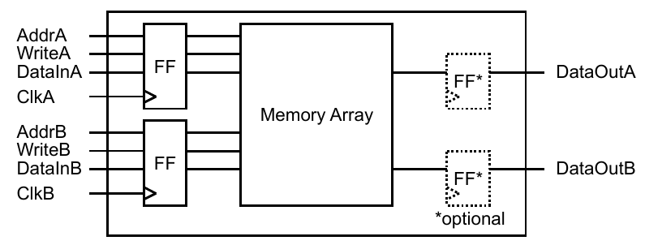
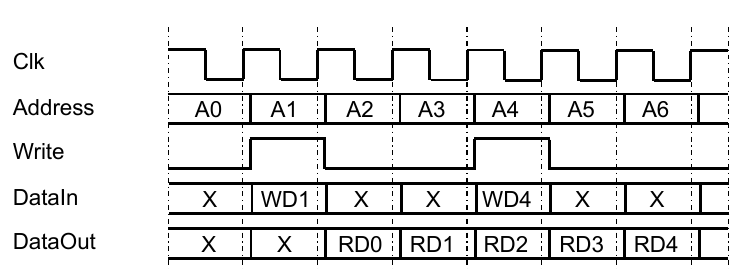

.. _FRAMEWORK/VCDevelopers:

OSVVM Verification Component Developer's Guide
##############################################

.. _FRAMEWORK/VCDevelopers/Overview:

Overview
********

This guide explores writing a verification component (VC) for a :vhdlcode:`DpRam` controller interface. The signaling on
the :vhdlcode:`DpRam` controller is quite simple. This allows the focus to be on the aspects of creating an OSVVM style
VC.

Be sure to read the OSVVM's Structured Testbench Framework Guide first. This guide provides you with the background to
the overall structure of OSVVM's testbench and where verification components fit in.

.. _FRAMEWORK/VCDevelopers/Step1IdentifyTheTransactionsSupportedByTheInterface:

Step 1: Identify the Transactions Supported by the Interface
************************************************************

Writing an OSVVM VC starts by looking at the interface we want to drive. In this guide, we will test the OSVVM
:vhdlcode:`DpRam` block. This :vhdlcode:`DpRam` is similar to the memory models provided by FPGAs – such as Xilinx's
BRAM.

The :vhdlcode:`DpRam` has two identical interfaces (hence Dual Port) that can both write or read from the interface. A
block diagram for the :vhdlcode:`DpRam` is shown in :ref:`Figure 1 <FRAMEWORK/VCDevelopers/Figure1>`. It has registers
on all input signals (:vhdlcode:`AddrX`, :vhdlcode:`DataX`, and :vhdlcode:`WriteX`) and optionally has a register on the
output :vhdlcode:`DataOutX`.

   Figure 1. DpRam structure

A timing diagram for the interface is shown in :ref:`Figure 2 <FRAMEWORK/VCDevelopers/Figure2>`. A write operation
starts by presenting the Address (:vhdlcode:`AddrX`), Data (:vhdlcode:`DataInX`), and the Write indicator
(:vhdlcode:`WriteX`). On the next rising edge of clock, the write operation is completed. A read operation starts by
presenting Address (:vhdlcode:`AddrX`). On the next rising edge of clock the Address is accepted and read data
(:vhdlcode:`DataOutX`) is available.

It has registers on all input signals (:vhdlcode:`AddrX`, :vhdlcode:`DataX`, and :vhdlcode:`WriteX`) and optionally has
a register on the output :vhdlcode:`DataOutX`.

   Figure 2. DpRam Timing Diagram

From a transaction point of view, OSVVM classifies interfaces that support address and data as an Address Bus interface.
This interface supports a Write and a Read operation. Depending on the FPGA, it can also support a Write and Read of the
same address. What you get on that read will depend on the FPGA target and configuration of the DPRAM for that target.
For our purposes, the DPRAM provides the value that was in the RAM before the write operation started.

.. _FRAMEWORK/VCDevelopers/Step2MapTheVCTransactionsToOSVVMMIT:

Step 2: Map the VC transactions to OSVVM MIT
********************************************

To simplify VC development, OSVVM provides model independent transactions for Address Bus and Streaming interfaces that
are intended to support a superset of the transactions that you need to implement in your VC.

We are in luck, the OSVVM Address Bus Model Independent Transactions support all the transactions needed in our
interface. They are shown in :ref:`Figure 3 <FRAMEWORK/VCDevelopers/Figure3>`.

.. code-block:: VHDL
   :caption: Figure 3. Address Bus Model Independent Transactions (a subset)
   :name: FRAMEWORK/VCDevelopers/Figure3

   Write(TRec, iAddr, iData, [MsgOn])

   Read(TransactionRec, iAddr, oData, [StatusMsgOn])

   ReadCheck(TransactionRec, iAddr, iData, [StatusMsgOn])

   WriteAndRead(TransactionRec, iAddr, iData, oData, [StatusMsgOn])

.. _FRAMEWORK/VCDevelopers/Step3CreateTheVerificationComponent:

Step 3: Create the Verification Component
*****************************************

We have choices with respect to the complexity of verification component that we write. The simplest VC we can write is
a blocking verification component. In this case, when a process in the test sequencer calls a transaction, that
transaction call blocks (does not return) until the VC is finished executing the transaction. Blocking VC are sufficient
for interfaces that only do one transaction at a time – such as a UART or AxiStream.

A more complex VC is an asynchronous VC. In this case, the test sequencer sends a transaction to the VC, but does not
wait for the VC to complete the transaction. This level of complexity is needed support an interface that supports
multiple independent operations at a time – such as an AXI4 interface where the Write Address, Write Data, Write
Response, Read Address, and Read Data aspects of the interface are all handled independently.

The choice of blocking vs asynchronous VC also impacts the structure of the test sequencer.

In the test sequencer, when we call transactions, we can either use multiple processes (OSVVM's preferred method) or use
a single process. Both have advantages and disadvantages. Independent of whether we use multiple processes or a single
process, test cases must be able to create simultaneous actions on independent interfaces – for example have activity on
two separate AXI4 interfaces start at the exact same clock cycle.

OSVVM prefers a test sequencer that uses a separate process (one for each independent VC – aka multiple processes) to
call transactions as it allows the usage of simpler blocking VC while at the same time supporting the ability to create
simultaneous actions on independent interfaces. The disadvantage is that to create a particular alignment of
transactions, we need to synchronize (align) the independent processes. To accomplish this OSVVM has created
synchronization primitives, such as :vhdlcode:`WaitForBarrier`, in the Utility library package :vhdlcode:`TbUtilPkg`.

For a test sequencer that uses a single process to call transactions, the VC must support asynchronous handling of the
transactions in order to support simultaneous actions on interfaces. Generally single process dispatch is more
complicated. Simple things that naturally require multiple clock cycles, like a read operation, must be refactored into
an asynchronous read address dispatch followed by one or more try read data operations (repeated until the data is
received). Going further when we start randomizing patterns on independent interfaces, it is much easier to do with
multiple processes.

In the OSVVM Verification Component Library all AXI (Axi4 Full, Axi4 Lite and AxiStream) VC support both blocking and
asynchronous transactions. For Axi4 this is a requirement of the interface. For all this means they can support either
multiple process or single process transaction dispatch.

Part 1 shows the creation the creation of a simple blocking VC for the :vhdlcode:`DpRamController`.

.. _FRAMEWORK/VCDevelopers/Part1CreateASimpleBlockingVC:

Part 1: Create a simple blocking VC
***********************************

If OSVVM were to have a "Lite" approach, this would be it. The structure for the :vhdlcode:`DpRamController` blocking VC
is shown in see :ref:`Figure 4 <FRAMEWORK/VCDevelopers/Figure4>`. This VC is an address bus VC, and hence, uses OSVVM's
Address Bus Model Independent Transactions.

.. code-block:: VHDL
   :caption: Figure 4. Blocking VC Structure
   :name: FRAMEWORK/VCDevelopers/Figure4
   :force:

   entity DpRamController is
     port (. . .) ;
   end entity DpRamController ;
   architecture blocking of DpRamController is

   TransctionHandler : process
   begin

      wait for Transaction(. . . ) ;
      case TransRec.Operation is
         when WRITE_OP =>        -- Do Write things
         when READ_OP =>         -- Do Read Things
         when …  =>              -- Do Model Directives
     end case
   end process TransactionHandler ;
   end architecture blocking ;

The remainder of this section creates the :vhdlcode:`DpRamController` VC piece by piece.

.. _FRAMEWORK/VCDevelopers/PackageReferences:

Package References
==================

:ref:`Figure 5 <FRAMEWORK/VCDevelopers/Figure5>` shows the package references for the :vhdlcode:`DpRamController`. The
library :vhdlcode:`osvvm_common` and its context reference supports usage of OSVVM's Model Independent Transactions. The
library :vhdlcode:`osvvm` and its context reference supports usage of the OSVVM Utility library. The IEEE library and
its package references support general VHDL modeling.

.. code-block:: VHDL
   :caption: Figure 5. Package References
   :name: FRAMEWORK/VCDevelopers/Figure5

   library ieee ;
     use ieee.std_logic_1164.all ;
     use ieee.numeric_std.all ;
     use ieee.numeric_std_unsigned.all ;
     use ieee.math_real.all ;

   library osvvm ;
     context osvvm.OsvvmContext ;

   library osvvm_common ;
     context osvvm_common.OsvvmCommonContext ;

.. _FRAMEWORK/VCDevelopers/DpRamControllerEntityInterface:

DpRamController Entity Interface
================================

The :vhdlcode:`DpRamController` entity interface has the DUT interface and a transaction record interface. This is shown
in :ref:`Figure 6 <FRAMEWORK/VCDevelopers/Figure6>`. The transaction record tells the VC what to do. For clocked
interfaces, each output changes after a propagation delay after clock rises. There is one generic of the form
:vhdlcode:`tpd_Clk_<output>` to specify a delay for each output.

.. code-block:: VHDL
   :caption: Figure 6. DpRamController Entity Interface
   :name: FRAMEWORK/VCDevelopers/Figure6

   entity DpRamController is
   generic (
     MODEL_ID_NAME    : string := "" ;
     DEFAULT_DELAY    : time   := 1 ns ;
     tpd_Clk_Address  : time   := DEFAULT_DELAY ;
     tpd_Clk_Write    : time   := DEFAULT_DELAY ;
     tpd_Clk_oData    : time   := DEFAULT_DELAY
   ) ;
   port (
     Clk         : In   std_logic ;
     nReset      : In   std_logic ;

     -- DpRam Functional Interface
     Address     : Out  std_logic_vector ;
     Write       : Out std_logic ;
     oData       : Out std_logic_vector ;
     iData       : In  std_logic_vector ;

     -- Address Bus Transaction Interface
     TransRec    : InOut AddressBusRecType
   ) ;

     -- Name for OSVVM Alerts
     constant MODEL_INSTANCE_NAME : string :=
       IfElse(MODEL_ID_NAME /= "",
           MODEL_ID_NAME, PathTail(to_lower(DpRamController'PATH_NAME))) ;

   end entity DpRamController ;

.. _FRAMEWORK/VCDevelopers/DeclareOneOrMoreAlertLogIDs:

Declare one or more AlertLogIDs
===============================

:vhdlcode:`AlertLogIDs` are used with self‐checking, error handling, and message filtering (see :vhdlcode:`AlertLogPkg`
User Guide for details). All OSVVM VC declare a signal :vhdlcode:`ModelID` of :vhdlcode:`AlertLogIDType` as the primary
error handling and message filtering ID for this VC. Naming the signal :vhdlcode:`ModelID` is a naming convention and is
not required – but does simplify copying code between VC if/when necessary. Additional IDs can be used to further
identify the source of errors or messages within a VC.

Using a signal as shown in :ref:`Figure 7 <FRAMEWORK/VCDevelopers/Figure7>` is the long way to do this. Many simulators
allow you to declare :vhdlcode:`ModelID` as a constant and directly initialize it with the value from :vhdlcode:`NewID`.
Unfortunately, the current version of the language does not permit this.

.. code-block:: VHDL
   :caption: Figure 7. Declaring and Initializing the AlertLogID
   :name: FRAMEWORK/VCDevelopers/Figure7

    architecture SimpleBlocking of DpRamController is
     signal ModelID : AlertLogIDType ;
   begin
     Initialize : process
     begin
       ModelID <= NewID(MODEL_INSTANCE_NAME) ;
       wait ;
     end process Initialize ;

.. _FRAMEWORK/VCDevelopers/AnatomyOfTheTransactionHandler:

Anatomy of the TransactionHandler
=================================

The :vhdlcode:`TransactionHandler` process decodes commands from the test sequencer and executes them. The basic
structure has a call to :vhdlcode:`WaitForTransaction` and then a case statement to decode the operation. In the body of
the case target are interface actions that are specific to the interface. See
:ref:`Figure 8 <FRAMEWORK/VCDevelopers/Figure8>`.

.. code-block:: VHDL
   :caption: Figure 8. Basic Transaction Handler
   :name: FRAMEWORK/VCDevelopers/Figure8
   :force:

   TransctionHandler : process
   begin
     WaitForTransaction(
       Clk      => Clk,
       Rdy      => TransRec.Rdy,
       Ack      => TransRec.Ack
     ) ;
     Operation := TransRec.Operation ;
     case TransRec.Operation is
       when WRITE_OP =>        -- Do Write things
       when READ_OP =>         -- Do Read Things
       when …  =>              -- Do Model Directives
     end case ;
   end process TransactionHandler ;

The :vhdlcode:`WaitForTransaction` does the handshaking with the test sequencer and causes the process to wait until a
transaction is available. It requires :vhdlcode:`Clk` and the two handshaking signals :vhdlcode:`Rdy` (driven by the
sequencer) and :vhdlcode:`Ack` (driven by the VC). Both :vhdlcode:`Rdy` and :vhdlcode:`Ack` are in the transaction
record. After checking :vhdlcode:`Rdy` and :vhdlcode:`Ack`, if the process is not aligned to clock,
:vhdlcode:`WaitForTransaction` ensures that it is.

The case statement decodes the operation field that is in the transaction record.

If the process needs to initialize interface outputs, add an assignment to the outputs at the beginning of the process
and put the repetitive part of the process into a "loop – end loop;". This is shown in
:ref:`Figure 9 <FRAMEWORK/VCDevelopers/Figure9>`.

.. code-block:: VHDL
   :caption: Figure 9. Transaction Handler with Initializations at the beginning.
   :name: FRAMEWORK/VCDevelopers/Figure9
   :force:

   TransctionHandler : process
   begin
     -- Initialize Outputs
     Address     <= (others => 'X') ;
     Write       <= 'X' ;
     oData       <= (others => 'X') ;

     loop
       wait for Transaction(. . . ) ;
       case TransRec.Operation is
         when WRITE_OP =>        -- Do Write things
         when READ_OP =>         -- Do Read Things
         when …  =>              -- Do Model Directives
       end case ;
     end loop ;
   end process TransactionHandler ;

.. _FRAMEWORK/VCDevelopers/CreatingTheWriteOperation:

Creating the Write Operation
============================

The Write Operation implements the interface behavior for a write cycle. When :vhdlcode:`WaitForTransaction` exits, the
VC will be aligned to the rising edge of clock. :vhdlcode:`Address` and :vhdlcode:`oData` will be driven aligned to
clock with a propagation delay specified by the output timing generics (:vhdlcode:`tpd_Clk_<output>`). See
:ref:`Figure 10 <FRAMEWORK/VCDevelopers/Figure10>`.

The Address for the write operation is in the :vhdlcode:`Address` field of the transaction record.
:vhdlcode:`SafeResize` is used to optionally resize the value as well as convert from the type used in the record
(:vhdlcode:`osvvm.ResolutionPkg.std_logic_vector_max`) to :vhdlcode:`std_logic_vector`. Write data is in the
:vhdlcode:`DataToModel` field of the transaction record.

.. code-block:: VHDL
   :caption: Figure 10. Write Transaction Implementation
   :name: FRAMEWORK/VCDevelopers/Figure10

   when WRITE_OP =>
     Address <= SafeResize(TransRec.Address, Address'length) after tpd_Clk_Address ;
     oData   <= SafeResize(TransRec.DataToModel, oData'length) after tpd_Clk_oData ;
     Write   <= '1' after tpd_Clk_Write ;

     WaitForClock(Clk) ;
     Log( . . . ) ; -- shown below
     Address <= not Address after tpd_Clk_Address ;
     oData   <= not oData    after tpd_Clk_oData ;
     Write   <= '0' after tpd_Clk_Write ;

In a "Lite" based approach that implements interface behavior in procedures, the above code is the same code that would
be in the procedure. Hence, writing a simple blocking VC is no more complex than writing a subprogram.

Logs are messages that provide feedback about what is happening in the VC. Logs are different from ordinary printing in
that they can be filtered – meaning enabled or disabled by the test sequencer. Logs should be placed where they give
information about what the VC is currently doing – such as this one which is at the point where the write operation is
acted upon by the :vhdlcode:`DpRam`. The details of the log are shown in
:ref:`Figure 11 <FRAMEWORK/VCDevelopers/Figure11>`. For details on Alert, Affirm, and Log please see the
:vhdlcode:`AlertLogPkg` Users Guide. The final parameter to :vhdlcode:`Log` below is the transaction enable for the log.
This allows the Log to be enabled for a single transaction without having to enable and then disable it.

.. code-block:: VHDL
   :caption: Figure 11. Details of the Call to Log.
   :name: FRAMEWORK/VCDevelopers/Figure11

   Log( ModelID,
     "Write Operation, Address: " & to_hxstring(Address) &
     "  Data: " & to_hxstring(oData) &
     "  Operation# " & to_string (TransRec.Rdy)
     INFO,
     TransRec.StatusMsgOn
   ) ;

.. _FRAMEWORK/VCDevelopers/CreatingTheReadOperation:

Creating the Read Operation
===========================

The read operation, shown :ref:`Figure 12 <FRAMEWORK/VCDevelopers/Figure12>`, is similar to the write operation except
we have to wait one to two clock cycles for the data to be available. The current :vhdlcode:`DpRamController` only waits
for one clock cycle (and hence ignores the extra optional register on the output of the :vhdlcode:`DpRam`). Read data is
returned to the test sequencer in the :vhdlcode:`DataFromModel` field of the transaction record. This version of
:vhdlcode:`SafeResize` optionally resizes the data value as well as converts from :vhdlcode:`std_logic_vector` to the
type used in the record (:vhdlcode:`osvvm.ResolutionPkg.std_logic_vector_max`).

.. code-block:: VHDL
   :caption: Figure 12. Read Transaction Implementation
   :name: FRAMEWORK/VCDevelopers/Figure12

   when READ_OP  | READ_CHECK =>
     Address <= SafeResize(TransRec.Address, Address'length) after tpd_Clk_Address ;
     Write   <= '0' after tpd_Clk_Write ;

     WaitForClock(Clk) ;
     Address <= not Address after tpd_Clk_Address ;

     WaitForClock(Clk) ;

     TransRec.DataFromModel <= SafeResize(iData, TransRec.DataFromModel'length) ;
     Log( . . . ) ;

The Log for a simple read transaction is the same as the Log for the write operation shown previously.

.. _FRAMEWORK/VCDevelopers/CreatingDirectiveTransactions:

Creating Directive Transactions
===============================

A directive transaction communicates with the verification component but does not result in any actions on the DUT
interface. Common directive transactions for OSVVM include, :vhdlcode:`WaitForClock`, :vhdlcode:`GetAlertLogID`, and
:vhdlcode:`WaitForTransaction`. :vhdlcode:`WaitForClock` stops the VC for the specified number of clocks.
:vhdlcode:`GetAlertLogID` looks up the :vhdlcode:`AlertLogID` of the VC and returns it. :vhdlcode:`WaitForTransaction`
waits for any pending transactions to complete and returns – in a blocking model, this does nothing because there all
transactions complete. Implementation of these transactions is shown in
:ref:`Figure 13 <FRAMEWORK/VCDevelopers/Figure13>`.

.. code-block:: VHDL
   :caption: Figure 13. Implementation of Directive Transactions
   :name: FRAMEWORK/VCDevelopers/Figure13

   when WAIT_FOR_CLOCK =>
     WaitForClock(Clk, TransRec.IntToModel) ;

   when GET_ALERTLOG_ID =>
     TransRec.IntFromModel <= integer(ModelID) ;

   when WAIT_FOR_TRANSACTION =>
     null ;

.. _FRAMEWORK/VCDevelopers/DetectingMultipleDrivers:

Detecting Multiple Drivers
==========================

When writing tests, it is natural to copy a piece of code from one process to another. It is common to forget to change
the transaction record name to the one for the current process. As a result, a transaction record can end up with two
processes in the test sequencer driving it. When the resolution function used for the operation field detects more than
one operation being driven, it resolves (changes) the operation to :vhdlcode:`MULTIPLE_DRIVER_DETECT`.

It is best practice for the model to decode the :vhdlcode:`MULTIPLE_DRIVER_DETECT` and produce an appropriate FAILURE
message. The implementation of multiple driver detect is shown in :ref:`Figure 14 <FRAMEWORK/VCDevelopers/Figure14>`.

.. code-block:: VHDL
   :caption: Figure 14. Implementation of Multiple Driver Detect
   :name: FRAMEWORK/VCDevelopers/Figure14

   when MULTIPLE_DRIVER_DETECT =>
     Alert(ModelID, MODEL_NAME & ": Multiple Drivers on Transaction Record." &
                    "  Transaction # " & to_string(TransRec.Rdy), FAILURE) ;

.. _FRAMEWORK/VCDevelopers/CatchingUnusedTransactions:

Catching Unused Transactions
============================

A VC is not required to implement all transactions that are supported by OSVVM Address Bus Model Independent
Transactions. It is best practice to produce an appropriate FAILURE message when an unsupported transaction is received.
This is shown in :ref:`Figure 15 <FRAMEWORK/VCDevelopers/Figure15>`.

.. code-block:: VHDL
   :caption: Figure 15. Catching and Signaling Unused Transactions
   :name: FRAMEWORK/VCDevelopers/Figure15

   when others =>
     Alert(ModelID, "Transaction " & to_string(Operation) &
                    " is not implemented by the DpRamController VC", FAILURE) ;

.. _FRAMEWORK/VCDevelopers/TheFinalDesign:

The Final Design
================

The final design can be found in the file :file:`DpRamController_Blocking.vhd` in the directory
:file:`OsvvmLibraries/DpRam/src`.

.. _FRAMEWORK/VCDevelopers/OSVVMBlockingVCVsALiteApproach:

OSVVM Blocking VC vs a "Lite" Approach
**************************************

Some VHDL "Lite" based approaches implement the interface behavior in procedures rather than using an entity – like
OSVVM's blocking VC. The thought is that it is easier. With OSVVM we have reduced the effort in creating the
verification approach so that the code in OSVVM's blocking VC is no more complex than writing a procedure.

With incremental learning and coding an OSVVM blocking VC can be transformed into a VC that supports asynchronous
transactions. The blocking VC can even be used temporarily in the test case generation until the VC that supports
asynchronous transactions is done.

.. _FRAMEWORK/VCDevelopers/Part2SupportingAsynchronousTransactions:

Part 2: Supporting Asynchronous Transactions
********************************************

Some interfaces, such as this one, allow multiple things to be going on at a time. For example, what happens when we do
a read address 1 followed by a write address 2. The interface allows the write address 2 to start on the clock
immediately after starting the read address 1 operation, such that due to latencies in the system, both will finish at
the same time. With blocking transactions, the read address 1 is required to finish before the write address 2 can
start. This leaves a dead cycle on the interface.

Writing a full example of this for the :vhdlcode:`DpRamController` is an activity for another day. For now, both the
AxiStream and Axi4 FULL support this capability. AxiStream can be found in the files :file:`AxiStreamTransmitter.vhd`
and :file:`AxiStreamReceiver.vhd` in the directory :file:`OsvvmLibraries/AXI4/AxiStream/src`. Axi4 Full can be found in
the directory :file:`OsvvmLibraries/AXI4/Axi4/src`.

This information can also be found in SynthWorks' class, Advanced VHDL Testbenches and Verification.

.. _FRAMEWORK/VCDevelopers/RunningTheExamples:

Running the Examples
********************

See the steps in the OSVVM Overview guide for running the OSVVM demos. Do the steps shown in
:ref:`Figure 16 <FRAMEWORK/VCDevelopers/Figure16>` in your simulator. :file:`StartUp.tcl` needs to be sourced each time
you start the simulator. See the Script User Guide for additional details for Aldec's ActiveHDL, GHDL, Synopsys VCS, and
Cadence Xcelium.

.. code-block:: tcl
   :caption: Figure 16. Compiling and Running DPRAM tests
   :name: FRAMEWORK/VCDevelopers/Figure16

   cd sim
   source ../OsvvmLibraries/Scripts/StartUp.tcl
   build  ../OsvvmLibraries/OsvvmLibraries.pro
   build  ../OsvvmLibraries/DpRam/RunAllTests.pro

.. _FRAMEWORK/VCDevelopers/Summary:

Summary
*******

In OSVVM, a verification component is nothing more than behavioral code. The busy work steps of creating a transaction
API and interface are taken care of by OSVVM's Model Independent. OSVVM's approach is similar enough to RTL that an
engineer can easily do both RTL and verification tasks.
