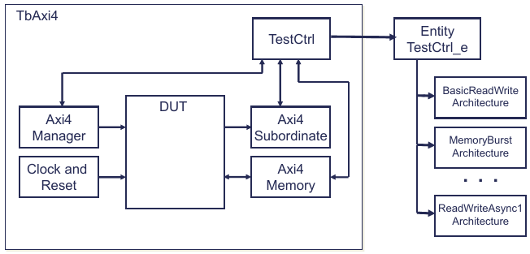
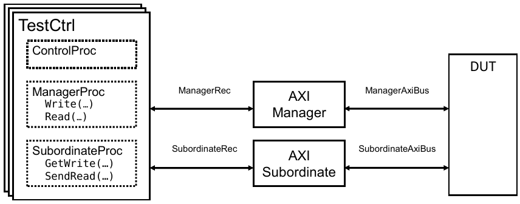
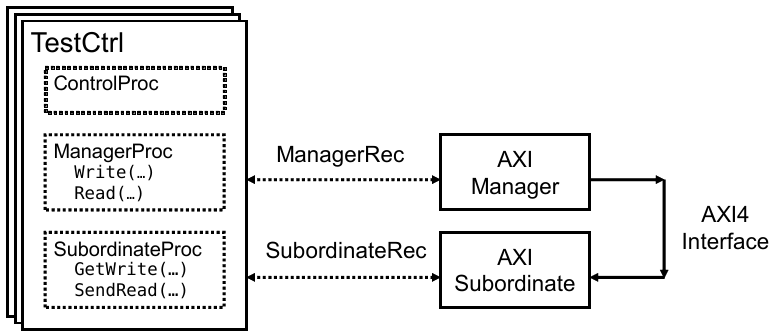
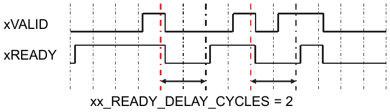
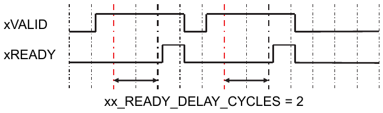

.. _VC/Axi4:

AXI4 Verification Components
############################

.. _VC/Axi4/TerminologyManagerAndSubordinate:

Terminology: Manager and Subordinate
************************************

OSVVM AXI4 VCs and this document use the more recent AXI terminology, Manager and Subordinate. An AXI Manager is the
agent that initiates transactions, and a Subordinate is the agent that receives and responds to requests.

.. _VC/Axi4/Overview:

Overview
********

The OSVVM AXI4 Verification Components (VCs) facilitate testing the interface and functionality of AXI4 devices. The
OSVVM AXI4 VCs include :vhdlcode:`Axi4Manager`, :vhdlcode:`Axi4Subordinate`, and :vhdlcode:`Axi4Memory`. These VCs are
intended to be part of a structured test environment.

The AXI4 Manager verification component implements the complete AXI4 Manager interface capability. It supports both
single word and burst transfers. For bursting it uses the :vhdlcode:`BurstFifos` in :vhdlcode:`AddressBusRecType`. The
signals :vhdlcode:`xAddr`, :vhdlcode:`xData`, :vhdlcode:`xStrb`, :vhdlcode:`xLen`, :vhdlcode:`xLast`,
:vhdlcode:`xValid`, and :vhdlcode:`xReady`, are set on a transaction-by-transaction basis. The signals :vhdlcode:`xID`,
:vhdlcode:`xSize`, :vhdlcode:`xBurst`, :vhdlcode:`xLock`, :vhdlcode:`xCache`, :vhdlcode:`xProt`, :vhdlcode:`xQOS`,
:vhdlcode:`xRegion`, :vhdlcode:`xUser`, and :vhdlcode:`xResp` are set using values inside the model.

The :vhdlcode:`Axi4Subordinate` is a transaction-based Subordinate. The :vhdlcode:`Axi4Memory` is a memory Subordinate
that responds to operations on the :vhdlcode:`AxiBus` inteface.

The :vhdlcode:`Axi4Memory` responds to AXI4 accesses on :vhdlcode:`AxiBus` by either writing to or reading from its
internal memory data structure (see OSVVM’s :vhdlcode:`MemoryGenericPkg`). It handles both AXI4 single word and burst
transfers. For bursting, it currently only handles incrementing bursts. The memory spans the complete address range of
the verification component. :vhdlcode:`MemoryPkg` currently limits the memory address to 40 bits.

In addition to the AXI4 bus interface (connected to the DUT), the :vhdlcode:`Axi4Memory` also supports a transaction
interface (:vhdlcode:`TransRec`) to the test sequencer (:vhdlcode:`TextCtrl`) that provides a "backdoor"
(non-functional) transaction interface to the memory. This interface accesses the memory contents on a delta cycle
basis.

The :vhdlcode:`Axi4Subordinate` verification component is a transaction-based component which allows the test sequencer
to program an arbitrary sequence of responses. Currently the :vhdlcode:`Axi4Subordinate` only supports AXI4 single word
transfers – primarily since burst transfers are handled by the :vhdlcode:`Axi4Memory`.

For the test case programming API (used in a test sequencer), the AXI4 VCs support the complete set of OSVVM Address Bus
Model Independent Transactions. Using this interface ensures uniformity and consistency with other OSVVM VCs and
improves verification test case reuse.

We are going to start with a brief overview and a demo of the AXI4 test environment.

PDF documents referenced in this document are in the directory :file:`OsvvmLibraries/Documentation`.

.. _VC/Axi4/OSVVMTestbenchArchitecture:

OSVVM Testbench Architecture
****************************

.. _VC/Axi4/TestArchitectureOverview:

Test Architecture Overview
==========================

The objective of any verification framework is to make the Device Under Test (DUT) "feel like" it has been plugged into
the board. Hence, the framework must be able to produce the same waveforms and sequence of waveforms that the DUT will
see on the board.

The OSVVM testbench framework looks identical to other frameworks, including SystemVerilog. It includes verification
components (:vhdlcode:`Axi4Manager`, :vhdlcode:`Axi4Subordinate`, and :vhdlcode:`Axi4Memory`) and :vhdlcode:`TestCtrl`
(the test sequencer) as shown in :ref:`Figure 1 <VC/Axi4/Figure1>`. The top level of the testbench connects the
components together (using the same methods as in RTL design) and is often called a test harness. Connections between
the verification components and :vhdlcode:`TestCtrl` use VHDL records (which we call the transaction interface).
Connections between the verification components and the DUT are the DUT interfaces (such as AxiStream, UART, AXI4, SPI,
and I2C).

   Figure 1. OSVVM Testbench Framework

.. _VC/Axi4/WritingTests:

Writing Tests
=============

Writing tests is all about creating waveforms at an interface. In a basic test approach, each test directly drives and
wiggles interface waveforms. This is tedious and error prone.

In OSVVM, signal wiggling is replaced by transactions. A transaction is an abstract representation of an interface
waveform (such as :vhdlcode:`Write`) or a directive to the VC (such as wait for clock). A transaction is initiated using
a procedure call. In a VC based approach, the procedure call collects the transaction information and passes it to the
Axi4 VCs via a transaction interface (a record). The Axi4 VC then decodes this information and creates the corresponding
interface waveforms.

Using transactions simplifies creating tests and increases their readability. :ref:`Figure 2 <VC/Axi4/Figure2>` shows
calls to the :vhdlcode:`Write`, :vhdlcode:`Read`, and :vhdlcode:`ReadCheck` transactions for an :vhdlcode:`Axi4Manager`
VC. In this test, the responses are provided by an :vhdlcode:`Axi4Memory` VC. Note that in the calls to
:vhdlcode:`Write`, :vhdlcode:`Read`, and :vhdlcode:`ReadCheck` that the size of the data parameter determines the
maximum size of the transactions on the interface.

.. code-block:: VHDL
   :caption: Figure 2. Calls to Axi4Manager Write, Read, and ReadCheck Transactions
   :name: VC/Axi4/Figure2

   ManagerProc : process
   Begin
       . . .
       log("Write and Read with ByteAddr = 0, 4 Bytes") ;
       Write(ManagerRec, X"0000_0000", X"5555_5555" ) ;
       Read(ManagerRec,  X"0000_0000", Data) ;
       AffirmIfEqual(Data, X"5555_5555", "Super Read Data: ") ;

       log("Write and Read with 1 Byte, and ByteAddr = 1") ;
       Write(ManagerRec, X"0000_0011", X"22" ) ;
       ReadCheck(ManagerRec, X"0000_0011", X"22" ) ;

       log("Write and Read with 3 Bytes and ByteAddr = 0") ;
       Write(ManagerRec, X"0000_0050", X"33_2211" ) ;
       ReadCheck(ManagerRec, X"0000_0050", X"33_2211" ) ;

.. _VC/Axi4/AddressBusTransactionInterface:

Address Bus Transaction Interface
=================================

Each Axi4 Verification Component receives transactions from the test sequencer via a Transaction Interface. OSVVM
implements the transaction interface as a record.

:vhdlcode:`AddressBus` Transaction Interface, :vhdlcode:`AddressBusRecType`, is used to connect the verification
component to :vhdlcode:`TestCtrl`. :vhdlcode:`AddressBusRecType`, shown in :ref:`Figure 3 <VC/Axi4/Figure3>`, is defined
in the Address Bus Model Independent Transaction package, :file:`AddressBusTransactionPkg.vhd`, which is in the
directory :file:`OsvvmLbraries/Common/Src`.

.. code-block:: VHDL
   :caption: Figure 3. AddressBusRecType
   :name: VC/Axi4/Figure3

   type AddressBusRecType is record
     -- Handshaking controls
     --   Used by RequestTransaction in the Transaction Procedures
     --   Used by WaitForTransaction in the Verification Component
     --   RequestTransaction and WaitForTransaction are in osvvm.TbUtilPkg
     Rdy                : RdyType ;
     Ack                : AckType ;
     -- Transaction Type
     Operation          : AddressBusOperationType ;
     -- Address to verification component and its width
     -- Width may be smaller than Address
     Address            : std_logic_vector_max_c ;
     AddrWidth          : integer_max ;
     -- Data to and from the verification component and its width.
     -- Width will be smaller than Data for byte operations
     -- Width size requirements are enforced in the verification component
     DataToModel        : std_logic_vector_max_c ;
     DataFromModel      : std_logic_vector_max_c ;
     DataWidth          : integer_max ;
     -- Burst FIFOs
     WriteBurstFifo     : ScoreboardIdType ;
     ReadBurstFifo      : ScoreboardIdType ;
     -- StatusMsgOn provides transaction messaging override.
     -- When true, print transaction messaging independent of
     -- other verification based based controls.
     StatusMsgOn        : boolean_max ;
     -- Verification Component Options Parameters - used by SetModelOptions
     IntToModel         : integer_max ;
     IntFromModel       : integer_max ;
     BoolToModel        : boolean_max ;
     BoolFromModel      : boolean_max ;
     -- Verification Component Options Type
     Options            : integer_max ;
   end record AddressBusRecType ;

Note that :vhdlcode:`Address`, :vhdlcode:`DataToModel`, and :vhdlcode:`DataFromModel` are unconstrained. Hence, when
they are used in a signal declaration they must be constrained. :vhdlcode:`Address` needs to be sized to match the
maximum (:vhdlcode:`AWADDR'length`, :vhdlcode:`ARADDR'length`). :vhdlcode:`DataToModel` and :vhdlcode:`DataFromModel`
need to be sized to match the maximum(:vhdlcode:`WDATA'length`, :vhdlcode:`RDATA'length`).

:ref:`Figure 4 <VC/Axi4/Figure4>` shows the declaration :vhdlcode:`ManagerRec` (which connects the
:vhdlcode:`Axi4Manager` to :vhdlcode:`TestCtrl`) and :vhdlcode:`SubordinateRec` (which connects the
:vhdlcode:`Axi4Subordinate` to :vhdlcode:`TestCtrl`).

.. code-block:: VHDL
   :caption: Figure 4. ManagerRec and SubordinateRec
   :name: VC/Axi4/Figure4

   signal ManagerRec, SubordinateRec  : AddressBusRecType(
           Address      (AXI_ADDR_WIDTH-1 downto 0),
           DataToModel  (AXI_DATA_WIDTH-1 downto 0),
           DataFromModel(AXI_DATA_WIDTH-1 downto 0)
         ) ;

.. _VC/Axi4/AxiBusAxi4RecType:

AxiBus : Axi4RecType
====================

:vhdlcode:`AxiBus` is defined as a record of type :vhdlcode:`Axi4RecType`, shown in :ref:`Figure 5 <VC/Axi4/Figure5>` is
defined in the package :file:`Axi4InterfacePkg.vhd` which is in the directory :file:`OsvvmLbraries/AXI4/common/src`.

.. code-block:: VHDL
   :caption: Figure 5. Axi4BaseRecType
   :name: VC/Axi4/Figure5

   type Axi4WriteAddressRecType is record
     -- AXI4 Lite
     Addr      : std_logic_vector ;
     Prot      : Axi4ProtType ;
     Valid     : std_logic ;
     Ready     : std_logic ;
     -- AXI4 Full
     -- User Config - AXI recommended 3:0 for Manager, 7:0 at slave
     ID        : std_logic_vector ;
     -- BurstLength = AxLen+1.  AXI4: 7:0,  AXI3: 3:0
     Len       : std_logic_vector(7 downto 0) ;
     -- #Bytes in transfer = 2**AxSize
     Size      : std_logic_vector(2 downto 0) ;
     -- AxBurst Binary Encoded (Fixed, Incr, Wrap, NotDefined)
     Burst     : std_logic_vector(1 downto 0) ;
     Lock      : std_logic ;
     -- AxCache bits (Write-Allocate, Read-Allocate, Modifiable, Bufferable)
     Cache     : std_logic_vector(3 downto 0) ;
     QOS       : std_logic_vector(3 downto 0) ;
     Region    : std_logic_vector(3 downto 0) ;
     User      : std_logic_vector ; -- User Config
   end record Axi4WriteAddressRecType ;

   type Axi4WriteDataRecType is record
     -- AXI4 Lite
     Data       : std_logic_vector ;
     Strb       : std_logic_vector ;
     Valid      : std_logic ;
     Ready      : std_logic ;
     -- AXI 4 Full
     Last       : std_logic ;
     User       : std_logic_vector ;
     -- AXI3
     ID         : std_logic_vector ;
   end record Axi4WriteDataRecType ;

   type Axi4WriteResponseRecType is record
     -- AXI4 Lite
     Valid      : std_logic ;
     Ready      : std_logic ;
     Resp       : Axi4RespType ;
     -- AXI 4 Full
     ID         : std_logic_vector ;
     User       : std_logic_vector ;
   end record Axi4WriteResponseRecType ;

   type Axi4ReadAddressRecType is record
     -- AXI4 Lite
     Addr      : std_logic_vector ;
     Prot      : Axi4ProtType ;
     Valid     : std_logic ;
     Ready     : std_logic ;
     -- AXI 4 Full
     -- User Config - AXI recommended 3:0 for Manager, 7:0 at slave
     ID        : std_logic_vector ;
     -- BurstLength = AxLen+1.  AXI4: 7:0,  AXI3: 3:0
     Len       : std_logic_vector(7 downto 0) ;
     -- #Bytes in transfer = 2**AxSize
     Size      : std_logic_vector(2 downto 0) ;
     -- AxBurst Binary Encoded (Fixed, Incr, Wrap, NotDefined)
     Burst     : std_logic_vector(1 downto 0) ;
     Lock      : std_logic ;
     -- AxCache bits (Write-Allocate, Read-Allocate, Modifiable, Bufferable)
     Cache     : std_logic_vector(3 downto 0) ;
     QOS       : std_logic_vector(3 downto 0) ;
     Region    : std_logic_vector(3 downto 0) ;
     User      : std_logic_vector ; -- User Config
   end record Axi4ReadAddressRecType ;

   type Axi4ReadDataRecType is record
     -- AXI4 Lite
     Data       : std_logic_vector ;
     Resp       : Axi4RespType ;
     Valid      : std_logic ;
     Ready      : std_logic ;
     -- AXI 4 Full
     Last       : std_logic ;
     User       : std_logic_vector ;
     ID         : std_logic_vector ;
   end record Axi4ReadDataRecType ;

   type Axi4BaseRecType is record
     WriteAddress   : Axi4WriteAddressRecType ;
     WriteData      : Axi4WriteDataRecType ;
     WriteResponse  : Axi4WriteResponseRecType ;
     ReadAddress    : Axi4ReadAddressRecType ;
     ReadData       : Axi4ReadDataRecType ;
   end record Axi4BaseRecType ;

   alias Axi4RecType is Axi4BaseRecType ;

:ref:`Figure 6 <VC/Axi4/Figure6>` shows the declaration :vhdlcode:`AxiBus`. The numerous unconstrained elements of
:vhdlcode:`Axi4BaseRecType` are constrained in the signal declaration.

.. code-block:: VHDL
   :caption: Figure 6. AxiBus
   :name: VC/Axi4/Figure6

   signal   AxiBus : Axi4RecType(
     WriteAddress(
       Addr(AXI_ADDR_WIDTH-1 downto 0),
       ID  (7 downto 0),
       User(7 downto 0)
     ),
     WriteData   (
       Data(AXI_DATA_WIDTH-1 downto 0),
       Strb(AXI_STRB_WIDTH-1 downto 0),
       User(7 downto 0),
       ID  (7 downto 0)
     ),
     WriteResponse(
       ID  (7 downto 0),
       User(7 downto 0)
     ),
     ReadAddress (
       Addr(AXI_ADDR_WIDTH-1 downto 0),
       ID  (7 downto 0),
       User(7 downto 0)
     ),
     ReadData    (
       Data(AXI_DATA_WIDTH-1 downto 0),
       ID  (7 downto 0),
       User(7 downto 0)
     )
   ) ;

.. _VC/Axi4/Axi4ContextDeclaration:

Axi4 Context Declaration
========================

To simplify the usage of OSVVM AXI4 packages, a context declaration that references all of the OSVVM AXI4 packages is
provided. Using a context declaration allows the packages to be refactored without impacting the designs that reference
the packages using the context. :ref:`Figure 7 <VC/Axi4/Figure7>` shows the :vhdlcode:`Axi4Context` as defined in
:file:`Axi4Context.vhd`.

.. code-block:: VHDL
   :caption: Figure 7. Axi4Context
   :name: VC/Axi4/Figure7

   context Axi4Context is
       library osvvm_common ;
       context osvvm_common.OsvvmCommonContext; -- Address Bus Transactions

       library osvvm_axi4 ;
       use osvvm_axi4.Axi4CommonPkg.all ;       -- AXI handshaking
       use osvvm_axi4.Axi4InterfacePkg.all ;    -- Interface definition
       use osvvm_axi4.Axi4OptionsPkg.all ;      -- Model parameters
       use osvvm_axi4.Axi4ModelPkg.all ;        -- Model support

       use osvvm_axi4.Axi4ComponentPkg.all ;    -- Port Based Interface
       use osvvm_axi4.Axi4ComponentVtiPkg.all ; -- Virtual Interface

       -- Package of aliases to maintain compatibility with the past
       use osvvm_axi4.Axi4VersionCompatibilityPkg.all ;
   end context Axi4Context ;

.. _VC/Axi4/ComponentDeclarationsForAxi4VerificationComponents:

Component Declarations for Axi4 Verification Components
=======================================================

OSVVM prefers to use component instances. One good reason is they support configuration declarations and direct entity
instances do not.

To make usage of component instances easier than direct entity instances, component declarations for each verification
component is provided in a package and the package is referenced by :vhdlcode:`Axi4Context`.

.. _VC/Axi4/DemoPreparationGettingAndBuildingTheOSVVMLibraries:

Demo Preparation: Getting and Building the OSVVM Libraries
**********************************************************

OSVVM is available on GitHub at https://github.com/OSVVM as a git repository or at https://osvvm.org/downloads as a ZIP
file. Retrieve OSVVM from GitHub using git as shown in :ref:`Figure 8 <VC/Axi4/Figure8>`. Note that the "—recursive"
option is required since the OSVVM repositories are submodules of OsvvmLibraries. Submodules greatly simplify
development and deployment of the libraries.

.. code-block:: shell
   :caption: Figure 8. Retrieving OSVVM from GitHub
   :name: VC/Axi4/Figure8

   git clone --recursive https://github.com/OSVVM/OsvvmLibraries.git

Prior to starting the OSVVM scripting environment, create a directory named :file:`sim` in which to run your
simulations. Start your simulator and go to the :file:`sim` directory. Once there, use the steps in
:ref:`Figure 9 <VC/Axi4/Figure9>` to build the OSVVM Libraries (utility and verification component). These directions
are supported in Mentor QuestaSim/ModelSim or Aldec RivieraPRO. Aldec's ActiveHDL is also supported but requires a few
extra steps. For these steps and additional details of the OSVVM scripting environment see
:osvvmdoc:`Script_user_guide.pdf <Script_user_guide>` (in :file:`OsvvmLibraries/Documentation`).

.. code-block:: tcl
   :caption: Figure 9. Building (Compiling) OSVVM
   :name: VC/Axi4/Figure9

   cd sim
   source ../OsvvmLibraries/Scripts/StartUp.tcl
   build  ../OsvvmLibraries

The intent of the OSVVM scripting is to make compiling and running your simulations independent of the simulator you are
using. We hope to update the scripting environment to support Synopsys and Cadence tools in the first half of 2021.

GHDL can be run using tclsh. In windows, using MSYS2/MinGW64 start tclsh using "winpty tclsh".

.. _VC/Axi4/TbAxi4PortBasedInterface:

TbAxi4: Port Based Interface
****************************

In the OSVVM Port Based Interfaces approach, the transaction interfaces are record ports of the verification components
(VCs) and the test sequencer (:vhdlcode:`TestCtrl`). The testbench then simply connects the ports together using, just
like we do for RTL design. OSVVM and its predecessor within SynthWorks has used this transaction interface methodology
since 1997.

The OSVVM Port Based Interface approach works well when the testbench components are external to the device being
tested. OSVVM's Virtual Transaction Interfaces (see next section) provide a simplified means to connect to a
verification component that is internal to the design – such as an embedded processor core.

OSVVM components with Virtual Transaction Interfaces interoperate well with OSVVM components with Port Based Interfaces.

.. _VC/Axi4/TbAxi4PortBasedInterface/DemoRunningTheAXI4Testbenches:

Demo: Running the AXI4 Testbenches
==================================

Prior to doing this step, do the steps in section 3, Demo Preparation.

Use the steps in :ref:`Figure 10 <VC/Axi4/Figure10>` to compile and run the tests for the Axi4 verification components
in Mentor QuestaSim/ModelSim or Aldec RivieraPRO. If you have not exited the simulator, you only need to do the
":tclcode:`build`" step.

.. code-block:: tcl
   :caption: Figure 10. Compiling and Running OSVVM
   :name: VC/Axi4/Figure10

   cd sim
   do ../OsvvmLibraries/startup.tcl
   build ../OsvvmLibraries/AXI4/Axi4/RunDemoTests.pro

.. _VC/Axi4/TbAxi4Axi4TestEnvironmentPortBasedInterface:

TbAxi4: Axi4 Test Environment - Port Based Interface
====================================================

In the previous section, you ran the Axi4 Testbench (:file:`TbAxi4.vhd`). It is in the directory
:file:`OsvvmLibraries/AXI4/Axi4/testbench`. It is structured as shown in :ref:`Figure 11 <VC/Axi4/Figure11>`.

   Figure 11. TbAxi4

:vhdlcode:`TbAxi4` is a test harness that connects components together. In an RTL design, this code is also called
structural code or a netlist. A sketch of :file:`TbAxi4.vhd` is shown in :ref:`Figure 12 <VC/Axi4/Figure12>`. For more
details, see :file:`TbAxi4.vhd`. Note that OSVVM uses VHDL-2008 external names and the order of instantiation is
important. First instantiate the design under test, next the verification components, and then finally the test
sequencer (:vhdlcode:`TestCtrl`).

.. code-block:: VHDL
   :caption: Figure 12. A sketch of TbAxi4.vhd
   :name: VC/Axi4/Figure12
   :force:

   library osvvm_Axi4 ;
     context osvvm_axi4.Axi4Context ;
   . . .
   entity  TbAxi4  is
   end entity TbAxi4 ;
   architecture TestHarness of TbAxi4 is
     signal ManagerRec, SubordinateRec  : AddressBusRecType(
             Address      (AXI_ADDR_WIDTH-1 downto 0),
             DataToModel  (AXI_DATA_WIDTH-1 downto 0),
             DataFromModel(AXI_DATA_WIDTH-1 downto 0)
           ) ;
     signal AxiBus : Axi4RecType( . . . ) ;
     . . .
   begin
     osvvm.TbUtilPkg.CreateClock(Clk, tperiod_Clk) ;
     osvvm.TbUtilPkg.CreateReset(nReset, . . .) ;
     DUT :           Axi4PassThru    port map (…, …) ;
     Subordinate_1 : Axi4Subordinate port map (…, AxiBus, SubordinateRec) ;
     Manager_1 :     Axi4Manager     port map (…, AxiBus, ManagerRec);
     TestCtrl_1 :    TestCtrl        port map (nReset, ManagerRec, SubordinateRec) ;
   end TestHarness ;

By default, each OSVVM verification component uses its instance label as the name it reports when an alert or log within
the model is called. This allows each message to be tracked to a unique verification component. :vhdlcode:`AlertLogIDs`
can be looked up using this name, so picking a good instance label will simplify looking up the :vhdlcode:`AlertLogID`
for each verification component from the test sequencer (:vhdlcode:`TestCtrl`). These names can also be set by the
generic :vhdlcode:`MODEL_ID_NAME`. The only reason to do this is to allow verification components to share the same
:vhdlcode:`AlertLogID`.

We recommend using the ":vhdlcode:`ComponentName_1`". In this case we shortened the names to :vhdlcode:`Manager_1` and
:vhdlcode:`Subordinate_1`. Our intent is to reuse some of the same test cases with other Manager and Subordinate
verification components (such as Avalon and Wishbone) – and hence the more generic naming.

.. _VC/Axi4/TestCtrlEntityPortBasedInterface:

TestCtrl Entity – Port Based Interface
======================================

Tests are written as architectures of the test sequencer, :vhdlcode:`TestCtrl`. The entity for :vhdlcode:`TestCtrl`,
shown in :ref:`Figure 13 <VC/Axi4/Figure13>`, consists of transaction interface connections. It uses records for the
transaction interfaces (:vhdlcode:`ManagerRec` and :vhdlcode:`SubordinateRec`). These records connect to the
:vhdlcode:`Axi4Manager` and :vhdlcode:`Axi4Subordinate`/:vhdlcode:`Axi4Memory` components.

.. code-block:: VHDL
   :caption: Figure 13. TestCtrl_e.vhd
   :name: VC/Axi4/Figure13

   library ieee ;
      use . . .

   library osvvm ;
     context osvvm.OsvvmContext ;
     use osvvm.ScoreboardPkg_slv.all ;

   library OSVVM_AXI4 ;
     context OSVVM_AXI4.Axi4Context ;

   entity TestCtrl is
     port (
       -- Global Signal Interface
       nReset          : in    std_logic ;

       -- Transaction Interfaces
       ManagerRec       : inout AddressBusRecType ;
       SubordinateRec    : inout AddressBusRecType
     ) ;

     -- Derive AXI interface properties from the interface
     constant AXI_ADDR_WIDTH : integer := ManagerRec.Address'length ;
     constant AXI_DATA_WIDTH : integer := ManagerRec.DataToModel'length ;
     constant AXI_DATA_BYTE_WIDTH : integer := AXI_DATA_WIDTH / 8 ;
     constant AXI_BYTE_ADDR_WIDTH : integer :=
         integer(ceil(log2(real(AXI_DATA_BYTE_WIDTH)))) ;

     -- Simplifying access to Burst FIFOs using aliases
     alias WriteBurstFifo : ScoreboardIdType is ManagerRec.WriteBurstFifo ;
     alias ReadBurstFifo  : ScoreboardIdType is ManagerRec.ReadBurstFifo ;

   end entity TestCtrl ;

Note the reference to “\ :vhdlcode:`osvvm.ScoreboardPkg_slv`\ ” is required with the 2021.06 update.

.. _VC/Axi4/Axi4ManagerEntityInterfacePortBasedInterface:

Axi4Manager Entity Interface – Port Based Interface
===================================================

The :vhdlcode:`Axi4Manager` entity interface is shown in :ref:`Figure 14 <VC/Axi4/Figure14>`. It uses records for both
the AXI4 (:vhdlcode:`AxiBus`) and transaction interface (:vhdlcode:`TransRec`). The :vhdlcode:`AxiBus` implements all
signals in the AXI interface.

Transactions are initiated by the test sequencer (:vhdlcode:`TestCtrl`) by calling a procedure from the transaction API
(defined by Address Bus Model Independent Transactions). These are passed through the transaction interface
(:vhdlcode:`TransRec`) to the :vhdlcode:`Axi4Manager` which then creates the requested interactions with the DUT via
:vhdlcode:`AxiBus`.

For generics, it has :vhdlcode:`MODEL_ID_NAME` which optionally specifies the model :vhdlcode:`AlertLogID` name. If the
:vhdlcode:`MODEL_ID_NAME` is not specified, the component instance label will be used (preferred method). The remaining
generics specify timing. :vhdlcode:`Tperiod_Clk` specifies the clock frequency. :vhdlcode:`Tpd_Clk_*` specifies the
delay for each interface output. See the file :file:`Axi4Manager.vhd` for the details of the generics.

.. code-block:: VHDL
   :caption: Figure 14. Axi4Manager
   :name: VC/Axi4/Figure14

   entity Axi4Manager is
   generic (
     MODEL_ID_NAME    : string :="" ;
     tperiod_Clk      : time   := 10 ns ;

     tpd_Clk_AWAddr   : time   := 2 ns ;
     -- . . .  see entity for remaining generics
     tpd_Clk_RReady   : time   := 2 ns
   ) ;
   port (
     -- Globals
     Clk         : in   std_logic ;
     nReset      : in   std_logic ;

     -- AXI Manager Functional Interface
     AxiBus      : inout Axi4RecType ;

     -- Testbench Transaction Interface
     TransRec    : inout AddressBusRecType
   ) ;

     -- Model Configuration
     -- Access via transactions or external name
     shared variable params : ModelParametersPType ;

   end entity Axi4Manager ;

.. _VC/Axi4/Axi4SubordinateEntityInterfacePortBasedInterface:

Axi4Subordinate Entity Interface – Port Based Interface
=======================================================

The :vhdlcode:`Axi4Subordinate` entity interface is shown in :ref:`Figure 15 <VC/Axi4/Figure15>`. It uses records for
both the :vhdlcode:`AxiBus` and transaction interfaces (:vhdlcode:`TransRec`). The :vhdlcode:`AxiBus` implements all
signals in the AXI interface. It supports single word operations. For bursts, see :vhdlcode:`Axi4Memory`.

Transactions are initiated by the DUT via the :vhdlcode:`AxiBus` interface. The test sequencer (:vhdlcode:`TestCtrl`)
responds to operations :vhdlcode:`AxiBus` by calling a procedure from the transaction API (defined by Address Bus Model
Independent Transactions). The procedures pass the transaction information to :vhdlcode:`Axi4Subordinate` via the
transaction interface (:vhdlcode:`TransRec`).

For generics, it has :vhdlcode:`MODEL_ID_NAME` which optionally specifies the model :vhdlcode:`AlertLogID` name. If the
:vhdlcode:`MODEL_ID_NAME` is not specified, the component instance label will be used (preferred method). The remaining
generics specify timing. :vhdlcode:`Tperiod_Clk` specifies the clock frequency. :vhdlcode:`Tpd_Clk_*` specifies the
delay for each interface output. See the file :file:`Axi4Manager.vhd` for the details of the generics.

.. code-block:: VHDL
   :caption: Figure 15. Axi4Subordinate
   :name: VC/Axi4/Figure15

   entity Axi4Subordinate is
   generic (
     MODEL_ID_NAME   : string :="" ;
     tperiod_Clk     : time := 10 ns ;

     tpd_Clk_AWReady : time := 2 ns ;
     -- . . .  see entity for remaining generics
     tpd_Clk_RResp   : time := 2 ns
   ) ;
   port (
     -- Globals
     Clk         : in   std_logic ;
     nReset      : in   std_logic ;

     -- AXI Manager Functional Interface
     AxiBus      : inout Axi4RecType ;

     -- Testbench Transaction Interface
     TransRec    : inout AddressBusRecType
   ) ;

     -- Model Configuration
     -- Access via transactions or external name
     shared variable Params : ModelParametersPType ;

   end entity Axi4Subordinate ;

.. _VC/Axi4/Axi4MemoryEntityInterfacePortBasedInterface:

Axi4Memory Entity Interface – Port Based Interface
==================================================

The :vhdlcode:`Axi4Memory` entity interface is shown in :ref:`Figure 16 <VC/Axi4/Figure16>`. It uses records for both
the :vhdlcode:`AxiBus` and transaction interfaces (:vhdlcode:`TransRec`). The :vhdlcode:`AxiBus` implements all signals
in the AXI interface. :vhdlcode:`Axi4Memory` is a subordinate AXI4 VC that internally has memory in the entire address
range.

The :vhdlcode:`Axi4Memory` responds to AXI4 accesses on :vhdlcode:`AxiBus` by either writing to or reading from its
internal memory data structure (see OSVVM’s :vhdlcode:`MemoryGenericPkg`). It handles both AXI4 single word and burst
transfers. For bursting, it currently only handles incrementing bursts. The memory spans the complete address range of
the verification component. :vhdlcode:`MemoryPkg` currently limits the memory address to 40 bits.

In addition to the AXI4 bus interface (connected to the DUT), the :vhdlcode:`Axi4Memory` also supports a transaction
interface (:vhdlcode:`TransRec`) to the test sequencer (:vhdlcode:`TextCtrl`) that provides a "backdoor"
(non-functional) transaction interface to the memory. This interface accesses the memory contents on a delta cycle
basis.

For generics, it has :vhdlcode:`MODEL_ID_NAME` which optionally specifies the model :vhdlcode:`AlertLogID` name. If the
:vhdlcode:`MODEL_ID_NAME` is not specified, the component instance label will be used (preferred method). The remaining
generics specify timing. :vhdlcode:`Tperiod_Clk` specifies the clock frequency. :vhdlcode:`Tpd_Clk_*` specifies the
delay for each interface output. See the file :file:`Axi4Manager.vhd` for the details of the generics.

.. code-block:: VHDL
   :caption: Figure 16. Axi4Memory
   :name: VC/Axi4/Figure16

   entity Axi4Memory is
   generic (
     MODEL_ID_NAME   : string :="" ;
     MEMORY_NAME     : string := "" ;
     tperiod_Clk     : time := 10 ns ;

     tpd_Clk_AWReady : time := 2 ns ;
     -- . . .  see entity for remaining generics
     tpd_Clk_RLast   : time := 2 ns
   ) ;
   port (
     -- Globals
     Clk         : in   std_logic ;
     nReset      : in   std_logic ;

     -- AXI Manager Functional Interface
     AxiBus      : inout Axi4RecType ;

     -- Testbench Transaction Interface
     TransRec    : inout AddressBusRecType
   ) ;

     -- Model Configuration
     -- Access via transactions or external name
     shared variable Params : ModelParametersPType ;

   end entity Axi4Memory ;

.. _VC/Axi4/TbAxi4PortBasedInterface/SettingTheNameOfTheAxi4MemoryModel:

Setting the Name of the Axi4Memory Model
----------------------------------------

The :vhdlcode:`Axi4Memory` name is the value of :vhdlcode:`MEMORY_NAME` if it is set (other than ""). If
:vhdlcode:`MEMORY_NAME` is not set, the memory name is :vhdlcode:`Axi4Memory'PATH_NAME`.

If two memory models have the same name, they use the same instance of the memory and share the same memory space.

.. _VC/Axi4/TbAxi4AXI4VirtualTransactionInterface:

TbAxi4: AXI4 - Virtual Transaction Interface
********************************************

In the Virtual Transaction Interface approach, the transaction interfaces are internal record signals of the
verification components (VCs). The test sequencer (:vhdlcode:`TestCtrl`) connects to these using VHDL-2008 external
names (hierarchical references). OSVVM Virtual Transaction Interfaces are a new feature of the OSVVM 2020.12 release.

OSVVM's Virtual Transaction Interfaces provide a simplified means to connect to a verification component that is
internal to the design – such as an embedded processor core. They also simplify any testbench since they remove the need
to use hierarchical connections.

OSVVM components with Virtual Transaction Interfaces interoperate well with OSVVM components with Port Based Interfaces.

.. _VC/Axi4/TbAxi4AXI4VirtualTransactionInterface/DemoRunningTheAXI4Testbenches:

Demo: Running the AXI4 Testbenches
==================================

Prior to doing this step, do the steps in section 3, Demo Preparation.

Use the steps in :ref:`Figure 17 <VC/Axi4/Figure17>` to compile and run the tests for the Axi4 verification components
in Mentor QuestaSim/ModelSim or Aldec RivieraPRO. If you have not exited the simulator, you only need to do the
":tclcode:`build`" step.

.. code-block:: tcl
   :caption: Figure 17. Compiling and Running OSVVM
   :name: VC/Axi4/Figure17

   cd sim
   do ../OsvvmLibraries/startup.tcl
   build ../OsvvmLibraries/AXI4/Axi4/RunDemoTestsVti.pro

.. _VC/Axi4/TbAxi4Axi4TestEnvironmentVirtualTransactionInterface:

TbAxi4: Axi4 Test Environment – Virtual Transaction Interface
=============================================================

In the previous section, you ran :file:`TbAxi4.vhd`, the Axi4 Testbench. It is in the directory
:file:`OsvvmLibraries/AXI4/Axi4/testbenchVti`. It is structured as shown in :ref:`Figure 18 <VC/Axi4/Figure18>`. The
record connections (shown with dotted lines) use external names rather than direct signal connections.

   Figure 18. TbAxi4 for Virtual Transaction Interfaces

:vhdlcode:`TbAxi4` is a test harness that connects components together. In an RTL design, this code is also called
structural code or a netlist. A sketch of :file:`TbAxi4.vhd` is shown in :ref:`Figure 19 <VC/Axi4/Figure19>`. For more
details, see :file:`Axi4/testbenchVti/TbAxi4.vhd`. Note that there are no transaction interface signals to connect
between the verification components (:vhdlcode:`Axi4Manager` and :vhdlcode:`Axi4Subordinate`/:vhdlcode:`Axi4Memory`) and
the test sequencer (:vhdlcode:`TestCtrl`). Instead, these are now connected via VHDL-2008 external names. See the entity
declaration for :vhdlcode:`TestCtrl` for details. Since external names are used, the order of instantiation is
important. First instantiate the design under test, next the verification components, and then finally the test
sequencer (:vhdlcode:`TestCtrl`).

.. code-block:: VHDL
   :caption: Figure 19. A sketch of TbAxi4.vhd for Virtual Transaction Interfaces
   :name: VC/Axi4/Figure19
   :force:

   library osvvm_Axi4 ;
     context osvvm_axi4.Axi4Context ;
   . . .
   entity  TbAxi4  is
   end entity TbAxi4 ;
   architecture TestHarness of TbAxi4 is
     signal AxiBus : Axi4RecType( . . . ) ;
     . . .
   begin
     osvvm.TbUtilPkg.CreateClock(Clk, tperiod_Clk) ;
     osvvm.TbUtilPkg.CreateReset(nReset, . . .) ;
     Subordinate_1 : Axi4Subordinate(…, AxiBus) ;
     Manager_1 :    Axi4Manager   (…, AxiBus);
     TestCtrl_1 :  TestCtrl     (nReset) ;
   end TestHarness ;

.. _VC/Axi4/TestCtrlEntityVirtualTransactionInterfaceExternalNames:

TestCtrl Entity – Virtual Transaction Interface (External Names)
================================================================

Tests are written as architectures of the test sequencer, :vhdlcode:`TestCtrl` (:file:`testbenchVTI`). The entity for
:vhdlcode:`TestCtrl`, shown in :ref:`Figure 20 <VC/Axi4/Figure20>`, consists of transaction interface connections.

.. code-block:: VHDL
   :caption: Figure 20. TestCtrl_e.vhd
   :name: VC/Axi4/Figure20

   library ieee ;
      use . . .

   library osvvm ;
     context osvvm.OsvvmContext ;
     use osvvm.ScoreboardPkg_slv.all ;

   library OSVVM_AXI4 ;
     context OSVVM_AXI4.Axi4Context ;

   entity TestCtrl is
     port (
       -- Global Signal Interface
       nReset          : in    std_logic
     ) ;

     -- Connect transaction interfaces using external names
     alias ManagerRec is <<signal ^.Manager_1.TransRec : AddressBusRecType>>;
     alias SubordinateRec is <<signal ^.Subordinate_1.TransRec :
         AddressBusRecType>>;

     -- Derive AXI interface properties from the ManagerRec
     constant AXI_ADDR_WIDTH : integer := ManagerRec.Address'length ;
     constant AXI_DATA_WIDTH : integer := ManagerRec.DataToModel'length ;
     constant AXI_DATA_BYTE_WIDTH : integer := AXI_DATA_WIDTH / 8 ;
     constant AXI_BYTE_ADDR_WIDTH : integer :=
         integer(ceil(log2(real(AXI_DATA_BYTE_WIDTH)))) ;

     -- Simplifying access to Burst FIFOs using aliases
     alias WriteBurstFifo : ScoreboardIdType is ManagerRec.WriteBurstFifo ;
     alias ReadBurstFifo  : ScoreboardIdType is ManagerRec.ReadBurstFifo ;

   end entity TestCtrl ;

Note the reference to “\ :vhdlcode:`osvvm.ScoreboardPkg_slv`\ ” is required with the 2021.06 update.

.. _VC/Axi4/Axi4ManagerVtiEntityInterfaceVirtualTransactionInterfaceExternalNames:

Axi4ManagerVti Entity Interface – Virtual Transaction Interface (External Names)
================================================================================

The :vhdlcode:`Axi4ManagerVti` entity interface is shown in :ref:`Figure 21 <VC/Axi4/Figure21>`. It uses a record for
the AXI4 (:vhdlcode:`AxiBus`) port. The :vhdlcode:`AxiBus` implements all signals in the AXI interface. The transaction
interface (:vhdlcode:`TransRec`) is declared as a signal in the entity declarative region. It is accessed using an
external name in the test sequencer (:vhdlcode:`TestCtrl`).

For generics, it has :vhdlcode:`MODEL_ID_NAME` which optionally specifies the model :vhdlcode:`AlertLogID` name. If the
:vhdlcode:`MODEL_ID_NAME` is not specified, the component instance label will be used (preferred method). The remaining
generics specify timing. :vhdlcode:`Tperiod_Clk` specifies the clock frequency. :vhdlcode:`Tpd_Clk_*` specifies the
delay for each interface output. See the file :file:`Axi4ManagerVti.vhd` for the details of the generics.

.. code-block:: VHDL
   :caption: Figure 21. Axi4Manager
   :name: VC/Axi4/Figure21

   entity Axi4ManagerVti is
   generic (
     MODEL_ID_NAME    : string :="" ;
     tperiod_Clk      : time   := 10 ns ;
     tpd_Clk_AWAddr   : time   := 2 ns ;
     -- . . .  see entity for remaining generics
   ) ;
   port (
     -- Globals
     Clk         : in   std_logic ;
     nReset      : in   std_logic ;

     -- AXI Manager Functional Interface
     AxiBus      : inout Axi4RecType
   ) ;

     -- Model Configuration
     -- Access via transactions or external name
     shared variable params : ModelParametersPType ;

     -- Derive AXI interface properties from the AxiBus
     alias AxiAddr is AxiBus.WriteAddress.Addr ;
     alias AxiData is AxiBus.WriteData.Data ;
     constant AXI_ADDR_WIDTH      : integer := AxiAddr'length ;
     constant AXI_DATA_WIDTH      : integer := AxiData'length ;

     -- Testbench Transaction Interface - Access via external names
     signal TransRec : AddressBusRecType (
             Address      (AXI_ADDR_WIDTH-1 downto 0),
             DataToModel  (AXI_DATA_WIDTH-1 downto 0),
             DataFromModel(AXI_DATA_WIDTH-1 downto 0)
           ) ;
   end entity Axi4ManagerVti ;

.. _VC/Axi4/Axi4SubordinateVtiEntityInterfaceVirtualTransactionInterfaceExternalNames:

Axi4SubordinateVti Entity Interface – Virtual Transaction Interface (External Names)
====================================================================================

The :vhdlcode:`Axi4SubordinateVti` entity interface is shown in :ref:`Figure 22 <VC/Axi4/Figure22>`. It uses records for
the AXI4 (:vhdlcode:`AxiBus`) port. The :vhdlcode:`AxiBus` implements all signals in the AXI interface. The transaction
interface (:vhdlcode:`TransRec`) is declared as a signal in the entity declarative region. It is accessed using an
external name in the test sequencer (:vhdlcode:`TestCtrl`).

For generics, it has :vhdlcode:`MODEL_ID_NAME` which optionally specifies the model :vhdlcode:`AlertLogID` name. If the
:vhdlcode:`MODEL_ID_NAME` is not specified, the component instance label will be used (preferred method). The remaining
generics specify timing. :vhdlcode:`Tperiod_Clk` specifies the clock frequency. :vhdlcode:`Tpd_Clk_*` specifies the
delay for each interface output. See the file :file:`Axi4SubordinateVti.vhd` for the details of the generics.

.. code-block:: VHDL
   :caption: Figure 22. Axi4Subordinate
   :name: VC/Axi4/Figure22

   entity Axi4SubordinateVti is
   generic (
     MODEL_ID_NAME   : string :="" ;
     tperiod_Clk     : time := 10 ns ;
     tpd_Clk_AWReady : time := 2 ns ;
     -- . . .  see entity for remaining generics
     tpd_Clk_RResp   : time := 2 ns
   ) ;
   port (
     -- Globals
     Clk         : in   std_logic ;
     nReset      : in   std_logic ;

     -- AXI Manager Functional Interface
     AxiBus      : inout Axi4RecType
   ) ;

     -- Model Configuration
     -- Access via transactions or external name
     shared variable Params : ModelParametersPType ;

     -- Derive AXI interface properties from the AxiBus
     alias    AxiAddr is AxiBus.WriteAddress.Addr ;
     alias    AxiData is AxiBus.WriteData.Data ;
     constant AXI_ADDR_WIDTH : integer := AxiAddr'length ;
     constant AXI_DATA_WIDTH : integer := AxiData'length ;

     -- Testbench Transaction Interface
     -- Access via external names
     signal TransRec : AddressBusRecType (
             Address      (AXI_ADDR_WIDTH-1 downto 0),
             DataToModel  (AXI_DATA_WIDTH-1 downto 0),
             DataFromModel(AXI_DATA_WIDTH-1 downto 0)
           ) ;
   end entity Axi4SubordinateVti ;

.. _VC/Axi4/Axi4MemoryVtiEntityInterfaceVirtualTransactionInterfaceExternalNames:

Axi4MemoryVti Entity Interface – Virtual Transaction Interface (External Names)
===============================================================================

The :vhdlcode:`Axi4MemoryVti` entity interface is shown in :ref:`Figure 23 <VC/Axi4/Figure23>`. It uses a record for the
AXI4 (:vhdlcode:`AxiBus`) port. The :vhdlcode:`AxiBus` implements all signals in the AXI interface. The transaction
interface (:vhdlcode:`TransRec`) is declared as a signal in the entity declarative region. It is accessed using an
external name in the test sequencer (:vhdlcode:`TestCtrl`).

The :vhdlcode:`Axi4Memory` responds to AXI4 accesses on :vhdlcode:`AxiBus` by either writing to or reading from its
internal memory data structure (see OSVVM’s :vhdlcode:`MemoryGenericPkg`). It handles both AXI4 single word and burst
transfers. For bursting, it currently only handles incrementing bursts. The memory spans the complete address range of
the verification component. :vhdlcode:`MemoryPkg` currently limits the memory address to 40 bits.

In addition to the AXI4 bus interface (connected to the DUT), the :vhdlcode:`Axi4Memory` also supports a transaction
interface (:vhdlcode:`TransRec`) to the test sequencer (:vhdlcode:`TextCtrl`) that provides a "backdoor"
(non-functional) transaction interface to the memory. This interface accesses the memory contents on a delta cycle
basis.

For generics, it has :vhdlcode:`MODEL_ID_NAME` which optionally specifies the model :vhdlcode:`AlertLogID` name. If the
:vhdlcode:`MODEL_ID_NAME` is not specified, the component instance label will be used (preferred method). The remaining
generics specify timing. :vhdlcode:`Tperiod_Clk` specifies the clock frequency. :vhdlcode:`Tpd_Clk_*` specifies the
delay for each interface output. See the file :file:`Axi4MemoryVti.vhd` for the details of the generics.

.. code-block:: VHDL
   :caption: Figure 23. Axi4MemoryVti
   :name: VC/Axi4/Figure23

   entity Axi4MemoryVti is
   generic (
     MODEL_ID_NAME   : string :="" ;
     MEMORY_NAME     : string := "" ;
     tperiod_Clk     : time := 10 ns ;
     tpd_Clk_AWReady : time := 2 ns ;
     -- . . .  see entity for remaining generics
     tpd_Clk_RLast   : time := 2 ns
   ) ;
   port (
     -- Globals
     Clk         : in   std_logic ;
     nReset      : in   std_logic ;

     -- AXI Manager Functional Interface
     AxiBus      : inout Axi4RecType
   ) ;
     -- Derive AXI interface properties from the AxiBus
     constant AXI_ADDR_WIDTH : integer := AxiBus.WriteAddress.Addr'length ;
     constant AXI_DATA_WIDTH : integer := AxiBus.WriteData.Data'length ;

     -- Testbench Transaction Interface - Access via external names
     signal TransRec : AddressBusRecType (
             Address      (AXI_ADDR_WIDTH-1 downto 0),
             DataToModel  (AXI_DATA_WIDTH-1 downto 0),
             DataFromModel(AXI_DATA_WIDTH-1 downto 0)
           ) ;
   end entity Axi4MemoryVti ;

.. _VC/Axi4/TbAxi4AXI4VirtualTransactionInterface/SettingTheNameOfTheAxi4MemoryModel:

Setting the Name of the Axi4Memory Model
----------------------------------------

The :vhdlcode:`Axi4Memory` name is the value of :vhdlcode:`MEMORY_NAME` if it is set (other than ""). If
:vhdlcode:`MEMORY_NAME` is not set, the memory name is :vhdlcode:`Axi4Memory'PATH_NAME`.

If two memory models have the same name, they use the same instance of the memory and share the same memory space.

.. _VC/Axi4/WritingTestsUsingTheAxi4VCs:

Writing Tests Using the Axi4 VCs
********************************

Tests are written by calling transactions in an architecture of :vhdlcode:`TestCtrl` (the test sequencer). Each separate
test is a separate architecture of :vhdlcode:`TestCtrl`. Each test generates a sequence of waveforms that verify a
particular aspect of the design. Hence, an entire test is visible in a single file, improving readability.

The :vhdlcode:`TestCtrl` architecture consists of a control process plus one process per independent interface, see
:ref:`Figure 24 <VC/Axi4/Figure24>`. The control process is used for test initialization and finalization. Each test
process creates interface waveform sequences by calling the transaction procedures (:vhdlcode:`Write`,
:vhdlcode:`WriteBurst`, :vhdlcode:`Read`, :vhdlcode:`ReadBurst`, :vhdlcode:`Check` …). This test architecture is based
on the test :file:`TbAxi4_MemoryReadWrite1.vhd` in the directory :file:`OsvvmLibraries/AXI4/Axi4/testbench`.

For more details on writing tests, see the OSVVM Test Writers User Guide. For more details on writing tests, see the
OSVVM Test Writers User Guide. For examples of using specific Address Bus transactions, see the Address Bus Independent
Transactions User Guide.

.. code-block:: VHDL
   :caption: Figure 24. TestCtrl Architecture
   :name: VC/Axi4/Figure24

   architecture MemoryReadWrite1 of TestCtrl is
     . . .
   begin
     ControlProc : process
     begin
       . . .
       WaitForBarrier(TestDone, 35 ms) ;
       ReportAlerts ;
       std.env.stop;
     end process ;

     ManagerProc : process
     begin
       WaitForClock(ManagerRec, 2) ;
       . . .
       Write(ManagerRec, X"0000_0000", X"5555_5555" ) ;
       Read (ManagerRec, X"0000_0000", Data) ;
       AffirmIfEqual(Data, X"5555_5555", "Manager Read Data: ") ;

       Write(ManagerRec, X"0000_0010", X"11" ) ;
       ReadCheck(ManagerRec, X"0000_0010", X"11" ) ;
       . . .
       WaitForBarrier(ManagerDone) ;
       WaitForBarrier(TestDone) ;
     end process ManagerProc;

     SubordinateProc : process
     begin
       WaitForBarrier(ManagerDone) ;
       -- Backdoor transaction access to Axi4Memory.vhd
       ReadCheck(SubordinateRec, X"0000_0000", X"5555_5555" ) ;
       ReadCheck(SubordinateRec, X"0000_0010", X"11" ) ;
       . . .
       WaitForBarrier(TestDone) ;
     end process ReceiverProc ;
   end MemoryReadWrite1 ;

.. _VC/Axi4/AXI4VCTransactions:

AXI4 VC Transactions
********************

The AXI4 VCs implement the OSVVM Address Bus Model Independent Transactions. The following is a summary of the supported
transactions supported by each VC. For details of the transactions, parameter types, and examples, see the Address Bus
Model Independent Transactions User Guide in the documentation repository.

.. _VC/Axi4/TransactionsSupportedByAxi4Manager:

Transactions Supported by Axi4Manager
=====================================

The :vhdlcode:`oData` and :vhdlcode:`iData` in Manager transactions should match the size of the transfer. For example,
if the transfer is for a byte of data, then only 8 bits should be present. Using the address byte address and the data
width, the specification of interface characteristics such byte enables in the transaction interface is not necessary
(as it is redundant information).

.. _VC/Axi4/InterfaceIndependentTransactions:

Interface Independent Transactions
----------------------------------

An interface independent transaction can be implemented by any interface. An interface independent transaction contains
all the information needed for an interface operation.

.. _VC/Axi4/InterfaceIndependentWriteTransactions:

.. rubric:: Interface Independent Write Transactions

.. code-block:: text

   Write(TRec, iAddr, iData, [MsgOn])

   WriteAsync(TRec, iAddr, iData, [MsgOn])

   WriteBurst         (TRec, iAddr, iNumFifoWords, [MsgOn])

   WriteBurstAsync    (TRec, iAddr, iNumFifoWords, [StatusMsgOn])

   WriteBurstVector   (TRec, iAddr, VectorOfWords, [MsgOn])
   WriteBurstIncrement(TRec, iAddr, FirstWord, iNumFifoWords, [MsgOn])
   WriteBurstRandom   (TRec, iAddr, FirstWord, iNumFifoWords, [MsgOn])
   WriteBurstRandom   (TRec, iAddr, CoverID, iNumFifoWords, FifoWidth, [MsgOn])

   WriteBurstVectorAsync   (TRec, iAddr, VectorOfWords, [StatusMsgOn])
   WriteBurstIncrementAsync(TRec, iAddr, FirstWord, iNumFifoWords, [MsgOn])
   WriteBurstRandomAsync   (TRec, iAddr, FirstWord, iNumFifoWords, [MsgOn])
   WriteBurstRandomAsync   (TRec, iAddr, CoverID, iNumFifoWords, FifoWidth, [MsgOn])

The parameter :vhdlcode:`TRec` is an abbreviation for the :vhdlcode:`TransactionRec` parameter. The parameter
:vhdlcode:`MsgOn` is an abbreviation for the :vhdlcode:`StatusMsgOn` parameter.

For :vhdlcode:`WriteBurst` and :vhdlcode:`WriteBurstAsync`, :vhdlcode:`iNumFifoWords` (input) specifies the number of
words in the :vhdlcode:`BurstFifo`. For pattern based :vhdlcode:`WriteBurst` (Vector, Increment, Random),
:vhdlcode:`iNumFifoWords` (input) specifies the number of words to be put into the FIFO by the pattern generator. Note
that when in the mode, :vhdlcode:`ADDRESS_BUS_BURST_BYTE_MODE`, this will be the number of bytes in the transfer,
otherwise it is the number of words in the transfer.

.. _VC/Axi4/InterfaceIndependentReadTransactions:

.. rubric:: Interface Independent Read Transactions

.. code-block:: text

   Read(TransactionRec, iAddr, oData, [StatusMsgOn])

   ReadCheck(TransactionRec, iAddr, iData, [StatusMsgOn])

   ReadBurst (TransactionRec, iAddr, iNumFifoWords, [StatusMsgOn])

   ReadBurstVector   (TRec, iAddr, VectorOfWords, [StatusMsgOn])
   ReadBurstIncrement(TRec, iAddr, FirstWord, iNumFifoWords, [MsgOn])
   ReadBurstRandom   (TRec, iAddr, FirstWord, iNumFifoWords, [MsgOn])
   ReadBurstRandom   (TRec, iAddr, CoverID, iNumFifoWords, FifoWidth, [MsgOn])

The parameter :vhdlcode:`TRec` is an abbreviation for the :vhdlcode:`TransactionRec` parameter. The parameter
:vhdlcode:`MsgOn` is an abbreviation for the :vhdlcode:`StatusMsgOn` parameter.

For :vhdlcode:`GetBurst` and :vhdlcode:`TryGetBurst`, :vhdlcode:`NumFifoWords` is only used as an output. For
:vhdlcode:`CheckBurst` and :vhdlcode:`TryCheckBurst`, :vhdlcode:`NumFifoWords` is an input.

.. _VC/Axi4/InteractingWithTheBurstFIFOs:

Interacting with the Burst FIFOs
--------------------------------

The basic forms of :vhdlcode:`WriteBurst`, :vhdlcode:`WriteBurstAsync` and :vhdlcode:`ReadBurst` do not provide a means
of interacting with the FIFO contents. The following FIFO fill and check patterns are implemented in
:file:`FifoFillPkg_slv.vhd` (in the :vhdlcode:`osvvm_common` library). Examples of their usage is in the Address Bus
Model Independent Transaction User Guide.

.. _VC/Axi4/ShortHandNamesForTheBurstFIFOs:

.. rubric:: Short Hand Names for the Burst FIFOs

To simplify access of the burst FIFO, the following aliases can be used.

.. code-block:: VHDL

   -- Simplifying access to Burst FIFOs using aliases
   alias WriteBurstFifo : ScoreboardIdType is ManagerRec.WriteBurstFifo ;
   alias ReadBurstFifo  : ScoreboardIdType is ManagerRec.ReadBurstFifo ;

.. _VC/Axi4/FillingTheBurstFIFO:

.. rubric:: Filling the Burst FIFO

These are intended to be used prior to calling :vhdlcode:`WriteBurst` or :vhdlcode:`WriteBurstAsync` transactions to
fill the FIFO with a set of values.

.. code-block:: VHDL

   alias WriteBurstFifo : ScoreboardIdType is ManagerRec.WriteBurstFifo ;
   . . .
   Push(WriteBurstFifo, DataWord) ;
   PushBurstVector   (WriteBurstFifo, VectorOfWords, FifoWidth)
   PushBurstIncrement(WriteBurstFifo, FirstWord, Count, FifoWidth)
   PushBurstRandom   (WriteBurstFifo, FirstWord, Count, FifoWidth)
   PushBurstRandom   (WriteBurstFifo, CoverID,   Count, FifoWidth)

.. _VC/Axi4/CheckingTheBurstFIFO:

.. rubric:: Checking the Burst FIFO

These are intended to be used after calling :vhdlcode:`ReadBurst` to check the contents of the FIFO.

.. code-block:: VHDL

   alias ReadBurstFifo  : ScoreboardIdType is ManagerRec.ReadBurstFifo ;
   . . .
   CheckExpected(ReadBurstFifo, CheckWord) ;
   CheckBurstVector   (ReadBurstFifo, VectorOfWords,    FifoWidth)
   CheckBurstIncrement(ReadBurstFifo, FirstWord, Count, FifoWidth)
   CheckBurstRandom   (ReadBurstFifo, FirstWord, Count, FifoWidth)
   CheckBurstRandom   (ReadBurstFifo, CoverID,   Count, FifoWidth)

.. _VC/Axi4/ReadingTheBurstFIFO:

.. rubric:: Reading the Burst FIFO

These are intended to be used after calling :vhdlcode:`ReadBurst` to manage the contents of the FIFO.

.. code-block:: VHDL

   alias ReadBurstFifo  : ScoreboardIdType is ManagerRec.ReadBurstFifo ;
   . . .
   DataWord := Pop(ReadBurstFifo) ;
   PopBurstVector(ReadBurstFifo, VectorOfWords,    FifoWidth)

.. _VC/Axi4/InterfaceSpecificTransactions:

Interface Specific Transactions
-------------------------------

Interface specific transactions support split transaction interfaces by providing a transaction call for each aspect of
the split transaction interface to be operated independently. This allows a :vhdlcode:`WriteDataAsync` transaction to be
dispatched and then perhaps 4 clocks later a :vhdlcode:`WriteAddressAsync` transaction to be dispatched. This gives the
test writer direct control of all aspects of the interface and facilitates testing of all interface characteristics.

.. _VC/Axi4/InterfaceSpecificWriteTransactions:

.. rubric:: Interface Specific Write Transactions

.. code-block:: text

   WriteAddressAsync(TransactionRec, iAddr, [StatusMsgOn])

   WriteDataAsync(TransactionRec, iAddr, iData, [StatusMsgOn])
   WriteDataAsync(TransactionRec, iAddr, [StatusMsgOn])

.. _VC/Axi4/InterfaceSpecificReadTransactions:

.. rubric:: Interface Specific Read Transactions

.. code-block:: text

   ReadAddressAsync(TransactionRec, iAddr, [StatusMsgOn])

   ReadData(TransactionRec, oData, [StatusMsgOn])

   ReadCheckData(TransactionRec, iData, [StatusMsgOn])

   TryReadData(TransactionRec, oData, Available, [StatusMsgOn])

   TryReadCheckData(TransactionRec, iData, Available, [StatusMsgOn])

.. _VC/Axi4/BurstModeControlDirectives:

BurstMode Control Directives
----------------------------

:vhdlcode:`BurstMode` control directives configure the FIFO to be in either WORD or BYTE mode. WORD mode should match
the exact size of the AXI data bus. BYTE mode is used to assemble bytes into words of a given interface. BYTE mode
allows a test to be written in a fashion that is independent of the interface width.

.. code-block:: text

   SetBurstMode (TransactionRec, ADDRESS_BUS_BURST_WORD_MODE) ;
   SetBurstMode (TransactionRec, ADDRESS_BUS_BURST_BYTE_MODE) ;

   GetBurstMode (TransactionRec, OptVal)

.. _VC/Axi4/TransactionsSupportedByAxi4Subordinate:

Transactions Supported by Axi4Subordinate
=========================================

The :vhdlcode:`Axi4Subordinate` only supports single word transfers. Its interface is a little like a Manager Read
/Write and a little like Stream Send/Get. For burst transactions, see the :vhdlcode:`Axi4Memory` Subordinate.

The :vhdlcode:`oData` and :vhdlcode:`iData` in Manager transactions should match the size of the transfer. For example,
if the transfer is for a byte of data, then only 8 bits should be present.

.. _VC/Axi4/TransactionsSupportedByAxi4Subordinate/WriteTransactions:

Write Transactions
------------------

.. code-block:: text

   GetWrite(TransactionRec, oAddr, oData, [StatusMsgOn])

   TryGetWrite(TransactionRec, oAddr, oData, Available, [StatusMsgOn])

   GetWriteAddress(TransactionRec, oAddr, [StatusMsgOn])

   TryGetWriteAddress(TransactionRec, oAddr, Available, [StatusMsgOn])

   GetWriteData(TransactionRec, iAddr, oData, [StatusMsgOn])

   GetWriteData(TransactionRec, oData, [StatusMsgOn])

   TryGetWriteData(TransactionRec, iAddr, oData, Available, [StatusMsgOn])

   TryGetWriteData(TransactionRec, oData, Available, [StatusMsgOn])

.. _VC/Axi4/TransactionsSupportedByAxi4Subordinate/ReadTransactions:

Read Transactions
-----------------

.. code-block:: text

   SendRead(TransactionRec, oAddr, iData, [StatusMsgOn])

   TrySendRead(TransactionRec, oAddr, iData, Available, [StatusMsgOn])

   GetReadAddress(TransactionRec, oAddr, [StatusMsgOn])

   TryGetReadAddress (TransactionRec, oAddr, Available, [StatusMsgOn])

   SendReadData(TransactionRec, iData, [StatusMsgOn])

   SendReadDataAsync(TransactionRec, iData, [StatusMsgOn])

.. _VC/Axi4/TransactionsSupportedByAxi4Memory:

Transactions Supported by Axi4Memory
====================================

The :vhdlcode:`Axi4Memory` VC supports the full capability of the AXI4 bus from the DUT side interface.

The transaction interface is a "backdoor" (non-functional) interface that gives the test sequencer
(:vhdlcode:`TestCtrl`) access to the internal memory of the device. Only basic single word transactions are currently
supported via this interface.

All transactions on the transaction interface (connecting to :vhdlcode:`TestCtrl`) complete without time passing (ie: in
delta cycles). Take care not to do too many consecutive transactions as a delta cycle iteration limit in the simulator
can be hit. In addition, there is no need for the VC to support Asynchronous (Async or Try) transactions. A future
release may add Asynchronous transactions for symmetry to the :vhdlcode:`Axi4Manager` VC.

.. _VC/Axi4/TransactionsSupportedByAxi4Memory/WriteTransactions:

Write Transactions
------------------

.. code-block:: text

   Write(TransactionRec, iAddr, iData, [StatusMsgOn])

.. _VC/Axi4/TransactionsSupportedByAxi4Memory/ReadTransactions:

Read Transactions
-----------------

.. code-block:: text

   Read(TransactionRec, iAddr, oData, [StatusMsgOn])

   ReadCheck(TransactionRec, iAddr, iData, [StatusMsgOn])

.. _VC/Axi4/AXI4VCSharedDirectives:

AXI4 VC Shared Directives
=========================

.. _VC/Axi4/GeneralDirectives:

General Directives
------------------

.. code-block:: text

   WaitForTransaction(TransactionRec)
   WaitForWriteTransaction(TransactionRec)
   WaitForReadTransaction(TransactionRec)

   WaitForClock(TransactionRec, NumberOfClocks)

   GetTransactionCount(TransactionRec, Count)
   GetWriteTransactionCount(TransactionRec, Count)
   GetReadTransactionCount(TransactionRec, Count)

   GetAlertLogID(TransactionRec, AlertLogID)

   GetErrorCount(TransactionRec, ErrorCount)

.. _VC/Axi4/AddressBusConfigurationDirectives:

Address Bus Configuration Directives
------------------------------------

.. code-block:: text

   SetModelOptions(TransactionRec, Option, OptVal)

   GetModelOptions(TransactionRec, Option, OptVal)

Largely the configuration directives are used indirectly through the :vhdlcode:`SetAxi4Options` and
:vhdlcode:`GetAxi4Options` directives. See Configuring the AXI4 VC. For AXI4, :vhdlcode:`OptVal` can have a type of
boolean, integer, or :vhdlcode:`std_logic_vector`.

.. _VC/Axi4/ConfiguringTheAXI4VC:

Configuring the AXI4 VC
***********************

The AXI4 Parameters configure the VC into a particular mode of operation or establish a default value for an interface
object when it is not specified directly in the transaction. AXI4 Parameters are set using :vhdlcode:`SetAxi4Options`.
Subordinate refers to either the Transaction Subordinate or the Memory Subordinate.

.. _VC/Axi4/SetAxi4OptionsGetAxi4Options:

SetAxi4Options / GetAxi4Options
===============================

Model options are set using :vhdlcode:`SetAxi4Options` and retrieved using :vhdlcode:`GetAxi4Options`. These are an
abstraction layer wrapped around the :vhdlcode:`SetModelOptions` and :vhdlcode:`GetModelOptions`. This allows values
from the enumerated type to be used, rather than using integer constant values. These are implemented in the package
:file:`Axi4OptionsPkg.vhd`.

.. code-block:: text

   SetAxi4Options(TransactionRec, Option, OptVal)

   GetAxi4Options(TransactionRec, Option, OptVal)

:vhdlcode:`OptVal` can be of type integer, :vhdlcode:`std_logic_vector`, or boolean.

.. _VC/Axi4/ControllingInterfaceSignalingCharacteristicsAndTimeouts:

Controlling Interface Signaling Characteristics and Timeouts
============================================================

.. _VC/Axi4/DelaysForValidAndReady:

Delays for Valid and Ready
--------------------------

Delays for Valid and Ready can either be a static value (a fixed delay) or can be randomized.

.. _VC/Axi4/StaticDelayValidDelayCycles:

.. rubric:: Static Delay: Valid Delay Cycles

The :vhdlcode:`xVALID` :vhdlcode:`_DELAY_CYCLES` value specifies the amount of time to initiate a new transaction on an
interface. For Burst transactions, :vhdlcode:`xVALID_BURST_DELAY_CYCLES` specifies the amount of time between valid
within a burst data cycle.

.. list-table::
   :header-rows: 1
   :widths: 162 378 162

   * - VC
     - Name
     - Initial Value in VC
   * - Manager
     - :vhdlcode:`WRITE_ADDRESS_VALID_DELAY_CYCLES`
     - 0
   * - Manager
     - :vhdlcode:`WRITE_DATA_VALID_DELAY_CYCLES`
     - 0
   * - Manager
     - :vhdlcode:`WRITE_DATA_VALID_BURST_DELAY_CYCLES`
     - 0
   * - Subordinate
     - :vhdlcode:`WRITE_RESPONSE_VALID_DELAY_CYCLES`
     - 0
   * - Manager
     - :vhdlcode:`READ_ADDRESS_VALID_DELAY_CYCLES`
     - 0
   * - Subordinate
     - :vhdlcode:`READ_DATA_VALID_DELAY_CYCLES`
     - 0
   * - Memory Subordinate
     - :vhdlcode:`READ_DATA_VALID_BURST_DELAY_CYCLES`
     - 0

.. _VC/Axi4/RandomDelayTValidDelayCycles:

.. rubric:: Random Delay: TValid Delay Cycles

Random delays for TValid are controlled by an array of Delay Coverage Models whose subtype is
:vhdlcode:`AxiDelayCoverageIdArrayType`. For more information on delay coverage models, see
:osvvmdoc:`DelayCoveragePkg_user_guide.pdf <DelayCoveragePkg_user_guide>`.

The delay coverage array type is indexed by the constants defined in the following table.

.. list-table::
   :header-rows: 1
   :widths: 162 378

   * - VC
     - Index into :vhdlcode:`DelayCoverageIDArrayType`
   * - Manager
     - :vhdlcode:`WRITE_ADDRESS_ID`
   * - Manager
     - :vhdlcode:`WRITE_DATA_ID`
   * - Subordinate
     - :vhdlcode:`WRITE_RESPONSE_ID`
   * - Manager
     - :vhdlcode:`READ_ADDRESS_ID`
   * - Subordinate
     - :vhdlcode:`READ_DATA_ID`

To use random delays in the verification component, call :vhdlcode:`SetUseRandomDelays`. At this point the TValid delays
will be randomized using the default coverage model.

.. code-block:: VHDL

   SetUseRandomDelays(ManagerRec, TRUE) ;

The coverage model can be retrieved using :vhdlcode:`GetDelayCoverageID`. After getting the :vhdlcode:`DelayCovID`, it
can be indexed using the constants in the table to access an individual delay coverage model. For example,
:vhdlcode:`DelayCovID(WRITE_ADDRESS_ID)` accesses the delay coverage model for the manager write address interface.

.. code-block:: VHDL

   variable DelayCovID  : AxiDelayCoverageIdArrayType ;
   . . .
   GetDelayCoverageID(ManagerRec, DelayCovID) ;

The delay coverage model can be changed using :vhdlcode:`SetDelayCoverageID`.

.. code-block:: VHDL

   SetDelayCoverageID(ManagerRec, NewDelayCoverageID) ;

:vhdlcode:`Axi4Manager` sets the default delays to the following.

.. code-block:: VHDL

   -- Write Address
       AddBins (WriteAddressDelayCov.BurstLengthCov,  GenBin(2,10,1)) ;
       AddBins (WriteAddressDelayCov.BeatDelayCov,    GenBin(0)) ;
       AddBins (WriteAddressDelayCov.BurstDelayCov,   GenBin(2,5,1)) ;
   -- Write Data
       AddBins (WriteDataDelayCov.BurstLengthCov,  GenBin(2,10,1)) ;
       AddBins (WriteDataDelayCov.BurstDelayCov,   GenBin(2,5,1)) ;
       AddBins (WriteDataDelayCov.BeatDelayCov,    GenBin(0)) ;
   -- Read Address
       AddBins (ReadAddressDelayCov.BurstLengthCov,  GenBin(2,10,1)) ;
       AddBins (ReadAddressDelayCov.BurstDelayCov,   GenBin(2,5,1)) ;
       AddBins (ReadAddressDelayCov.BeatDelayCov,    GenBin(0)) ;

:vhdlcode:`Axi4Subordinate` and :vhdlcode:`AxiMemory` sets the default delays to the following.

.. code-block:: VHDL

   -- Write Response
       AddBins (WriteResponseDelayCov.BurstLengthCov,  GenBin(2,10,1)) ;
       AddBins (WriteResponseDelayCov.BurstDelayCov,   GenBin(2,5,1)) ;
       AddBins (WriteResponseDelayCov.BeatDelayCov,    GenBin(0)) ;
   -- Read Data
       AddBins (ReadDataDelayCov.BurstLengthCov,  GenBin(2,10,1)) ;
       AddBins (ReadDataDelayCov.BurstDelayCov,   GenBin(2,5,1)) ;
       AddBins (ReadDataDelayCov.BeatDelayCov,    GenBin(0)) ;

For examples of using this feature, see :file:`TbAxi4_Axi<VC>RandomTiming1.vhd` and
:file:`TbAxi4_Axi<VC>RandomTiming2.vhd`. Here <VC> is Manager, Memory, and Subordinate.

.. _VC/Axi4/StaticDelayReadyBeforeValid:

.. rubric:: Static Delay: Ready Before Valid

When :vhdlcode:`xREADY_BEFORE_VALID` is TRUE then the interface may assert :vhdlcode:`xREADY` before :vhdlcode:`xVALID`
is received.

.. list-table::
   :header-rows: 1
   :widths: 162 378 162

   * - VC
     - Name
     - Initial Value in VC
   * - Subordinate
     - :vhdlcode:`WRITE_ADDRESS_READY_BEFORE_VALID`
     - TRUE
   * - Subordinate
     - :vhdlcode:`WRITE_DATA_READY_BEFORE_VALID`
     - TRUE
   * - Manager
     - :vhdlcode:`WRITE_RESPONSE_READY_BEFORE_VALID`
     - TRUE
   * - Subordinate
     - :vhdlcode:`READ_ADDRESS_READY_BEFORE_VALID`
     - TRUE
   * - Manager
     - :vhdlcode:`READ_DATA_READY_BEFORE_VALID`
     - TRUE

.. _VC/Axi4/StaticDelayReadyDelayCycles:

.. rubric:: Static Delay: Ready Delay Cycles

When :vhdlcode:`xx_READY_BEFORE_VALID` is TRUE, then :vhdlcode:`xx_READY_DELAY_CYCLES` is a relative to when the last
transfer completed. :ref:`Figure 25 <VC/Axi4/Figure25>` shows :vhdlcode:`xx_READY_DELAY_CYCLES` = 2 when
:vhdlcode:`xx_READY_BEFORE_VALID` is TRUE.

   Figure 25. xx_READY_DELAY_CYCLES = 2 when xx_READY_BEFORE_VALID is TRUE

When :vhdlcode:`xx_READY_BEFORE_VALID` is FALSE, then :vhdlcode:`xx_READY_DELAY_CYCLES` is a relative to when
:vhdlcode:`xValid` is asserted. :ref:`Figure 26 <VC/Axi4/Figure26>` shows :vhdlcode:`xx_READY_DELAY_CYCLES` = 2 when
:vhdlcode:`xx_READY_BEFORE_VALID` is FALSE.

   Figure 26. xx_READY_DELAY_CYCLES = 2 when xx_READY_BEFORE_VALID is FALSE

.. list-table::
   :header-rows: 1
   :widths: 162 378 162

   * - VC
     - Name
     - Initial Value in VC
   * - Subordinate
     - :vhdlcode:`WRITE_ADDRESS_READY_DELAY_CYCLES`
     - 0
   * - Subordinate
     - :vhdlcode:`WRITE_DATA_READY_DELAY_CYCLES`
     - 0
   * - Manager
     - :vhdlcode:`WRITE_RESPONSE_READY_DELAY_CYCLES`
     - 0
   * - Subordinate
     - :vhdlcode:`READ_ADDRESS_READY_DELAY_CYCLES`
     - 0
   * - Manager
     - :vhdlcode:`READ_DATA_READY_DELAY_CYCLES`
     - 0

.. _VC/Axi4/RandomDelayTReadyDelayCycles:

.. rubric:: Random Delay: TReady Delay Cycles

Random delays for TReady and random settings for :vhdlcode:`RECEIVE_READY_BEFORE_VALID` are controlled an array of Delay
Coverage Models whose subtype is :vhdlcode:`AxiDelayCoverageIdArrayType`. For more information on delay coverage models,
see :osvvmdoc:`DelayCoveragePkg_user_guide.pdf <DelayCoveragePkg_user_guide>`.

The delay coverage array type is indexed by the constants defined in the following table.

.. list-table::
   :header-rows: 1
   :widths: 162 378

   * - VC
     - Index into :vhdlcode:`DelayCoverageIDArrayType`
   * - Manager
     - :vhdlcode:`WRITE_ADDRESS_ID`
   * - Manager
     - :vhdlcode:`WRITE_DATA_ID`
   * - Subordinate
     - :vhdlcode:`WRITE_RESPONSE_ID`
   * - Manager
     - :vhdlcode:`READ_ADDRESS_ID`
   * - Subordinate
     - :vhdlcode:`READ_DATA_ID`

To use random delays in the verification component, call :vhdlcode:`SetUseRandomDelays`. At this point TReady delays and
:vhdlcode:`RECEIVE_READY_BEFORE_VALID` settings will be randomized.

.. code-block:: VHDL

   SetUseRandomDelays(ManagerRec, TRUE) ;

The coverage model can be retrieved using :vhdlcode:`GetDelayCoverageID`. After getting the :vhdlcode:`DelayCovID`, it
can be indexed using the constants in the table to access an individual delay coverage model. For example,
:vhdlcode:`DelayCovID(WRITE_RESPONSE_ID)` accesses the delay coverage model for the manager write response interface.

.. code-block:: VHDL

   variable DelayCovID  : AxiDelayCoverageIdArrayType ;
   . . .
   GetDelayCoverageID(ManagerRec, DelayCovID) ;

The delay coverage model can be changed using :vhdlcode:`SetDelayCoverageID`.

.. code-block:: VHDL

   SetDelayCoverageID(ManagerRec, NewDelayCoverageID) ;

:vhdlcode:`Axi4Manager` sets the default delays to the following.

.. code-block:: VHDL

   -- Write Response
       AddBins (WriteResponseDelayCov.BurstLengthCov,  GenBin(2,10,1)) ;
       AddCross(WriteResponseDelayCov.BurstDelayCov,   GenBin(0,1,1), GenBin(2,5,1)) ;
       AddCross(WriteResponseDelayCov.BeatDelayCov,    GenBin(0), GenBin(0)) ;
   -- Read Data
       AddBins (ReadDataDelayCov.BurstLengthCov,  GenBin(2,10,1)) ;
       AddCross(ReadDataDelayCov.BurstDelayCov,   GenBin(0,1,1), GenBin(2,5,1)) ;
       AddCross(ReadDataDelayCov.BeatDelayCov,    GenBin(0),     GenBin(0)) ;

:vhdlcode:`Axi4Subordinate` and :vhdlcode:`AxiMemory` sets the default delays to the following.

.. code-block:: VHDL

   -- Write Address
       AddBins (WriteAddressDelayCov.BurstLengthCov,  GenBin(2,10,1)) ;
       AddCross(WriteAddressDelayCov.BurstDelayCov,   GenBin(0,1,1), GenBin(2,5,1)) ;
       AddCross(WriteAddressDelayCov.BeatDelayCov,    GenBin(0),     GenBin(0)) ;
   -- Write Data
       AddBins (WriteDataDelayCov.BurstLengthCov,  GenBin(2,10,1)) ;
       AddCross(WriteDataDelayCov.BurstDelayCov,   GenBin(0,1,1), GenBin(2,5,1)) ;
       AddCross(WriteDataDelayCov.BeatDelayCov,    GenBin(0),     GenBin(0)) ;
   -- Read Address
       AddBins (ReadAddressDelayCov.BurstLengthCov,  GenBin(2,10,1)) ;
       AddCross(ReadAddressDelayCov.BurstDelayCov,   GenBin(0,1,1), GenBin(2,5,1)) ;
       AddCross(ReadAddressDelayCov.BeatDelayCov,    GenBin(0),     GenBin(0)) ;

For examples of using this feature, see :file:`TbAxi4_Axi<VC>RandomTiming1.vhd` and
:file:`TbAxi4_Axi<VC>RandomTiming2.vhd`. Here <VC> is Manager, Memory, and Subordinate.

.. _VC/Axi4/TimeoutNoXReadyInResponseXValid:

Timeout: No xReady in response xValid
-------------------------------------

On the AXI4 interface, it is expected that after a :vhdlcode:`xValid` is asserted, an :vhdlcode:`xReady` will be
asserted within a reasonable amount of time. The :vhdlcode:`xx_READY_TIME_OUT` specifies the number of clocks that
:vhdlcode:`xValid` is asserted without :vhdlcode:`xReady` before a FAILURE is generated. The
:vhdlcode:`xx_READY_TIME_OUT` value is an integer.

.. list-table::
   :header-rows: 1
   :widths: 162 378 162

   * - VC
     - Name
     - Initial Value in VC
   * - Manager
     - :vhdlcode:`WRITE_ADDRESS_READY_TIME_OUT`
     - 25
   * - Manager
     - :vhdlcode:`WRITE_DATA_READY_TIME_OUT`
     - 25
   * - Subordinate
     - :vhdlcode:`WRITE_RESPONSE_READY_TIME_OUT`
     - 25
   * - Manager
     - :vhdlcode:`READ_ADDRESS_READY_TIME_OUT`
     - 25
   * - Responder
     - :vhdlcode:`READ_DATA_READY_TIME_OUT`
     - 25

.. _VC/Axi4/TimeoutNoXValidForWriteResponseOrReadDataToCompleteCycles:

Timeout: No xValid for Write Response or Read Data to complete cycles
---------------------------------------------------------------------

On the AXI4 interface, after a Write Address cycle and its corresponding Write Data cycle(s) have completed, it is
expected that the Subordinate will initiate a Write Response cycle (signaled with BVALID) within a reasonable amount of
time. Likewise, after a Read Address cycle is completed, it is expected that the Subordinate will initiate a Read Data
cycle (signaled with RVALID) within a reasonable amount of time. The :vhdlcode:`xx_VALID_TIME_OUT` specifies the number
of clocks within which the Subordinate must asssert :vhdlcode:`xValid` before a FAILURE is generated.
:vhdlcode:`xx_VALID_TIME_OUT` value is an integer.

.. list-table::
   :header-rows: 1
   :widths: 162 378 162

   * - VC
     - Name
     - Initial Value in VC
   * - Manager
     - :vhdlcode:`WRITE_RESPONSE_VALID_TIME_OUT`
     - 8192 (AXI Full)

       25 (AXI Lite)
   * - Manager
     - :vhdlcode:`READ_DATA_VALID_TIME_OUT`
     - 25

.. _VC/Axi4/SettingInterfaceSignalingCharacteristicsAndTimeouts:

Setting Interface Signaling Characteristics and Timeouts
--------------------------------------------------------

:ref:`Figure 27 <VC/Axi4/Figure27>` shows setting the Subordinate's Write Address interface so that AWREADY occurs two
cycles after AWVALID is asserted.

.. code-block:: VHDL
   :caption: Figure 27. Setting the Subordinate's Write Address Interface AWREADY Parameters
   :name: VC/Axi4/Figure27

   SetAxi4Options(SubordinateRec, WRITE_ADDRESS_READY_BEFORE_VALID,   FALSE) ;
   SetAxi4Options(SubordinateRec, WRITE_ADDRESS_READY_DELAY_CYCLES,   2) ;

.. _VC/Axi4/AXI4InterfaceDefaultValues:

AXI4 Interface Default Values
=============================

For interface objects, a value set in the VC that drives the interface, establishes the default value to be driven if it
is not specified by the transaction. Similarly, a value set in the VC that does not drive the interface, establishes a
default expected value used for checking when checking is done for that item and it is not specified by the transaction.

.. _VC/Axi4/WriteAddressDefaultValues:

Write Address Default Values
----------------------------

.. list-table::
   :header-rows: 1
   :widths: 97 97 100 54 353

   * - Signal
     - Driver
     - Configurable
     - AXI
     - Description
   * - AWADDR
     - Manager
     - No
     - All
     - Write Address
   * - AWVALID
     - Manager
     - No
     - All
     - Set when address channels has valid values
   * - AWREADY
     - Subordinate
     - No
     - All
     - Set when Subordinate ready to accept values
   * - AWPROT
     - Manager
     - Yes
     - All
     - | Initial value = 0
       | Privilege level. Frequency of usage?
   * - AWID
     - Manager
     - Yes
     - Full
     - | Write Address ID. Initial value = 0.
       | Used in reordering operations.
   * - AWLEN
     - Manager
     - No
     - Full
     - | Number of transfers in a burst.
       | F(#Bytes, Word Width, Starting Address)
   * - AWSIZE
     - Manager
     - Yes
     - Full
     - Set to log2(Data Bytes) = Full width of interface.
   * - AWBURST
     - Manager
     - Yes
     - Full
     - | Initial value = INCR
       | Options: Fixed, Incr, Wrap.
   * - AWLOCK
     - Manager
     - Yes
     - AXI3
     - Initial value = 0.
   * - AWCACHE
     - Manager
     - Yes
     - Full
     - Initial value = 0. Cache Memory Access Types.
   * - AWQOS
     - Manager
     - Yes
     - Full
     - Initial value = 0. Quality of Service.
   * - AWREGION
     - Manager
     - Yes
     - Full
     - | Initial value = 0.
       | Partitions Subordinates into separate areas.
   * - AWUSER
     - Manager
     - Yes
     - Full
     - Initial value = 0

.. _VC/Axi4/WriteDataDefaultValues:

Write Data Default Values
-------------------------

.. list-table::
   :header-rows: 1
   :widths: 97 97 100 54 354

   * - Signal
     - Driver
     - Configurable
     - AXI
     - Description
   * - WDATA
     - Manager
     - No
     - All
     - Write Address
   * - WSTRB
     - Manager
     - No
     - All
     - | Currently only supports contiguous bursts.
       | F(#Bytes, Starting Address)

       Upgrade to support Metavalue = 0
   * - WVALID
     - Manager
     - No
     - All
     - Set when channel has valid values
   * - WREADY
     - Subordinate
     - No
     - All
     - Set when Subordinate ready to accept values
   * - WLAST
     - Manager
     - No
     - Full
     - | Asserted on last data value of transaction.
       | Single word – always asserted
       | Burst – last word
   * - WID
     - Manager
     - Yes
     - AXI3
     - | Write Data ID. Initial value = 0.
       | Used in reordering operations.
   * - WUSER
     - Manager
     - Yes
     - Full
     - Initial value = 0.

.. _VC/Axi4/WriteResponseDefaultValues:

Write Response Default Values
-----------------------------

.. list-table::
   :header-rows: 1
   :widths: 97 97 100 53 355

   * - Signal
     - Driver
     - Configurable
     - AXI
     - Description
   * - BRESP
     - Subordinate
     - Yes
     - All
     - | Values:
       |    :vhdlcode:`AXI4_RESP_OKAY` (Initial)
       |    :vhdlcode:`AXI4_RESP_EXOKAY`
       |    :vhdlcode:`AXI4_RESP_SLVERR`
       |    :vhdlcode:`AXI4_RESP_DECERR`
   * - BVALID
     - Subordinate
     - No
     - All
     - Set when Subordinate has valid values
   * - BREADY
     - Manager
     - No
     - All
     - Set when Manager ready to accept values
   * - BID
     - Subordinate
     - No
     - Full
     - :vhdlcode:`Axi4Memory`: Matches Address Write

       :vhdlcode:`Axi4Subordinate`: Set by configuration = 0
   * - BUSER
     - Subordinate
     - No
     - Full
     - :vhdlcode:`Axi4Memory`: Matches Address Write

       :vhdlcode:`Axi4Subordinate`: Set by configuration = 0

.. _VC/Axi4/ReadAddressDefaultValues:

Read Address Default Values
---------------------------

.. list-table::
   :header-rows: 1
   :widths: 97 97 100 54 354

   * - Signal
     - Driver
     - Configurable
     - AXI
     - Description
   * - ARADDR
     - Manager
     - No
     - All
     - Read Address
   * - ARVALID
     - Manager
     - No
     - All
     - Set when address channels has valid values
   * - ARREADY
     - Subordinate
     - No
     - All
     - Set when Subordinate ready to accept values
   * - ARPROT
     - Manager
     - Yes
     - All
     - Initial value = 0

       Privilege level. Frequency of usage?
   * - ARID
     - Manager
     - Yes
     - Full
     - | Read Address ID. Initial value = 0.
       | Used in reordering operations.
   * - ARLEN
     - Manager
     - No
     - Full
     - | Number of transfers in a burst.
       | F(#Bytes, Word Width, Starting Address)
   * - ARSIZE
     - Manager
     - Yes
     - Full
     - Set to log2(Data Bytes) = Full width of interface.
   * - ARBURST
     - Manager
     - Yes
     - Full
     - | Initial value = INCR
       | Options: Fixed, Incr, Wrap.
   * - ARLOCK
     - Manager
     - Yes
     - AXI3
     - Initial value = 0.
   * - ARCACHE
     - Manager
     - Yes
     - Full
     - Initial value = 0. Cache Memory Access Types.
   * - ARQOS
     - Manager
     - Yes
     - Full
     - Initial value = 0. Quality of Service.
   * - ARREGION
     - Manager
     - Yes
     - Full
     - | Initial value = 0.
       | Partitions Subordinates into separate areas.
   * - ARUSER
     - Manager
     - Yes
     - Full
     - Initial value = 0

.. _VC/Axi4/ReadDataDefaultValues:

Read Data Default Values
------------------------

.. list-table::
   :header-rows: 1
   :widths: 97 97 100 54 354

   * - Signal
     - Driver
     - Configurable
     - AXI
     - Description
   * - RDATA
     - Subordinate
     - No
     - All
     - Write Address
   * - RRESP
     - Subordinate
     - Yes
     - All
     - Initial = OKAY
   * - RVALID
     - Subordinate
     - No
     - All
     - Set when channel has valid values
   * - RREADY
     - Manager
     - No
     - All
     - Set when Subordinate ready to accept values
   * - RID
     - Subordinate
     - Yes
     - AXI3
     - :vhdlcode:`Axi4Memory`: Matches Address Read

       :vhdlcode:`Axi4Subordinate`: Set by configuration = 0
   * - RUSER
     - Subordinate
     - Yes
     - Full
     - :vhdlcode:`Axi4Memory`: Matches Address Read

       :vhdlcode:`Axi4Subordinate`: Set by configuration = 0
   * - RLAST
     - Subordinate
     - No
     - Full
     - | Asserted on last data value of transaction.
       | Single word – always asserted
       | Burst – last word

.. _VC/Axi4/SettingInterfaceDefaultValues:

Setting Interface Default Values
--------------------------------

All AXI interface values are :vhdlcode:`std_logic_vector` and must match the size of the corresponding interface object.
:ref:`Figure 28 <VC/Axi4/Figure28>` shows setting the AWPROT and AWUSER values.

.. code-block:: VHDL
   :caption: Figure 28. Setting values for AWPROT and AWUSER
   :name: VC/Axi4/Figure28

   SetAxi4Options(TransactionRec, AWPROT,   "010") ;
   SetAxi4Options(TransactionRec, AWUSER,   X"02") ;

.. _VC/Axi4/SettingBRESPAndRRESP:

Setting BRESP and RRESP
-----------------------

By default, the expected value for BRESP and RRESP are OKAY. When testing a subordinates response to an incorrect
address, a SLVERR is expected. AXI4 models support the enumeration values OKAY, EXOKAY, SLVERR, and DECERR of type
:vhdlcode:`Axi4RespEnumType`. :ref:`Figure 29 <VC/Axi4/Figure29>` shows how to set BRESP and RRESP to expect a SLVERR
for a single transfer.

.. code-block:: VHDL
   :caption: Figure 29. Setting values for BRESP and RRESP to expect a SLVERR.
   :name: VC/Axi4/Figure29

   -- Write transfer that expects a SLVERR
   SetAxi4Options(ManagerRec, BRESP,     SLVERR) ;
   Write(ManagerRec, X"0002_0000", X"0002_0101" ) ;
   SetAxi4Options(ManagerRec, BRESP,     OKAY) ;

   -- Read transfer that expects a SLVERR
   SetAxi4Options(ManagerRec, RRESP,     SLVERR) ;
   Read(ManagerRec,    X"0004_000C", Data) ;
   AffirmIfEqual(Data, X"0004_0404", "Manager Read Data: ") ;
   SetAxi4Options(ManagerRec, RRESP,     OKAY) ;

.. _VC/Axi4/SettingWSTRB:

Setting WSTRB
-------------

WSTRB indicates which bytes are active in a transfer. It is a function of the number of bytes in a transfer and the
starting address.

The current implementation of the AXI4 VC requires that Data bytes in a burst transfer are contiguous. Hence, only the
starting and ending words in the transfer will not be all '1'.
