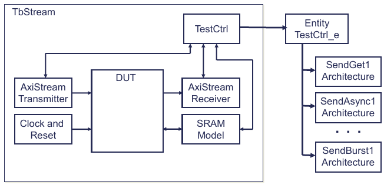
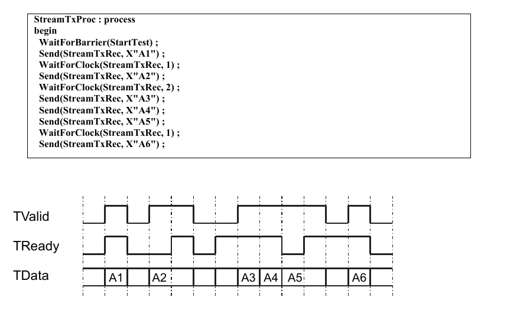
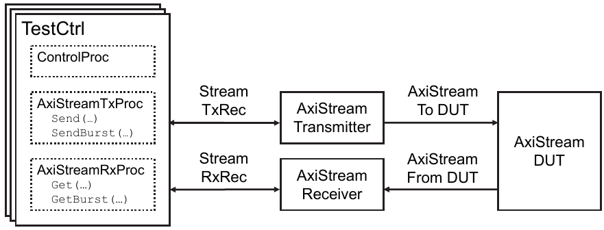
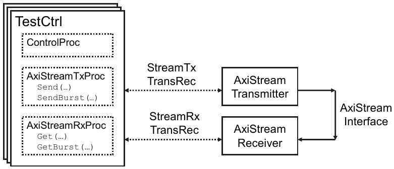
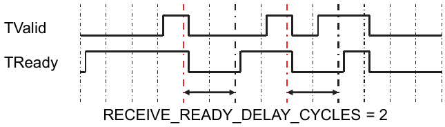
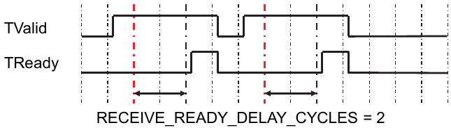

.. _VC/AxiStream:

AxiStream Verification Components
#################################

.. _VC/AxiStream/Overview:

Overview
********

The OSVVM AxiStream Verification Components (VCs) facilitate testing the interface and functionality of AxiStream
devices. The OSVVM AxiStream VCs include :vhdlcode:`AxiStreamTransmitter` and :vhdlcode:`AxiStreamReceiver`. These VCs
are intended to be part of a structured test environment.

The AxiStream verification components implement the complete AxiStream interface capability. They support bursting
capability via :vhdlcode:`BurstFifos` in :vhdlcode:`StreamRecType` as well as through direct and algorithmic control of
TLast during single word transfers. They support setting of TStrb and TKeep for either single word transfers or burst
transfers. Within a burst transfer, they support sparse data streams (ie: TKeep=0 and/or TStrb=0). They support setting
of TID, TDest, and TUser. For single word transfers, these can either be set from defaults in the VC or supplied as
values to the transaction call. For Bursting, TID and TDest are intended to maintain their value throughout the entire
transfer, and TUser can be set either for the entire transfer or on a word by word basis.

For the test case programming API (used in a test sequencer), the AxiStream VCs support the OSVVM Stream Model
Independent Transactions. Using this interface ensures uniformity and consistency with other OSVVM VCs and improves
verification test case reuse.

We are going to start with a brief overview and a demo of the AxiStream test environment.

.. _VC/AxiStream/OSVVMTestbenchArchitecture:

OSVVM Testbench Architecture
****************************

.. _VC/AxiStream/TestArchitectureOverview:

Test Architecture Overview
==========================

The objective of any verification framework is to make the Device Under Test (DUT) "feel like" it has been plugged into
the board. Hence, the framework must be able to produce the same waveforms and sequence of waveforms that the DUT will
see on the board.

The OSVVM testbench framework looks identical to other frameworks, including SystemVerilog. It includes verification
components (:vhdlcode:`AxiStreamTransmitter` and :vhdlcode:`AxiStreamReceiver`) and :vhdlcode:`TestCtrl` (the test
sequencer) as shown in :ref:`Figure 1 <VC/AxiStream/Figure1>`. The top level of the testbench connects the components
together (using the same methods as in RTL design) and is often called a test harness. Connections between the
verification components and :vhdlcode:`TestCtrl` use VHDL records (which we call the transaction interface). Connections
between the verification components and the DUT are the DUT interfaces (such as AxiStream, UART, AXI4, SPI, and I2C).

   Figure 1. OSVVM Testbench Framework

.. _VC/AxiStream/WritingTests:

Writing Tests
=============

Writing tests is all about creating waveforms at an interface. In a basic test approach, each test directly drives and
wiggles interface waveforms. This is tedious and error prone.

In OSVVM, signal wiggling is replaced by transactions. A transaction is an abstract representation of an interface
waveform (such as Send) or a directive to the VC (such as wait for clock). A transaction is initiated using a procedure
call. In a VC based approach, the procedure call collects the transaction information and passes it to the AxiStream VC
via a transaction interface (a record). The AxiStream VC then decodes this information and creates the corresponding
interface waveforms.

Using transactions simplifies creating tests and increases their readability. :ref:`Figure 2 <VC/AxiStream/Figure2>`
shows calls to the Send and :vhdlcode:`WaitForClock` transactions and the corresponding waveforms produced by the
:vhdlcode:`AxiStreamTransmitter` verification component. Note this waveform implies that during the cycle in which data
values A1, A3, A4, and A6 were sent, the AxiStream receiver was ready to receive TData and during the cycle in which
data values A2 and A4 were sent, the AxiStream receiver was not ready to receive TData until a clock cycle later.

   Figure 2. Waveform resulting from the calls to Send and WaitForClock

.. _VC/AxiStream/StreamTransactionInterface:

Stream Transaction Interface
============================

Each AxiStream Verification Component receives transactions from the test sequencer via a Transaction Interface. OSVVM
implements the transaction interface as a record.

Stream Transaction Interface, :vhdlcode:`StreamRecType`, is used to connect the verification component to
:vhdlcode:`TestCtrl`. :vhdlcode:`StreamRecType`, shown in :ref:`Figure 3 <VC/AxiStream/Figure3>`, is defined in the
Stream Model Independent Transaction package, :file:`StreamTransactionPkg.vhd`, which is in the directory
:vhdlcode:`OsvvmLbraries`/Common/Src.

.. code-block:: VHDL
   :caption: Figure 3. StreamRecType
   :name: VC/AxiStream/Figure3

     -- Handshaking controls
     Rdy             : RdyType ;
     Ack             : AckType ;
     -- Transaction Type
     Operation       : StreamOperationType ;
     -- Data and Transaction Parameter to and from verification component
     DataToModel     : std_logic_vector_max_c ;
     ParamToModel    : std_logic_vector_max_c ;
     DataFromModel   : std_logic_vector_max_c ;
     ParamFromModel  : std_logic_vector_max_c ;
     -- BurstFifo
     BurstFifo       : ScoreboardIdType ;
     -- Verification Component Options Parameters - used by SetModelOptions
     IntToModel      : integer_max ;
     IntFromModel    : integer_max ;
     BoolToModel     : boolean_max ;
     BoolFromModel   : boolean_max ;
     TimeToModel     : time_max ;
     TimeFromModel   : time_max ;
     -- Verification Component Options Type
     Options         : integer_max ;
   end record StreamRecType ;

The :vhdlcode:`BurstFifo` is inside :vhdlcode:`StreamRecType`. This means it is easily accessible to both the
verification component and the Test Sequencer (:vhdlcode:`TestCtrl`). The type, :vhdlcode:`ScoreboardIdType`, is a
reference (though not an access type) to the scoreboard singleton data structure in :vhdlcode:`ScoreboardGenericPkg`.
Using :vhdlcode:`ScoreboardIdType` allows the structure to be used as either a FIFO (by :vhdlcode:`SendBurst` or
:vhdlcode:`GetBurst`) or a Scoreboard (by :vhdlcode:`CheckBurst`). The FIFO is :vhdlcode:`std_logic_vector` based and
uses the :vhdlcode:`ScoreboardPkg_slv` instance from :file:`OsvvmLibraries/osvvm`.

Note that :vhdlcode:`DataToModel`, :vhdlcode:`ParamToModel`, :vhdlcode:`DataFromModel`, and :vhdlcode:`ParamFromModel`
are unconstrained. Hence, when they are used in a signal declaration they must be constrained. :vhdlcode:`DataToModel`
and :vhdlcode:`DataFromModel` need to be sized to match TData. :vhdlcode:`ParamToModel` and :vhdlcode:`ParamFromModel`
need to be sized to be (:vhdlcode:`TID'length` + :vhdlcode:`TDest'length` + :vhdlcode:`TUser'length` + 1) in length.

:ref:`Figure 4 <VC/AxiStream/Figure4>` shows the declaration :vhdlcode:`StreamTxRec` (which connects the
:vhdlcode:`AxiStreamTransmitter` to :vhdlcode:`TestCtrl`) and :vhdlcode:`StreamRxRec` (which connects the
:vhdlcode:`AxiStreamReceiver` to :vhdlcode:`TestCtrl`).

.. code-block:: VHDL
   :caption: Figure 4. StreamRecType
   :name: VC/AxiStream/Figure4

   constant AXI_PARAM_WIDTH : integer :=
         TID'length + TDest'length + TUser'length + 1;

   signal StreamTxRec, StreamRxRec : StreamRecType(
       DataToModel   (AXI_DATA_WIDTH-1  downto 0),
       ParamToModel  (AXI_PARAM_WIDTH-1 downto 0),
       DataFromModel (AXI_DATA_WIDTH-1  downto 0),
       ParamFromModel(AXI_PARAM_WIDTH-1 downto 0)
     ) ;

.. _VC/AxiStream/AxiStreamContextDeclaration:

AxiStream Context Declaration
=============================

To simplify the usage of OSVVM AxiStream packages, a context declaration that references all of the OSVVM AxiStream
packages is provided. Using a context declaration allows the packages to be refactored without impacting the designs
that reference the packages using the context. :ref:`Figure 5 <VC/AxiStream/Figure5>` shows the
:vhdlcode:`AxiStreamContext` as defined in :file:`AxiStreamContext.vhd`.

.. code-block:: VHDL
   :caption: Figure 5. AxiStreamContext
   :name: VC/AxiStream/Figure5

   context AxiStreamContext is
     library osvvm_common ;
       context osvvm_common.OsvvmCommonContext ;

     library osvvm_axi4 ;
       use osvvm_axi4.AxiStreamOptionsPkg.all ;
       use osvvm_axi4.Axi4CommonPkg.all ;
       use osvvm_axi4.AxiStreamComponentPkg.all ;
   end context AxiStreamContext ;

.. _VC/AxiStream/ComponentDeclarationsForAxiStreamVerificationComponents:

Component Declarations for AxiStream Verification Components
============================================================

OSVVM prefers to use component instances. One good reason is they support configuration declarations and direct entity
instances do not.

To make usage of component instances easier than direct entity instances, component declarations for each verification
component is provided in a package.

.. _VC/AxiStream/DemoPreparationGettingAndBuildingTheOSVVMLibraries:

Demo Preparation: Getting and Building the OSVVM Libraries
**********************************************************

The best way to learn is by trying things out as you go. In this step you will download OSVVM, build the libraries, and
then run the demo.

OSVVM is available on GitHub at https://github.com/OSVVM as a git repository or at https://osvvm.org/downloads as a ZIP
file. Retrieve OSVVM from GitHub using git as shown in :ref:`Figure 6 <VC/AxiStream/Figure6>`. Note that the
"—recursive" option is required since the OSVVM repositories are submodules of OsvvmLibraries. Submodules greatly
simplify development and deployment of the libraries.

.. code-block:: shell
   :caption: Figure 6. Retrieving OSVVM from GitHub
   :name: VC/AxiStream/Figure6

   git clone --recursive https://github.com/OSVVM/OsvvmLibraries.git

Prior to starting the OSVVM scripting environment, create a directory named sim in which to run your simulations. Start
your simulator and go to the sim directory. Once there, use the steps in :ref:`Figure 7 <VC/AxiStream/Figure7>` to build
the OSVVM Libraries (utility and verification component). These directions are supported in Mentor QuestaSim/ModelSim or
Aldec RivieraPRO. Aldec's ActiveHDL, Synopsys' VCS, and Cadence's Xcelium are also supported but require a few extra
steps. For these steps and additional details of the OSVVM scripting environment see
:osvvmdoc:`Script_user_guide.pdf <Script_user_guide>` (in :file:`OsvvmLibraries/Documentation`).

.. code-block:: tcl
   :caption: Figure 7. Building OSVVM and running the Demo
   :name: VC/AxiStream/Figure7

   cd sim
   source ../OsvvmLibraries/Scripts/StartUp.tcl
   build  ../OsvvmLibraries
   build  ../OsvvmLibraries/AXI4/AxiStream/RunDemoTests.pro

The intent of the OSVVM scripting is to make compiling and running your simulations independent of the simulator you are
using.

GHDL can be run using tclsh. In windows, using MSYS2/MinGW64 start tclsh using "winpty tclsh".

.. _VC/AxiStream/TbStreamPortBasedTransactionInterface:

TbStream: Port Based Transaction Interface
******************************************

In the OSVVM Port Based Transaction Interfaces approach, the transaction interfaces are record ports of the verification
components (VCs) and the test sequencer (:vhdlcode:`TestCtrl`). The testbench then simply connects the ports together
using, just like we do for RTL design. OSVVM and its predecessor within SynthWorks has used this transaction interface
methodology since 1997.

The OSVVM Port Based Transaction Interface approach works well when the testbench components are external to the device
being tested. OSVVM's Virtual Transaction Interfaces provide a simplified means to connect to a verification component
that is internal to the design – such as an embedded processor core.

OSVVM components with Virtual Transaction Interfaces interoperate well with OSVVM components with Port Based Transaction
Interfaces.

.. _VC/AxiStream/TbStreamPortBasedTransactionInterface/DemoRunningTheAXI4Testbenches:

Demo: Running the AXI4 Testbenches
==================================

The AXI4, Axi4Lite, AxiStream, and UART verification components all come with testbenches and the process to run them is
similar to what is discussed here for AxiStream.

Prior to doing this step, do the steps in section 3, Demo Preparation.

Use the steps in :ref:`Figure 8 <VC/AxiStream/Figure8>` to compile and run the tests for the Axi4 verification
components. If you have not exited the simulator, you only need to do the "build" step.

.. code-block:: tcl
   :caption: Figure 8. Compiling and Running OSVVM
   :name: VC/AxiStream/Figure8

   cd sim
   do ../OsvvmLibraries/startup.tcl
   build ../OsvvmLibraries/AXI4/AxiStream/RunDemoTests.pro

.. _VC/AxiStream/TbStreamAxiStreamTestEnvironmentPortBasedTransactionInterface:

TbStream: AxiStream Test Environment - Port Based Transaction Interface
=======================================================================

In the previous section, you ran :file:`TbStream.vhd`, the AxiStream Testbench. It is in the directory
:file:`OsvvmLibraries/AXI4/AxiStream/testbench`. It is structured as shown in :ref:`Figure 9 <VC/AxiStream/Figure9>`.

   Figure 9. TbStream

:vhdlcode:`TbStream` is a test harness that connects components together. In an RTL design, this code is also called
structural code or a netlist. A sketch of :file:`TbStream.vhd` is shown in :ref:`Figure 10 <VC/AxiStream/Figure10>`. For
more details, see :file:`TbStream.vhd`. Note that OSVVM uses VHDL-2008 external names and the order of instantiation is
important. First instantiate the design under test, next the verification components, and then finally the test
sequencer (:vhdlcode:`TestCtrl`).

.. code-block:: VHDL
   :caption: Figure 10. A sketch of TbStream.vhd
   :name: VC/AxiStream/Figure10

   library osvvm_Axi4 ;
     context osvvm_axi4.AxiStreamContext ;
   . . .
   entity  TbStream  is
   end entity TbStream ;
   architecture TestHarness of TbStream is
     signal StreamTxRec, StreamRxRec :
       StreamRecType( . . . ) ;
     . . .
   begin
     osvvm.TbUtilPkg.CreateClock (Clk, tperiod_Clk) ;
     osvvm.TbUtilPkg.CreateReset (nReset, . . .) ;
     Receiver_1 :    AxiStreamReceiver    ( . . .,  StreamRxRec) ;
     Transmitter_1 : AxiStreamTransmitter ( . . .,  StreamTxRec) ;
     TestCtrl_1 :    TestCtrl (nReset, StreamTxRec, StreamRxRec) ;
   end TestHarness ;

By default each OSVVM verification component uses its instance label as the name it reports when an alert or log within
the model is called. This allows each message to be tracked to a unique verification component. :vhdlcode:`AlertLogIDs`
can be looked up using this name, so picking a good instance label will simplify looking up the :vhdlcode:`AlertLogID`
for each verification component from the test sequencer (:vhdlcode:`TestCtrl`). These names can also be set by the
generic :vhdlcode:`MODEL_ID_NAME`. The only reason to do this is to allow verification components to share the same
:vhdlcode:`AlertLogID`.

We recommend using the ":vhdlcode:`ComponentName_1`". In this case we shortened the names to :vhdlcode:`Transmitter_1`
and :vhdlcode:`Receiver_1`. Our intent is to reuse some of the same test cases with other Transmitter and Receiver
verification components (such as UART) – and hence the more generic naming.

.. _VC/AxiStream/TestCtrlEntityPortBasedTransactionInterfaceRecordPort:

TestCtrl Entity – Port Based Transaction Interface (Record Port)
================================================================

Tests are written as architectures of the test sequencer, :vhdlcode:`TestCtrl`. The entity for :vhdlcode:`TestCtrl`,
shown in :ref:`Figure 11 <VC/AxiStream/Figure11>`, consists of transaction interface connections.

.. code-block:: VHDL
   :caption: Figure 11. TestCtrl.vhd
   :name: VC/AxiStream/Figure11

   library ieee ;
     use ieee.std_logic_1164.all ;
     use ieee.numeric_std.all ;
     use ieee.numeric_std_unsigned.all ;

   library osvvm ;
     context osvvm.OsvvmContext ;
     use osvvm.ScoreboardPkg_slv.all ;

   library osvvm_AXI4 ;
     context osvvm_AXI4.AxiStreamContext ;

   entity TestCtrl is
     generic (
       ID_LEN       : integer ;
       DEST_LEN     : integer ;
       USER_LEN     : integer
     ) ;
     port (
         -- Global Signal Interface
         nReset             : In    std_logic ;

         -- Transaction Interfaces
         StreamTxRec        : InOut StreamRecType ;
         StreamRxRec        : InOut StreamRecType
     ) ;

     -- Derive AXI interface properties from the StreamTxRec
     constant DATA_WIDTH : integer := StreamTxRec.DataToModel'length ;
     constant DATA_BYTES : integer := DATA_WIDTH/8 ;

     -- Simplifying access to Burst FIFOs using aliases
     alias TxBurstFifo : ScoreboardIdType is StreamTxRec.BurstFifo ;
     alias RxBurstFifo : ScoreboardIdType is StreamRxRec.BurstFifo ;

   end entity TestCtrl ;

Note the reference to “\ :vhdlcode:`osvvm.ScoreboardPkg_slv`\ ” is required with the 2021.06 update.

.. _VC/AxiStream/AxiStreamTransmitterPortBasedTransactionInterfaceRecordPort:

AxiStream Transmitter – Port Based Transaction Interface (Record Port)
======================================================================

The :vhdlcode:`AxiStreamTransmitter` entity interface is shown in :ref:`Figure 12 <VC/AxiStream/Figure12>`. It has the
full set of AxiStream interface signals as well as the transaction interface (:vhdlcode:`TransRec`).

.. code-block:: VHDL
   :caption: Figure 12. AxiStreamTransmitter
   :name: VC/AxiStream/Figure12

   entity AxiStreamTransmitter is
     generic (
       MODEL_ID_NAME  : string := "" ;
       INIT_ID        : std_logic_vector := "" ;
       INIT_DEST      : std_logic_vector := "" ;
       INIT_USER      : std_logic_vector := "" ;
       INIT_LAST      : natural := 0 ;

       tperiod_Clk    : time := 10 ns ;
       DEFAULT_DELAY  : time := 1 ns ;
       tpd_Clk_TValid : time := DEFAULT_DELAY ;
       -- . . .  see entity for remaining generics
       tpd_Clk_TValid : time := DEFAULT_DELAY
     ) ;
     port (
       -- Globals
       Clk       : in  std_logic ;
       nReset    : in  std_logic ;

       -- AXI Transmitter Functional Interface
       TValid    : out std_logic ;
       TReady    : in  std_logic ;
       TID       : out std_logic_vector ;
       TDest     : out std_logic_vector ;
       TUser     : out std_logic_vector ;
       TData     : out std_logic_vector ;
       TStrb     : out std_logic_vector ;
       TKeep     : out std_logic_vector ;
       TLast     : out std_logic ;

       -- Testbench Transaction Interface
       TransRec  : inout StreamRecType
     ) ;

     -- Derive AXI interface properties from interface signals
     constant AXI_STREAM_DATA_WIDTH : integer := TData'length ;

     -- Use MODEL_ID_NAME Generic if set, otherwise,
     -- use model instance label (preferred if set as entityname_1)
     constant MODEL_INSTANCE_NAME : string :=
       IfElse(MODEL_ID_NAME'length > 0, MODEL_ID_NAME,
         to_lower(PathTail(AxiStreamTransmitter'PATH_NAME))) ;

     constant MODEL_NAME : string := "AxiStreamTransmitter" ;

   end entity AxiStreamTransmitter ;

.. _VC/AxiStream/AxiStreamReceiverPortBasedTransactionInterfaceRecordPort:

AxiStream Receiver – Port Based Transaction Interface (Record Port)
===================================================================

The :vhdlcode:`AxiStreamReceiver` entity interface is shown in :ref:`Figure 13 <VC/AxiStream/Figure13>`. It has the full
set of AxiStream interface signals as well as the transaction interface (:vhdlcode:`TransRec`).

.. code-block:: VHDL
   :caption: Figure 13. AxiStreamReceiver
   :name: VC/AxiStream/Figure13

   entity AxiStreamReceiver is
     generic (
       MODEL_ID_NAME  : string :="" ;
       INIT_ID        : std_logic_vector := "" ;
       INIT_DEST      : std_logic_vector := "" ;
       INIT_USER      : std_logic_vector := "" ;
       INIT_LAST      : natural := 0 ;

       tperiod_Clk    : time := 10 ns ;
       tpd_Clk_TReady : time := 2 ns
     ) ;
     port (
       -- Globals
       Clk       : in  std_logic ;
       nReset    : in  std_logic ;

       -- AXI Master Functional Interface
       TValid    : in  std_logic ;
       TReady    : out std_logic ;
       TID       : in  std_logic_vector ;
       TDest     : in  std_logic_vector ;
       TUser     : in  std_logic_vector ;
       TData     : in  std_logic_vector ;
       TStrb     : in  std_logic_vector ;
       TKeep     : in  std_logic_vector ;
       TLast     : in  std_logic ;

       -- Testbench Transaction Interface
       TransRec  : inout StreamRecType
     ) ;

     -- Derive AXI interface properties from interface signals
     constant AXI_STREAM_DATA_WIDTH   : integer := TData'length ;

     -- Use MODEL_ID_NAME Generic if set, otherwise,
     -- use model instance label (preferred if set as entityname_1)
     constant MODEL_INSTANCE_NAME : string :=
       IfElse(MODEL_ID_NAME'length > 0, MODEL_ID_NAME,
         to_lower(PathTail(AxiStreamReceiver'PATH_NAME))) ;

     constant MODEL_NAME : string := "AxiStreamReceiver" ;

   end entity AxiStreamReceiver ;

.. _VC/AxiStream/TbStreamPortBasedTransactionInterface/AxiStreamTransmitterAndReceiverGenerics:

AxiStream Transmitter and Receiver Generics
===========================================

:vhdlcode:`AxiStreamTransmitter` and :vhdlcode:`AxiStreamReceiver` both have a similar set of generics. The
:vhdlcode:`MODEL_ID_NAME` optionally specifies the model :vhdlcode:`AlertLogID` name. If the :vhdlcode:`MODEL_ID_NAME`
is not specified, the component instance label will be used (preferred method).

:vhdlcode:`INIT_ID`, :vhdlcode:`INIT_DEST`, :vhdlcode:`INIT_USER`, and :vhdlcode:`INIT_LAST` set the internal default
values for TID, TDest, TUser, and TLast. In :vhdlcode:`AxiStreamTransmitter`, these are default driving values. In
:vhdlcode:`AxiStreamReceiver`, these are default values for checking. Note that when :vhdlcode:`INIT_ID`,
:vhdlcode:`INIT_DEST`, and :vhdlcode:`INIT_USER` are specified, they must be the same size as their corresponding
interface signals.

The remaining generics specify timing. :vhdlcode:`Tperiod_Clk` specifies the clock frequency. Tpd_Clk\_\* specifies the
delay for each interface output. See the file :file:`AxiStreamTransmitter.vhd` and :file:`AxiStreamReceiver.vhd` for the
details of the generics.

.. _VC/AxiStream/TbStreamVirtualTransactionInterface:

TbStream: "Virtual" Transaction Interface
*****************************************

In the Virtual Transaction Interface approach, the transaction interfaces are internal record signals of the
verification components (VCs). The test sequencer (:vhdlcode:`TestCtrl`) connects to these using VHDL-2008 external
names (hierarchical references). OSVVM Virtual Transaction Interfaces are a new feature of the OSVVM 2020.12 release.

OSVVM's Virtual Transaction Interfaces provide a simplified means to connect to a verification component that is
internal to the design – such as an embedded processor core. They also simplify any testbench since they remove the need
to use hierarchical connections.

OSVVM components with Virtual Transaction Interfaces interoperate well with OSVVM components with Port Based Transaction
Interfaces.

.. _VC/AxiStream/TbStreamVirtualTransactionInterface/DemoRunningTheAXI4Testbenches:

Demo: Running the AXI4 Testbenches
==================================

The AXI4, Axi4Lite, AxiStream, and UART verification components all come with testbenches and the process to run them is
similar to what is discussed here for AxiStream.

Prior to doing this step, do the steps in section 3, Demo Preparation.

Use the steps in :ref:`Figure 14 <VC/AxiStream/Figure14>` to compile and run the tests for the Axi4 verification. If you
have not exited the simulator, you only need to do the "build" step.

.. code-block:: tcl
   :caption: Figure 14. Compiling and Running OSVVM
   :name: VC/AxiStream/Figure14

   cd sim
   do ../OsvvmLibraries/startup.tcl
   build ../OsvvmLibraries/AXI4/AxiStream/RunDemoTestsVti.pro

.. _VC/AxiStream/TbStreamAxiStreamTestEnvironmentVirtualTransactionInterface:

TbStream: AxiStream Test Environment - Virtual Transaction Interface
====================================================================

In the previous section, you ran :file:`TbStream.vhd`, the AxiStream Testbench. It is in the directory
:file:`OsvvmLibraries/AXI4/AxiStream/testbenchVti`. It is structured as shown in
:ref:`Figure 15 <VC/AxiStream/Figure15>`. The record connections (shown with dotted lines) use external names rather
than direct signal connections.

   Figure 15. TbStream for Virtual Transaction Interfaces

:vhdlcode:`TbStream` is a test harness that connects components together. In an RTL design, this code is also called
structural code or a netlist. A sketch of :file:`TbStream.vhd` is shown in :ref:`Figure 16 <VC/AxiStream/Figure16>`. For
more details, see :file:`AxiStream/testbenchVti/TbStream.vhd`. Note that there are no transaction interface signals to
connect between the verification components (:vhdlcode:`Axi4Master` and
:vhdlcode:`Axi4Responder`/:vhdlcode:`Axi4Memory`) and the test sequencer (:vhdlcode:`TestCtrl`). Instead, these are now
connected via VHDL-2008 external names. See the entity declaration for :vhdlcode:`TestCtrl` for details. Since external
names are used, the order of instantiation is important. First instantiate the design under test, next the verification
components, and then finally the test sequencer (:vhdlcode:`TestCtrl`).

.. code-block:: VHDL
   :caption: Figure 16. A sketch of TbStream.vhd for Virtual Transaction Interfaces
   :name: VC/AxiStream/Figure16

   library osvvm_Axi4 ;
     context osvvm_axi4.AxiStreamContext ;
   . . .
   entity  TbStream  is
   end entity TbStream ;
   architecture TestHarness of TbStream is
     . . .
   begin
     osvvm.TbUtilPkg.CreateClock (Clk, tperiod_Clk) ;
     osvvm.TbUtilPkg.CreateReset (nReset, . . .) ;
     Receiver_1 :    AxiStreamReceiver    ( . . .) ;
     Transmitter_1 : AxiStreamTransmitter ( . . .) ;
     TestCtrl_1 :    TestCtrl (nReset) ;
   end TestHarness ;

By default each OSVVM verification component uses its instance label as the name it reports when an alert or log within
the model is called. This allows each message to be tracked to a unique verification component. :vhdlcode:`AlertLogIDs`
can be looked up using this name, so picking a good instance label will simplify looking up the :vhdlcode:`AlertLogID`
for each verification component from the test sequencer (:vhdlcode:`TestCtrl`). These names can also be set by the
generic :vhdlcode:`MODEL_ID_NAME`. The only reason to do this is to allow verification components to share the same
:vhdlcode:`AlertLogID`.

We recommend using the ":vhdlcode:`ComponentName_1`". In this case we shortened the names to :vhdlcode:`Transmitter_1`
and :vhdlcode:`Receiver_1`. Our intent is to reuse some of the same test cases with other Transmitter and Receiver
verification components (such as UART) – and hence the more generic naming.

.. _VC/AxiStream/TestCtrlEntityVirtualTransactionInterfaceExternalNames:

TestCtrl Entity – Virtual Transaction Interface (External Names)
================================================================

Tests are written as architectures of the test sequencer, :vhdlcode:`TestCtrl`. The entity for :vhdlcode:`TestCtrl`,
shown in :ref:`Figure 17 <VC/AxiStream/Figure17>`, consists of transaction interface connections.

.. code-block:: VHDL
   :caption: Figure 17. TestCtrl.vhd for Virtual Transaction Interfaces
   :name: VC/AxiStream/Figure17

   library ieee ;
     use ieee.std_logic_1164.all ;
     use ieee.numeric_std.all ;
     use ieee.numeric_std_unsigned.all ;

   library OSVVM ;
     context OSVVM.OsvvmContext ;
     use osvvm.ScoreboardPkg_slv.all ;

   library osvvm_AXI4 ;
     context osvvm_AXI4.AxiStreamContext ;

   entity TestCtrl is
     generic (
       ID_LEN       : integer ;
       DEST_LEN     : integer ;
       USER_LEN     : integer
     ) ;
     port (
         -- Global Signal Interface
         nReset             : In    std_logic
     ) ;

     -- Connect transaction interfaces using external names
     alias StreamTxRec is <<signal ^.Transmitter_1.TransRec : StreamRecType>>;
     alias StreamRxRec is <<signal ^.Receiver_1.TransRec : StreamRecType>> ;

     -- Derive AXI interface properties from the StreamTxRec
     constant DATA_WIDTH : integer := StreamTxRec.DataToModel'length ;
     constant DATA_BYTES : integer := DATA_WIDTH/8 ;

     -- Simplifying access to Burst FIFOs using aliases
     alias TxBurstFifo : ScoreboardIdType is StreamTxRec.BurstFifo ;
     alias RxBurstFifo : ScoreboardIdType is StreamRxRec.BurstFifo ;

   end entity TestCtrl ;

Note the reference to “\ :vhdlcode:`osvvm.ScoreboardPkg_slv`\ ” is required with the 2021.06 update.

.. _VC/AxiStream/AxiStreamTransmitterVirtualTransactionInterfaceExternalNames:

AxiStream Transmitter – Virtual Transaction Interface (External Names)
======================================================================

The :vhdlcode:`AxiStreamTransmitter` entity interface is shown in :ref:`Figure 18 <VC/AxiStream/Figure18>`. It has the
full set of AxiStream interface signals. The transaction interface (:vhdlcode:`TransRec`) is declared as a signal in the
entity declarative region. It is accessed using an external name in the test sequencer (:vhdlcode:`TestCtrl`).

.. code-block:: VHDL
   :caption: Figure 18. AxiStreamTransmitterVti
   :name: VC/AxiStream/Figure18

    entity AxiStreamTransmitterVti is
     generic (
       MODEL_ID_NAME  : string := "" ;
       INIT_ID        : std_logic_vector := "" ;
       -- . . .  see entity for other generics

       tperiod_Clk    : time := 10 ns ;
       DEFAULT_DELAY  : time := 1 ns ;
       -- . . .  see entity for remaining generics
     ) ;
     port (
       -- Globals
       Clk       : in  std_logic ;
       nReset    : in  std_logic ;

       -- AXI Transmitter Functional Interface
       TValid    : out std_logic ;
       TReady    : in  std_logic ;
       TID       : out std_logic_vector ;
       TDest     : out std_logic_vector ;
       TUser     : out std_logic_vector ;
       TData     : out std_logic_vector ;
       TStrb     : out std_logic_vector ;
       TKeep     : out std_logic_vector ;
       TLast     : out std_logic
     ) ;

     -- Derive AXI interface properties from interface signals
     constant AXI_STREAM_DATA_WIDTH   : integer := TData'length ;
     constant AXI_STREAM_PARAM_WIDTH  : integer :=
         TID'length + TDest'length + TUser'length + 1 ;

     -- Testbench Transaction Interface - Access via external names
     signal TransRec  : StreamRecType (
       DataToModel   (AXI_STREAM_DATA_WIDTH-1  downto 0),
       DataFromModel (AXI_STREAM_DATA_WIDTH-1  downto 0),
       ParamToModel  (AXI_STREAM_PARAM_WIDTH-1 downto 0),
       ParamFromModel(AXI_STREAM_PARAM_WIDTH-1 downto 0)
     ) ;

     -- Use MODEL_ID_NAME Generic if set, otherwise,
     -- use model instance label (preferred if set as entityname_1)
     constant MODEL_INSTANCE_NAME : string :=
       IfElse(MODEL_ID_NAME'length > 0, MODEL_ID_NAME,
         to_lower(PathTail(AxiStreamTransmitterVti'PATH_NAME))) ;

     constant MODEL_NAME : string := "AxiStreamTransmitterVti" ;

   end entity AxiStreamTransmitterVti ;

.. _VC/AxiStream/AxiStreamReceiverVirtualTransactionInterfaceExternalNames:

AxiStream Receiver – Virtual Transaction Interface (External Names)
===================================================================

The :vhdlcode:`AxiStreamReceiver` entity interface is shown in :ref:`Figure 19 <VC/AxiStream/Figure19>`. It has the full
set of AxiStream interface signals. The transaction interface (:vhdlcode:`TransRec`) is declared as a signal in the
entity declarative region. It is accessed using an external name in the test sequencer (:vhdlcode:`TestCtrl`).

.. code-block:: VHDL
   :caption: Figure 19. AxiStreamReceiverVti
   :name: VC/AxiStream/Figure19

      entity AxiStreamReceiverVti is
     generic (
       MODEL_ID_NAME  : string :="" ;
       INIT_ID        : std_logic_vector := "" ;
       -- . . .  see entity for other generics

       tperiod_Clk    : time := 10 ns ;
       tpd_Clk_TReady : time := 1 ns
     ) ;
     port (
       -- Globals
       Clk       : in  std_logic ;
       nReset    : in  std_logic ;

       -- AXI Master Functional Interface
       TValid    : in  std_logic ;
       TReady    : out std_logic ;
       TID       : in  std_logic_vector ;
       TDest     : in  std_logic_vector ;
       TUser     : in  std_logic_vector ;
       TData     : in  std_logic_vector ;
       TStrb     : in  std_logic_vector ;
       TKeep     : in  std_logic_vector ;
       TLast     : in  std_logic
     ) ;

     -- Derive AXI interface properties from interface signals
     constant AXI_STREAM_DATA_WIDTH   : integer := TData'length ;
     constant AXI_STREAM_PARAM_WIDTH  : integer :=
         TID'length + TDest'length + TUser'length + 1 ;

     -- Testbench Transaction Interface - Access via external names
     signal TransRec  : StreamRecType (
       DataToModel   (AXI_STREAM_DATA_WIDTH-1  downto 0),
       DataFromModel (AXI_STREAM_DATA_WIDTH-1  downto 0),
       ParamToModel  (AXI_STREAM_PARAM_WIDTH-1 downto 0),
       ParamFromModel(AXI_STREAM_PARAM_WIDTH-1 downto 0)
     ) ;

     -- Use MODEL_ID_NAME Generic if set, otherwise,
     -- use model instance label (preferred if set as entityname_1)
     constant MODEL_INSTANCE_NAME : string :=
       IfElse(MODEL_ID_NAME'length > 0, MODEL_ID_NAME,
         to_lower(PathTail(AxiStreamReceiverVti'PATH_NAME))) ;

     constant MODEL_NAME : string := "AxiStreamReceiverVti" ;

   end entity AxiStreamReceiverVti ;

.. _VC/AxiStream/TbStreamVirtualTransactionInterface/AxiStreamTransmitterAndReceiverGenerics:

AxiStream Transmitter and Receiver Generics
===========================================

:vhdlcode:`AxiStreamTransmitterVti` and :vhdlcode:`AxiStreamReceiverVti` both have a similar set of generics. The
:vhdlcode:`MODEL_ID_NAME` optionally specifies the model :vhdlcode:`AlertLogID` name. If the :vhdlcode:`MODEL_ID_NAME`
is not specified, the component instance label will be used (preferred method).

:vhdlcode:`INIT_ID`, :vhdlcode:`INIT_DEST`, :vhdlcode:`INIT_USER`, and :vhdlcode:`INIT_LAST` set the internal default
values for TID, TDest, TUser, and TLast. In :vhdlcode:`AxiStreamTransmitter`, these are default driving values. In
:vhdlcode:`AxiStreamReceiver`, these are default values for checking. Note that when :vhdlcode:`INIT_ID`,
:vhdlcode:`INIT_DEST`, and :vhdlcode:`INIT_USER` are specified, they must be the same size as their corresponding
interface signals.

The remaining generics specify timing. :vhdlcode:`Tperiod_Clk` specifies the clock frequency. Tpd_Clk\_\* specifies the
delay for each interface output. See the file :file:`AxiStreamTransmitter.vhd` and :file:`AxiStreamReceiver.vhd` for the
details of the generics.

.. _VC/AxiStream/WritingTestsUsingTheAxiStreamVC:

Writing Tests Using the AxiStream VC
************************************

Tests are written by calling transactions in an architecture of :vhdlcode:`TestCtrl` (the test sequencer). Each separate
test is a separate architecture of :vhdlcode:`TestCtrl`. Each test generates a sequence of waveforms that verify a
particular aspect of the design. Hence, an entire test is visible in a single file, improving readability.

The :vhdlcode:`TestCtrl` architecture consists of a control process plus one process per independent interface, see
:ref:`Figure 20 <VC/AxiStream/Figure20>`. The control process is used for test initialization and finalization. Each
test process creates interface waveform sequences by calling the transaction procedures (Send, :vhdlcode:`SendBurst`,
Get, :vhdlcode:`GetBurst`, Check, :vhdlcode:`CheckBurst` …). This test architecture is based on the test
:file:`TbStream_SendGet1.vhd` in the directory :file:`OsvvmLibraries/AXI4/AxiStream/testbench`.

For more details on writing tests, see the OSVVM Test Writers User Guide. For examples of using specific Stream
transactions, see the Stream Model Independent Transactions User Guide.

.. code-block:: VHDL
   :caption: Figure 20. TestCtrl Architecture
   :name: VC/AxiStream/Figure20

   architecture SendGet1 of TestCtrl is
     . . .
   begin
     ControlProc : process
     begin
       . . .
       WaitForBarrier(TestDone, 35 ms) ;
       EndOfTestReports ;
       std.env.stop(GetAlertCount) ;
     end process ;
     TransmitterProc : process
     begin
       WaitForClock(StreamTxRec, 2) ;
       Send(StreamTxRec, X"0000_0010") ;
       Send(StreamTxRec, X"0000_0011") ;
       . . .
       WaitForBarrier(TestDone) ;
     end process TransmitterProc ;
     ReceiverProc : process
       variable RxD : std_logic_vector(31 downto 0) ;
     begin
       WaitForClock(StreamRxRec, 2) ;
       Get(StreamRxRec, RxD) ;
       AffirmIfEqual(TBID, RxD, X"0000_0010") ;
       Check(StreamRxRec, X"0000_0011") ;
       WaitForBarrier(TestDone) ;
     end process ReceiverProc ;
   end SendGet1 ;

.. _VC/AxiStream/AxiStreamVCTransactions:

AxiStream VC Transactions
*************************

.. _VC/AxiStream/AxiStreamSupportedStreamIndependentTransactions:

AxiStream Supported Stream Independent Transactions
===================================================

The AxiStream VC implements the OSVVM Stream Model Independent Transactions. The following is a summary of the supported
transactions. See
:osvvmdoc:`Stream_Model_Independent_Transactions_user_guide.pdf <Stream_Model_Independent_Transactions_user_guide>` in
the documentation repository for details.

.. _VC/AxiStream/TransmitterTransactions:

Transmitter Transactions
------------------------

A summary of the transmitter transactions implemented by :vhdlcode:`AxiStreamTransmitter` and
:vhdlcode:`AxiStreamTransmitterVti` VC are shown in the following tables. For details of the transactions, parameter
types, and examples, see the Stream Model Independent Transactions User Guide.

.. _VC/AxiStream/BlockingTransmitterTransactions:

.. rubric:: Blocking Transmitter Transactions

.. code-block:: text

   Send(TransactionRec, Data, [Param], [MsgOn])

   SendBurst(TransactionRec, NumFifoWords, [Param], [MsgOn])

   SendBurstVector   (TransactionRec, VectorOfWords,           [Param], [MsgOn])
   SendBurstIncrement(TransactionRec, FirstWord, NumFifoWords, [Param], [MsgOn])
   SendBurstRandom   (TransactionRec, FirstWord, NumFifoWords, [Param], [MsgOn])
   SendBurstRandom   (TransactionRec, CoverID,   NumFifoWords, [Param], [MsgOn])

.. _VC/AxiStream/NonblockingTransmitterTransactions:

.. rubric:: Nonblocking Transmitter Transactions

.. code-block:: text

   SendAsync(TransactionRec, Data, [Param], [MsgOn])

   SendBurstAsync(TransactionRec, NumFifoWords, [Param], [MsgOn])

   SendBurstVectorAsync   (TransactionRec, VectorOfWords,           [Param], [MsgOn])
   SendBurstIncrementAsync(TransactionRec, FirstWord, NumFifoWords, [Param], [MsgOn])
   SendBurstRandomAsync   (TransactionRec, FirstWord, NumFifoWords, [Param], [MsgOn])
   SendBurstRandomAsync   (TransactionRec, CoverID,   NumFifoWords, [Param], [MsgOn])

.. _VC/AxiStream/TransmitterTransactions/ParametersTRecMsgOnParamAndNumFifoWords:

.. rubric:: Parameters: TRec, MsgOn, Param and NumFifoWords

The parameter TRec is an abbreviation for the :vhdlcode:`TransactionRec` parameter. The parameter :vhdlcode:`MsgOn` is
an abbreviation for the :vhdlcode:`StatusMsgOn` parameter.

Here the Param (input) parameter specifies the values ID & Dest & User & Last (in that order). If less than
:vhdlcode:`ID'length` + Dest'lengh + :vhdlcode:`User'length` + 1 values are specified, the left-most values will be
filled with a '-'. As an input, a value of '-' indicates the corresponding field is not specified and will use the
default value :vhdlcode:`DEFAULT_ID`, :vhdlcode:`DEFAULT_DEST`, :vhdlcode:`DEFAULT_USER`, and :vhdlcode:`DEFAULT_LAST`
(see AxiStream Parameters). For :vhdlcode:`SendBurst` and :vhdlcode:`SendBurstAsync` when the :vhdlcode:`BurstMode` is
:vhdlcode:`STREAM_BURST_WORD_PARAM_MODE` the value in the :vhdlcode:`BurstFifo` specifies (Data & User).

:vhdlcode:`NumFifoWords` (input) specifies the number of words in the :vhdlcode:`BurstFifo`. Note that when in the mode,
:vhdlcode:`STREAM_BURST_BYTE_MODE`, this will be the number of bytes in the transfer, otherwise it is the number of
words in the transfer.

Currently the :vhdlcode:`AxiStreamTransmitter` does not use the optional :vhdlcode:`StatusMsgOn` (boolean input)
parameter.

.. _VC/AxiStream/ReceiverTransactions:

Receiver Transactions
---------------------

A summary of the receiver transactions implemented by :vhdlcode:`AxiStreamReceiver` and :vhdlcode:`AxiStreamReceiverVti`
VC are shown in the following tables. For details of the transactions, types, and examples, see the Stream Model
Independent Transactions User Guide.

.. _VC/AxiStream/BlockingReceiverTransactions:

.. rubric:: Blocking Receiver Transactions

.. code-block:: text

   Get(TRec, Data, [Param], [MsgOn])

   GetBurst(TRec, NumFifoWords, [Param], [MsgOn])

   Check(TRec, Data, [Param], [MsgOn])

   CheckBurst(TRec, NumFifoWords, [Param], [MsgOn])

   CheckBurstVector   (TRec, VectorOfWords,           [Param], [MsgOn])
   CheckBurstIncrement(TRec, FirstWord, NumFifoWords, [Param], [MsgOn])
   CheckBurstRandom   (TRec, FirstWord, NumFifoWords, [Param], [MsgOn])
   CheckBurstRandom   (TRec, CoverID,   NumFifoWords, [Param], [MsgOn])

.. _VC/AxiStream/NonblockingReceiverTransactions:

.. rubric:: Nonblocking Receiver Transactions

.. code-block:: text

   TryGet(TRec, Data, [Param], Available, [MsgOn])

   TryGetBurst(TRec, NumFifoWords, [Param], Available, [MsgOn])

   TryCheck(TRec, Data, [Param], Available, [MsgOn])

   TryCheckBurst(TRec, NumFifoWords, [Param], Available[,MsgOn])

   TryCheckBurstVector   (TRec, VectorOfWords,           [Param], Available, [MsgOn])
   TryCheckBurstIncrement(TRec, FirstWord, NumFifoWords, [Param], Available, [MsgOn])
   TryCheckBurstRandom   (TRec, FirstWord, NumFifoWords, [Param], Available, [MsgOn])
   TryCheckBurstRandom   (TRec, CoverID,   NumFifoWords, [Param], Available, [MsgOn])

.. _VC/AxiStream/ReceiverTransactions/ParametersTRecMsgOnParamAndNumFifoWords:

.. rubric:: Parameters: TRec, MsgOn, Param and NumFifoWords

The parameter TRec is an abbreviation for the :vhdlcode:`TransactionRec` parameter. The parameter :vhdlcode:`MsgOn` is
an abbreviation for the :vhdlcode:`StatusMsgOn` parameter.

Here the Param parameter specifies the values ID & Dest & User & Last (in that order). For Get, :vhdlcode:`TryGet`,
:vhdlcode:`GetBurst`, :vhdlcode:`TryGetBurst` the Param parameter returns the values that were received by TID, TDest,
TUser, and TLast.

For Check, :vhdlcode:`TryCheck`, :vhdlcode:`CheckBurst` and :vhdlcode:`TryCheckBurst`, Param parameter is an input. If
less than :vhdlcode:`ID'length` + Dest'lengh + :vhdlcode:`User'length` + 1 values are specified, the left-most values
will be filled with a '-'. As an input, a value of '-' indicates the corresponding field is not specified and will use
the default value :vhdlcode:`DEFAULT_ID`, :vhdlcode:`DEFAULT_DEST`, :vhdlcode:`DEFAULT_USER`, and
:vhdlcode:`DEFAULT_LAST` (see AxiStream Parameters). For :vhdlcode:`CheckBurst` or :vhdlcode:`TryCheckBurst` when the
:vhdlcode:`BurstMode` is :vhdlcode:`STREAM_BURST_WORD_PARAM_MODE` the value in the :vhdlcode:`BurstFifo` specifies (Data
& User).

For :vhdlcode:`GetBurst` and :vhdlcode:`TryGetBurst`, :vhdlcode:`NumFifoWords` is only used as an output. For
:vhdlcode:`CheckBurst` and :vhdlcode:`TryCheckBurst`, :vhdlcode:`NumFifoWords` is an input.

Currently the :vhdlcode:`AxiStreamReceiver` does not use the optional :vhdlcode:`StatusMsgOn` (boolean input) parameter.

.. _VC/AxiStream/InteractingWithTheBurstFIFOs:

Interacting with the Burst FIFOs
--------------------------------

The basic forms of :vhdlcode:`SendBurst`, :vhdlcode:`SendBurstAsync`, :vhdlcode:`GetBurst`, :vhdlcode:`TryGetBurst`,
:vhdlcode:`CheckBurst`, and :vhdlcode:`TryCheckBurst` do not provide a means of interacting with the FIFO contents. The
following FIFO fill and check patterns are implemented in :file:`FifoFillPkg_slv.vhd` (in the :vhdlcode:`osvvm_common`
library). Examples of their usage is in the Stream Model Independent Transaction User Guide.

.. _VC/AxiStream/ShortHandNamesForTheBurstFIFOs:

.. rubric:: Short Hand Names for the Burst FIFOs

To simplify access of the burst FIFO, the following aliases can be used.

.. code-block:: VHDL

   -- Simplifying access to Burst FIFOs using aliases
   alias TxBurstFifo : ScoreboardIdType is StreamTxRec.BurstFifo ;
   alias RxBurstFifo : ScoreboardIdType is StreamRxRec.BurstFifo ;

.. _VC/AxiStream/FillingTheBurstFIFO:

.. rubric:: Filling the Burst FIFO

These are intended to be used prior to calling :vhdlcode:`SendBurst`, :vhdlcode:`SendBurstAsync`,
:vhdlcode:`CheckBurst`, or :vhdlcode:`TryCheckBurst` transactions to fill the FIFO with a set of values.

.. code-block:: VHDL

   alias TxBurstFifo : ScoreboardIdType is StreamTxRec.BurstFifo ;
   . . .
   Push(TxBurstFifo, DataWord) ;
   PushBurstVector   (TxBurstFifo, VectorOfWords, FifoWidth)
   PushBurstIncrement(TxBurstFifo, FirstWord, Count, FifoWidth)
   PushBurstRandom   (TxBurstFifo, FirstWord, Count, FifoWidth)
   PushBurstRandom   (TxBurstFifo, CoverID,   Count, FifoWidth)

.. _VC/AxiStream/CheckingTheBurstFIFO:

.. rubric:: Checking the Burst FIFO

These are intended to be used after calling :vhdlcode:`GetBurst` or :vhdlcode:`TryGetBurst` to check the contents of the
FIFO.

.. code-block:: VHDL

   alias RxBurstFifo : ScoreboardIdType is StreamRxRec.BurstFifo ;
   . . .
   CheckExpected(RxBurstFifo, CheckWord) ;
   CheckBurstVector   (RxBurstFifo, VectorOfWords,    FifoWidth)
   CheckBurstIncrement(RxBurstFifo, FirstWord, Count, FifoWidth)
   CheckBurstRandom   (RxBurstFifo, FirstWord, Count, FifoWidth)
   CheckBurstRandom   (RxBurstFifo, CoverID,   Count, FifoWidth)

.. _VC/AxiStream/ReadingTheBurstFIFO:

.. rubric:: Reading the Burst FIFO

These are intended to be used after calling :vhdlcode:`GetBurst` or :vhdlcode:`TryGetBurst` to manage the contents of
the FIFO.

.. code-block:: VHDL

   alias RxBurstFifo : ScoreboardIdType is StreamRxRec.BurstFifo ;
   . . .
   DataWord := Pop(RxBurstFifo) ;
   PopBurstVector(RxBurstFifo, VectorOfWords,    FifoWidth)

.. _VC/AxiStream/GeneralDirectives:

General Directives
------------------

.. code-block:: text

   WaitForTransaction(TransactionRec)

   WaitForClock(TransactionRec, NumberOfClocks)

   GetTransactionCount(TransactionRec, Count)

   GetAlertLogID(TransactionRec, AlertLogID)

   GetErrorCount(TransactionRec, ErrorCount)

.. _VC/AxiStream/BurstModeControlDirectives:

BurstMode Control Directives
----------------------------

.. code-block:: text

   SetBurstMode (TransactionRec, STREAM_BURST_WORD_MODE) ;
   SetBurstMode (TransactionRec, STREAM_BURST_WORD_PARAM_MODE) ;
   SetBurstMode (TransactionRec, STREAM_BURST_BYTE_MODE) ;

   GetBurstMode (TransactionRec, OptVal)

.. _VC/AxiStream/StreamConfigurationDirectives:

Stream Configuration Directives
-------------------------------

.. code-block:: text

   SetModelOptions(TransactionRec, Option, OptVal)

   GetModelOptions(TransactionRec, Option, OptVal)

Largely these are used indirectly through the :vhdlcode:`SetAxiStreamOptions` and :vhdlcode:`GetAxiStreamOptions`
directives. See Configuring the AxiStream VC. For AxiStream, :vhdlcode:`OptVal` can have a type of boolean, integer, or
:vhdlcode:`std_logic_vector`.

.. _VC/AxiStream/ConfiguringTheAxiStreamVC:

Configuring the AxiStream VC
============================

The AxiStream Parameters configure the VC into a particular mode of operation or establish a default value for an
interface object when it is not specified directly in the transaction.

.. _VC/AxiStream/SetAxiStreamOptionsGetAxiStreamOptions:

SetAxiStreamOptions / GetAxiStreamOptions
-----------------------------------------

Model options are set using :vhdlcode:`SetAxiStreamOptions` and retrieved using :vhdlcode:`GetAxiStreamOptions`. These
are an abstraction layer wrapped around the :vhdlcode:`SetModelOptions` and :vhdlcode:`GetModelOptions`. This allows
values from the enumerated type to be used, rather than using integer constant values. These are implemented in the
package :file:`AxiStreamOptionsPkg.vhd`.

.. code-block:: text

   SetAxiStreamOptions(TransactionRec, Option, OptVal)

   GetAxiStreamOptions(TransactionRec, Option, OptVal)

:vhdlcode:`OptVal` can be of type integer, :vhdlcode:`std_logic_vector`, or boolean.

.. _VC/AxiStream/OptionsCommonToAxiStreamTransmitterAndAxiStreamReceiver:

Options common to AxiStreamTransmitter and AxiStreamReceiver
------------------------------------------------------------

.. list-table::
   :header-rows: 0
   :widths: 194 508

   * - :vhdlcode:`DEFAULT_ID` :vhdlcode:`std_logic_vector`
     - Default value for TID if not specified in a send or check. Initial value = :vhdlcode:`INIT_ID` (generic) if set,
       otherwise 0
   * - :vhdlcode:`DEFAULT_DEST` :vhdlcode:`std_logic_vector`
     - Default value for TDest if not specified in a send or check. Initial value = :vhdlcode:`INIT_DEST` (generic) if
       set, otherwise 0.
   * - :vhdlcode:`DEFAULT_USER` :vhdlcode:`std_logic_vector`
     - Default value for TUser if not specified in a send or check. Initial value = :vhdlcode:`INIT_USER` (generic) if
       set, otherwise 0
   * - :vhdlcode:`DEFAULT_LAST` integer
     - Default value for TLast if not specified in a send or check. If value <= 1, then TLast =
       ??(:vhdlcode:`DEFAULT_LAST`\ =1). If value > 1, then TLast = ??(:vhdlcode:`NumOperations` mod
       :vhdlcode:`DEFAULT_LAST` = 0). Initial value = :vhdlcode:`INIT_LAST` (generic) which defaults to 0.

The following set defaults for TID, TDest, and TUser. Note that the :vhdlcode:`std_logic_vector` value must match the
size of the corresponding interface object.

.. code-block:: VHDL

   SetAxiStreamOptions(TransactionRec, DEFAULT_ID,   X"01") ;
   SetAxiStreamOptions(TransactionRec, DEFAULT_DEST, X"2") ;
   SetAxiStreamOptions(TransactionRec, DEFAULT_USER, X"1") ;

The following set default so that it generates TLast once every 16 transfers.

.. code-block:: VHDL

   SetAxiStreamOptions(TransactionRec, DEFAULT_LAST, 16) ;

.. _VC/AxiStream/ControllingInterfaceTValidAndTReadyDelays:

Controlling Interface TValid and TReady Delays
----------------------------------------------

Delays for TValid (:vhdlcode:`AxiStreamTransmitter`) and TReady (:vhdlcode:`AxiStreamReceiver`) can be a static value (a
fixed delay) or randomized.

.. _VC/AxiStream/StaticDelayTValidDelayCyclesAxiStreamTransmitter:

.. rubric:: Static Delay: TValid Delay Cycles (AxiStreamTransmitter)

.. list-table::
   :header-rows: 0
   :widths: 324 378

   * - :vhdlcode:`TRANSMIT_VALID_DELAY_CYCLES` Integer. Initialized to 0
     - Specifies the number of cycles before a transaction starts once the :vhdlcode:`AxiStreamTransmitter` receives
       the transaction.
   * - :vhdlcode:`TRANSMIT_VALID_BURST_DELAY_CYCLES` Integer. Initialized to 0
     - Specifies the number of cycles between each word during a burst cycle.
   * - :vhdlcode:`TRANSMIT_READY_TIME_OUT` Integer. Initialized to :vhdlcode:`integer'right`
     - Generates FAILURE if TValid is asserted for more specified number of clocks without TReady. Disable by setting
       to Integer’right.

.. _VC/AxiStream/RandomDelayTValidDelayCyclesAxiStreamTransmitter:

.. rubric:: Random Delay: TValid Delay Cycles (AxiStreamTransmitter)

Random delays for TValid are controlled by a Delay Coverage Model. For more information on delay coverage models, see
:osvvmdoc:`DelayCoveragePkg_user_guide.pdf <DelayCoveragePkg_user_guide>`.

To use random delays in the verification component, call :vhdlcode:`SetUseRandomDelays`. At this point the TValid delays
will be randomized using the default coverage model.

.. code-block:: VHDL

   SetUseRandomDelays(StreamTxRec, TRUE) ;

The coverage model can be retrieved using :vhdlcode:`GetDelayCoverageID`.

.. code-block:: VHDL

   GetDelayCoverageID(StreamTxRec, DelayCoverageID) ;

The delay coverage model can be changed using :vhdlcode:`SetDelayCoverageID`.

.. code-block:: VHDL

   SetDelayCoverageID(StreamRxRec, NewDelayCoverageID) ;

:vhdlcode:`AxiStreamTransmitter` sets the default delays to the following.

.. code-block:: VHDL

   -- BurstLength - once per BurstLength, use BurstDelay, otherwise use BeatDelay
   AddBins(BurstCov.BurstLengthCov, 80, GenBin(3,11,1)) ;    -- 80% Small Burst Length
   AddBins(BurstCov.BurstLengthCov, 20, GenBin(109,131,1)) ; -- 20% Large Burst Length

   -- BurstDelay - happens at BurstLength boundaries
   AddBins (BurstCov.BurstDelayCov,   80, GenBin(2,8,1)) ;     -- 80% Small delay
   AddBins (BurstCov.BurstDelayCov,   20, GenBin(108,156,1)) ; -- 20% Large delay

   -- BeatDelay - happens between each transfer it not at a BurstLength boundary
   -- These are all small
   AddBins (BurstCov.BeatDelayCov,    85, GenBin(0)) ;       -- 85%  0 Delay
   AddBins (BurstCov.BeatDelayCov,    10, GenBin(1)) ;       -- 10%  1 Delay
   AddBins (BurstCov.BeatDelayCov,     5, GenBin(2)) ;       --  5%  2 Delay

.. _VC/AxiStream/StaticDelayTReadyDelayCyclesAxiStreamReceiver:

.. rubric:: Static Delay: TReady Delay Cycles (AxiStreamReceiver)

.. list-table::
   :header-rows: 0
   :widths: 324 378

   * - :vhdlcode:`RECEIVE_READY_BEFORE_VALID` Boolean. Initialized to TRUE.
     - If TRUE generate TReady even if TValid is not asserted.
   * - :vhdlcode:`RECEIVE_READY_DELAY_CYCLES` Integer. Initialized to 0.
     - Number of clock cycles to delay assertion of TReady. If :vhdlcode:`READY_BEFORE_VALID` is TRUE, then number of
       clocks from previous cycle ending. If :vhdlcode:`READY_BEFORE_VALID` is FALSE, then the number of clocks after
       RValid.
   * - :vhdlcode:`DROP_UNDRIVEN` Boolean. Initialized to FALSE.
     - If TRUE, then undriven values in a burst stream are not copied to a BYTE wide burst FIFO. Has no impact if the
       :vhdlcode:`BurstFifo` is word oriented (default).
   * - :vhdlcode:`RECEIVE_READY_WAIT_FOR_GET`
     - If TRUE, do not drive ready until a Get, :vhdlcode:`GetBurst`, :vhdlcode:`TryGet`, or :vhdlcode:`TryGetBurst` is
       called.

When :vhdlcode:`RECEIVE_READY_BEFORE_VALID` is TRUE, then :vhdlcode:`RECEIVE_READY_DELAY_CYCLES` is a relative to when
the last transfer completed. :ref:`Figure 21 <VC/AxiStream/Figure21>` shows :vhdlcode:`RECEIVE_READY_DELAY_CYCLES` = 2
when :vhdlcode:`RECEIVE_READY_BEFORE_VALID` is TRUE.

   Figure 21. RECEIVE_READY_DELAY_CYCLES = 2 when RECEIVE_READY_BEFORE_VALID is TRUE

When :vhdlcode:`RECEIVE_READY_BEFORE_VALID` is FALSE, then :vhdlcode:`RECEIVE_READY_DELAY_CYCLES` is a relative to when
TValid is asserted. :ref:`Figure 22 <VC/AxiStream/Figure22>` shows :vhdlcode:`RECEIVE_READY_DELAY_CYCLES` = 2 when
:vhdlcode:`RECEIVE_READY_BEFORE_VALID` is FALSE.

   Figure 22. RECEIVE_READY_DELAY_CYCLES = 2 when RECEIVE_READY_BEFORE_VALID is FALSE

.. _VC/AxiStream/RandomDelayTReadyDelayCyclesAxiStreamReceiver:

.. rubric:: Random Delay: TReady Delay Cycles (AxiStreamReceiver)

Random delays for TReady and random settings for :vhdlcode:`RECEIVE_READY_BEFORE_VALID` are controlled by a Delay
Coverage Model. For more information on delay coverage models, see
:osvvmdoc:`DelayCoveragePkg_user_guide.pdf <DelayCoveragePkg_user_guide>`.

To use random delays in the verification component, call :vhdlcode:`SetUseRandomDelays`. At this point TReady delays and
:vhdlcode:`RECEIVE_READY_BEFORE_VALID` settings will be randomized.

.. code-block:: VHDL

   SetUseRandomDelays(StreamRxRec, TRUE) ;

The coverage model can be retrieved using :vhdlcode:`GetDelayCoverageID`.

.. code-block:: VHDL

   GetDelayCoverageID(StreamRxRec, DelayCoverageID) ;

The delay coverage model can be changed using :vhdlcode:`SetDelayCoverageID`.

.. code-block:: VHDL

   SetDelayCoverageID(StreamRxRec, NewDelayCoverageID) ;

:vhdlcode:`AxiStreamReceiver` sets the default delays to the following.

.. code-block:: VHDL

   -- BurstLength - once per BurstLength, use BurstDelay, otherwise use BeatDelay
   AddBins(BurstCov.BurstLengthCov,  80, GenBin(3,11,1)) ;    -- 80% Small Burst Length
   AddBins(BurstCov.BurstLengthCov,  20, GenBin(109,131,1)) ; -- 20% Large Burst Length

   -- BurstDelay - happens at BurstLength boundaries
   -- 65% Ready Before Valid, small delay
   AddCross(BurstCov.BurstDelayCov,   65, GenBin(0), GenBin(2,8,1)) ;
   -- 10% Ready Before Valid, large delay
   AddCross(BurstCov.BurstDelayCov,   10, GenBin(0), GenBin(108,156,1)) ;
   -- 15% Ready After Valid, small delay
   AddCross(BurstCov.BurstDelayCov,   15, GenBin(1), GenBin(2,8,1)) ;
   -- 10% Ready After Valid, large delay
   AddCross(BurstCov.BurstDelayCov,   10, GenBin(1), GenBin(108,156,1)) ;

   -- BeatDelay - happens between each transfer it not at a BurstLength boundary
   -- 85% Ready Before Valid, no delay
   AddCross(BurstCov.BeatDelayCov,    85, GenBin(0), GenBin(0)) ;
   --  5% Ready Before Valid, 1 cycle delay
   AddCross(BurstCov.BeatDelayCov,     5, GenBin(0), GenBin(1)) ;
   --  5% Ready After Valid, no delay
   AddCross(BurstCov.BeatDelayCov,     5, GenBin(1), GenBin(0)) ;
   --  5% Ready After Valid, 1 cycle delay
   AddCross(BurstCov.BeatDelayCov,     5, GenBin(1), GenBin(1)) ;

.. _VC/AxiStream/SettingAndCheckingTKeepAndTStrb:

Setting and Checking TKeep and TStrb
====================================

On the AxiStream interface, a TStrb value that corresponds to a data value of '1' indicates the value contains valid
data. A value of '0' indicates it is a filler value. A TKeep value of '1' indicates the value is either valid data or a
filler value that may not be dropped. A value of '0' indicates the value may be dropped by the interface.

Rather than supplying this sort of information as a value in the transaction call, the OSVVM
:vhdlcode:`AxiStreamTransmitter` VC uses a data value of X"UU" to indicate the data byte is to have TStrb = '0' and
TKeep = '0' and a data value of X"WW" to indicate the data byte is to have TStrb = '0' and TKeep = '1'. This applies to
values supplied either via the Send transaction or via the :vhdlcode:`BurstFifo` for a :vhdlcode:`SendBurst`
transaction.

Similarly, in the :vhdlcode:`AxiStreamReceiver` VC, when TKeep = '0', then the corresponding data byte will be X"UU" and
if TKeep = '1' and TStrb = '0', then the corresponding data byte will be X"WW". If the transaction is a
:vhdlcode:`GetBurst`, and the :vhdlcode:`BurstFIFO` is configured to receive bytes, and the :vhdlcode:`DropUndriven` VC
parameter is TRUE, and the received byte is X"UU", then it will be dropped (ie not put into the :vhdlcode:`BurstFIFO`).
