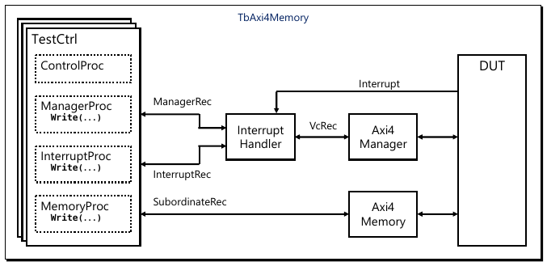
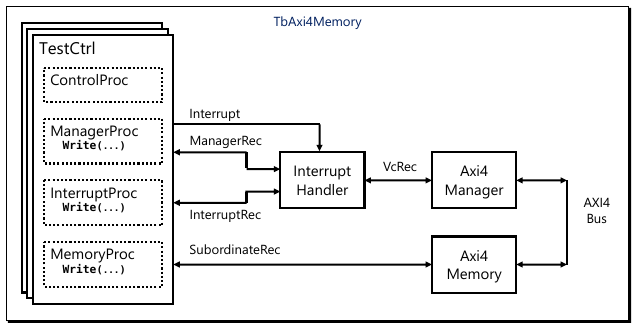

.. _VC/InterruptHandler:

Interrupt Handler
#################

.. _VC/InterruptHandler/Overview:

Overview
********

When software is running and an interrupt occurs, the normal thread of execution is interrupted, and the interrupt
thread of execution is started. When the interrupt thread completes, the previous thread is resumed.

VHDL does not support context switching of threads (aka processes), so OSVVM created an Interrupt Handler verification
component that implements this capability. The Interrupt Handler works with any OSVVM verification component that uses
the Address Bus Model Independent Transaction interface, such as AXI4 full, Axi4Lite, Avalon, or Wishbone.

To follow along with the demo example in this document, you may find it helpful to read the following first.

* :ref:`OSVVM’s Structured Testbench Framework User Guide <FRAMEWORK/StructuredTestbench>`
* :ref:`OSVVM’s Test Writers User Guide <FRAMEWORK/TestWriters>`
* :ref:`AXI4 Verification Components (VCs) User Guide <VC/Axi4>`

These can be found in :file:`OsvvmLibraries/Documentation` or in the Documentation repository on GitHub.

.. _VC/InterruptHandler/TestbenchArchitecture:

Testbench Architecture
**********************

When using the interrupt handler, the testbench architecture (also called test harness) includes the test sequencer
(:vhdlcode:`TestCtrl`), verification components (:vhdlcode:`Axi4Manager` and :vhdlcode:`Axi4Memory`), the
:vhdlcode:`InterruptHandler` verification component, and DUT as shown in :ref:`Figure 1 <VC/InterruptHandler/Figure1>`.

   Figure 1. InterruptHandler Testbench Typical Use Case

The demo example for this user guide is based on the test harness, :file:`TbAxi4Memory.vhd`, which can be found in the
directory :file:`OsvvmLibraries/Common/TbInterrupt`. It creates a minimal system to test the
:vhdlcode:`InterruptHandler` shown in :ref:`Figure 2 <VC/InterruptHandler/Figure2>`. To simplify the system, the DUT was
removed and instead the :vhdlcode:`Axi4Manager` is connected directly to the :vhdlcode:`Axi4Memory`. Without the DUT,
the Interrupt source comes from :vhdlcode:`TestCtrl`.

   Figure 2. InterruptHandler Verification Test Harness (TbAxi4Memory)

.. _VC/InterruptHandler/TheTestSequencerTestCtrl:

The Test Sequencer (TestCtrl)
*****************************

The test sequencer (:vhdlcode:`TestCtrl`) in general includes a control process and a separate process for each
verification component (:vhdlcode:`ManagerProc` for :vhdlcode:`Axi4Manager` and :vhdlcode:`SubordinateProc` for
:vhdlcode:`Axi4Memory`). When working with an interrupt handler an interrupt process (:vhdlcode:`InterruptProc`) is
added. This also adds the record :vhdlcode:`InterruptRec` which contains the transaction source for the Interrupt
Handler.

:vhdlcode:`InterruptProc` does the same function that a software interrupt handler would do. It reads the interrupt
status and other registers as needed to service and clear the interrupt source. When it has finished servicing the
interrupt, it calls :vhdlcode:`InterruptReturn` transaction. :vhdlcode:`InterruptReturn` must be the last transaction
call in the process. For every interrupt event, the :vhdlcode:`InterruptProc` is run once in its entirety.

The test cases, such as :file:`TbAxi4_Interrupt1.vhd`, have a different objective than a normal interrupt handler. Its
objective is to verify the :vhdlcode:`InterruptHandler` by reading and writing the :vhdlcode:`Axi4Memory` while the
:vhdlcode:`ManagerProc` is doing the same and show that all reads and writes complete properly.

See the :ref:`next section, Interrupt Handler <VC/InterruptHandler/TheInterruptHandlerVerificationComponentVC>` for more
details on how control is switched from :vhdlcode:`ManagerProc` to :vhdlcode:`InterruptProc` and back.

.. _VC/InterruptHandler/TheInterruptHandlerVerificationComponentVC:

The Interrupt Handler Verification Component (VC)
*************************************************

The Interrupt handler verification component (:file:`InterruptHandler.vhd`) is a general-purpose solution that works for
any VC that uses OSVVM’s Address Bus Model Independent Transaction Interface. It can be found in the directory
:file:`OsvvmLibraries/Common/src`. It is compiled into the :vhdlcode:`OSVVM_Common` library.

The interface for the Interrupt Handler VC is shown in :ref:`Figure 3 <VC/InterruptHandler/Figure3>`.

.. code-block:: VHDL
   :caption: Figure 3. Interrupt Handler VC Interface
   :name: VC/InterruptHandler/Figure3

   entity InterruptHandler is
   generic (
     MODEL_ID_NAME    : string := ""
   ) ;
   port (
     -- Interrupt Input
     IntReq          : in   std_logic ;

     -- From TestCtrl
     TransRec        : inout AddressBusRecType ;
     InterruptRec    : inout AddressBusRecType ;

     -- To Verification Component
     VcRec           : inout AddressBusRecType
   ) ;

:vhdlcode:`IntReq` port is the interrupt input and is generally connected to the DUT. Here :vhdlcode:`IntReq` port is
connected to :vhdlcode:`TestCtrl` only because there is no DUT. :vhdlcode:`TransRec` port connects to
:vhdlcode:`ManagerRec` (driven by :vhdlcode:`ManagerProc`). :vhdlcode:`InterruptRec` connects to
:vhdlcode:`InterruptRec` (driven by :vhdlcode:`InterruptProc`). :vhdlcode:`VcRec` connects to the
:vhdlcode:`Axi4Manager` :vhdlcode:`TransRec` port.

.. _VC/InterruptHandler/ComponentDeclarationIsProvidedInInterruptHandlerComponentPkg:

Component Declaration is Provided in InterruptHandlerComponentPkg
*****************************************************************

As with all OSVVM VC, you can use a simple component declaration when instancing the :vhdlcode:`InterruptHandler`. No
component declaration is needed in the test harness as a component declaration is provided in
:file:`InterruptHandlerComponentPkg.vhd`. :vhdlcode:`InterruptHandlerComponentPkg` is compiled into the
:vhdlcode:`osvvm_common` library by OSVVM scripts and referenced by the :vhdlcode:`OsvvmCommonContext`.

:vhdlcode:`OsvvmCommonContext` is included in :vhdlcode:`Axi4Context`. As a result, you only need the reference shown in
:ref:`Figure 4 <VC/InterruptHandler/Figure4>` to include both :vhdlcode:`InterruptHandlerComponentPkg`,
:vhdlcode:`AddressBusRecType` (Address Bus Interface), and the component declarations for AXI4 VC.

.. code-block:: VHDL
   :caption: Figure 4. Context Reference to use InterruptHandler and Axi4 VC
   :name: VC/InterruptHandler/Figure4

   library OSVVM_AXI4 ;
     context OSVVM_AXI4.Axi4Context ;

.. _VC/InterruptHandler/InterruptHandlerVCOperation:

Interrupt Handler VC Operation
******************************

At the start of the simulation, both :vhdlcode:`ManagerProc` and :vhdlcode:`InterruptProc` start running and eventually
call a transaction.

When no interrupt is pending, the Interrupt Handler VC passes transactions from :vhdlcode:`TransRec`
(:vhdlcode:`ManagerRec`) to the :vhdlcode:`Axi4Manager` (via :vhdlcode:`VcRec`). Results received via :vhdlcode:`VcRec`
are sent back to :vhdlcode:`TransRec` (:vhdlcode:`ManagerRec`).

If an interrupt is pending and the :vhdlcode:`InterruptRec` has a transaction, the Interrupt Handler VC allows the
current :vhdlcode:`TransRec` (:vhdlcode:`ManagerRec`) transaction to complete and then switches to Interrupt Handling
Mode. When in Interrupt Handling Mode, it passes transactions from :vhdlcode:`InterruptRec` to the
:vhdlcode:`Axi4Manager` (via :vhdlcode:`VcRec`) and results received via :vhdlcode:`VcRec` are sent back to
:vhdlcode:`InterruptRec`.

The Interrupt Handler VC remains in Interrupt Handling Mode until an :vhdlcode:`InterruptReturn` transaction is received
on :vhdlcode:`InterruptRec`. The :vhdlcode:`InterruptReturn` must be the last transaction in the
:vhdlcode:`InterruptProc` process. Following that, the :vhdlcode:`InterruptProc` loops back to the top of the process
and calls the first transaction, however, it stops because the :vhdlcode:`InterruptHandler` VC is no longer in Interrupt
Handling mode and is now handling transactions from :vhdlcode:`TransRec` (:vhdlcode:`ManagerRec`).

In the :vhdlcode:`InterruptHandler` VC, interrupt pending is defined to be :vhdlcode:`IntReq` is asserted (currently a
1) and there is a transaction pending on :vhdlcode:`InterruptRec` (ie: a transaction was called in
:vhdlcode:`InterruptProc`). Hence, if there is no :vhdlcode:`InterruptProc` to call transactions using
:vhdlcode:`InterruptRec`, the :vhdlcode:`InterruptHandler` will not go into Interrupt Handling Mode.

.. _VC/InterruptHandler/RestrictionsWhenUsingTheInterruptHandlerVerificationComponentVC:

Restrictions When Using the Interrupt Handler Verification Component (VC)
*************************************************************************

When using the :vhdlcode:`InterruptHandler` VC, do not use split transactions in the :vhdlcode:`ManagerProc`. If you
were to call :vhdlcode:`WriteAddressAsync` and then :vhdlcode:`WriteDataAsync`, an interrupt could interrupt after
:vhdlcode:`WriteAddressAsync` and before :vhdlcode:`WriteDataAsync` – which would leave the :vhdlcode:`Axi4Manager`
write interface in a bad state. Same applies for :vhdlcode:`ReadAddressAsync` and :vhdlcode:`ReadData` (or
:vhdlcode:`ReadCheckData`, :vhdlcode:`TryReadData`, :vhdlcode:`TryReadCheckData`).

Note that the split transactions are intended to be used to fully test the operation of split transaction interfaces,
such as AXI4. Hence, split transactions are a low level test capability that is not needed when testing higher level
functionality such as interrupts.

.. _VC/InterruptHandler/RunningTheExamples:

Running the Examples
********************

See the steps in the :ref:`OSVVM Overview guide <FRAMEWORK/Overview>` for running the OSVVM demos. Do the steps shown in
:ref:`Figure 5 <VC/InterruptHandler/Figure5>` in your simulator. :file:`StartUp.tcl` needs to be sourced each time you
start the simulator. See the :ref:`Script User Guide <UG>` for additional details for Aldec's ActiveHDL, GHDL, Synopsys
VCS, and Cadence Xcelium.

.. code-block:: tcl
   :caption: Figure 5. Compiling and Running InterruptHandler tests
   :name: VC/InterruptHandler/Figure5

   cd sim
   source ../OsvvmLibraries/Scripts/StartUp.tcl
   build  ../OsvvmLibraries/OsvvmLibraries.pro
   build  ../OsvvmLibraries/Common/TbInterrupt

.. _VC/InterruptHandler/Summary:

Summary
*******

At the end of the day, the :vhdlcode:`InterruptHandler` is just a specialized multiplexer/demultiplexer (responses) that
chooses between connecting :vhdlcode:`TransRec` to :vhdlcode:`VcRec` or :vhdlcode:`InterruptRec` to :vhdlcode:`VcRec`
depending on the state of the Interrupt Handling Mode.

The :vhdlcode:`InterruptHandler` works with any OSVVM verification component that uses the Address Bus Model Independent
Transaction interfaces.

It is simple to deploy since all you must do is

* Add an additional :vhdlcode:`AddressBusRecType` port to :vhdlcode:`TestCtrl` Entity (:vhdlcode:`InterruptRec`)
* Instance :vhdlcode:`InterruptHandler` to your test harness – don’t forget we provide the component declaration in a
  package to further simplify this.
* Add an :vhdlcode:`InterruptProc` to :vhdlcode:`TestCtrl` with the interrupt handler (that does transaction calls using
  :vhdlcode:`InterruptRec`).
