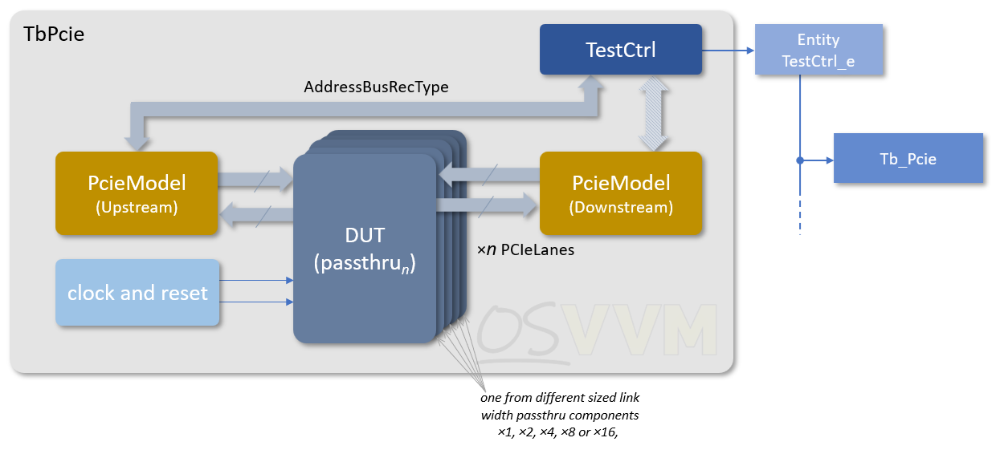
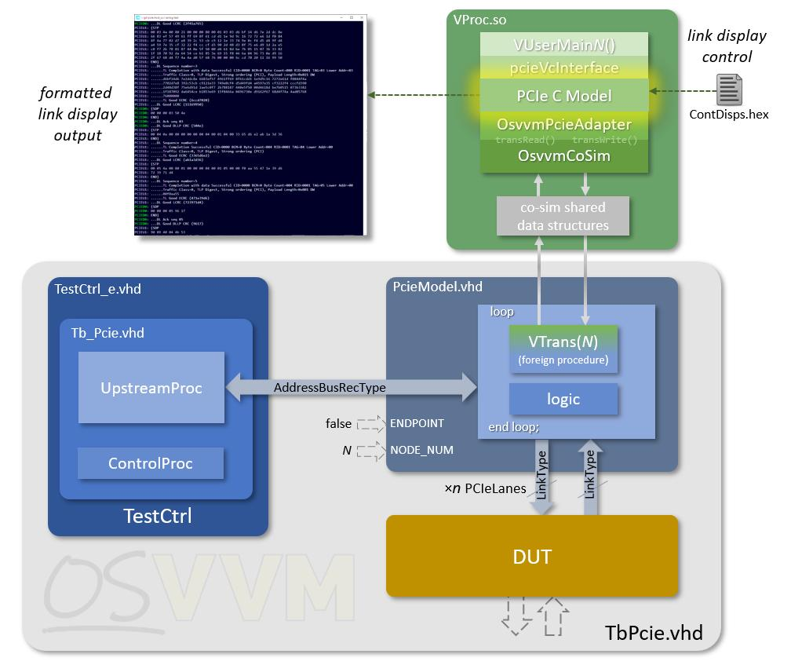
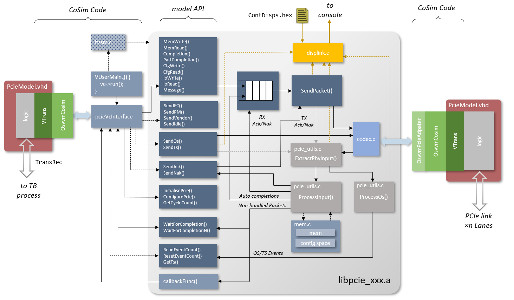

.. _VC/PCIe:

PCIe Verification Component
###########################

.. _VC/PCIe/TerminologyUpstreamAndDownstream:

Terminology: Upstream and Downstream
************************************

OSVVM PCIe VC and this document use the PCIe terminology, Upstream device and Downstream device. A PCIe Upstream device
is a PCIe component whose link is ‘upstream’, nearer the root complex (e.g. the RC itself), whilst a PCIe downstream
device is a PCIe component whose link is downstream, further away from the root complex (e.g. an endpoint). Further, a
downlink is the TX output link from an upstream device (and thus an RX link for the downstream device), and an upstream
link is the TX link from a downstream device (and an RX link of an upstream device).

.. _VC/PCIe/Overview:

Overview
********

The OSVVM PCIe Verification Component (VC) facilitates testing the interface and functionality of PCIe GEN1 and GEN2
devices `[1] <https://drive.google.com/file/d/1CECftcznLwcKDADtjpHhW13-IBHTZVXx>`__ and is intended to form part of a
structured test environment. It can support up to 16 lanes in a link, though configurable for 1, 2, 4 and 8 lane links
as well.

The PCIe VC is a co-simulation component based on the pcievhost C/C++ model
`[2] <https://github.com/wyvernSemi/pcievhost/blob/master/doc/pcieVHost.pdf>`__ and is integrated with the existing
OSVVM co-simulation environment :ref:`[3] <FRAMEWORK/CoSimulation>`. Like some other OSVVM VCs :ref:`[4] <VC/Axi4>` the
PCIe VC is a transaction based VC and uses the OSVVM Address Bus Model Independent Transaction interface
:ref:`[5] <MIT/AddressBus>`. The PCIe VC can act as an Upstream device interface or a Downstream device interface,
depending on configuration. The PCIe VC can instigate transactions from a test sequencer program and receive arbitrary
transactions and has internal memory models for both main memory and a configuration space, but these can be disabled
and the received request transactions passed to a separate test sequencer to program arbitrary sequences of responses.
The model supports all the types of PCIe TLPs:

* MRd Memory read request (32 and 64 bit address)
* MRdLk Memory read request-locked (32 and 64 bit address)
* MWr Memory write request (32 and 64 bit address)
* IORd I/O read request
* IOWr I/O write request
* CfgRd0 Configuration read type 0
* CfgWr0 Configuration write type 0
* CfgRd1 Configuration read type 1
* CfgWr1 Configuration write type 1
* Msg Message request
* MsgD Message request with data
* Cpl Completion with no data. Used for all reads with error status and for I/O and configuration writes.
* CplD Completion with data. Used for all reads with good status.
* CplLk Completion for locked memory read with error status
* CplDLk Completion for locked memory read with good status.

The PCIe VC has many automatic features. The internal memories, already mentioned, are the default targets for memory
and configuration space transactions, though these can be disabled. In addition, by default, all DLL packets for flow
control, PHY Ordered Sets and PHY Training Sequences are automatically handled by the model. However, these can be
bypassed in configuration and their pattern types generated from a sequencer program and received in another sequencer
program. The model provides facilities to do basic link initialisation, with the DLL initialisation built into the model
for VC0, and a partial LTSSM compiled into the library, but separate from the model. This implements an LTSSM to go from
electrical idle to the PHY Link Up state of L0 but does not yet implement the other states. It is extensible and the C
source code for this is provided with the model.

.. _VC/PCIe/OSVVMTestbenchArchitecture:

OSVVM Testbench Architecture
****************************

.. _VC/PCIe/TestArchitectureOverview:

Test Architecture Overview
==========================

To create a test bench based on the PCIe model a set of choices first has to be made for configuring the model
instantiation within that test bench using the generics and PCIe port connections

* What is the maximum link width required?

   * Configured with the PCIe ports’ size of the connected :vhdlcode:`LinkType` array (:vhdlcode:`PcieModel`) or the
     width of the serial vectors (:vhdlcode:`PcieModelSerial`).

* What data input/output format is required 8b10b or PIPE?

   * Configured with the :vhdlcode:`PIPE` generic (:vhdlcode:`PcieModel` only)

* Is the :vhdlcode:`PcieModel` to be an Upstream link (RC or switch EP facing) or a Downstream link (Endpoint or switch
  RC facing)?

   * Configured with the :vhdlcode:`ENDPOINT` generic.

* If required to model a downstream link endpoint, is the model to generate auto-replies or is a separate (classic)
  architecture required, with a responder VHDL process as part of the test bench?

   * Configured with the :vhdlcode:`ENABLE_AUTO` generic.

* Is link training initialisation required from electrical idle to L0?

   * Configured with :vhdlcode:`ENABLE_INIT_PHY`.

There are three test benches for the PCIe VC that demonstrate the VC main configurations. The first, :vhdlcode:`TbPcie`,
uses the VC in a "classic" manner with an "upstream" requester and "downstream" responder driven by VHDL test programs.
The second, :vhdlcode:`TbPcieAutoEp` uses the VC with the downstream VC as an endpoint configured for auto-completion
and internal memory models. The last, :vhdlcode:`TbPcieSerial` is similar to the auto-completion test bench but uses the
serialisation wrapper VHDL for single bit lanes. The diagram below shows the "classic" testbench structure
(:vhdlcode:`TbPcie`), but all have a similar architecture.

In the non-serial test benches, the DUT uses a “pass-thru” stand-in component to demonstrate connection to a real piece
of PCIe IP from the :vhdlcode:`LinkType` signals of the model. The TBs use generate statements to select the pass-thru
of the required link width. A :vhdlcode:`TestCtrl_e` component, common to all the test benches, is instantiated that
will drive the models’ model independent transaction signal(s) which, for the PCIe VC, is of type
:vhdlcode:`AddressBusRecType`. Which test is run on the test bench is selected as a selected architecture; e.g.
:vhdlcode:`CoSim` in :file:`Tb_Pcie.vhd`.

In addition, the test benches have clock and reset generation, and a monitor component which, for the PCIe VC, is a
dummy component as display of link activity is done by the model itself.

.. _VC/PCIe/RunningTheTests:

Running the Tests
-----------------

To build the VC model and run the tests from a clean simulation directory the following commands can be used (e.g. for
Riviera—adjust for particular simulator as per the documentation).

.. code-block:: tcl

   source <path to OsvvmLibraries>/Scripts/StartUp.tcl
   source <path to OsvvmLibraries>/OsvvmLibraries.pro
   build  <path to OsvvmLibraries>/PCIe/testbench
   build  <path to OsvvmLibraries>/PCIe/testbench/tests.pro

.. _VC/PCIe/ThePcieModelVCHDLComponent:

The PcieModel VC HDL component
==============================

The :vhdlcode:`PcieModel` component has a clock and reset signal inputs (:vhdlcode:`Clk` and :vhdlcode:`nReset`), where
the clock frequency needs to be set to the base symbol rate. E.g. PCIe GEN1 has a 2.5Gb/s rate, so for 10 bit symbols,
this is 250MSym/s and a clock rate of 250 MHz. The active low reset signal must be asserted for a minimum of 1 cycle.
The test control interface is via the :vhdlcode:`TransRec` port of type :vhdlcode:`AddressBusRecType`
:ref:`[5] <MIT/AddressBus>`, and there are a pair of PCIe links, in output and input of type :vhdlcode:`LinkType` which
carry the 10-bit encoded data or, if configured, the 9-bit pre-encoded PIPE data.

The entity declaration for the :vhdlcode:`PcieModel` VC is defined as shown below:

.. code-block:: VHDL

   entity PcieModel is
   generic (
     MODEL_ID_NAME      : string  := "" ;
     NODE_NUM           : integer := 8 ;
     ENDPOINT           : boolean := false ;
     REQ_ID             : integer := 0 ;
     EN_TLP_REQ_DIGEST  : boolean := false ;
     PIPE               : boolean := false ;
     DISABLE_SCRAMBLING : boolean := false ;
     ENABLE_INIT_PHY    : boolean := true ;
     ENABLE_AUTO        : boolean := false
   ) ;
   port (
     -- Globals
     Clk         : in   std_logic ;
     nReset      : in   std_logic ;

     -- Testbench Transaction Interface
     TransRec    : inout AddressBusRecType ;

     -- PCIe port Functional Interface
     PcieLinkOut : out  LinkType ;
     PcieLinkIn  : in   LinkType
   ) ;

.. _VC/PCIe/Generics:

Generics
--------

The model has some generics to configure the model. The :vhdlcode:`MODEL_ID_NAME` can give an identifying name for
reports and assertions or can be left at the default, where its hierarchical instantiation name will be used.

As the :vhdlcode:`PcieModel` VC is a co-simulation component it requires a node number, configured through the
:vhdlcode:`NODE_NUM` generic. The model can exist within a test environment with other co-simulation components
:ref:`[3] <FRAMEWORK/CoSimulation>`, including other :vhdlcode:`PcieModel` components, but each must have a unique node
number in order to run the particular software for that node—this is the pcievhost C model in the case of
:vhdlcode:`PcieModel`.

Unlike some other common bus/interconnect protocols, a PCIe “subordinate”, known as an Endpoint, can initiate read and
write type transactions, but not all possible transactions. It also has an associated Type 0 configuration space. The
:vhdlcode:`ENDPOINT` generic configures the model to behave like an endpoint (though it is the same code inside). It
enables an internal configuration space model (though this can be disabled through configuration) and has some effect on
the link display features.

The :vhdlcode:`REQ_ID` generic sets the device’s requester ID that is added to each transaction request to identify the
source. The default value is set to 0, but a recommended setting might be the device’s :vhdlcode:`NODE_NUM` value.

The :vhdlcode:`EN_TLP_REQ_DIGEST` generic enables the adding of an ECRC end-to-end cyclic redundancy check to each
generated TLP. The inclusion of an ECRC is usually a function of whether extended PCIe capabilities are in the
configuration space and whether enabled there. For testing of correct handling of these scenarios, this generic is
included. If enabled, any auto-generated completion TLPs will include an ECRC in response to a TLP request that also has
an ECRC.

By default, the VC will generate a 10-bit stream of scrambled and 8b10b encoded data. The :vhdlcode:`PIPE` generic, when
set to :vhdlcode:`true`, bypasses the 8b10b encoding (and the corresponding received data decoding) to produce a stream
of 9-bit pre-encoded symbols, with 8 bits of data (bits 7 down to 0) and a control symbol indicator (bit 8), matching a
PIPE interface’s data paths. Note that a PIPE’s data path ports can also be wider than a symbol, with 16, 32 and 64 bit
widths supported with additional control bits for each of the extra bytes. This would require some wrapper logic to
widen and down-clock the :vhdlcode:`PcieModel` output for each lane. In addition to disabling the 8b10b encoding, the
scrambling can also be disabled with the :vhdlcode:`DISABLE_SCRAMBLING` boolean generic.

The :vhdlcode:`ENABLE_INIT_PHY` generic is used to indicate to the running software if configured to automatically
generate initialisation sequences, to run the physical layer link training or not. Note that the link training is
provided by some demonstration code :file:`ltssm.c` in the PCIe/ltssm directory and is not part of the model proper but
uses the provided API to generate training sequence ordered sets. The provided code is limited to taking a link from an
idle state all the way through the “link up” L0 state. Other low power states, or ancillary states are not supported,
including the recovery state which is used when switching from a lower generation to a higher generation speed.
:vhdlcode:`PcieModel` is capable of generating all the possible patterns required to fully implement the LTSSM and so
test code can place a DUT into any state, but the provided :file:`ltssm.c` code has limited functionality at this time.
It has hooks for all the functionality and can be extended, which is why the source code is made available.

The :vhdlcode:`ENABLE_AUTO` generic enables or disables some automatic features of the PCIe model. In particular an
internal memory model and an internal configuration space, along with auto-generating “unsupported request” completions
for IO accesses.

.. _VC/PCIe/AddressBusTransactionInterface:

Address Bus Transaction Interface
=================================

The :vhdlcode:`PcieModel` Verification Component receives transactions from the test sequencer via a Transaction
Interface. OSVVM implements the transaction interface as a record. The :vhdlcode:`AddressBusRecType` is used to connect
the verification component to :vhdlcode:`TestCtrl`. :vhdlcode:`AddressBusRecType`, shown below, is defined in the
Address Bus Model Independent Transaction package, :file:`AddressBusTransactionPkg.vhd`, which is in the directory
:file:`OsvvmLibraries/Common/src`.

.. code-block:: VHDL

   type AddressBusRecType is record
    -- Handshaking controls
    -- Used by RequestTransaction in the Transaction Procedures
    -- Used by WaitForTransaction in the Verification Component
    -- RequestTransaction and WaitForTransaction are in osvvm.TbUtilPkg
    Rdy : RdyType ;
    Ack : AckType ;
    -- Transaction Type
    Operation : AddressBusOperationType ;
    -- Address to verification component and its width
    -- Width may be smaller than Address
    Address : std_logic_vector_max_c ;
    AddrWidth : integer_max ;
    -- Data to and from the verification component and its width.
    -- Width will be smaller than Data for byte operations
    -- Width size requirements are enforced in the verification component
    DataToModel : std_logic_vector_max_c ;
    DataFromModel : std_logic_vector_max_c ;
    DataWidth : integer_max ;
    -- Burst FIFOs
    WriteBurstFifo : ScoreboardIdType ;
    ReadBurstFifo : ScoreboardIdType ;
    -- StatusMsgOn provides transaction messaging override.
    -- When true, print transaction messaging independent of
    -- other verification based based controls.
     StatusMsgOn : boolean_max ;
     -- Verification Component Options Parameters - used by SetModelOptions
     IntToModel : integer_max ;
     IntFromModel : integer_max ;
     BoolToModel : boolean_max ;
     BoolFromModel : boolean_max ;
     -- Verification Component Options Type
     Options : integer_max ;
     end record AddressBusRecType ;

Note that Address, :vhdlcode:`DataToModel`, and :vhdlcode:`DataFromModel` are unconstrained. Hence, when they are used
in a signal declaration they must be constrained. Address needs to be sized to match the maximum
(:vhdlcode:`PCIE_ADDR_WIDTH`). :vhdlcode:`DataToModel` and :vhdlcode:`DataFromModel` need to be sized to match the
maximum (:vhdlcode:`PCIE_DATA_WIDTH`).

The code below shows the declaration :vhdlcode:`UpstreamRec` (which connects a :vhdlcode:`PcieModel` RC to
:vhdlcode:`TestCtrl`) and :vhdlcode:`DownstreamRec` (which connects a :vhdlcode:`PcieModel` endpoint to
:vhdlcode:`TestCtrl`).

.. code-block:: VHDL

   signal UpstreamRec, DownstreamRec  : AddressBusRecType(
           Address      (PCIE_ADDR_WIDTH-1 downto 0),
           DataToModel  (PCIE_DATA_WIDTH-1 downto 0),
           DataFromModel(PCIE_DATA_WIDTH-1 downto 0)
         ) ;

.. _VC/PCIe/PCIeInterface:

PCIe Interface
==============

.. _VC/PCIe/PcieRecType:

PcieRecType
-----------

The PCIe interface is a record with :vhdlcode:`LinkOut` and :vhdlcode:`LinkIn` fields, each of which is of
:vhdlcode:`LinkType`—where :vhdlcode:`LinkType` is an unbound array of unconstrained :vhdlcode:`std_logic_vector`. The
definitions for these are shown below.

.. code-block:: VHDL

   type LinkType is array (natural range <>) of std_logic_vector ;

   type PcieRecType is record
     LinkOut       : LinkType ;
     LinkIn        : LinkType ;
   end record PcieRecType;

The :vhdlcode:`PcieModel` PCIe interface supports up to 16 lanes, as defined by :vhdlcode:`MAX_PCIE_LINK_WIDTH`, with
encoded symbol lane data width. The link width can be set for 1, 2, 4, 8 or 16 lanes.

The code below shows the declaration for :vhdlcode:`PcieDnLink` (which connects a :vhdlcode:`PcieModel` RC to a DUT) and
:vhdlcode:`PcieUpLink` (which connects a :vhdlcode:`PcieModel` endpoint to a DUT).

.. code-block:: VHDL

   -- PCIe Functional Interface
   signal   PcieDnLink, PcieUpLink : PcieRecType (
     LinkOut (0 to MAX_PCIE_LINK_WIDTH-1)(PCIE_LANE_WIDTH-1 downto 0),
     LinkIn  (0 to MAX_PCIE_LINK_WIDTH-1)(PCIE_LANE_WIDTH-1 downto 0)
   ) ;

.. _VC/PCIe/PCIeSerialInterfaceWrapperComponent:

PCIe Serial Interface Wrapper Component
=======================================

An alternative top level :vhdlcode:`PcieModel` component is available as :vhdlcode:`PcieModelSerial`. This is the same
as the :vhdlcode:`PcieModel` components except in two important ways. Firstly, it does not have the :vhdlcode:`PIPE`
boolean generic as only 8b10b encode output can be serialised and, secondly it has a single-ended input and output pair
for each lane. These are organised as :vhdlcode:`std_logic_vector` :vhdlcode:`SerLinkIn` and :vhdlcode:`SerLinkOut`
ports in place of the :vhdlcode:`LinkType` :vhdlcode:`PcieLinkIn` and :vhdlcode:`PcieLinkOut` ports of the
:vhdlcode:`PcieModel`. The serial ports require an additional clock input, :vhdlcode:`SerClk`, running at ten times the
normal :vhdlcode:`Clk` input. This can be phase aligned with the :vhdlcode:`Clk`, but it is not strictly necessary.

The model does not require the normal differential pair of signals used for PCIe, but a DUT that does require this can
simply create inverted signals from the :vhdlcode:`SerLinkOut` bits for its negative inputs and leave its inverted
signals outputs unconnected. The entity for :vhdlcode:`PcieModelSerial` is shown below:

.. code-block:: VHDL

   entity PcieModelSerial is

     generic (
       MODEL_ID_NAME         : string  := "" ;
       NODE_NUM              : integer := 8 ;
       ENDPOINT              : boolean := false ;
       REQ_ID                : integer := 0 ;
       EN_TLP_REQ_DIGEST     : boolean := false ;
       ENABLE_INIT_PHY       : boolean := true  ;
       ENABLE_AUTO           : boolean := false
     );
     port (
       Clk                   : in  std_logic;
       SerClk                : in  std_logic;
       nReset                : in  std_logic;

       -- Testbench Transaction Interface
       TransRec              : inout AddressBusRecType ;

       SerLinkIn             : in  std_logic_vector;
       SerLinkOut            : out std_logic_vector
     );

   end entity PcieModelSerial;

.. _VC/PCIe/ConnectingTheHDLToTheCoSimulationModel:

Connecting the HDL to the Co-simulation Model
=============================================

Each instantiation of a :vhdlcode:`PcieModel` must be bound to the underlying PCIe C model that will run using the OSVVM
co-simulation features. This requires a simple program to be provided and placed in a co-simulation test directory. The
code will look like the following:

.. code-block:: c++

   #include "pcieVcInterface.h"

   extern "C" void VUserMain62 (int node)
   {
       pcieVcInterface *vc = new pcieVcInterface(node);

       // Should not return
       vc->run();
   }

This example code is for a :vhdlcode:`PcieModel` instantiated with the :vhdlcode:`NODE_NUM` generic as 62, thus needs an
entry point equivalent to “:vhdlcode:`main`” as :vhdlcode:`VUserMain62` which must have C linkage. In this code the
:file:`pcieVcInterface.h` header file is included and a pointer to the model created in the main function. The model is
then run using the :vhdlcode:`run()` method. For each instantiated model an equivalent :vhdlcode:`VUserMain<n>` function
must be created. These can all reside in the same source file.

To compile the model, independently from other OSVVM code, a test script should look something like the following:

.. code-block:: tcl

   library    osvvm_TbPcie
   ChangeWorkingDirectory ../tests

   MkVproc    vc
   TestName   CoSim_pcie
   simulate   Tb_PCIe [CoSim]

This script is adapted from the :file:`PCIe/testbench/tests.pro` file. The source code files are in a
:file:`PCIe/tests/vc` directory, and they are all compiled with the :tclcode:`MkVproc vc` command.

The :tclcode:`simulate Tb_PCIe [CoSim]` command then runs the model.

.. _VC/PCIe/ConfigurationOptionsForThePCIeVC:

Configuration Options for the PCIe VC
*************************************

.. _VC/PCIe/SetModelOptionsAndConfiguringTheModel:

SetModelOptions and Configuring the Model
=========================================

The :vhdlcode:`PcieModel` is highly configurable with the VHDL component having several generic settings. In addition to
these fixed parameters, the test code can configure the model via the :vhdlcode:`SetModelOptions` procedure. The options
can have an argument value, or do not require an argument, and the :vhdlcode:`SetModelOptions` value parameter can be
set to :vhdlcode:`NULLOPTVALUE` for these cases. E.g.

.. code-block:: VHDL

   SetModelOptions(TransactionRec, CONFIG_ENABLE_FC, NULLOPTVALUE);

The type of options for the :vhdlcode:`PcieModel` available fall into two categories:

* Those that are sent to the underlying pcievhost C model
* Those that configure the VC, e.g. for signalling

For the first category details can be found in the pcievhost documentation
`[2] <https://github.com/wyvernSemi/pcievhost/blob/master/doc/pcieVHost.pdf>`__, but the table below summarises the
available options:

+------------------------------------------------------+--------+---------+--------------------------------------------+
| TYPE                                                 | VALUE? | UNITS   | Description                                |
+======================================================+========+=========+============================================+
| Configuration setting values for pcievhost model                                                                     |
+------------------------------------------------------+--------+---------+--------------------------------------------+
| :vhdlcode:`CONFIG_FC_HDR_RATE`                       | yes    | cycles  | Rx Header consumption rate (default 4)     |
+------------------------------------------------------+--------+---------+--------------------------------------------+
| :vhdlcode:`CONFIG_FC_DATA_RATE`                      | yes    | cycles  | Rx Data consumption rate (default 4)       |
+------------------------------------------------------+--------+---------+--------------------------------------------+
| :vhdlcode:`CONFIG_ENABLE_FC`                         | no     |         | Enable auto flow control (default)         |
+------------------------------------------------------+--------+---------+--------------------------------------------+
| :vhdlcode:`CONFIG_DISABLE_FC`                        | no     |         | Disable auto flow control                  |
+------------------------------------------------------+--------+---------+--------------------------------------------+
| :vhdlcode:`CONFIG_ENABLE_ACK`                        | yes    | cycles  | Enable auto acknowledges with processing   |
|                                                      |        |         | rate (default rate 1)                      |
+------------------------------------------------------+--------+---------+--------------------------------------------+
| :vhdlcode:`CONFIG_DISABLE_ACK`                       | no     |         | Disable auto acknowledges                  |
+------------------------------------------------------+--------+---------+--------------------------------------------+
| :vhdlcode:`CONFIG_ENABLE_MEM`                        | no     |         | Enable internal memory (default)           |
+------------------------------------------------------+--------+---------+--------------------------------------------+
| :vhdlcode:`CONFIG_DISABLE_MEM`                       | no     |         | Disable internal memory                    |
+------------------------------------------------------+--------+---------+--------------------------------------------+
| :vhdlcode:`CONFIG_ENABLE_SKIPS`                      | yes    | cycles  | Enable regular Skip ordered sets, with     |
|                                                      |        |         | interval (default interval 1180)           |
+------------------------------------------------------+--------+---------+--------------------------------------------+
| :vhdlcode:`CONFIG_DISABLE_SKIPS`                     | no     |         | Disable regular Skip ordered sets          |
+------------------------------------------------------+--------+---------+--------------------------------------------+
| :vhdlcode:`CONFIG_DISABLE_SCRAMBLING`                | no     |         | Disable data scrambling                    |
+------------------------------------------------------+--------+---------+--------------------------------------------+
| :vhdlcode:`CONFIG_ENABLE_SCRAMBLING`                 | no     |         | Enable data scrambling (default)           |
+------------------------------------------------------+--------+---------+--------------------------------------------+
| :vhdlcode:`CONFIG_DISABLE_8B10B`                     | no     |         | Disable 8b10b encoding and decoding        |
+------------------------------------------------------+--------+---------+--------------------------------------------+
| :vhdlcode:`CONFIG_ENABLE_8B10B`                      | no     |         | Enable 8b10b encoding and decoding         |
|                                                      |        |         | (default)                                  |
+------------------------------------------------------+--------+---------+--------------------------------------------+
| :vhdlcode:`CONFIG_DISABLE_ECRC_CMPL`                 | no     |         | Disable ECRC auto-generation on            |
|                                                      |        |         | completions for requests with ECRCs        |
+------------------------------------------------------+--------+---------+--------------------------------------------+
| :vhdlcode:`CONFIG_ENABLE_ECRC_CMPL`                  | no     |         | Enable ECRC auto-generation on completions |
|                                                      |        |         | for requests with ECRCs (default)          |
+------------------------------------------------------+--------+---------+--------------------------------------------+
| :vhdlcode:`CONFIG_ENABLE_CRC_CHK`                    | no     |         | Enable CRC checks (default)                |
+------------------------------------------------------+--------+---------+--------------------------------------------+
| :vhdlcode:`CONFIG_DISABLE_CRC_CHK`                   | no     |         | Disable CRC checks                         |
+------------------------------------------------------+--------+---------+--------------------------------------------+
| :vhdlcode:`CONFIG_ENABLE_UR_CPL`                     | no     |         | Enable auto unsupported request            |
|                                                      |        |         | completions (default)                      |
+------------------------------------------------------+--------+---------+--------------------------------------------+
| :vhdlcode:`CONFIG_DISABLE_UR_CPL`                    | no     |         | Disable auto unsupported request           |
|                                                      |        |         | completions                                |
+------------------------------------------------------+--------+---------+--------------------------------------------+
| :vhdlcode:`CONFIG_ENABLE_INTERNAL_MEM`               | no     |         | Enable internal memory (default)           |
+------------------------------------------------------+--------+---------+--------------------------------------------+
| :vhdlcode:`CONFIG_DISABLE_INTERNAL_MEM`              | no     |         | Disable internal memory (packets passed to |
|                                                      |        |         | user callback if registered)               |
+------------------------------------------------------+--------+---------+--------------------------------------------+
| :vhdlcode:`CONFIG_ENABLE_DISPLINK_COLOUR`            | no     |         | Enable colour formatting of link display   |
|                                                      |        |         | output (default)                           |
+------------------------------------------------------+--------+---------+--------------------------------------------+
| :vhdlcode:`CONFIG_DISABLE_DISPLINK_COLOUR`           | no     |         | Disable colour formatting of link display  |
|                                                      |        |         | output                                     |
+------------------------------------------------------+--------+---------+--------------------------------------------+
| :vhdlcode:`CONFIG_BCK_NODE_NUM`                      | yes    | node#   | Set the displink display node number for   |
|                                                      |        |         | back completing node (default this node# ^ |
|                                                      |        |         | 1)                                         |
+------------------------------------------------------+--------+---------+--------------------------------------------+
| :vhdlcode:`CONFIG_POST_HDR_CR`\ †                    | yes    | credits | Initial advertised posted header credits   |
|                                                      |        |         | (default 32)                               |
+------------------------------------------------------+--------+---------+--------------------------------------------+
| :vhdlcode:`CONFIG_POST_DATA_CR`\ †                   | yes    | credits | Initial advertised posted data credits     |
|                                                      |        |         | (default 1K)                               |
+------------------------------------------------------+--------+---------+--------------------------------------------+
| :vhdlcode:`CONFIG_NONPOST_HDR_CR`\ †                 | yes    | credits | Initial advertised non-posted header       |
|                                                      |        |         | credits (default 32)                       |
+------------------------------------------------------+--------+---------+--------------------------------------------+
| :vhdlcode:`CONFIG_NONPOST_DATA_CR`\ †                | yes    | credits | Initial advertised non-posted data credits |
|                                                      |        |         | (default 1)                                |
+------------------------------------------------------+--------+---------+--------------------------------------------+
| :vhdlcode:`CONFIG_CPL_HDR_CR`\ †                     | yes    | credits | Initial advertised completion header       |
|                                                      |        |         | credits (default ∞)                        |
+------------------------------------------------------+--------+---------+--------------------------------------------+
| :vhdlcode:`CONFIG_CPL_DATA_CR`\ †                    | yes    | credits | Initial advertised completion data credits |
|                                                      |        |         | (default ∞)                                |
+------------------------------------------------------+--------+---------+--------------------------------------------+
| :vhdlcode:`CONFIG_CPL_DELAY_RATE`\ †                 | yes    | cycles  | Auto completion delay rate (default 0)     |
+------------------------------------------------------+--------+---------+--------------------------------------------+
| :vhdlcode:`CONFIG_CPL_DELAY_SPREAD`\ †               | yes    | cycles  | Auto completion delay randomised spread    |
|                                                      |        |         | (default 0)                                |
+------------------------------------------------------+--------+---------+--------------------------------------------+
| Configuration setting values for :file:`ltssm.c` if used                                                             |
+------------------------------------------------------+--------+---------+--------------------------------------------+
| :vhdlcode:`CONFIG_LTSSM_LINKNUM`\ ††                 | yes    | integer | Training sequence advertised link number   |
|                                                      |        |         | (default 0)                                |
+------------------------------------------------------+--------+---------+--------------------------------------------+
| :vhdlcode:`CONFIG_LTSSM_N_FTS`\ ††                   | yes    | integer | Training sequence number of fast training  |
|                                                      |        |         | sequences (default 255)                    |
+------------------------------------------------------+--------+---------+--------------------------------------------+
| :vhdlcode:`CONFIG_LTSSM_TS_CTL`\ ††                  | yes    | integer | Five bit TS control field (default 0)      |
+------------------------------------------------------+--------+---------+--------------------------------------------+
| :vhdlcode:`CONFIG_LTSSM_DETECT_QUIET_TO`\ ††         | yes    | cycles  | Detect quite timeout (default 1500/6M,     |
|                                                      |        |         | depending if :vhdlcode:`LTSSM_ABBREVIATED` |
|                                                      |        |         | defined or not)                            |
+------------------------------------------------------+--------+---------+--------------------------------------------+
| :vhdlcode:`CONFIG_LTSSM_POLL_ACTIVE_TO_COUNT`\ ††    | yes    | cycles  | Polling active TX count (default 16/1024,  |
|                                                      |        |         | depending if :vhdlcode:`LTSSM_ABBREVIATED` |
|                                                      |        |         | defined or not)                            |
+------------------------------------------------------+--------+---------+--------------------------------------------+
| :vhdlcode:`CONFIG_LTSSM_DISABLE_DISP_STATE`\ ††      | yes    | integer | Disable display of link state (default 0 = |
|                                                      |        |         | false)                                     |
+------------------------------------------------------+--------+---------+--------------------------------------------+
| † Call before generating transactions to take effect from time 0                                                     |
|                                                                                                                      |
| †† Call before calling initialising link to take effect in training sequences.                                       |
+----------------------------------------------------------------------------------------------------------------------+

The second group of settings configure the VC itself, independent of the pcievhost model. These are used for things such
as setting values to be used in transaction fields or some simulation control.

.. _VC/PCIe/SettingTheInternalConfigurationSpace:

Setting the Internal Configuration Space
----------------------------------------

If a model is configured as an endpoint (via the :vhdlcode:`ENDPOINT` generic) and has its internal memories enabled
(model option :vhdlcode:`CONFIG_ENABLE_MEM`) the values in the configuration space can be set with the following
options:

.. list-table::
   :header-rows: 1
   :widths: 159 425

   * - option
     - Description
   * - :vhdlcode:`SETCFGSPCOFFSET`
     - Set the offset into the configuration space that will be updated by a :vhdlcode:`SETCFGSPC` or
       :vhdlcode:`SETCFGSPCMASK`
   * - :vhdlcode:`SETCFGSPC`
     - Set the register indexed by last :vhdlcode:`SETCFGSPCOFFSET` call to value
   * - :vhdlcode:`SETCFGSPCMASK`
     - Set the register mask indexed by last :vhdlcode:`SETCFGSPCOFFSET` call to value

The :vhdlcode:`SETCFGSPCOFFSET` option is set first to select the offset into the configuration space where a word is to
be written. To update the word at the pre-programmed offset the :vhdlcode:`SETCFGSPC` option is used. If any of the bits
in the word are read-only, then the :vhdlcode:`SETCFGSPCMASK` can be used to mask those bits, with a 1 indicating the
read-only bits.

.. _VC/PCIe/SettingTheInternalMemorySpace:

Setting the Internal Memory Space
---------------------------------

If a model has its internal memories enabled (model option :vhdlcode:`CONFIG_ENABLE_MEM`) the values in the full 64-bit
memory space can be set or read, in 32-bit words, with the following options:

.. list-table::
   :header-rows: 1
   :widths: 159 425

   * - option
     - Description
   * - :vhdlcode:`SETMEMENDIANNESS`
     - Set to either :vhdlcode:`LITTLE_ENDIAN` or :vhdlcode:`BIG_ENDIAN` for order of bytes in words accessed from
       memory (default :vhdlcode:`LITTLE_ENDIAN`)
   * - :vhdlcode:`SETMEMADDRLO`
     - Set the low 32-bits of the address (word aligned) into the memory space that will be updated by a
       :vhdlcode:`SETMEMDATA` or read with :vhdlcode:`GETMEMDATA`
   * - :vhdlcode:`SETMEMADDRHI`
     - Set the high 32-bits of address into the memory space that will be updated by a :vhdlcode:`SETMEMDATA` or read
       with :vhdlcode:`GETMEMDATA`
   * - :vhdlcode:`SETMEMDATA`
     - Set the 32-bit data in the addressed memory with the value specified and auto increment the set address by 4
   * - :vhdlcode:`GETMEMDATA`
     - Get the 32-bit data in the addressed memory and auto-increment the set address by 4

The :vhdlcode:`SETMEMADDRLO` and :vhdlcode:`SETMEMADDRHI` are called first to set the 32-bit aligned memory word
location to be updated. Note that both values need to be set even if address to be accessed is in the first 32-bit
address space as no bits are cleared in the setting of the model options. The memory location may be updated with a
32-bit word with :vhdlcode:`SETMEMDATA` or read using the :vhdlcode:`GETMEMDATA`. The set address then auto-increments
by a word (i.e. 4) so that multiple contiguous memory words may be updated without updating the memory with new
:vhdlcode:`SetModelOptions` calls. The endianness of the word accesses can be controlled with the
:vhdlcode:`SETMEMENDIANNESS` model option, usually done just once before accessing internal memory.

Note that if multiple :vhdlcode:`PcieModel` components, with internal memory enabled, are instantiated the internal
memory is shared between all of them, emulating a system with common main memory and multiple access ports.

.. _VC/PCIe/LowLevelGenerationOfTransactions:

Low Level Generation of Transactions
************************************

This section describes the basic methods for generating PCIe TLP transactions for maximum flexibility and customisation
when using the model. The :vhdlcode:`PcieInterfacePkg` package gathers these procedures up into a set of single
procedure calls for convenience (see :ref:`section 6 <VC/PCIe/ThePCIeTransactionGenerationWrapperProcedures>`). For
burst data, data must still be extracted from the Fifo in the user tests in the same manner as shown in these next
sections.

.. _VC/PCIe/InitialisingTheLink:

Initialising the Link
=====================

A PCIe interface needs initialising if starting from a powered down or reset state. The PHY layer requires link training
and once it is in the “link up” (L0) state, then the data link layer (DLL) needs to initialise flow control for virtual
channel zero (VC0) before any data can be transferred over the link. The :vhdlcode:`PcieModel` can operate without these
initialisation steps if a target DUT has test modes that allow it to do so as well, saving in simulation time. In order
to do so the model must use the :vhdlcode:`CONFIG_DISABLE_FC` model configuration setting. To optionally go through the
DLL and/or the PHY initialisation, the following :vhdlcode:`PcieModel` specific procedures can be used:

.. list-table::
   :header-rows: 1
   :widths: 224 330

   * - option
     - Description
   * - :vhdlcode:`PcieInitLink(TransactionRec)`
     - Initiate link training from electrical idle to L0
   * - :vhdlcode:`PcieInitDll(TransactionRec)`
     - Initiate DLL flow control initialisation from VC0

.. _VC/PCIe/TransactionParameters:

Transaction Parameters
======================

.. _VC/PCIe/SettingTheTransactionMode:

Setting the Transaction Mode
----------------------------

Unlike some other bus or interconnect interfaces PCIe can generate a range of different types of transactions though,
fundamentally, these still send a transaction over the link and either get a response (like a read), or don’t (like a
write). However, to generate the desired transaction type, a value must be set in the :vhdlcode:`TransactionRec`\ ’s
:vhdlcode:`Params` entry. This is done with the :vhdlcode:`Set()` procedure and at the :vhdlcode:`PARAM_TRANS_MODE`
index. There are six valid values for this configuration:

.. list-table::
   :header-rows: 1
   :widths: 120 581

   * - value
     - Description
   * - :vhdlcode:`MEM_TRANS`
     - This mode is for sending memory read requests or memory write requests. These can have variable sized read data
       requests or variable sized write data payloads. Reads receive a completion (non-posted), whilst writes do not
       (posted).
   * - :vhdlcode:`IO_TRANS`
     - This mode is for I/O read and write transactions. These transactions always receive a completion, including
       writes (non-posted), and are limited to 32-bit data.
   * - :vhdlcode:`CFG_SPC_TRANS`
     - This mode is for sending configuration read and write transactions. These transactions always receive a
       completion, including writes (non-posted), and are limited to 32-bit data.
   * - :vhdlcode:`MSG_TRANS`
     - This mode is for sending messages. These transactions do not receive a completion (posted).
   * - :vhdlcode:`CPL_TRANS`
     - This mode is for sending a full completion to a non-posted request. The transaction may or may not have
       associated return data.
   * - :vhdlcode:`PART_CPL_TRANS`
     - This mode is for sending a part completion to a non-posted request. The transaction must have data which is only
       a part of the requested amount.

An example configuration setting might be:

.. code-block:: VHDL

   Set(UpstreamRec.Params, PARAM_TRANS_MODE, IO_TRANS) ;

.. _VC/PCIe/SettingTransactionFields:

Setting Transaction Fields
--------------------------

Some of the transaction types require additional fields to be set, and further parameters are used to set the desired
values. The table below shows the :vhdlcode:`Params` index values for each of these parameters.

.. list-table::
   :header-rows: 1
   :widths: 135 139 427

   * - option
     - Valid transactions
     - Description
   * - :vhdlcode:`PARAM_RDLCK`
     - Memory reads, completions, part completions
     - Generates the RdLck variants of memory reads and completions (either full or part).
   * - :vhdlcode:`PARAM_CMPLRID`
     - Completions, part completions
     - Sets the requester ID for a [part] completion, as sent in the request that is being responded to.
   * - :vhdlcode:`PARAM_CMPLCID`
     - Completions, part completions
     - Sets the completer ID for a [part] completion. This is set for a device on configuration write transactions and
       consists of a bus (8 bits), device (5 bits) and function number (3 bits), to make a 16-bit CID value.
   * - :vhdlcode:`PARAM_CMPLRLEN`
     - Part completions
     - Sets the remaining length field of a part completion, where this indicates the amount of data still to be
       completed, including the current completion.
   * - :vhdlcode:`PARAM_CMPLRTAG`
     - Completions, part completions
     - Sets the reply tag value for the completion. This is an incrementing number for each transaction sent from the
       device.
   * - :vhdlcode:`PARAM_CMPLSTATUS`
     - Completions, part completions
     - Sets the completion status for the completion being sent. This can be one of :vhdlcode:`CPL_SUCCESS`,
       :vhdlcode:`CPL_UNSUPPORTED`, :vhdlcode:`CPL_CRS` or :vhdlcode:`CPL_ABORT`.
   * - :vhdlcode:`PARAM_REQTAG`
     - All but completions, or part completions
     - Set the requester tag for a request transaction. This is an incrementing number for each transaction sent from
       the device. The model can automatically generate a tag if the value is set to :vhdlcode:`TLP_TAG_AUTO`. It will
       then keep incrementing from the last set value.

.. _VC/PCIe/CompletionAndTransactionStatus:

Completion and Transaction Status
=================================

All received completions return a completion status, an error status and the tag number of the received request which
the completion is associated with. When processing a completion these three values can be accessed from the
:vhdlcode:`AddressBusRecType` transaction signal parameters with:

.. code-block:: text

   Get(TransactionRec.Params, <PARAM INDEX>).

The table below shows the parameters to use for each of these.

.. list-table::
   :header-rows: 1
   :widths: 142 464

   * - option
     - Description
   * - :vhdlcode:`PARAM_CMPL_STATUS`
     - Get the completion status for the last received completion packet. This can be one of :vhdlcode:`CPL_SUCCESS`,
       :vhdlcode:`CPL_UNSUPPORTED`, :vhdlcode:`CPL_CRS` or :vhdlcode:`CPL_ABORT`.
   * - :vhdlcode:`PARAM_PKT_STATUS`
     - Get the error status for the last received completion. This can be :vhdlcode:`PKT_STATUS_GOOD`,
       :vhdlcode:`PKT_STATUS_BAD_LCRC`, :vhdlcode:`PKT_STATUS_BAD_DLLP_CRC`, :vhdlcode:`PKT_STATUS_BAD_ECRC`,
       :vhdlcode:`PKT_STATUS_UNSUPPORTED` or :vhdlcode:`PKT_STATUS_NULLIFIED`.
   * - :vhdlcode:`PARAM_CMPL_RX_TAG`
     - Get the returned tag value for the last received completion.

Note that for blocking transactions, the completion received tag will be the tag that the instigating request used and
so may be omitted in retrieving status. If using non-blocking requests, and out-of-order completions supported by the
DUT, then this tag can be used to associate the completion with an outstanding request.

.. _VC/PCIe/WriteTransactions:

Write Transactions
==================

.. _VC/PCIe/MemoryWordWrites:

Memory Word Writes
------------------

For memory writes, the transaction mode needs to be set for memory transactions, and a tag value supplied or
auto-tagging used. The example shows a 16-bit word write.

.. code-block:: VHDL

   Set (TransactionRec.Params, PARAM_TRANS_MODE, MEM_TRANS) ;
   Set (TransactionRec.Params, PARAM_REQTAG,     TLP_TAG_AUTO) ;
   Write(TransactionRec, X"00000106", X"CAFE") ;

.. _VC/PCIe/MemoryBurstWrites:

Memory Burst Writes
-------------------

For burst writes, data bytes are pushed onto the write fifo, then set up is the same as for word writes.
:vhdlcode:`WriteBurst` is then called with an address and a byte count. The example below shows a memory write transfer
of 27 bytes to a given address.

.. code-block:: VHDL

   for i in 0 to 26 loop
     Push(TransactionRec.WriteBurstFifo, to_slv(i, 8)) ;
   end loop ;
   Set (TransactionRec.Params, PARAM_TRANS_MODE, MEM_TRANS) ;
   Set (TransactionRec.Params, PARAM_REQTAG,     TLP_TAG_AUTO) ;
   WriteBurst(TransactionRec, X"00000210", 27) ;

.. _VC/PCIe/ConfigurationSpaceWrites:

Configuration Space Writes
--------------------------

For configuration writes, the transaction mode is set for configurations and the tag set. A normal write is then
performed, but the “address” argument is in two parts. The lower 16 bits define the register index into the
configuration space as a byte offset aligned to 32 bits, whilst the upper 16-bits constitute the bus, device and
function number that the device must use as its CID for subsequent completions.

As all configuration accesses get a returned completion, the error and completion statuses are fetched from the
parameters after the write transaction returns. E.g.

.. code-block:: VHDL

   Set (TransactionRec.Params, PARAM_TRANS_MODE, CFG_SPC_TRANS) ;
   Set (TransactionRec.Params, PARAM_REQTAG,     TLP_TAG_AUTO) ;
   Write(TransactionRec, X"0200_0010", X"00010000") ;
   PktErrStatus := Get(TransactionRec.Params, PARAM_PKT_STATUS) ;
   CplStatus    := Get(TransactionRec.Params, PARAM_CMPL_STATUS) ;

As configuration accesses are all 32-bit, there are no burst transactions.

.. _VC/PCIe/IOWrites:

I/O Writes
----------

I/O writes are similar to configuration writes, in that they are limited to 32 bit accesses and get a completion. As all
I/O accesses get a returned completion, the completion and error statuses are fetched from the parameters after the
write transaction returns. E.g.

The mode is set for I/O and a tag or auto-tag provided. The address is a true address value. E.g.

.. code-block:: VHDL

   Set (TransactionRec.Params, PARAM_TRANS_MODE, IO_TRANS) ;
   Set (TransactionRec.Params, PARAM_REQTAG,     TLP_TAG_AUTO) ;
   Write(TransactionRec, X"12345678", X"87654321") ;
   PktErrStatus := Get(TransactionRec.Params, PARAM_PKT_STATUS) ;
   CplStatus    := Get(TransactionRec.Params, PARAM_CMPL_STATUS) ;

As I/O accesses are all 32-bit, there are no burst transactions.

.. _VC/PCIe/MessageWrites:

Message Writes
--------------

Messages are similar to memory writes in that they don’t receive a completion. The “address” for messages has a
different meaning and some messages also don’t have a payload, determined by its type. Here the “address” will be used
to specify the message type, and this can be one of the following values:

.. list-table::
   :widths: 25 25 25 25

   * - :vhdlcode:`MSG_ASSERT_INTA`
     - :vhdlcode:`MSG_ASSERT_INTB`
     - :vhdlcode:`MSG_ASSERT_INTC`
     - :vhdlcode:`MSG_ASSERT_INTD`
   * - :vhdlcode:`MSG_DEASSERT_INTA`
     - :vhdlcode:`MSG_DEASSERT_INTB`
     - :vhdlcode:`MSG_DEASSERT_INTC`
     - :vhdlcode:`MSG_DEASSERT_INTD`
   * - :vhdlcode:`MSG_PM_ACTIVE_STATE_NAK`
     - :vhdlcode:`MSG_PME`
     - :vhdlcode:`MSG_PME_TURN_OFF`
     - :vhdlcode:`MSG_PME_TO_ACK`
   * - :vhdlcode:`MSG_ERR_CORR`
     - :vhdlcode:`MSG_ERR_NON_FATAL`
     - :vhdlcode:`MSG_ERR_FATAL`
     - :vhdlcode:`MSG_SET_PWR_LIMIT`
   * - :vhdlcode:`MSG_UNLOCK`
     - :vhdlcode:`MSG_VENDOR_0`
     - :vhdlcode:`MSG_VENDOR_1`
     -

The example below is for a message with no data, and :vhdlcode:`WriteAddressAsync` is used as there is no data payload:

.. code-block:: VHDL

   Set (TransactionRec.Params, PARAM_TRANS_MODE, MSG_TRANS) ;
   Set (TransactionRec.Params, PARAM_REQTAG,     TLP_TAG_AUTO) ;
   WriteAddressAsync(TransactionRec, MSG_ERR_NON_FATAL) ;

For a message requiring data the setup is the same but the :vhdlcode:`Write` procedure is used.

.. code-block:: VHDL

   Set (TransactionRec.Params, PARAM_TRANS_MODE, MSG_TRANS) ;
   Set (TransactionRec.Params, PARAM_REQTAG,     TLP_TAG_AUTO) ;
   Write(TransactionRec, MSG_SET_PWR_LIMIT, X"20251015") ;

.. _VC/PCIe/ReadTransactions:

Read Transactions
=================

.. _VC/PCIe/MemoryWordReads:

Memory Word Reads
-----------------

For memory reads, the transaction mode needs to be set for memory transactions, and a tag value supplied, or
auto-tagging used. As all memory read accesses get a returned completion, the status is fetched from the parameters
after the read transaction returns. The example shows a 16-bit word read and fetching the returned completion and error
statuses. E.g.

.. code-block:: VHDL

   Set (TransactionRec.Params, PARAM_TRANS_MODE, MEM_TRANS) ;
   Set (TransactionRec.Params, PARAM_REQTAG,     TLP_TAG_AUTO) ;
   Read(TransactionRec, X"00000106", Data_slv) ;
   PktErrStatus := Get(TransactionRec.Params, PARAM_PKT_STATUS) ;
   CplStatus    := Get(TransactionRec.Params, PARAM_CMPL_STATUS) ;

The requesting read transaction’s tag can also be fetched to match the returned data to original request if required, if
out of order completions allowed. E.g.

.. code-block:: VHDL

   oTag    := Get(TransactionRec.Params, PARAM_CMPL_RX_TAG) ;

.. _VC/PCIe/MemoryBurstReads:

Memory Burst Reads
------------------

For burst reads the set up is the same as for word writes with the addition of setting the read lock bit as well.
:vhdlcode:`ReadBurst` is then called with an address and a byte count. The returned completion and error statuses can
then be fetched for inspection and the data popped from the read fifo. The example below shows a memory read transfer of
27 bytes to a given address.

.. code-block:: VHDL

   Set (TransactionRec.Params, PARAM_TRANS_MODE, MEM_TRANS) ;
   Set (TransactionRec.Params, PARAM_REQTAG,     TLP_TAG_AUTO) ;
   Set (TransactionRec.Params, PARAM_RDLCK,      0) ;
   ReadBurst(TransactionRec, X"00000210", 27) ;
   PktErrStatus := Get(TransactionRec.Params, PARAM_PKT_STATUS) ;
   CplStatus    := Get(TransactionRec.Params, PARAM_CMPL_STATUS) ;
   for i in 0 to 26 loop
     Pop(TransactionRec.ReadBurstFifo, to_slv(i, 8)) ;
   end loop ;

.. _VC/PCIe/ConfigurationSpaceReads:

Configuration Space Reads
-------------------------

For configuration reads, the transaction mode is set for configurations and the tag set. A normal read is then
performed, but the “address” argument defines the register index into the configuration space as a byte offset aligned
to 32 bits. The completion and error statuses can then be fetched from the parameters after the read transaction returns
and inspected. E.g.

.. code-block:: VHDL

   Set (TransactionRec.Params, PARAM_TRANS_MODE, CFG_SPC_TRANS) ;
   Set (TransactionRec.Params, PARAM_REQTAG,     TLP_TAG_AUTO) ;
   Read(TransactionRec, X"00000010", Data_slv) ;
   PktErrStatus := Get(TransactionRec.Params, PARAM_PKT_STATUS) ;
   CplStatus    := Get(TransactionRec.Params, PARAM_CMPL_STATUS) ;

As configuration accesses are all 32-bit, there are no burst transactions.

.. _VC/PCIe/IOReads:

I/O Reads
---------

I/O reads are similar to configuration reads, in that they are limited to 32 bit accesses and get a completion. The mode
is set for I/O and a tag or auto-tag provided. The address is a true address value. As all I/O accesses get a returned
completion, the completion and error statuses are fetched from the parameters after the read transaction returns. E.g.

.. code-block:: VHDL

   Set (TransactionRec.Params, PARAM_TRANS_MODE, IO_TRANS) ;
   Set (TransactionRec.Params, PARAM_REQTAG,     TLP_TAG_AUTO) ;
   Read(TransactionRec, X"12345678", Data_slv) ;
   PktErrStatus := Get(TransactionRec.Params, PARAM_PKT_STATUS) ;
   CplStatus    := Get(TransactionRec.Params, PARAM_CMPL_STATUS) ;

As I/O accesses are all 32-bit, there are no burst transactions.

.. _VC/PCIe/FullCompletionTransactions:

Full Completion Transactions
============================

.. _VC/PCIe/WordCompletions:

Word Completions
----------------

Completions require a few more options. As well as setting the transaction type to :vhdlcode:`CPL_TRANS`, a requester ID
and a completer ID must also be set. There is no auto-tag mode as the tag must be set to the received request’s tag for
which the completion is the response. A locked completion should also be the response to a locked memory read request.
Since a completion is a data push, requiring no response, it is considered a posted write like memory writes, and so the
standard :vhdlcode:`Write` procedure is used. The address for the call to :vhdlcode:`Write` needs only be the 7 lower
address bits of a memory read request, or 0 in completions for other transaction request types. E.g.

.. code-block:: VHDL

   Set (TransactionRec.Params, PARAM_TRANS_MODE, CPL_TRANS) ;
   Set (TransactionRec.Params, PARAM_CMPLRID,    X"3e") ;
   Set (TransactionRec.Params, PARAM_CMPLCID,    X"0123") ;
   Set (TransactionRec.Params, PARAM_CMPLRTAG,   12) ;
   Set (TransactionRec.Params, PARAM_RDLCK,      0) ;
   Set (TransactionRec.Params, PARAM_CMPLSTATUS, CPL_SUCCESS) ;

   Write(TransactionRec, X"63", X"0badf00d") ;

.. _VC/PCIe/NoDataPayloadCompletions:

No Data Payload Completions
---------------------------

If a completion does not require a data payload, then the :vhdlcode:`WriteAddressAsync` procedure is used in place of
:vhdlcode:`Write`, though the setup is the same. E.g.

.. code-block:: VHDL

   Set (TransactionRec.Params, PARAM_TRANS_MODE, CPL_TRANS) ;
   Set (TransactionRec.Params, PARAM_CMPLRID,    X"3e") ;
   Set (TransactionRec.Params, PARAM_CMPLCID,    X"0123") ;
   Set (TransactionRec.Params, PARAM_CMPLRTAG,   12) ;
   Set (TransactionRec.Params, PARAM_RDLCK,      0) ;
   Set (TransactionRec.Params, PARAM_CMPLSTATUS, CPL_SUCCESS) ;

   WriteAddressAsync(TransactionRec, X"63") ;

.. _VC/PCIe/BurstCompletions:

Burst Completions
-----------------

As well as setting the transaction type to :vhdlcode:`CPL_TRANS`, a requester ID and a completer ID must also be set.
There is no auto-tag mode as the tag must be set to the received request’s tag for which the completion is the response.
A locked completion should also be the response to a locked memory read request. Since a completion is a data push,
requiring no response, it is considered a posted write like memory writes, and so the standard :vhdlcode:`WriteBurst`
procedure is used. The address for the call to :vhdlcode:`WriteBurst` needs only be the 7 lower address bits of a memory
read request. Completions for other types of transaction require either no data or a single word payload, and so this
burst method is limited to use in completing for read requests only. E.g.

.. code-block:: VHDL

   for i in 0 to 15 loop
     Push(TransactionRec.WriteBurstFifo, to_slv(i, 8)) ;
   end loop ;

   Set (TransactionRec.Params, PARAM_TRANS_MODE, CPL_TRANS) ;
   Set (TransactionRec.Params, PARAM_CMPLRID,    X"3e") ;
   Set (TransactionRec.Params, PARAM_CMPLCID,    X"0123") ;
   Set (TransactionRec.Params, PARAM_CMPLRTAG,   12) ;
   Set (TransactionRec.Params, PARAM_RDLCK,      0) ;
   Set (TransactionRec.Params, PARAM_CMPLSTATUS, CPL_SUCCESS) ;

   WriteBurst(TransactionRec, X"00010080", 16) ;

.. _VC/PCIe/LowLevelGenerationOfTransactions/PartCompletions:

Part Completions
================

Part completions are only associated with returning a partial set of data to a burst read request, and so only needs a
burst method to instigate. The set up is then the same as for a burst completion but, in addition, must set up the
remaining length value. E.g.

.. code-block:: VHDL

   for i in 0 to 15 loop
     Push(TransactionRec.WriteBurstFifo, to_slv(i, 8)) ;
   end loop ;
   Set (TransactionRec.Params, PARAM_TRANS_MODE, CPL_TRANS) ;
   Set (TransactionRec.Params, PARAM_CMPLRID,    X"3e") ;
   Set (TransactionRec.Params, PARAM_CMPLCID,    X"0123") ;
   Set (TransactionRec.Params, PARAM_CMPLRTAG,   12) ;
   Set (TransactionRec.Params, PARAM_RDLCK,      0) ;
   Set (TransactionRec.Params, PARAM_CMPLRLEN,   X"20") ;
   Set (TransactionRec.Params, PARAM_CMPLSTATUS, CPL_SUCCESS) ;

   WriteBurst(TransactionRec, X"00010080", 16) ;

.. _VC/PCIe/ThePCIeTransactionGenerationWrapperProcedures:

The PCIe Transaction Generation Wrapper Procedures
**************************************************

The :vhdlcode:`PcieInterfacePkg` provides a set of PCIe specific wrapper procedures to abstract away the details of the
setting and getting of options as described in the last subsections, and to present a more coherent set of arguments.
The following sections show the available procedures. For non-posted TLP request procedures, the completion status is
returned in a record as shown below:

.. code-block:: VHDL

   type PcieStatusRecType is record
       Packet     : integer ;
       Completion : integer ;
       Tag        : TagType ;
   end record PcieStatusRecType ;

The Packet field returns the error status (e.g. CRC failures) and the Completion field returns the completion packets
status, as defined in :ref:`section 5.3 <VC/PCIe/CompletionAndTransactionStatus>`. The Tag field returns the requester
tag returned by the completion packet. When the non-posted procedures have their :vhdlcode:`iTag` argument set to
:vhdlcode:`TLP_TAG_AUTO`, then, for blocking procedures, the returned tag should be that used by the internal PCIe
model. If a tag was set on the call to the blocking procedure then, in normal circumstances, the returned tag should be
that supplied. For non-blocking procedures, where out-of-order completions are possible, the returned tag references the
request that was originally sent, so cross-referencing can be done to match completions with the original request.

.. _VC/PCIe/MemoryTransactions:

Memory Transactions
===================

These procedures generate memory TLPs, with the write procedures being posted and thus implied non-blocking. The read
TLPs are non-posted transactions, and the procedures are blocking except the :vhdlcode:`PcieMemReadAddress` procedures.
The procedures have both burst and “word” variants, with “word” variants for 8-bit, 16-bit or 32-bit word transactions.

.. code-block:: VHDL

   ------------------------------------------------------------
   procedure PcieMemWrite (
   -- do PCIe Memory Write Cycle
   ------------------------------------------------------------
     signal   TransactionRec : InOut AddressBusRecType ;
              iAddr          : In    std_logic_vector ;
              iData          : In    std_logic_vector ;
              iTag           : In    TagType := TLP_TAG_AUTO
   ) ;

   ------------------------------------------------------------
   procedure PcieMemWrite (
   -- do PCIe Burst Write Cycle
   ------------------------------------------------------------
     signal   TransactionRec : InOut AddressBusRecType ;
              iAddr          : In    std_logic_vector ;
              iByteCount     : In    integer ;
              iTag           : In    TagType := TLP_TAG_AUTO
   ) ;
   ------------------------------------------------------------
   procedure PcieMemRead (
   -- do PCIe Memory Read Cycle
   ------------------------------------------------------------
     signal   TransactionRec  : InOut AddressBusRecType ;
              iAddr           : In    std_logic_vector ;
              oData           : Out   std_logic_vector ;
              oStatus         : Out   PcieStatusRecType ;
              iTag            : In    TagType := TLP_TAG_AUTO
   ) ;

   ------------------------------------------------------------
   procedure PcieMemRead (
   -- do PCIe Memory Read Burst Cycle
   ------------------------------------------------------------
     signal   TransactionRec  : InOut AddressBusRecType ;
              iAddr           : In    std_logic_vector ;
              iByteCount      : In    integer ;
              oStatus         : Out   PcieStatusRecType ;
              iTag            : In    TagType := TLP_TAG_AUTO
   ) ;

   ------------------------------------------------------------
   procedure PcieMemReadLock (
   -- do PCIe Locked Memory Read Cycle
   ------------------------------------------------------------
     signal   TransactionRec  : InOut AddressBusRecType ;
              iAddr           : In    std_logic_vector ;
              oData           : Out   std_logic_vector ;
              oStatus         : Out   PcieStatusRecType ;
              iTag            : In    TagType := TLP_TAG_AUTO
   ) ;

   ------------------------------------------------------------
   procedure PcieMemReadLock (
   -- do PCIe Locked Burst Read Cycle
   ------------------------------------------------------------
     signal   TransactionRec  : InOut AddressBusRecType ;
              iAddr           : In    std_logic_vector ;
              iByteCount      : In    integer ;
              oStatus         : Out   PcieStatusRecType ;
              iTag            : In    TagType := TLP_TAG_AUTO
   ) ;
   ------------------------------------------------------------
   procedure PcieMemReadAddress (
   -- do PCIe Burst Read Address Cycle
   ------------------------------------------------------------
     signal   TransactionRec : InOut AddressBusRecType ;
              iAddr          : In    std_logic_vector ;
              iByteCount     : In    integer ;
              iTag           : In    TagType := TLP_TAG_AUTO
   ) ;

   ------------------------------------------------------------
   procedure PcieMemReadLockAddress (
   -- do PCIe Locked Burst Read Address Cycle
   ------------------------------------------------------------
     signal   TransactionRec : InOut AddressBusRecType ;
              iAddr          : In    std_logic_vector ;
              iByteCount     : In    integer ;
              iTag           : In    TagType := TLP_TAG_AUTO
   ) ;

   ------------------------------------------------------------
   procedure PcieMemReadData (
   -- do PCIe Read Data Cycle
   ------------------------------------------------------------
     signal   TransactionRec  : InOut AddressBusRecType ;
              oData           : Out   std_logic_vector ;
              oStatus         : Out   PcieStatusRecType
     ) ;

.. _VC/PCIe/ConfigurationSpaceTransactions:

Configuration Space Transactions
================================

These procedures generate single 32-bit read and write TLPs to a configuration space. As both the read and write TLPs
are non-posted, these procedures are blocking.

.. code-block:: VHDL

   ------------------------------------------------------------
   procedure PcieCfgSpaceWrite (
   -- do PCIe Configuration Space Write Cycle
   ------------------------------------------------------------
     signal   TransactionRec  : InOut AddressBusRecType ;
              iAddr           : In    std_logic_vector ;
              iCid            : In    std_logic_vector ;
              iData           : In    std_logic_vector ;
              oStatus         : Out   PcieStatusRecType ;
              iTag            : In    TagType := TLP_TAG_AUTO
   ) ;

   ------------------------------------------------------------
   procedure PcieCfgSpaceRead (
   -- do PCIe Configuration Space Read Cycle
   ------------------------------------------------------------
     signal   TransactionRec  : InOut AddressBusRecType ;
              iAddr           : In    std_logic_vector ;
              oData           : Out   std_logic_vector ;
              oStatus         : Out   PcieStatusRecType ;
              iTag            : In    TagType := TLP_TAG_AUTO
   ) ;

   ------------------------------------------------------------
   procedure PcieCfgSpaceRead (
   -- do PCIe Configuration Space Read Cycle
   ------------------------------------------------------------
     signal   TransactionRec  : InOut AddressBusRecType ;
              iAddr           : In    std_logic_vector ;
              iCid            : In    std_logic_vector ;
              oData           : Out   std_logic_vector ;
              oStatus         : Out   PcieStatusRecType ;
              iTag            : In    TagType := TLP_TAG_AUTO
   ) ;

.. _VC/PCIe/IOTransactions:

I/O Transactions
================

These procedures generate single 32-bit read and write TLPs to an I/O space. As both the read and write TLPs are
non-posted, these procedures are blocking.

.. code-block:: VHDL

   ------------------------------------------------------------
   procedure PcieIoWrite (
   -- do PCIe I/O Space Write Cycle
   ------------------------------------------------------------
     signal   TransactionRec  : InOut AddressBusRecType ;
              iAddr           : In    std_logic_vector ;
              iData           : In    std_logic_vector ;
              oStatus         : Out   PcieStatusRecType ;
              iTag            : In    TagType := TLP_TAG_AUTO
   ) ;

   ------------------------------------------------------------
   procedure PcieIoRead (
   -- do PCIe I/O Space Read Cycle
   ------------------------------------------------------------
     signal   TransactionRec  : InOut AddressBusRecType ;
              iAddr           : In    std_logic_vector ;
              oData           : Out   std_logic_vector ;
              oStatus         : Out   PcieStatusRecType ;
              iTag            : In    TagType := TLP_TAG_AUTO
   ) ;

.. _VC/PCIe/MessageTransactions:

Message Transactions
====================

These procedures generate message TLPs with a variant for messages that do not require data and for messages that do. As
messages are posted TLPs the procedures are implied non-blocking.

.. code-block:: VHDL

   ------------------------------------------------------------
   procedure PcieMessageWrite (
   -- do PCIe message (no data) Cycle
   ------------------------------------------------------------
     signal   TransactionRec : InOut AddressBusRecType ;
              iMsgType       : In    std_logic_vector ;
              iTag           : In    TagType := TLP_TAG_AUTO
   ) ;

   ------------------------------------------------------------
   procedure PcieMessageWrite (
   -- do PCIe message (with data) Cycle
   ------------------------------------------------------------
     signal   TransactionRec : InOut AddressBusRecType ;
              iMsgType       : In    std_logic_vector ;
              iMsgData       : In    std_logic_vector ;
              iTag           : In    TagType := TLP_TAG_AUTO
   ) ;

.. _VC/PCIe/CompletionTransactions:

Completion Transactions
=======================

These procedures generate completion TLPs with variants for “word”, burst or no-payload packets. Completions for locked
read requests are also provided. These are for whole completions, with all requested data returned.

.. code-block:: VHDL

   ------------------------------------------------------------
   procedure PcieCompletion (
   -- do PCIe completion (with data) Cycle
   ------------------------------------------------------------
   signal   TransactionRec : InOut AddressBusRecType ;
            iLowAddr       : In    std_logic_vector ;
            iData          : In    std_logic_vector ;
            iRid           : In    std_logic_vector ;
            iCid           : In    std_logic_vector ;
            iTag           : In    TagType ;
            iCplStatus     : In    integer := CPL_SUCCESS
   ) ;

   ------------------------------------------------------------
   procedure PcieCompletion (
   -- do PCIe completion (with burst data) Cycle
   ------------------------------------------------------------
   signal   TransactionRec : InOut AddressBusRecType ;
            iLowAddr       : In    std_logic_vector ;
            iByteCount     : In    integer ;
            iRid           : In    std_logic_vector ;
            iCid           : In    std_logic_vector ;
            iTag           : In    TagType ;
            iCplStatus     : In    integer := CPL_SUCCESS
   ) ;

   ------------------------------------------------------------
   procedure PcieCompletion (
   -- do PCIe completion (with no data) Cycle
   ------------------------------------------------------------
   signal   TransactionRec : InOut AddressBusRecType ;
            iLowAddr       : In    std_logic_vector ;
            iRid           : In    std_logic_vector ;
            iCid           : In    std_logic_vector ;
            iTag           : In    TagType ;
            iCplStatus     : In    integer := CPL_SUCCESS
   ) ;

   ------------------------------------------------------------
   procedure PcieCompletionLock (
   -- do PCIe locked completion (with data) Cycle
   ------------------------------------------------------------
   signal   TransactionRec : InOut AddressBusRecType ;
            iLowAddr       : In    std_logic_vector ;
            iData          : In    std_logic_vector ;
            iRid           : In    std_logic_vector ;
            iCid           : In    std_logic_vector ;
            iTag           : In    TagType ;
            iCplStatus     : In    integer := CPL_SUCCESS
   ) ;

   ------------------------------------------------------------
   procedure PcieCompletionLock (
   -- do PCIe locked completion (with burst data) Cycle
   ------------------------------------------------------------
   signal   TransactionRec : InOut AddressBusRecType ;
            iLowAddr       : In    std_logic_vector ;
            iByteCount     : In    integer ;
            iRid           : In    std_logic_vector ;
            iCid           : In    std_logic_vector ;
            iTag           : In    TagType ;
            iCplStatus     : In    integer := CPL_SUCCESS
   ) ;

.. _VC/PCIe/ThePCIeTransactionGenerationWrapperProcedures/PartCompletions:

Part Completions
================

These procedures generate partial completion TLPs. These procedures only support burst transactions as they generate
partial data for larger read requests. Part completions for locked read requests are also provided. These are for whole
completions, with all requested data returned.

.. code-block:: VHDL

   ------------------------------------------------------------
   procedure PciePartCompletion (
   -- do PCIe completion (with burst data) Cycle
   ------------------------------------------------------------
   signal   TransactionRec : InOut AddressBusRecType ;
            iLowAddr       : In    std_logic_vector ;
            iByteCount     : In    integer ;
            iRid           : In    std_logic_vector ;
            iCid           : In    std_logic_vector ;
            iRemainingLen  : In    std_logic_vector ;
            iTag           : In    TagType ;
            iCplStatus     : In    integer := CPL_SUCCESS
   ) ;

   ------------------------------------------------------------
   procedure PciePartCompletionLock (
   -- do PCIe locked completion (with burst data) Cycle
   ------------------------------------------------------------
   signal   TransactionRec : InOut AddressBusRecType ;
            iLowAddr       : In    std_logic_vector ;
            iByteCount     : In    integer ;
            iRid           : In    std_logic_vector ;
            iCid           : In    std_logic_vector ;
            iRemainingLen  : In    std_logic_vector ;
            iTag           : In    TagType ;
            iCplStatus     : In    integer := CPL_SUCCESS
   ) ;

.. _VC/PCIe/ReceivingTransactionRequests:

Receiving Transaction Requests
******************************

If a PCIe VC does not have its internal memories enabled, all received transactions are passed over the transaction
interface for processing by a receiving downstream test process. Processing of received transactions is achieved in two
steps. The first step is to wait for a transaction or test if a transaction is available. When a packet is available,
its basic status is returned along with the type of transaction. This allows to ensure the packet is good, and to fetch
the appropriate data in the second step. The second step is to get the detailed data from the received packet for
processing and testing, if the first step was successful.

.. _VC/PCIe/ReceiveTransactionProcedures:

Receive Transaction Procedures
==============================

Two procedures are provided to test for a received transaction, either as a blocking or non-blocking procedure:

.. code-block:: VHDL

   ------------------------------------------------------------
   procedure PcieGetTrans (
   -- Blocking fetch of received transaction
   ------------------------------------------------------------
     signal   TransactionRec  : InOut AddressBusRecType ;
              oTransType      : Out   integer ;
              oPktErrorStatus : Out   integer ;
     constant StatusMsgOn     : In    boolean := false
   ) ;

   ------------------------------------------------------------
   procedure PcieTryGetTrans (
   -- Non-blocking test for a received transaction
   ------------------------------------------------------------
     signal   TransactionRec  : InOut AddressBusRecType ;
              oTransType       : Out   integer ;
              oPktErrorStatus  : Out   integer ;
              oAvailable       : Out   boolean ;
     constant StatusMsgOn     : In    boolean := false
   ) ;

When these procedures return (with a transaction), the transaction type is returned to indicate the type of packet. This
is one of the values as shown in the table below:

.. list-table::
   :header-rows: 1
   :widths: 129 288

   * - Pkt type
     - Description
   * - :vhdlcode:`TL_MRD32`
     - Memory read with 32-bit address
   * - :vhdlcode:`TL_MRD64`
     - Memory read with 64-bit address
   * - :vhdlcode:`TL_MRDLCK32`
     - Memory locked read with 32-bit address
   * - :vhdlcode:`TL_MRDLCK64`
     - Memory locked read with 64-bit address
   * - :vhdlcode:`TL_MWR32`
     - Memory write with 32-bit address
   * - :vhdlcode:`TL_MWR64`
     - Memory write with 64-bit address
   * - :vhdlcode:`TL_IORD`
     - I/O space read
   * - :vhdlcode:`TL_IOWR`
     - I/O space write
   * - :vhdlcode:`TL_CFGRD0`
     - Type 0 Configuration space read
   * - :vhdlcode:`TL_CFGWR0`
     - Type 0 Configuration space write
   * - :vhdlcode:`TL_CFGRD1`
     - Type 1 Configuration space read
   * - :vhdlcode:`TL_CFGWR1`
     - Type 1 Configuration space write
   * - :vhdlcode:`TL_MSG`
     - Message transaction with no data
   * - :vhdlcode:`TL_MSGD`
     - Message transaction with data

A packet status is also returned indicating any error conditions—one of :vhdlcode:`PKT_STATUS_GOOD`,
:vhdlcode:`PKT_STATUS_BAD_LCRC`, :vhdlcode:`PKT_STATUS_BAD_DLLP_CRC`, :vhdlcode:`PKT_STATUS_BAD_ECRC`,
:vhdlcode:`PKT_STATUS_UNSUPPORTED` or :vhdlcode:`PKT_STATUS_NULLIFIED`.

.. _VC/PCIe/RetrievingReceivedPacketData:

Retrieving Received Packet Data
===============================

To access the detailed information and data from a received packet, the transaction record parameter field is used and
is transaction type dependent. The table below shows the parameter offset definitions for the various parameters:

.. list-table::
   :header-rows: 1
   :widths: 165 164 372

   * - Parameter
     - Transaction types
     - Description
   * - :vhdlcode:`PARAM_REQ_TYPE`
     - all
     - The received packet type, as described above
   * - :vhdlcode:`PARAM_REQ_PKT_STATUS`
     - all
     - The received packet error status
   * - :vhdlcode:`PARAM_REQ_ADDR`
     - :vhdlcode:`TL_MEM*`, :vhdlcode:`TL_IO*`
     - The received address, extended for 64-bit, regardless of type.
   * - :vhdlcode:`PARAM_REQ_TAG`
     - all
     - The received transaction’s tag number
   * - :vhdlcode:`PARAM_REQ_RID`
     - all
     - The received transaction’s requester ID
   * - :vhdlcode:`PARAM_REQ_DIGEST`
     - all
     - The received transaction’s digest flag (> 0 indicates ECRC present)
   * - :vhdlcode:`PARAM_REQ_POISONED`
     - all
     - The received transaction’s poisoned status.
   * - :vhdlcode:`PARAM_REQ_ATTR`
     - all
     - The received transaction’s attribute value
   * - :vhdlcode:`PARAM_REQ_AT`
     - all
     - The received transaction’s AT bits value
   * - :vhdlcode:`PARAM_REQ_FBE`
     - not :vhdlcode:`TL_MSG*`
     - The received transaction’s first byte enable bits
   * - :vhdlcode:`PARAM_REQ_LBE`
     - not :vhdlcode:`TL_MSG*`
     - The received transaction’s last byte enable bits
   * - :vhdlcode:`PARAM_REQ_MSG_CODE`
     - :vhdlcode:`TL_MSG*`
     - The received message transaction’s code
   * - :vhdlcode:`PARAM_REQ_CFG_FUNC`
     - :vhdlcode:`TL_CFG*`
     - The received configuration space transaction’s function number
   * - :vhdlcode:`PARAM_REQ_CFG_DEV`
     - :vhdlcode:`TL_CFG*`
     - The received configuration space transaction’s device number
   * - :vhdlcode:`PARAM_REQ_CFG_BUS`
     - :vhdlcode:`TL_CFG*`
     - The received configuration space transaction’s bus number
   * - :vhdlcode:`PARAM_REQ_CFG_REG`
     - :vhdlcode:`TL_CFG*`
     - The received configuration space transaction’s register byte offset (word aligned).
   * - :vhdlcode:`PARAM_REQ_LENGTH`
     - :vhdlcode:`TL_MEMWR*`, :vhdlcode:`TL_IOWR`, :vhdlcode:`TL_CFGWR`, :vhdlcode:`TL_MSGD`
     - The received write transaction’s payload word length
   * - :vhdlcode:`PARAM_REQ_BYTE_LEN`
     - :vhdlcode:`TL_MEMWR*`, :vhdlcode:`TL_IOWR`, :vhdlcode:`TL_CFGWR`, :vhdlcode:`TL_MSGD`
     - The received write transaction’s number of active bytes in the payload

.. _VC/PCIe/PCIeExtractWrapperProcedures:

PCIe Extract Wrapper Procedures
===============================

To ease the use of the above described procedures, a set of PCIe extraction procedures are provided to call and present
the data as output parameters. These are detailed below.

.. _VC/PCIe/MemoryAccessExtraction:

Memory Access Extraction
------------------------

.. code-block:: VHDL

   ------------------------------------------------------------
   procedure PcieExtractMemWrite (
   -- Extract memory write data word
   ------------------------------------------------------------
     signal   TransactionRec     : InOut AddressBusRecType ;
              oAddress           : Out   std_logic_vector ;
              oData              : Out   std_logic_vector ;
              oLength            : Out   integer ;
              oFBE               : Out   integer ;
              oLBE               : Out   integer ;
              oRID               : Out   integer ;
              oTag               : Out   integer ;
              oPayloadByteLength : Out   integer
   ) ;

   ------------------------------------------------------------
   procedure PcieExtractMemWrite (
   -- Extract memory write with burst data
   ------------------------------------------------------------
     signal   TransactionRec     : InOut AddressBusRecType ;
              oAddress           : Out   std_logic_vector ;
              oLength            : Out   integer ;
              oFBE               : Out   integer ;
              oLBE               : Out   integer ;
              oRID               : Out   integer ;
              oTag               : Out   integer ;
              oPayloadByteLength : Out   integer
   ) ;

   ------------------------------------------------------------
   procedure PcieExtractMemRead (
   -- Extract memory read
   ------------------------------------------------------------
     signal   TransactionRec     : InOut AddressBusRecType ;
              oAddress           : Out   std_logic_vector ;
              oLength            : Out   integer ;
              oFBE               : Out   integer ;
              oLBE               : Out   integer ;
              oRID               : Out   integer ;
              oTag               : Out   integer ;
              oLocked            : Out   boolean
   ) ;

.. _VC/PCIe/IOAccessExtraction:

I/O Access Extraction
---------------------

.. code-block:: VHDL

   ------------------------------------------------------------
   procedure PcieExtractIoWrite (
   -- Extract memoryI/O write data word
   ------------------------------------------------------------
     signal   TransactionRec     : InOut AddressBusRecType ;
              oAddress           : Out   std_logic_vector ;
              oData              : Out   std_logic_vector ;
              oFBE               : Out   integer ;
              oRID               : Out   integer ;
              oTag               : Out   integer
   ) ;

   ------------------------------------------------------------
   procedure PcieExtractIoRead (
   -- Extract I/O read
   ------------------------------------------------------------
     signal   TransactionRec     : InOut AddressBusRecType ;
              oAddress           : Out   std_logic_vector ;
              oFBE               : Out   integer ;
              oRID               : Out   integer ;
              oTag               : Out   integer
   ) ;

.. _VC/PCIe/ConfigurationSpaceExtraction:

Configuration Space Extraction
------------------------------

.. code-block:: VHDL

   ------------------------------------------------------------
   procedure PcieExtractCfgWrite (
   -- Extract configuration space write data word
   ------------------------------------------------------------
     signal   TransactionRec     : InOut AddressBusRecType ;
              oBus               : Out   integer ;
              oDev               : Out   integer ;
              oFunc              : Out   integer ;
              oReg               : Out   integer ;
              oData              : Out   std_logic_vector ;
              oFBE               : Out   integer ;
              oRID               : Out   integer ;
              oTag               : Out   integer
   ) ;

   ------------------------------------------------------------
   procedure PcieExtractCfgRead (
   -- Extract Configuration space read
   ------------------------------------------------------------
     signal   TransactionRec     : InOut AddressBusRecType ;
              oBus               : Out   integer ;
              oDev               : Out   integer ;
              oFunc              : Out   integer ;
              oReg               : Out   integer ;
              oFBE               : Out   integer ;
              oRID               : Out   integer ;
              oTag               : Out   integer
   ) ;

.. _VC/PCIe/MessageTransactionExtraction:

Message Transaction Extraction
------------------------------

.. code-block:: VHDL

   ------------------------------------------------------------
   procedure PcieExtractMsg (
   -- Extract message
   ------------------------------------------------------------
     signal   TransactionRec     : InOut AddressBusRecType ;
              oMsgCode           : Out   integer ;
              oLength            : Out   integer ;
              oRouteType         : out   integer ;
              oRID               : Out   integer ;
              oTag               : Out   integer ;
              oPayloadByteLength : Out   integer
   );

.. _VC/PCIe/ThePCIeLinkDisplay:

The PCIe Link Display
*********************

The PCIe C model has abilities to display the traffic on the link in a formatted way. The level of detail displayed, and
other characteristics is controllable from a file read at run-time, and the display can be turned on or off at specified
cycles.

.. _VC/PCIe/RunTimeControlOfDisplayOutput:

Run-time Control of Display Output
==================================

To control the display a file must be present in the directory from which the simulation is run as
:file:`./hex/ContDisps.hex`. If the file is not present, then the simulation will run without any link display
output. An example file is shown below:

.. code-block:: text

   // Example ContDisps.hex file
   // Copy to the appropriate <test dir>/hex directory, and edit as necessary.

   //                      +8              +4              +2              +1
   //  ,---> 11 - 8:    DispSwNoColour     DispSwEnIfEp   DispSwEnIfRc    DispSwTx
   //  |,-->  7 - 4:    DispRawSym         DispPL         DispDL          DispTL
   //  ||,->  3 - 0:    Unused             DispStop       DispFinish      DispAll
   //  ||| ,-> Time (clock cycles, decimal)
   //  ||| |
       D70 000000000000
       002 009999999999

In this file there are specified a series of number pairs. The first of the pair is a 12 bit hexadecimal value to
control the display and the second is a decimal value (note the difference) for which clock cycle count the control is
activated.

The first nibble of the control has some simulation control and a “display all” override. Bit 0, when set, will override
individual output control of the other bits in the word. Bit 1 will cause the simulation to finish and exit at the
specified cycle, and bit 2 will cause the simulation to stop. Bit 3 is unused, but all unused bits should be set to 0 to
allow for future expansion.

The second nibble controls what is displayed as output. This matches the three layers of PCIe, with control for TLP,
DLLP and PHY traffic, or even the unformatted raw data on the link, though this produces a lot of output. Bit 4, when
set, enables formatted TLP output, bit 5 DLLP formatted output and bit 6 PHY Ordered Set output. All these bits can be
used in isolation or together. If a lower level (starting from PHY) is used with a higher level, then the higher level
output is indented for ease of interpretation.

By default, the :vhdlcode:`PcieModel` displays only received data. If two models were being used back-to-back then all
traffic would be displayed over a given link. If the model is being used in solitude to drive a DUT, then bit 8 can turn
on the display of traffic that is being transmitted by the model as well as that being received, so all traffic on the
link is displayed for this case. As the model can be configured as an endpoint (downstream) or root-complex (upstream)
device bits 9 and 10 enable display individually for models configured as RCs or EPs (as defined by the
:vhdlcode:`ENDPOINT` generic setting).

Finally, the model displays colour output by default, but this can be disabled by bit 11 being set. Though extremely
useful to have colour output for discriminating between up- and down-link traffic, the data that is logged for the
simulation or displayed on some simulator’s console, does not decode the escape sequences and pollutes the output with
literal additional characters. Note that the colour display can also be disabled via the
:vhdlcode:`CONFIG_DISABLE_DISPLINK_COLOUR` model option, which will override the settings in the :file:`ContDisps.hex`
file.

.. _VC/PCIe/ExampleOutput:

Example Output
==============

The diagram below shows an example output fragment for the :file:`ContDisps.hex` file example above, with all three
layers active from time 0 (but not raw output), with the EP doing both RX and TX display and the RC disabled and colour
output disabled.

.. code-block:: text

   PCIEU63: {SDP
   PCIEU63: 00 00 00 0f dc fd
   PCIEU63: END}
   PCIEU63: ...DL Ack seq 15
   PCIEU63: ...DL Good DLLP CRC (dcfd)
   PCIEU63: {SDP
   PCIEU63: 80 09 43 f4 6e 02
   PCIEU63: END}
   PCIEU63: ...DL UpdateFC-P   VC0  HdrFC=37 DataFC=1012
   PCIEU63: ...DL Good DLLP CRC (6e02)
   PCIED62: {STP
   PCIED62: 00 10 00 00 00 20 00 3e 8a 7e 00 01 02 00 14 e2 2c d5
   PCIED62: END}
   PCIED62: ...DL Sequence number=16
   PCIED62: ......TL Mem read req Addr=00010200 (32) RID=003e TAG=8a FBE=1110 LBE=0111 Len=020
   PCIED62: ......Traffic Class=0, Strong ordering (PCI)
   PCIED62: ......TL No ECRC
   PCIED62: ...DL Good LCRC (14e22cd5)
   PCIEU63: {STP
   PCIEU63: 00 09 4a 00 00 20 02 00 00 7e 00 3e 8a 01 00 00 01 02 03 04 05 06
   PCIEU63: 07 08 09 0a 0b 0c 0d 0e 0f 10 11 12 13 14 15 16 17 18 19 1a 1b 1c
   PCIEU63: 1d 1e 1f 20 21 22 23 24 25 26 27 28 29 2a 2b 2c 2d 2e 2f 30 31 32
   PCIEU63: 33 34 35 36 37 38 39 3a 3b 3c 3d 3e 3f 40 41 42 43 44 45 46 47 48
   PCIEU63: 49 4a 4b 4c 4d 4e 4f 50 51 52 53 54 55 56 57 58 59 5a 5b 5c 5d 5e
   PCIEU63: 5f 60 61 62 63 64 65 66 67 68 69 6a 6b 6c 6d 6e 6f 70 71 72 73 74
   PCIEU63: 75 76 77 78 79 7a 7b 7c 7d 00 d2 4c 4a b4
   PCIEU63: END}
   PCIEU63: ...DL Sequence number=9
   PCIEU63: ......TL Completion with data Successful CID=0200 BCM=0 Byte Count=07e RID=003e TAG=8a Lower Addr=01
   PCIEU63: ......Traffic Class=0, Strong ordering (PCI), Payload Length=0x020 DW
   PCIEU63: ......00000102 03040506 0708090a 0b0c0d0e 0f101112 13141516 1718191a 1b1c1d1e
   PCIEU63: ......1f202122 23242526 2728292a 2b2c2d2e 2f303132 33343536 3738393a 3b3c3d3e
   PCIEU63: ......3f404142 43444546 4748494a 4b4c4d4e 4f505152 53545556 5758595a 5b5c5d5e
   PCIEU63: ......5f606162 63646566 6768696a 6b6c6d6e 6f707172 73747576 7778797a 7b7c7d00
   PCIEU63: ......TL No ECRC
   PCIEU63: ...DL Good LCRC (d24c4ab4)

If using the :file:`ltssm.c` code for link training, then it will display progress on state transitions. This can be
disabled using the :vhdlcode:`CONFIG_LTSSM_DISABLE_DISP_STATE` model option.

More details of the link display capabilities can be found in the pcievhost documentation
`[2] <https://github.com/wyvernSemi/pcievhost/blob/master/doc/pcieVHost.pdf>`__.

.. _VC/PCIe/TheAutomaticFeaturesOfTheModel:

The Automatic Features of the Model
***********************************

The pcievhost C model integrated into OSVVM was originally conceived as a means to generate and decode all the various
type of PCIe traffic from the viewpoint of a host machine (i.e. a root complex) in order to drive an Endpoint or other
downstream device. From this perspective, all higher layer features existed outside of the model, including the LTSSM,
configuration space or main memory etc. It generated just the traffic for the three layers and a program driving the
model needed to add these features if necessary. Since that time additional features have been added that cover some of
these functional components.

.. _VC/PCIe/PHYLayerAutomaticFeatures:

PHY Layer Automatic Features
============================

.. _VC/PCIe/LTSSM:

LTSSM
-----

All ordered set types, including training sequence ordered sets, can be generated from a test program via the API as
detailed in this document. Included with the model, but not part of it, are the :file:`ltssm.c` and :file:`ltssm.h`
files located in the :file:`PCIe/ltssm` directory. This will generate training sequences to automatically take a link
from electrical idle to the L0 “link up” state. It is incomplete, however, and does not support the low power states
(L1, L2 and L0s) or any of the ancillary states (Disabled, Hot Reset, Loopback or Recovery). The hooks are present in
the code to add this functionality, and the source code is available to extend as necessary. Or the test code itself can
send the appropriate OSs as needed.

By default, the model does not instigate a PHY link training sequence, but this can be initiated with a command:

.. code-block:: VHDL

   SetModelOptions(UpstreamRec, INITPHY, NULLOPTVALUE) ;

The model will still function without the link training which can be skipped, if the DUT has some test mode to also skip
this step, to save on simulation time where link training is not the focus of the test.

The LTSSM can be configured via :vhdlcode:`SetModelOptions`. The control symbols in the training sequences can be set
using the following options:

* :vhdlcode:`CONFIG_LTSSM_LINKNUM`
* :vhdlcode:`CONFIG_LTSSM_N_FTS`
* :vhdlcode:`CONFIG_LTSSM_TS_CTL`

These program the values at the positions 1, 3 and 5 respectively to set the link number, the number of fast training
sequence from L0s to L0, and the CTL control symbol value for generated Training Sequence ordered sets.

In order to speed up simulations a couple of timeout counts can be re-programmed using the
:vhdlcode:`CONFIG_LTSSM_DETECT_QUIET_TO` and :vhdlcode:`CONFIG_LTSSM_POLL_ACTIVE_TO_COUNT`. For normal operations these
would never timeout but to generate a timeout at these points they can be set to be much lower values using these
options.

.. _VC/PCIe/SkipOrderedSets:

Skip Ordered Sets
-----------------

By default, the model will automatically schedule skip ordered sets at a period of 1180 cycles. This rate can be changed
in configuration:

.. code-block:: VHDL

   SetModelOptions(TransactionRec, CONFIG_ENABLE_SKIPS, 1200) ;

If required, automatic generation of skip ordered sets can be disabled:

.. code-block:: VHDL

   SetModelOptions(TransactionRec, CONFIG_DISABLE_SKIPS, NULLOPTVALUE) ;

Configuration of skip ordered set generation should be done before any link initialisation and transaction generation in
order to be active from time 0.

.. _VC/PCIe/AutomaticDLLPackets:

Automatic DLL Packets
=====================

.. _VC/PCIe/FlowControl:

Flow Control
------------

The model has automatic flow control features with the ability to configure the apparent size of its receive buffers,
initialise the link and automatically generate flow control update DLLPs. To configure the size of the buffers, in units
of “credits”, a set of model options for setting each of the six types is available:

* :vhdlcode:`CONFIG_POST_HDR_CR`
* :vhdlcode:`CONFIG_POST_DATA_CR`
* :vhdlcode:`CONFIG_NONPOST_HDR_CR`
* :vhdlcode:`CONFIG_NONPOST_DATA_CR`
* :vhdlcode:`CONFIG_CPL_HDR_CR`
* :vhdlcode:`CONFIG_CPL_DATA_CR`

E.g. :vhdlcode:`SetModelOptions(TransactionRec, CONFIG_POST_DATA_CR, 1024) ;`

The rate at which DLL headers and data packets are consumed can be separately configured using the
:vhdlcode:`CONFIG_FC_HDR_RATE` and :vhdlcode:`CONFIG_FC_DATA_RATE` model options, both of which have a 4 cycle default
value. This allows for emulating latency in response with update DLLPs. E.g:

.. code-block:: VHDL

   SetModelOptions(TransactionRec, CONFIG_FC_HDR_RATE, 2) ;
   SetModelOptions(TransactionRec, CONFIG_FC_DATA_RATE, 10) ;

In addition, the rate at which auto-generated completions are generated can be controlled with the
:vhdlcode:`CONFIG_CPL_DELAY_RATE` and the :vhdlcode:`CONFIG_CPL_DELAY_SPREAD` model option. This first sets a cycle
delay before responding with a completion to a processed request (default 0), and the second sets a randomised spread
around the programmed delay (default 0). E.g.:

.. code-block:: VHDL

   SetModelOptions(TransactionRec, CONFIG_CPL_DELAY_RATE, 20) ;
   SetModelOptions(TransactionRec, CONFIG_CPL_DELAY_SPREAD, 10) ;

Flow control can be disabled, meaning that, effectively, all credit values are 0, which is equivalent to infinite buffer
space, and no flow control. E.g.:

.. code-block:: VHDL

   SetModelOptions(TransactionRec, CONFIG_DISABLE_FC, NULLOPTVALUE) ;

Built into the model is code to initialise flow control for VC0, though the model does not require this step to
function, but then the flow control must be disabled before any transactions generated. To initiate VC0 flow control
initialisation execute:

.. code-block:: VHDL

   SetModelOptions(TransactionRec, INITDLL, NULLOPTVALUE) ;

This must be done after any PHY link initialisation but before any transactions are generated.

.. _VC/PCIe/PacketAcknowledges:

Packet Acknowledges
-------------------

The model can automatically generate ACK packets on reception of a TLP (with good LCRC). By default, this is enabled
with a “processing rate” of 1. I.e., it will send an ACK on reception of each packet. This can be altered to receive
multiple packets before acknowledging them in a single ACK. E.g.:

.. code-block:: VHDL

   SetModelOptions(TransactionRec, CONFIG_ENABLE_ACK, 3) ;

This can be updated throughout a simulation. Automatic generation of ACKs can be also disabled:

.. code-block:: VHDL

   SetModelOptions(TransactionRec, CONFIG_DISABLE_ACK, NULLOPTVALUE) ;

.. _VC/PCIe/InternalMemoryModelsAndAutomaticCompletions:

Internal Memory Models and Automatic Completions
================================================

.. _VC/PCIe/MainMemoryModel:

Main Memory Model
-----------------

Built into the PCIe C model is a sparse memory model that can model a full 64-bit address space. When the model receives
memory requests it will handle these requests internally and access the memory model to load or store data as
appropriate for reads or writes. For memory reads, it will automatically generate a completion packet to return the
data. If the model is configured as an endpoint (via the :vhdlcode:`ENDPOINT` generic) and internal memory is enabled,
then the incoming memory requests will be checked against the active :vhdlcode:`BAR` registers and, if outside a valid
range, the model will automatically return an unsupported request completion. This feature can be disabled with the
:vhdlcode:`CONFIG_DISABLE_UR_CPL` model option.

Internal memory can be disabled through a model option:

.. code-block:: VHDL

   SetModelOptions(TransactionRec, CONFIG_DISABLE_MEM, NULLOPTVALUE) ;

.. _VC/PCIe/ConfigurationSpace:

Configuration Space
-------------------

Built into the model is a 4K word Type 0 configuration space. By default, this acts just like a memory and can be
written and read using configuration space writes and reads if the model is configured as an endpoint (via the
:vhdlcode:`ENDPOINT` generic) and internal memory is enabled. When active, completions are automatically generated for
both writes and reads (as configuration accesses are non-posted). If configuration writes or reads are sent to the model
when not an endpoint the model will automatically generate an unsupported request completion, unless disabled (via the
:vhdlcode:`CONFIG_DISABLE_UR_CPL` model option). Just as for the main memory model, the internal configuration space can
be disabled with the model :vhdlcode:`CONFIG_DISABLE_MEM` option.

The internal configuration space, when active, can be programmed to contain valid Type 0 configuration space values and
to include a mask for each word to indicate if a bit in the register word is read-only or not, with a mask bit of 1
indicating read-only. To program a configuration space register three model options are available. The option
:vhdlcode:`SETCFGSPCOFFSET` is used first to set which register is active for an update—a byte offset aligned to
32-bits— and is then programmed with the :vhdlcode:`SETCFGSPC` option. A read-only mask can then be set as well, if
necessary, with the :vhdlcode:`SETCFGSPCMASK` option. The example below shows setting the BAR0 register to be a 32-bit
prefetchable space of 4Kbytes:

.. code-block:: VHDL

   SetModelOptions(TransactionRec, SETCFGSPCOFFSET, 16#10#) ;
   SetModelOptions(TransactionRec, SETCFGSPC,       16#00000008#) ;
   SetModelOptions(TransactionRec, SETCFGSPCMASK,   16#00000fff#) ;

.. _VC/PCIe/AutomaticEPConfigurationSpaceSettings:

.. rubric:: Automatic EP Configuration Space Settings

If a :vhdlcode:`PcieModel` is configured as an EP and the :vhdlcode:`runAutoEp()` method is used in its
:vhdlcode:`VUserMain<n>` program, then a configuration space is set up as follows:

+-------------+-------------+--------------+--------------+------------+-----------+--------+
| 31:24       | 23:16       | 15:8         | 7:0          | value      | mask      | offset |
+=============+=============+==============+==============+============+===========+========+
| PCI compatibility structure                                                               |
+---------------------------+-----------------------------+------------+-----------+--------+
| device ID                 | vendor id                   | 0000214fch | ffffffffh | 00h    |
+---------------------------+-----------------------------+------------+-----------+--------+
| status                    | command                     | 00100006h  | ffffffffh | 04h    |
+---------------------------+--------------+--------------+------------+-----------+--------+
| class code                               | revision ID  | 02800001h  | ffffffffh | 08h    |
+-------------+-------------+--------------+--------------+------------+-----------+--------+
| BIST        | header type | master       | cache line   | 00000000h  | ffffffffh | 0ch    |
|             |             | latency      | size         |            |           |        |
|             |             | timer        |              |            |           |        |
+-------------+-------------+--------------+--------------+------------+-----------+--------+
| base address register                                   | 00000008h  | ffffff00h | 10h    |
+---------------------------------------------------------+------------+-----------+--------+
| base address register                                   | 00000008h  | 00000fffh | 14h    |
+---------------------------------------------------------+------------+-----------+--------+
| base address register                                   | 00000000h  | 000003ffh | 18h    |
+---------------------------------------------------------+------------+-----------+--------+
| base address register                                   | 00000000h  | ffffffffh | 1ch    |
+---------------------------------------------------------+------------+-----------+--------+
| base address register                                   | 00000000h  | ffffffffh | 20h    |
+---------------------------------------------------------+------------+-----------+--------+
| base address register                                   | 00000000h  | ffffffffh | 24h    |
+---------------------------------------------------------+------------+-----------+--------+
| cardbus CIS pointer                                     | 00000000h  | ffffffffh | 28h    |
+---------------------------+-----------------------------+------------+-----------+--------+
| subsystem ID              | subsystem vendor ID         | 00000000h  | ffffffffh | 2ch    |
+---------------------------+-----------------------------+------------+-----------+--------+
| expansion ROM base address                              | 00000000h  | 000007feh | 30h    |
+------------------------------------------+--------------+------------+-----------+--------+
| reserved                                 | capabilities | 00000040h  | ffffffffh | 34h    |
|                                          | pointer      |            |           |        |
+------------------------------------------+--------------+------------+-----------+--------+
| reserved                                                | 00000000h  | ffffffffh | 38h    |
+-------------+-------------+--------------+--------------+------------+-----------+--------+
| max latency | min grant   | interrupt    | interrupt    | 00000000h  | ffffffffh | 3ch    |
|             |             | pin          | line         |            |           |        |
+-------------+-------------+--------------+--------------+------------+-----------+--------+
| PCIe capabilities structure                                                               |
+---------------------------+--------------+--------------+------------+-----------+--------+
| pcie capabilities         | next         | capability   | 00007c10h  | ffffffffh | 40h    |
| register                  | capability   | ID           |            |           |        |
|                           | ptr          |              |            |           |        |
+---------------------------+--------------+--------------+------------+-----------+--------+
| device capabilities                                     | 00000001h  | ffffffffh | 44h    |
+---------------------------+-----------------------------+------------+-----------+--------+
| device status             | device control              | 00002810h  | ffff0000h | 48h    |
+---------------------------+-----------------------------+------------+-----------+--------+
| link capabilities                                       | 0003fc12h  | ffffffffh | 4ch    |
+---------------------------+-----------------------------+------------+-----------+--------+
| link status               | link control                | 00910000h  | fffff004h | 50h    |
+---------------------------+-----------------------------+------------+-----------+--------+
| slot capability                                         | 00000000h  | ffffffffh | 54h    |
+---------------------------+-----------------------------+------------+-----------+--------+
| slot status               | slot control                | 00000000h  | ffffffffh | 58h    |
+---------------------------+-----------------------------+------------+-----------+--------+
| root capabilities         | root control                | 00000000h  | ffffffffh | 5ch    |
+---------------------------+-----------------------------+------------+-----------+--------+
| root status                                             | 00000000h  | ffffffffh | 60h    |
+---------------------------------------------------------+------------+-----------+--------+
| device capabilities 2                                   | 00000000h  | ffffffffh | 64h    |
+---------------------------+-----------------------------+------------+-----------+--------+
| device status 2           | device control 2            | 00000000h  | ffffffffh | 68h    |
+---------------------------+-----------------------------+------------+-----------+--------+
| link capabilities 2                                     | 00000000h  | ffffffffh | 6ch    |
+---------------------------+-----------------------------+------------+-----------+--------+
| link status 2             | link control 2              | 00000002h  | ffffe06fh | 70h    |
+---------------------------+-----------------------------+------------+-----------+--------+
| slot capabilities 2                                     | 00000000h  | ffffffffh | 74h    |
+---------------------------+-----------------------------+------------+-----------+--------+
| slot status 2             | slot control 2              | 00000000h  | ffffffffh | 78h    |
+---------------------------+-----------------------------+------------+-----------+--------+
| MSI capabilities structure                                                                |
+---------------------------+--------------+--------------+------------+-----------+--------+
| message control           | next         | capability   | 00809405h  | ff8effffh | 7ch    |
|                           | capabilities | ID           |            |           |        |
|                           | ptr          |              |            |           |        |
+---------------------------+--------------+--------------+------------+-----------+--------+
| message address                                         | 00000000h  | 00000003h | 80h    |
+---------------------------------------------------------+------------+-----------+--------+
| message upper address                                   | 00000000h  | 00000000h | 84h    |
+---------------------------+-----------------------------+------------+-----------+--------+
| reserved                  | message data                | 00000000h  | ffff0000h | 88h    |
+---------------------------+-----------------------------+------------+-----------+--------+
| mask bits                                               | 00000000h  | 00000000h | 8ch    |
+---------------------------------------------------------+------------+-----------+--------+
| pending bits                                            | 00000000h  | ffffffffh | 90h    |
+---------------------------------------------------------+------------+-----------+--------+
| Power management capabilities structure                                                   |
+---------------------------+--------------+--------------+------------+-----------+--------+
| PMC                       | next         | capability   | 00030001h  | ffffffffh | 94h    |
|                           | capabilities | ID           |            |           |        |
|                           | ptr          |              |            |           |        |
+-------------+-------------+--------------+--------------+------------+-----------+--------+
| PMCSR_BSE   | rsvd        | PMCSR                       | 00000008h  | ffffe0fch | 98h    |
+-------------+-------------+-----------------------------+------------+-----------+--------+

.. _VC/PCIe/IOSpace:

I/O Space
---------

The model does not currently support an internal I/O space and will automatically send an unsupported request completion
on reception of I/O requests, unless disabled with the :vhdlcode:`CONFIG_DISABLE_UR_CPL` model option.

.. _VC/PCIe/WritingTestsAsCoSimulationSoftware:

Writing Tests as Co-simulation Software
***************************************

In the previous sections, configuration and control of the model was done through standard OSVVM VHDL procedure calls.
OSVVM’s co-simulation capabilities map these calls (and others) to the C or C++ domains
:ref:`[3] <FRAMEWORK/CoSimulation>` and so the model can be driven from software in this way, though this is true of all
the OSVVM VCs.

However, the PCIe model is a true co-simulation component and can be driven directly by software using the C++ API that
the underlying pcievhost model provides `[2] <https://github.com/wyvernSemi/pcievhost/blob/master/doc/pcieVHost.pdf>`__.
Here the :vhdlcode:`VUserMain<n>` function does not call the :vhdlcode:`pcieVcInterface` :vhdlcode:`run()` method but
creates a :vhdlcode:`pcieModelClass` API object and makes calls directly to this interface. A template program might
look like the following:

.. code-block:: c++

   #include <stdio.h>
   #include <stdlib.h>

   #include "OsvvmCosim.h"
   #include "pcieVcInterface.h"
   #include "ltssm.h"

   //-------------------------------------------------------------
   static void VUserInput (pPkt_t pkt, int status, void* usrptr) {
       // handle received packets here

       // Once packet is finished with, the allocated space *must* be freed.
       // All input packets have their own memory space to avoid overwrites
       // which shared buffers.
       DISCARD_PACKET(pkt);
   }

   //-------------------------------------------------------------
   extern "C" void VUserMain63 (int node) {
       // Create an API object for this node
       pcieModelClass* pcie = new pcieModelClass(node);

       // Initialise PCIe VHost, with input callback function & pass in node number.
       pcie->initialisePcie(VUserInput, &node);

       /********** CONFIGURE MODEL*************/
       /**** DO ANY LINK/DLL INITIALISATION ***/
       /*********** DO ANY TESTS **************/

       // Send out idles forever
       while(true) pcie->sendIdle(10000);
   }

This program does not use the transaction interface but drives the PCIe link directly. If the model is configured as an
endpoint with memory enabled, then the code just needs to configure the model and run any PHY and/or DLL
initialisations. It can then bypass the need to make calls to the API methods to generate transactions and simply act as
a target for an upstream device, automatically responding to TLP requests. The code mustn’t return, and so it simply
loops over the methods to generate idles to advance simulation time. The model will internally then process any received
transactions. The code in :file:`PCIe/tests/vc/VUserMainEP.cpp` is of this type of usage.

Details of the :vhdlcode:`PcieModelClass` API can be found in the pcievhost documentation
`[2] <https://github.com/wyvernSemi/pcievhost/blob/master/doc/pcieVHost.pdf>`__, but there are some low level API calls
that are useful to get access to the settings of the HDL model. To access these the :vhdlcode:`VRead` function is called
which has a prototype:

.. code-block:: c++

   VRead(uint32_t value_type, uint32_t *value, int delta, int node);

The type is just an offset where the value to be read is available but comes with predefined values. The most useful are
shown below:

.. list-table::
   :widths: 149 446

   * - :vhdlcode:`NODENUMADDR`
     - Fetch the node number generic’s value
   * - :vhdlcode:`LANESADDR`
     - Fetch the number of lanes for the connected link
   * - :vhdlcode:`EP_ADDR`
     - Fetch the :vhdlcode:`ENDPOINT` generic’s setting
   * - :vhdlcode:`CLK_COUNT`
     - Fetch the model’s current clock count
   * - :vhdlcode:`RESET_STATE`
     - Fetch the current state of the reset input port (1 = being reset)

When accessing these types, the value is returned in the :vhdlcode:`value` pointer. The delta argument is to control
whether the access takes a cycle or not of simulation time. It is usually the case for these value that they should be
“delta” cycles, taking no simulation time, and the argument is usually set to :vhdlcode:`pcieVcInterface::DELTACYCLE`.
Lastly the node number is passed in to send the access to the correct instantiation.

.. _VC/PCIe/SummaryOfPcieInterfacePackageProcedures:

Summary of Pcie Interface Package Procedures
********************************************

.. _VC/PCIe/TransactionGenerationProcedures:

Transaction Generation Procedures
=================================

The following procedures generate one or more transactions on the output link of the PCIe VC and, where applicable,
receive the returned response.

.. list-table::
   :header-rows: 1
   :widths: 153 351

   * - Procedure
     - Description
   * - :vhdlcode:`PcieInitLink`
     - Initiate an Electrical Idle to L0 power up link training sequence
   * - :vhdlcode:`PcieInitDll`
     - Initiate a data link layer flow control initialisation
   * - :vhdlcode:`PcieMemWrite`
     - Generate a 32- or 64- bit memory write transaction request, either word or burst (posted)
   * - :vhdlcode:`PcieMemRead`
     - Generate a blocking 32- or 64- bit memory read transaction request, either word or burst (non-posted)
   * - :vhdlcode:`PcieMemReadLock`
     - Generate a blocking 32- or 64- bit locked memory read transaction request, either word or burst (non-posted)
   * - :vhdlcode:`PcieMemReadAddress`
     - Generate a non-blocking 32- or 64- bit memory read transaction request, either word or burst (non-posted)
   * - :vhdlcode:`PcieMemReadLockAddress`
     - Generate a non-blocking 32- or 64- bit locked memory read transaction request, either word or burst
   * - :vhdlcode:`PcieMemReadData`
     - Wait for and extract completion status and data from a previous unblocked memory read address.
   * - :vhdlcode:`PcieCfgSpaceWrite`
     - Generate a blocking configuration space word write (non-posted)
   * - :vhdlcode:`PcieCfgSpaceRead`
     - Generate a blocking configuration space word read (non-posted)
   * - :vhdlcode:`PcieIoWrite`
     - Generate a blocking I/O space word write (non-posted)
   * - :vhdlcode:`PcieIoRead`
     - Generate a blocking I/O space word read (non-posted)
   * - :vhdlcode:`PcieMessageWrite`
     - Generate a message transaction with or without data (posted)
   * - :vhdlcode:`PcieCompletion`
     - Generate a completion with word data, burst data or without data
   * - :vhdlcode:`PcieCompletionLock`
     - Generate a locked completion with word data or with burst data
   * - :vhdlcode:`PciePartCompletion`
     - Generate a part-completion with burst data
   * - :vhdlcode:`PciePartCompletionLock`
     - Generate a locked part-completion with burst data

.. _VC/PCIe/TransactionReceptionProcedures:

Transaction Reception Procedures
================================

When the :vhdlcode:`PcieModel` is not configured for automatic endpoint completions, the following procedures can be
used to receive transactions and extract the parameters and data (if a payload is present).

.. list-table::
   :header-rows: 1
   :widths: 202 499

   * - Procedure
     - Description
   * - :vhdlcode:`PcieGetTrans`
     - Block on receiving a transaction request and extract essential type and status of transaction.
   * - :vhdlcode:`PcieTryGetTrans`
     - Non-blocking inspection for a received transaction, returning type and status if one available
   * - :vhdlcode:`PcieExtractMemWrite`
     - Extract a received memory write transaction’s data and parameters
   * - :vhdlcode:`PcieExtractMemRead`
     - Extract a received memory read transaction’s parameters
   * - :vhdlcode:`PcieExtractIoWrite`
     - Extract a received I/O write transaction’s data and parameters
   * - :vhdlcode:`PcieExtractIoRead`
     - Extract a received I/O read transaction’s parameters
   * - :vhdlcode:`PcieExtractCfgWrite`
     - Extract a received configuration space write transaction’s data and parameters
   * - :vhdlcode:`PcieExtractCfgRead`
     - Extract a received configuration space read transaction’s parameters
   * - :vhdlcode:`PcieExtractMsg`
     - Extract a received message transaction’s data (if present) and parameters

.. _VC/PCIe/PCIeCModelArchitectureAndConnectionToVHDL:

PCIe C model Architecture and Connection to VHDL
************************************************

Unlike other OSVVM VCs, the PCIe VC is a C based model that utilises the OSVVM co-simulation capabilities to integrate
that C model into the OSVVM VHDL environment. The diagram below summarises the connection stack for the model

This diagram shows a fragment of a test bench, as discussed previously. Inside the :vhdlcode:`PcieModel` component in
its main process is a loop that continually loops calling the :vhdlcode:`VTrans` low-level co-simulation foreign
procedure with newly received model independent transaction requests and update and inspect the PCIe interface. The
transaction requests are passed up to the C model via shared structures within the :vhdlcode:`OsvvmCoSim` software. The
program “running” on the co-simulation node is :vhdlcode:`pcieVcInterface` program that processes the transaction
requests sent up over the foreign interface and makes appropriate calls the PCIe model’s API. The generated PCIe link
input and output data to and from the C model passes through a thin :vhdlcode:`OsvvmPcieAdapter` layer to convert the C
model’s link read and write calls to calls for :vhdlcode:`VTrans`.

The main role of the VHDL in the :vhdlcode:`PcieModel` is to memory map into :vhdlcode:`VTrans` co-simulation space all
the ports of the component, both the model independent transaction interface and the PCIe link signalling (along with
some other status like the values of the generics), so that the :vhdlcode:`pcieVcInterface` and PCIe C model can access
them as “registers” in that space. The loop in the main process simply processes memory mapped reads and writes from
:vhdlcode:`VTrans`. All the actual processing is done in the C domain to read and write the interface signals.

.. _VC/PCIe/TheCModelArchitecture:

The C model Architecture
========================

The internal architecture of the model is fairly straight forward. The diagram below shows its main features:

In the above diagram the :vhdlcode:`PcieModel` shown on both the left and right side represents the same component and
software stack, but is drawn like this for clarity. However, it also highlights the two halves of the processing that’s
required.

From the left, the VHDL receives transaction requests over its :vhdlcode:`TransRec` port and sends these to the C code
as returned data over the :vhdlcode:`VTrans` foreign procedure which regularly polls for new transactions. These are
sent through the :vhdlcode:`OsvvmCosim` layer to the VC specific :vhdlcode:`pcieVcInterface`, which is the program
running on the co-simulation node. The PCIe C model library is linked with the interface, and the received transactions
are processed and the appropriate calls to the model’s API are made to generate transaction traffic and receive data
from the input link. The main flow out is via a queue and then a :vhdlcode:`SendPacket` function, allowing several
requests to be accumulated before sending and for retrying NAK’d packets. The :file:`codec.c` code encodes these packets
and streams them out on the output link, a cycle at a time, by writing (in 0 simulation time) to the memory mapped link
ports and then allowing a clock tick to advance.

Simultaneously, the input link is read at each cycle to look for packets being received. The :file:`codec.c` code
decodes the received data and passes to the :vhdlcode:`ExtractPhyInput` function that assembles these into whole
transactions or ordered sets. The whole transactions then get sent to either the :vhdlcode:`ProcessOs` function if an OS
or Training Sequence, or the :vhdlcode:`ProcessInput` function if a TLP or DLLP. The OS or Training Sequences are then
simply “event counted” for use by the :vhdlcode:`ReadEventCount` API function. The DLLPs are sent to the queue for
ACKing or NAKing and for flow control updating, whilst the TLP processing depends on configuration. If auto-completions
are enabled, the internal memory and configuration space models are enabled (in :file:`mem.c`) and memory and
configurations space transactions are processed there and completions automatically generated as appropriate and placed
on the output queue for transmission. All other packets are sent to any user registered callback function for handling,
with a :vhdlcode:`WaitForCompletion` API function to allow inspection if any packet is available. This callback
function, then, is part of the :vhdlcode:`pcieVcInterface` code so it can handle the transactions. When auto-completions
are disabled, the received TLPs are sent back to the :vhdlcode:`PcieModel` VHDL and over the :vhdlcode:`TransRec`
interface for processing by user test code using the :vhdlcode:`PcieInterfacePkg` procedures to wait for and then
process these TLPs.

The model also has code to display formatted link traffic information to the output. This is coded in :file:`displink.c`
which is passed information from both input and output functions. It reads an external :file:`ContDisps.hex` file to
give the user the ability to control what data to show and where in the simulation to display this.

.. _VC/PCIe/LimitationsOfTheModel:

Limitations of the Model
************************

The above text mentions various limitations of the PCIe VC at the relevant points, but this section gathers these
together for ease of reference.

.. _VC/PCIe/TransactionLayerPackets:

Transaction Layer Packets
=========================

All TLPs can be generated using all three methods of writing tests: classic VHDL, OSVVM CoSim program or co-simulation
running directly on the model. Only the latter has access to all the PCIe C model’s API. The model itself has various
assumptions and limitations:

* Only a single VC (VC0) is assumed. Generated packets’ traffic class field (TC) are always 0, but all TC values can be
  processed.
* Generated TLPs always have the EP (error poisoned) set to 0
* The ATTR (attribute field) always has strict ordering and snooping expected
* The AT (address type) field (GEN2 only) is always for untranslated accesses

.. _VC/PCIe/DataLinkLayerPackets:

Data Link Layer Packets
=======================

The C model can generate all types of DLL packets and using the “co-simulation running directly on the model” approach,
all the packets can be generated from the running program. For the other approaches, via the
:vhdlcode:`AddressBusRecType` MIT port, there are certain other limitations:

* InitFC[1|2]_xxx packets can’t be directly generated

   * The :vhdlcode:`PcieInitDll` procedure initiates a DLL initialisation and the sizes of the flow control buffers can
     be configured using :vhdlcode:`SetModelOptions` calls

* Update_xxx packets can’t be directly generated

   * The internal model automatically generates these based on the configured buffer sizes

* ACK and NAK can’t be directly generated

   * The internal model will automatically acknowledge received packets
   * NAKs can’t be generated, but the model will NAK a packet if errors introduced externally from the
     :vhdlcode:`PcieModel` VC.

* Power management DLLPs can’t be generated except if running a direct co-simulation program
* Vendor specific DLLPs can’t be generated except if running a direct co-simulation program

.. _VC/PCIe/PhysicalLayerOrderedSetsAndTrainingSequences:

Physical Layer Ordered Sets and Training Sequences
==================================================

The C model can generate all types of OS and TS data and using the “co-simulation running directly on the model”
approach, all the OSs and TSs can be generated from the running program. For the other approaches, via the
:vhdlcode:`AddressBusRecType` MIT port, there are certain other limitations:

* Training Sequences can’t be directly generated, but a limited LTSSM is provided with the model
  (see :ref:`below <VC/PCIe/LTSSMFunctionality>`)
* Electrical Idle OS (IDL) and fast training sequence OS (FTS) can’t be directly generated.
* Skip ordered sets (SKP) can't be directly generated

   * The model can be configured to generate them at a given cyclic period (or disable them)

.. _VC/PCIe/LTSSMFunctionality:

LTSSM Functionality
-------------------

The PCIe VC is a model to generate PCIe traffic patterns to drive PCIe IP under test. The link training status and state
machine (LTSSM) does not form part of the model, but provides the means, via its C API, for generating the TS and OS
traffic required to implement an LTSSM.

An external program source code is provided in the form of :file:`PCIe/ltssm.[ch]`, and this source code is compiled
into the co-simulation code for the model. This sits on top of the C API of the model, making calls to generate and
receive the Physical Layer patterns. It is not a complete LTSSM implementation but has enough functionality to go from
an electrical idle state to L0 in GEN1 mode. The source code has hooks to allow expansion for further functionality,
with all major states having an equivalent function.

The list below summarises what is yet to be implemented in the :file:`ltssm.c` code, needing input from the user.

* Some LTSSM states are currently stubs:

   * L0s
   * L1
   * L2
   * Recovery
   * Loopback
   * Hot Reset
   * Disabled

* There is currently no means to switch GEN speeds through the Recovery state

   * Hooks are in place to do so
   * The model can generate fast training sequences (FTS)

Users can expand upon this code or substitute their own. Whatever code is in the :file:`PCIe/ltssm` directory will be
compiled and linked with the other PCIe co-simulation code. If the :vhdlcode:`PcieInitLink` procedure is called, this
makes its way to the PCIe models C code which is expecting to call a C function with the following prototype:

.. code-block:: c++

   InitLink(const int linkwidth, const int node);

The user LTSSM code must provide this entry point in its implementation and use the passed in node number for all its
calls to the model’s C API, or to the C++ :vhdlcode:`pcieModelClass` constructor.

.. _VC/PCIe/SummaryOfTheModelSCAPIFunctions:

Summary of the Model’s C API Functions
======================================

In this section, for reference, a summary of the PCIe C model’s API is given, but more details can be found in
`[2] <https://github.com/wyvernSemi/pcievhost/blob/master/doc/pcieVHost.pdf>`__.

.. _VC/PCIe/TLPOutputFunctions:

TLP Output Functions
--------------------

.. code-block:: c++

   pPktData_t MemWrite             (uint64 addr, PktData_t *data, int length, int tag, uint32 rid,
                                    bool queue, int node);
   pPktData_t MemRead              (uint64 addr, int length, int tag, uint32 rid, bool queue,
                                    int node);
   pPktData_t Completion           (uint64 addr, PktData_t *data, int status, int fbe, int lbe,
                                    int word_length, int tag, uint32 cid, uint32 rid, bool queue,
                                    int node);
   pPktData_t PartCompletion       (uint64 addr, const PktData_t *data, int status, int fbe, int lbe,
                                    int word_rlength, int word_length,
                                    int tag, uint32 cid, uint32 rid, bool queue, int node);
   pPktData_t CfgWrite             (uint64 addr, PktData_t *data, int length, int tag, uint32 rid,
                                    int queue, int node);
   pPktData_t CfgRead              (uint64 addr, int length, int tag, uint32 rid, bool queue,
                                    int node);
   pPktData_t IoWrite              (uint64 addr, PktData_t *data, int length, int tag, uint32 rid,
                                    bool queue, int node);
   pPktData_t IoRead               (uint64 addr, int length, int tag, uint32 rid, bool queue,
                                    int node);
   pPktData_t Message              (int code, PktData_t *data, int length, int tag, uint32 rid,
                                    bool queue, int node);

   pPktData_t MemWriteDigest       (uint64 addr, PktData_t *data, int length, int tag, uint32 rid,
                                    bool digest, bool queue, int node);
   pPktData_t MemReadDigest        (uint64 addr, int length, int tag, uint32 rid, bool digest,
                                    bool queue, int node);
   pPktData_t MemReadLockDigest    (uint64 addr, int length, int tag, uint32 rid, bool lock,
                                    bool digest,bool queue, int node);

   pPktData_t CompletionDigest     (uint64 addr, PktData_t *data, int status, int fbe, int lbe,
                                    int word_length, int tag, uint32 cid, uint32 rid, bool digest,
                                    bool queue, int node);
   pPktData_t PartCompletionDigest (uint64 addr, const PktData_t *data, int status, int fbe, int lbe,
                                    int word_rlength, int word_length, int tag, uint32 cid,
                                    uint32 rid, bool digest, bool queue, int node);
   pPktData_t CfgWriteDigest       (uint64 addr, PktData_t *data, int length, int tag, uint32 rid,
                                    bool digest, bool queue, int node);
   pPktData_t CfgReadDigest        (uint64 addr, int length, int tag, uint32 rid, int digest,
                                    int queue, int node);
   pPktData_t IoWriteDigest        (uint64 addr, PktData_t *data, int length, int tag, uint32 rid,
                                    bool digest, bool queue, int node);
   pPktData_t IoReadDigest         (uint64 addr, int length, int tag, uint32 rid, bool digest,
                                    bool queue, int node);
   pPktData_t MessageDigest        (int code, PktData_t *data, int length, int tag, uint32 rid,
                                    bool digest, bool queue, int node);

   pPktData_t CompletionDelay      (uint64 addr, PktData_t *data, int status, int fbe, int lbe,
                                    int length, int tag, uint32 cid, uint32 rid, int node);
   pPktData_t PartCompletionDelay  (uint64 addr, PktData_t *data, int status, int fbe, int lbe,
                                    int rlength, int length, int tag, uint32 cid, uint32 rid,
                                    bool digest, bool delay, bool queue, int node);
   pPktData_t PartCompletionLockDelay
                                  (uint64 addr, PktData_t *data, int status, int fbe, int lbe,
                                    int rlength, int length, int tag, uint32 cid, uint32 rid,
                                    bool lock, bool digest, bool delay, bool queue, int node);

   void       SendPacket           (void);

.. _VC/PCIe/DLLPOutputFunctions:

DLLP Output Functions
---------------------

.. code-block:: c++

   void SendAck    (int seq, int node);
   void SendNak    (int seq, int node);
   void SendFC     (int type, int vc, int hdrfc, int datafc, bool queue, int node);
   void SendPM     (int type, bool queue, int node);
   void SendVendor (bool queue, int node);

.. _VC/PCIe/LowLevelOutput:

Low Level Output
----------------

.. code-block:: c++

   void SendIdle (int Ticks, int node);
   void SendOs   (int Type, int node);
   void SendTs   (int identifier, int lane_num, int link_num, int n_fts, int control, bool is_gen2,
                  int node);

.. _VC/PCIe/LowLevelInput:

Low Level Input
---------------

.. code-block:: c++

   int  ResetEventCount (int type, int node);
   int  ReadEventCount  (int type, uint32 *ts_data, int node);
   TS_t GetTS           (int lane, int node);

.. _VC/PCIe/LinkTraining:

Link Training
-------------

.. code-block:: c++

   void InitLink       (int linkwidth, int node);
   void InitFc         (int node);

.. _VC/PCIe/MiscellaneousFunctions:

Miscellaneous Functions
-----------------------

.. code-block:: c++

   void     WaitForCompletion  (int node);
   void     WaitForCompletionN (unsigned int count, int node);
   uint32_t GetCycleCount      (int node);
   void     InitialisePcie     (callback_t cb_func, int node);
   void     ConfigurePcie      (config_t type, int value, int node);
   void     ConfigurePcieLtssm (config_t type, int value, int node);
   void     PcieRand           (int node);
   void     PcieSeed           (int seed, int node);

.. _VC/PCIe/InternalMemoryAccessFunctions:

Internal Memory Access Functions
--------------------------------

.. code-block:: c++

   void     WriteRamByteBlock (uint64 addr, const PktData_t *data, int fbe, int lbe, int byte_length,
                               uint32 node);
   int      ReadRamByteBlock  (uint64 addr, PktData_t *data, int byte_length, uint32 node);
   void     WriteRamByte      (uint64 addr, uint32 data, uint32 node);
   void     WriteRamWord      (uint64 addr, uint32 data, int little_endian, uint32 node);
   void     WriteRamDWord     (uint64 addr, uint64 data, int little_endian, uint32 node);
   uint32_t ReadRamByte       (uint64 addr, uint32 node);
   uint32_t ReadRamWord       (uint64 addr, int little_endian, uint32 node);
   uint64_t ReadRamDWord      (uint64 addr, int little_endian, uint32 node);

   void     WriteConfigSpace     (const uint32 addr, const uint32 data, const uint32 node);
   uint32_t ReadConfigSpace      (const uint32 addr, const uint32 node);
   void     WriteConfigSpaceMask (const uint32 addr, const uint32 data, const uint32 node);
   uint32_t ReadConfigSpaceMask  (const uint32 addr, const uint32 node);

.. _VC/PCIe/CAPIClass:

C++ API Class
-------------

In addition to the C API described in the previous sections, there is a C++ API class that wraps the API functionality
into a :vhdlcode:`pcieModelClass`. This is defined in :file:`pcieModeClass.h` in the :file:`PCIe/include/` directory,
which can be included in user code compiled for C++. The methods of the class match one-to-one with the API C functions
but with the first letter of the method name in lower case and with no trailing node parameter. An exception to this is
that the :vhdlcode:`getPcieVersionString` C function maps to a :vhdlcode:`getPcieVersionStr` in the class.
